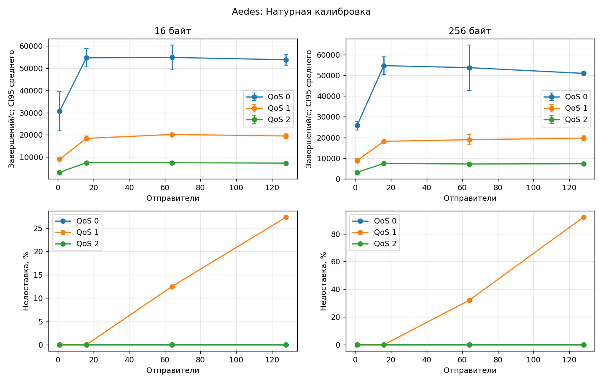
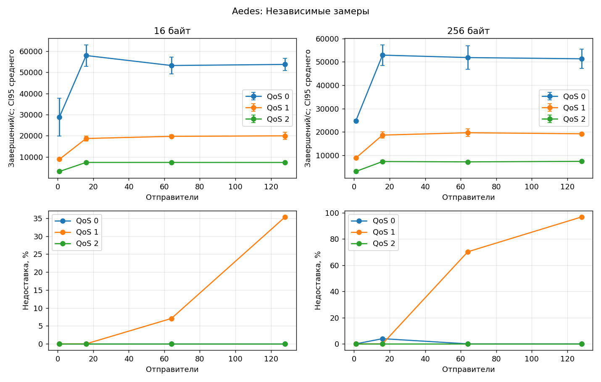
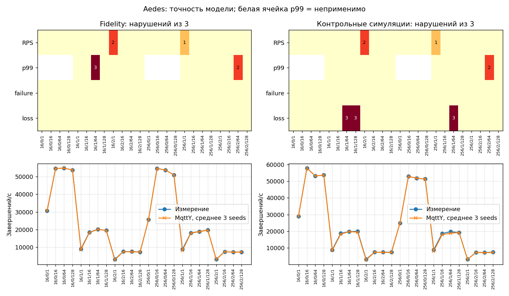
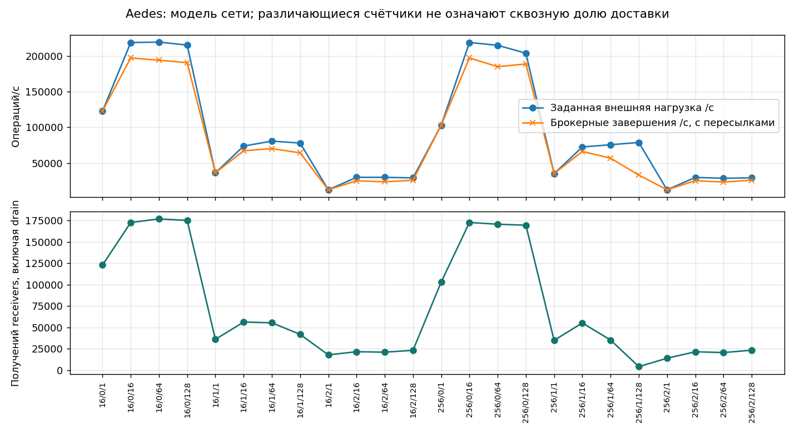

# Aedes: итоговый отчёт

Полный цикл: **144 натурных измерения и 216 симуляций**. Финальная серия завершена 19 октября 2026 года в 16:44 МСК. Полное покрытие не означает прохождения всех проверок точности. [Сравнение и EST](../Broker-comparison.md) · [Краткий выбор](../Best-broker.md) · [HTML](Aedes.html).

## Установка и воспроизведение

Брокер: **1.1.2**; исполняющая среда: `v22.13.1`. Linux, Intel Xeon E5-2680 v3, 12 физических ядер / 24 логических CPU; контроллер и брокер на одной машине, loopback. Брокер закреплён за CPU 0, контроллер — за 1–11 и 13–23. Это не эксклюзивное физическое ядро; SMT, память и ОС общие. Натурные измерения и симуляции не пересекались. Guard контроллера — 99%, это не предел CPU брокера.

Сетка: 16/256 байт × QoS 0/1/2 × 1/16/64/128 отправителей × три повтора. Натурные warmup/measurement/cooldown/drain: 5/20/1/до 10 с. Модель: 1/2/до 5 с, seeds 42/43/44. BrokerFidelity: closedLoopPerPublisher, empiricalServiceBudget, tick=10 мкс. Relay: openLoopRate, fixed, tick=100 мкс. Запуски симуляций выполнялись до четырёх одновременно, обновление внутри каждой модели последовательное.

Измерительный CLI: `3a689466009a0d5410f5dc88dc1282d72c27f7dd`; MqttY: `115885e012053d0112413e07743b061369ebea93`; калибратор: `f61daa47ec581ff88f20ee70882722085d1a0a10`. Изменения скриптов телеметрии и происхождение заимствованных этапов записаны в [series](../../data/series.json), [native-origins](../../data/native-origins.json), [repair-transition](../../data/repair-transition.json). Идентификаторы исходных серий сохранены; они не заменены идентификатором итоговой сборки.

[Настройки стенда](../../data/inputs/Aedes-stand.json) · [Калибровочная программа](../../data/inputs/Aedes-calibration.json) · [Контрольная программа](../../data/inputs/Aedes-validation.json) · [Окружение](../../data/environment.json).

Профиль: [broker-calibration.v3.json](../../data/Aedes/profile/broker-calibration.v3.json), SHA-256 `e16c599ebf32dda761f84afa2e21c8d2fc29e95bbb31b987607d83906b347239`. Хэш проверен во всех manifests Fidelity, holdout и Relay; независимые измерения не изменяли профиль.

## Покрытие

| Этап | Готово | Технические попытки | Нарушения точности |
| --- | --- | --- | --- |
| Натурная калибровка | ✅ 72/72 | ❌ 1; прервано 0 | ⚠ неприменимо |
| Fidelity | ✅ 72/72 | ❌ 0 незавершённых в итоговом индексе | ⚠ 8 |
| Независимые замеры | ✅ 72/72 | ❌ 0; прервано 0 | ⚠ неприменимо |
| Контрольные симуляции | ✅ 72/72 | ❌ 0 незавершённых в итоговом индексе | ⚠ 14 |
| MqttRelay | ✅ 72/72 | ❌ 0 незавершённых в итоговом индексе | ⚠ натурного эталона нет |

Технические ошибки относятся к попыткам, а предупреждения — к завершённым сценариям. Итоговый индекс симуляций не является полным журналом прежних перезапусков. Pilots и диагностика исключены из покрытия.

## Натурная калибровка

Средние по трём повторам. ± — полуширина CI95 Стьюдента: 4,30265273 × s / √3. Полные интервалы RPS, failure/loss и задержек сохранены в JSON. p50/p95/p99 — среднее перцентилей повторов, а не перцентиль объединённых сообщений. Для QoS 0 ACK latency неприменима. RTT измерен отдельно.

| Байт | QoS | N | Попыток/с | Завершений/с ± CI95 | Failure, % | Loss, % | p50, мс | p95, мс | p99, мс | RTT, мс |
| --- | --- | --- | --- | --- | --- | --- | --- | --- | --- | --- |
| 16 | 0 | 1 | 3.067e+04 | 3.067e+04 ± 8810 | 0 | 0 | н/п | н/п | н/п | 0.3026 |
| 16 | 0 | 16 | 5.472e+04 | 5.472e+04 ± 4148 | 0 | 0 | н/п | н/п | н/п | 0.3242 |
| 16 | 0 | 64 | 5.488e+04 | 5.488e+04 ± 5598 | 0 | 0 | н/п | н/п | н/п | 0.3004 |
| 16 | 0 | 128 | 5.383e+04 | 5.383e+04 ± 2404 | 0 | 0 | н/п | н/п | н/п | 0.3105 |
| 16 | 1 | 1 | 9051 | 9051 ± 713 | 0 | 0 | 0.084 | 0.1133 | 0.1391 | 0.2904 |
| 16 | 1 | 16 | 1.842e+04 | 1.842e+04 ± 1112 | 0 | 0 | 0.7891 | 0.8267 | 1.323 | 0.3028 |
| 16 | 1 | 64 | 2.018e+04 | 2.018e+04 ± 571.1 | 0 | 12.5 | 2.939 | 3.659 | 4.791 | 0.2953 |
| 16 | 1 | 128 | 1.949e+04 | 1.949e+04 ± 1041 | 0 | 27.35 | 6.061 | 8.829 | 11.36 | 0.3053 |
| 16 | 2 | 1 | 3117 | 3117 ± 78.21 | 0 | 0 | 0.2871 | 0.3329 | 0.3677 | 0.2857 |
| 16 | 2 | 16 | 7481 | 7481 ± 283.3 | 0 | 0 | 2.003 | 2.493 | 2.777 | 0.3122 |
| 16 | 2 | 64 | 7474 | 7474 ± 284.3 | 0 | 0 | 7.385 | 8.306 | 12.06 | 0.2756 |
| 16 | 2 | 128 | 7280 | 7280 ± 452 | 0 | 0 | 14.98 | 16.76 | 27.85 | 0.2951 |
| 256 | 0 | 1 | 2.573e+04 | 2.573e+04 ± 2184 | 0 | 0 | н/п | н/п | н/п | 0.2887 |
| 256 | 0 | 16 | 5.474e+04 | 5.474e+04 ± 4343 | 0 | 0 | н/п | н/п | н/п | 0.2932 |
| 256 | 0 | 64 | 5.375e+04 | 5.375e+04 ± 1.097e+04 | 0 | 0 | н/п | н/п | н/п | 0.2921 |
| 256 | 0 | 128 | 5.099e+04 | 5.099e+04 ± 681.2 | 0 | 0 | н/п | н/п | н/п | 0.3288 |
| 256 | 1 | 1 | 8779 | 8779 ± 1190 | 0 | 0 | 0.08603 | 0.1151 | 0.1407 | 0.3057 |
| 256 | 1 | 16 | 1.811e+04 | 1.811e+04 ± 433.1 | 0 | 0 | 0.803 | 0.8642 | 1.387 | 0.2994 |
| 256 | 1 | 64 | 1.89e+04 | 1.89e+04 ± 2417 | 0 | 32.15 | 3.03 | 3.932 | 6.886 | 0.2907 |
| 256 | 1 | 128 | 1.97e+04 | 1.97e+04 ± 1340 | 0 | 92.02 | 5.165 | 11.17 | 14.44 | 0.2935 |
| 256 | 2 | 1 | 3102 | 3102 ± 85.59 | 0 | 0 | 0.2891 | 0.3379 | 0.3793 | 0.3312 |
| 256 | 2 | 16 | 7443 | 7443 ± 143 | 0 | 0 | 2.017 | 2.532 | 2.92 | 0.3075 |
| 256 | 2 | 64 | 7152 | 7152 ± 470 | 0 | 0 | 7.522 | 8.82 | 71.32 | 0.2895 |
| 256 | 2 | 128 | 7285 | 7285 ± 40.2 | 0 | 0 | 14.55 | 19.78 | 124.8 | 0.2911 |



CPU: взвешенное по длительности среднее внутренних интервалов нагрузки; интервалы у границ исключены из-за округления UTC до секунды. В таблице среднее CPU трёх повторов; RSS — максимум наблюдённых отсчётов в этих интервалах. CPU нормирован на одно закреплённое логическое CPU. Эти показатели относятся к настоящему процессу, модель их не воспроизводит. Receipts/s = uniqueDeliveries / actualMeasurementSeconds, включая получения при drain в числителе. Доставлено от попыток = uniqueDeliveries / attemptedPublishes; это другая доля, чем loss среди завершённых публикаций.

| Байт | QoS | N | CPU, % | RSS, МиБ | Receipts/s | Доставлено от попыток, % |
| --- | --- | --- | --- | --- | --- | --- |
| 16 | 0 | 1 | 99.91 | 105.2 | 3.067e+04 | 100 |
| 16 | 0 | 16 | 99.83 | 99.73 | 5.472e+04 | 100 |
| 16 | 0 | 64 | 99.91 | 184.4 | 5.488e+04 | 100 |
| 16 | 0 | 128 | 99.61 | 458.4 | 5.383e+04 | 100 |
| 16 | 1 | 1 | 99.72 | 84.44 | 9051 | 100 |
| 16 | 1 | 16 | 99.87 | 98.7 | 1.842e+04 | 100 |
| 16 | 1 | 64 | 99.7 | 136.8 | 1.765e+04 | 87.5 |
| 16 | 1 | 128 | 99.76 | 457.4 | 1.419e+04 | 72.65 |
| 16 | 2 | 1 | 97.81 | 84.45 | 3117 | 100 |
| 16 | 2 | 16 | 99.91 | 98.54 | 7481 | 100 |
| 16 | 2 | 64 | 99.87 | 109.8 | 7474 | 100 |
| 16 | 2 | 128 | 99.89 | 115.6 | 7280 | 100 |
| 256 | 0 | 1 | 99.76 | 97.74 | 2.573e+04 | 100 |
| 256 | 0 | 16 | 99.87 | 115.1 | 5.474e+04 | 100 |
| 256 | 0 | 64 | 99.83 | 248.3 | 5.375e+04 | 100 |
| 256 | 0 | 128 | 99.5 | 479 | 5.099e+04 | 100 |
| 256 | 1 | 1 | 99.89 | 84.93 | 8779 | 100 |
| 256 | 1 | 16 | 99.91 | 99.06 | 1.811e+04 | 100 |
| 256 | 1 | 64 | 99.78 | 496.3 | 1.265e+04 | 67.85 |
| 256 | 1 | 128 | 99.83 | 916.4 | 1544 | 7.978 |
| 256 | 2 | 1 | 99.83 | 84.55 | 3102 | 100 |
| 256 | 2 | 16 | 99.87 | 99.01 | 7443 | 100 |
| 256 | 2 | 64 | 99.85 | 107.6 | 7152 | 100 |
| 256 | 2 | 128 | 99.91 | 111.5 | 7285 | 100 |

[CSV](../../Aedes-calibration.csv) · [Агрегат](../../data/Aedes/calibration/observations.json) · [Восстановление и повторная агрегация](../../data/Aedes/calibration/archive-verification.json).

## Независимые замеры

Средние по трём повторам. ± — полуширина CI95 Стьюдента: 4,30265273 × s / √3. Полные интервалы RPS, failure/loss и задержек сохранены в JSON. p50/p95/p99 — среднее перцентилей повторов, а не перцентиль объединённых сообщений. Для QoS 0 ACK latency неприменима. RTT измерен отдельно.

| Байт | QoS | N | Попыток/с | Завершений/с ± CI95 | Failure, % | Loss, % | p50, мс | p95, мс | p99, мс | RTT, мс |
| --- | --- | --- | --- | --- | --- | --- | --- | --- | --- | --- |
| 16 | 0 | 1 | 2.886e+04 | 2.886e+04 ± 8936 | 0 | 0 | н/п | н/п | н/п | 0.2968 |
| 16 | 0 | 16 | 5.789e+04 | 5.789e+04 ± 5102 | 0 | 0 | н/п | н/п | н/п | 0.3058 |
| 16 | 0 | 64 | 5.318e+04 | 5.318e+04 ± 3895 | 0 | 0 | н/п | н/п | н/п | 0.2959 |
| 16 | 0 | 128 | 5.37e+04 | 5.37e+04 ± 2788 | 0 | 0 | н/п | н/п | н/п | 0.2844 |
| 16 | 1 | 1 | 8901 | 8901 ± 273.1 | 0 | 0 | 0.08447 | 0.1152 | 0.1401 | 0.2971 |
| 16 | 1 | 16 | 1.872e+04 | 1.872e+04 ± 1236 | 0 | 0 | 0.7708 | 0.8056 | 1.291 | 0.3025 |
| 16 | 1 | 64 | 1.974e+04 | 1.974e+04 ± 650.2 | 0 | 7.078 | 2.985 | 3.691 | 3.795 | 0.3126 |
| 16 | 1 | 128 | 1.997e+04 | 1.997e+04 ± 1653 | 0 | 35.37 | 5.782 | 8.009 | 11.41 | 0.2998 |
| 16 | 2 | 1 | 3148 | 3148 ± 74.39 | 0 | 0 | 0.2858 | 0.3312 | 0.3701 | 0.3238 |
| 16 | 2 | 16 | 7416 | 7416 ± 371.7 | 0 | 0 | 2.021 | 2.503 | 2.756 | 0.3058 |
| 16 | 2 | 64 | 7414 | 7414 ± 433.1 | 0 | 0 | 7.442 | 8.233 | 11.69 | 0.2879 |
| 16 | 2 | 128 | 7398 | 7398 ± 261.7 | 0 | 0 | 14.71 | 15.82 | 30.48 | 0.3138 |
| 256 | 0 | 1 | 2.477e+04 | 2.477e+04 ± 566 | 0 | 0 | н/п | н/п | н/п | 0.2969 |
| 256 | 0 | 16 | 5.289e+04 | 5.289e+04 ± 4453 | 0 | 3.954 | н/п | н/п | н/п | 0.3019 |
| 256 | 0 | 64 | 5.185e+04 | 5.185e+04 ± 5029 | 0 | 0 | н/п | н/п | н/п | 0.2946 |
| 256 | 0 | 128 | 5.132e+04 | 5.132e+04 ± 4115 | 0 | 0 | н/п | н/п | н/п | 0.307 |
| 256 | 1 | 1 | 8860 | 8860 ± 63.83 | 0 | 0 | 0.08483 | 0.1143 | 0.1387 | 0.2986 |
| 256 | 1 | 16 | 1.867e+04 | 1.867e+04 ± 1366 | 0 | 0 | 0.7808 | 0.8162 | 1.342 | 0.2921 |
| 256 | 1 | 64 | 1.968e+04 | 1.968e+04 ± 1595 | 0 | 70.3 | 2.784 | 6.347 | 8.356 | 0.3101 |
| 256 | 1 | 128 | 1.923e+04 | 1.923e+04 ± 534.9 | 0 | 96.87 | 5.547 | 11.5 | 14.67 | 0.2898 |
| 256 | 2 | 1 | 3106 | 3106 ± 70.51 | 0 | 0 | 0.2866 | 0.3336 | 0.3602 | 0.3066 |
| 256 | 2 | 16 | 7355 | 7355 ± 498.5 | 0 | 0 | 2.052 | 2.464 | 2.712 | 0.2942 |
| 256 | 2 | 64 | 7222 | 7222 ± 301.9 | 0 | 0 | 7.472 | 8.682 | 43.45 | 0.3035 |
| 256 | 2 | 128 | 7419 | 7419 ± 35.87 | 0 | 0 | 14.27 | 17.58 | 123.2 | 0.2917 |



CPU: взвешенное по длительности среднее внутренних интервалов нагрузки; интервалы у границ исключены из-за округления UTC до секунды. В таблице среднее CPU трёх повторов; RSS — максимум наблюдённых отсчётов в этих интервалах. CPU нормирован на одно закреплённое логическое CPU. Эти показатели относятся к настоящему процессу, модель их не воспроизводит. Receipts/s = uniqueDeliveries / actualMeasurementSeconds, включая получения при drain в числителе. Доставлено от попыток = uniqueDeliveries / attemptedPublishes; это другая доля, чем loss среди завершённых публикаций.

| Байт | QoS | N | CPU, % | RSS, МиБ | Receipts/s | Доставлено от попыток, % |
| --- | --- | --- | --- | --- | --- | --- |
| 16 | 0 | 1 | 97.96 | 101.6 | 2.886e+04 | 100 |
| 16 | 0 | 16 | 99.93 | 100.8 | 5.789e+04 | 100 |
| 16 | 0 | 64 | 99.94 | 178.1 | 5.318e+04 | 100 |
| 16 | 0 | 128 | 99.91 | 429.6 | 5.37e+04 | 100 |
| 16 | 1 | 1 | 99.83 | 85.79 | 8901 | 100 |
| 16 | 1 | 16 | 99.7 | 98.83 | 1.872e+04 | 100 |
| 16 | 1 | 64 | 99.78 | 101.1 | 1.834e+04 | 92.92 |
| 16 | 1 | 128 | 99.74 | 336.6 | 1.294e+04 | 64.63 |
| 16 | 2 | 1 | 99.85 | 84.67 | 3148 | 100 |
| 16 | 2 | 16 | 99.83 | 98.91 | 7416 | 100 |
| 16 | 2 | 64 | 99.89 | 109.8 | 7414 | 100 |
| 16 | 2 | 128 | 99.87 | 125.5 | 7398 | 100 |
| 256 | 0 | 1 | 99.83 | 98.45 | 2.477e+04 | 100 |
| 256 | 0 | 16 | 96.18 | 111.5 | 5.083e+04 | 96.05 |
| 256 | 0 | 64 | 99.87 | 255 | 5.185e+04 | 100 |
| 256 | 0 | 128 | 99.59 | 404.8 | 5.132e+04 | 100 |
| 256 | 1 | 1 | 99.81 | 84.71 | 8860 | 100 |
| 256 | 1 | 16 | 99.85 | 98.68 | 1.867e+04 | 100 |
| 256 | 1 | 64 | 99.74 | 873.1 | 5717 | 29.7 |
| 256 | 1 | 128 | 99.87 | 842.4 | 605.5 | 3.131 |
| 256 | 2 | 1 | 99.76 | 84.68 | 3106 | 100 |
| 256 | 2 | 16 | 99.79 | 99.3 | 7355 | 100 |
| 256 | 2 | 64 | 99.89 | 113.2 | 7222 | 100 |
| 256 | 2 | 128 | 99.91 | 112 | 7419 | 100 |

[CSV](../../Aedes-validation.csv) · [Агрегат](../../data/Aedes/validation/observations.json) · [Восстановление и повторная агрегация](../../data/Aedes/validation/archive-verification.json).

## Точность двойника MqttY

Пороги сохранены: RPS ≤15%, p99 ≤20%, абсолютная разница failure/loss ≤0,05 (5 процентных пунктов). Fidelity сравнивает модель с данными настройки; holdout — с новыми измерениями при неизменном профиле. Успешность процесса и выполнение критериев — разные результаты. Числа нарушений по критериям могут пересекаться.

| Этап | Критерий | passed | failed | notApplicable |
| --- | --- | --- | --- | --- |
| Fidelity | rps | 69 | 3 | 0 |
| Fidelity | latencyP99Ms | 43 | 5 | 24 |
| Fidelity | publishFailureRate | 72 | 0 | 0 |
| Fidelity | deliveryLossRate | 72 | 0 | 0 |
| Контрольные симуляции | rps | 69 | 3 | 0 |
| Контрольные симуляции | latencyP99Ms | 46 | 2 | 24 |
| Контрольные симуляции | publishFailureRate | 72 | 0 | 0 |
| Контрольные симуляции | deliveryLossRate | 63 | 9 | 0 |



### Область подтверждённого соответствия в этой сетке

Число seed, прошедших все применимые критерии. Только 3/3 в контроле означает прохождение всех трёх контрольных симуляций данной точки; это не доказывает точность на других нагрузках или оборудовании.

| Байт | QoS | N | Fidelity | Контроль |
| --- | --- | --- | --- | --- |
| 16 | 0 | 1 | 3/3 | 3/3 |
| 16 | 0 | 16 | 3/3 | 3/3 |
| 16 | 0 | 64 | 3/3 | 3/3 |
| 16 | 0 | 128 | 3/3 | 3/3 |
| 16 | 1 | 1 | 3/3 | 3/3 |
| 16 | 1 | 16 | 3/3 | 3/3 |
| 16 | 1 | 64 | 0/3 | 0/3 |
| 16 | 1 | 128 | 3/3 | 0/3 |
| 16 | 2 | 1 | 1/3 | 1/3 |
| 16 | 2 | 16 | 3/3 | 3/3 |
| 16 | 2 | 64 | 3/3 | 3/3 |
| 16 | 2 | 128 | 3/3 | 3/3 |
| 256 | 0 | 1 | 3/3 | 3/3 |
| 256 | 0 | 16 | 3/3 | 3/3 |
| 256 | 0 | 64 | 3/3 | 3/3 |
| 256 | 0 | 128 | 3/3 | 3/3 |
| 256 | 1 | 1 | 2/3 | 2/3 |
| 256 | 1 | 16 | 3/3 | 3/3 |
| 256 | 1 | 64 | 3/3 | 0/3 |
| 256 | 1 | 128 | 3/3 | 3/3 |
| 256 | 2 | 1 | 3/3 | 3/3 |
| 256 | 2 | 16 | 3/3 | 3/3 |
| 256 | 2 | 64 | 1/3 | 1/3 |
| 256 | 2 | 128 | 3/3 | 3/3 |

[Все нарушения, точные числа и пределы](../../Aedes-fidelity-failures.csv) · [Настройки и исходные модельные файлы](../../data/external-archives.json).

## Модель сети MqttRelay

Завершены 72 запуска: четыре двойника, networkLength=2, 24 точки × три seed. Все показатели ниже — средние по трём seed. Общий брокерный RPS включает внутренние пересылки. Счётчик receivers означает фактические получения модельными удалёнными приложениями, а не настоящими сетевыми процессами. Он охватывает время после сброса измерений до конца drain; сообщения прогрева в пути могут пересечь границу. Без сквозных ID его нельзя делить на внешнюю нагрузку и называть уникальной сквозной доставкой.


Все четыре двойника — Aedes. Суммарная внешняя нагрузка равна 4 × attemptedRps калибровочной точки; на каждый узел приходится четверть.

Модель транспорта: 125 000 000 байт/с (1 Гбит/с), transferTicks=2, очередь 100 000, tick=0,1 мс. Пропускная способность и очередь — допущения; loopback этой кампании не измеряет реальную Ethernet-сеть. Внутренние Relay-публикации добавляют нагрузку и могут получать rateRejected.

| Байт | QoS | N | Внешних/с | На узел/с | Брокерных завершений/с | Failure, % | Loss, % | p99, мс | RateRejected | Ожидалось доставок | Доставлено брокерами | Получений receivers |
| --- | --- | --- | --- | --- | --- | --- | --- | --- | --- | --- | --- | --- |
| 16 | 0 | 1 | 1.227e+05 | 3.067e+04 | 1.228e+05 | 66.66 | 0 | н/п | 4.91e+05 | 3.683e+05 | 3.683e+05 | 1.229e+05 |
| 16 | 0 | 16 | 2.189e+05 | 5.472e+04 | 1.973e+05 | 61.85 | 0 | н/п | 6.397e+05 | 5.192e+05 | 5.192e+05 | 1.726e+05 |
| 16 | 0 | 64 | 2.195e+05 | 5.488e+04 | 1.941e+05 | 57.03 | 0 | н/п | 5.153e+05 | 4.725e+05 | 4.725e+05 | 1.768e+05 |
| 16 | 0 | 128 | 2.153e+05 | 5.383e+04 | 1.906e+05 | 56.54 | 0 | н/п | 4.96e+05 | 4.612e+05 | 4.612e+05 | 1.75e+05 |
| 16 | 1 | 1 | 3.62e+04 | 9051 | 3.623e+04 | 66.6 | 0 | 2.4 | 1.444e+05 | 1.085e+05 | 1.085e+05 | 3.612e+04 |
| 16 | 1 | 16 | 7.37e+04 | 1.842e+04 | 6.71e+04 | 57.84 | 0 | 3.3 | 1.841e+05 | 1.651e+05 | 1.651e+05 | 5.631e+04 |
| 16 | 1 | 64 | 8.072e+04 | 2.018e+04 | 7.02e+04 | 55.08 | 12.56 | 5.8 | 1.722e+05 | 1.722e+05 | 1.506e+05 | 5.546e+04 |
| 16 | 1 | 128 | 7.795e+04 | 1.949e+04 | 6.419e+04 | 55.32 | 27.44 | 13.27 | 1.59e+05 | 1.65e+05 | 1.197e+05 | 4.195e+04 |
| 16 | 2 | 1 | 1.247e+04 | 3117 | 1.251e+04 | 70.88 | 0 | 4.8 | 6.086e+04 | 4.295e+04 | 4.295e+04 | 1.801e+04 |
| 16 | 2 | 16 | 2.992e+04 | 7481 | 2.51e+04 | 60.94 | 0 | 6.8 | 7.834e+04 | 6.352e+04 | 6.352e+04 | 2.166e+04 |
| 16 | 2 | 64 | 2.989e+04 | 7474 | 2.364e+04 | 61.81 | 0 | 16.17 | 7.651e+04 | 5.976e+04 | 5.976e+04 | 2.116e+04 |
| 16 | 2 | 128 | 2.912e+04 | 7280 | 2.582e+04 | 60.66 | 0 | 31.3 | 7.964e+04 | 6.623e+04 | 6.623e+04 | 2.331e+04 |
| 256 | 0 | 1 | 1.029e+05 | 2.573e+04 | 1.03e+05 | 66.66 | 0 | н/п | 4.119e+05 | 3.089e+05 | 3.089e+05 | 1.031e+05 |
| 256 | 0 | 16 | 2.189e+05 | 5.474e+04 | 1.974e+05 | 61.85 | 0 | н/п | 6.4e+05 | 5.194e+05 | 5.194e+05 | 1.726e+05 |
| 256 | 0 | 64 | 2.15e+05 | 5.375e+04 | 1.85e+05 | 58.11 | 0 | н/п | 5.133e+05 | 4.545e+05 | 4.545e+05 | 1.706e+05 |
| 256 | 0 | 128 | 2.04e+05 | 5.099e+04 | 1.889e+05 | 55.16 | 0 | н/п | 4.646e+05 | 4.529e+05 | 4.529e+05 | 1.694e+05 |
| 256 | 1 | 1 | 3.512e+04 | 8779 | 3.514e+04 | 66.6 | 0 | 2.4 | 1.401e+05 | 1.052e+05 | 1.052e+05 | 3.498e+04 |
| 256 | 1 | 16 | 7.246e+04 | 1.811e+04 | 6.616e+04 | 57.78 | 0 | 3.3 | 1.811e+05 | 1.627e+05 | 1.627e+05 | 5.524e+04 |
| 256 | 1 | 64 | 7.56e+04 | 1.89e+04 | 5.676e+04 | 56.42 | 32.24 | 9.9 | 1.47e+05 | 1.467e+05 | 9.939e+04 | 3.533e+04 |
| 256 | 1 | 128 | 7.881e+04 | 1.97e+04 | 3.304e+04 | 61.4 | 92.09 | 14.6 | 1.051e+05 | 1.189e+05 | 9409 | 4255 |
| 256 | 2 | 1 | 1.241e+04 | 3102 | 1.244e+04 | 67.94 | 0 | 4.8 | 5.274e+04 | 3.883e+04 | 3.883e+04 | 1.403e+04 |
| 256 | 2 | 16 | 2.977e+04 | 7443 | 2.508e+04 | 60.92 | 0 | 6.8 | 7.819e+04 | 6.351e+04 | 6.351e+04 | 2.161e+04 |
| 256 | 2 | 64 | 2.861e+04 | 7152 | 2.338e+04 | 61.41 | 0 | 51.47 | 7.441e+04 | 5.923e+04 | 5.923e+04 | 2.069e+04 |
| 256 | 2 | 128 | 2.914e+04 | 7285 | 2.584e+04 | 60.44 | 0 | 128.5 | 7.897e+04 | 6.608e+04 | 6.608e+04 | 2.345e+04 |



[CSV](../../Aedes-relay.csv) · [Все настройки, counters, manifests и точные GraphML/PlantUML](../../data/external-archives.json). Все критерии натурной точности Relay имеют статус `notApplicable`. Они не считаются пройденными.

## Вывод и ограничения

Отказов PublishAsync в натурных агрегатах нет; при этом при большой нагрузке возможна недоставка. Стабильный RPS сам по себе не подтверждает стабильность получения подписчиком.

Ни один двойник не прошёл все 72 независимых сценария. Короткое модельное окно, изменчивость натурного стенда, разные знаменатели времени и способ объединения распределений ограничивают интерпретацию. Benchmark делит на фактическое окно завершения нагрузки; модель — на заданные 2 с, включая завершения при drain. Недоставка означает отсутствие ID к концу наблюдения, а не доказанную безвозвратную потерю. Показатели CPU/RSS и точность настоящей Relay-сети этой моделью не подтверждены.

## Проверяемость и команды

[Индекс исходных файлов и их SHA-256](../../data/snapshot.json) · [Архивы raw](../../data/archive-registry.json) · [Результаты и ресурсы всех 576 натурных запусков](../../data/native-evidence.json) · [Извлечённые sealed members](../../data/external-archives.json) · [Повторение выбранных моделей](../../data/replay-results.json). При финальной публикации сверены seals прочитанных членов ZIP, исходные результаты и средние/CI95. Полные ZIP заново не хэшировались и журналы всех сообщений не пересчитывались: сохранены квитанции прежнего восстановления. Полные raw остаются на hd250; Git содержит компактные доказательства и пути к архивам.

```bash
python tools/campaign/render-final-reports.py --output reports
```

Для повтора модели распакуйте model-evidence.zip, возьмите config.json нужной точки, замените только пути к профилям/observations/репозиториям и вызовите `dotnet EntityFX.MqttY.MqttRelay.App.dll experiment --config <config.json> --output <новый-каталог>`. Нужна зафиксированная версия DLL, а не произвольная свежая сборка. Для новой полной натурной серии: [руководство](../../../docs/mqtt-benchmark/runbook.md).
