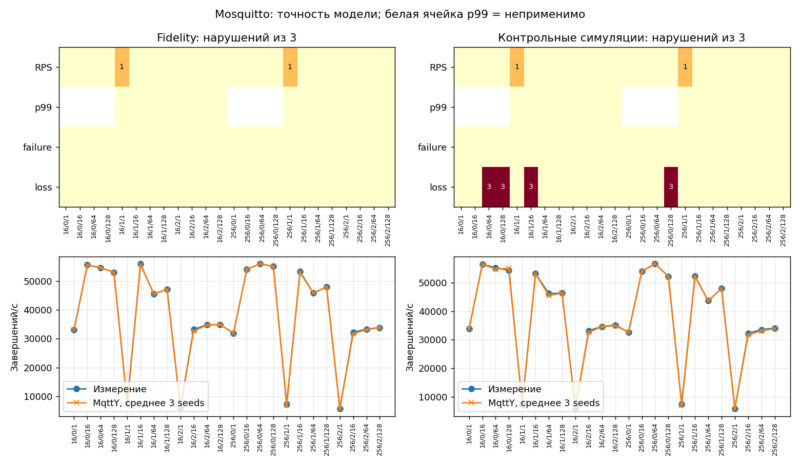
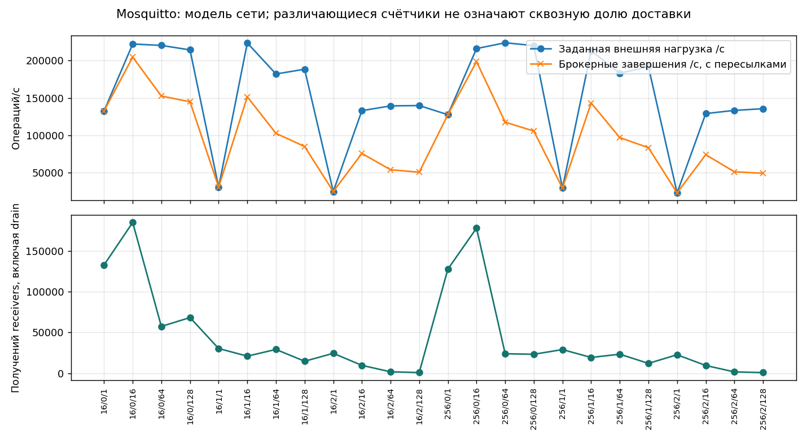

# Mosquitto: итоговый отчёт

Полный цикл: **144 натурных измерения и 216 симуляций**. Финальная серия завершена 19 октября 2026 года в 16:44 МСК. Полное покрытие не означает прохождения всех проверок точности. [Сравнение и EST](../Broker-comparison.md) · [Краткий выбор](../Best-broker.md) · [HTML](Mosquitto.html).

## Установка и воспроизведение

Брокер: **2.0.15**; исполняющая среда: `mosquitto version 2.0.15  mosquitto is an MQTT v5.0/v3.1.1/v3.1 broker.  Usage: mosquitto [-c config_file] [-d] [-h] [-p port]   -c : specify the broker config file.  -d : put the broker into the background after starting.  -h : display this help.  -p : start the broker listening on the specified port.       Not recommended in conjunction with the -c option.  -v : verbose mode - enable all logging types. This overrides       any logging options given in the config file.  See https://mosquitto.org/ for more information. `. Linux, Intel Xeon E5-2680 v3, 12 физических ядер / 24 логических CPU; контроллер и брокер на одной машине, loopback. Брокер закреплён за CPU 0, контроллер — за 1–11 и 13–23. Это не эксклюзивное физическое ядро; SMT, память и ОС общие. Натурные измерения и симуляции не пересекались. Guard контроллера — 99%, это не предел CPU брокера.

Сетка: 16/256 байт × QoS 0/1/2 × 1/16/64/128 отправителей × три повтора. Натурные warmup/measurement/cooldown/drain: 5/20/1/до 10 с. Модель: 1/2/до 5 с, seeds 42/43/44. BrokerFidelity: closedLoopPerPublisher, empiricalServiceBudget, tick=10 мкс. Relay: openLoopRate, fixed, tick=100 мкс. Запуски симуляций выполнялись до четырёх одновременно, обновление внутри каждой модели последовательное.

Измерительный CLI: `3a689466009a0d5410f5dc88dc1282d72c27f7dd`; MqttY: `115885e012053d0112413e07743b061369ebea93`; калибратор: `f61daa47ec581ff88f20ee70882722085d1a0a10`. Изменения скриптов телеметрии и происхождение заимствованных этапов записаны в [series](../../data/series.json), [native-origins](../../data/native-origins.json), [repair-transition](../../data/repair-transition.json). Идентификаторы исходных серий сохранены; они не заменены идентификатором итоговой сборки.

[Настройки стенда](../../data/inputs/Mosquitto-stand.json) · [Калибровочная программа](../../data/inputs/Mosquitto-calibration.json) · [Контрольная программа](../../data/inputs/Mosquitto-validation.json) · [Окружение](../../data/environment.json).

Профиль: [broker-calibration.v3.json](../../data/Mosquitto/profile/broker-calibration.v3.json), SHA-256 `d9cf125fb8cb6ec3677fc3c596bafcdfced8be0502362e2b4ff03da1421d46eb`. Хэш проверен во всех manifests Fidelity, holdout и Relay; независимые измерения не изменяли профиль.

## Покрытие

| Этап | Готово | Технические попытки | Нарушения точности |
| --- | --- | --- | --- |
| Натурная калибровка | ✅ 72/72 | ❌ 1; прервано 0 | ⚠ неприменимо |
| Fidelity | ✅ 72/72 | ❌ 0 незавершённых в итоговом индексе | ⚠ 2 |
| Независимые замеры | ✅ 72/72 | ❌ 0; прервано 1 | ⚠ неприменимо |
| Контрольные симуляции | ✅ 72/72 | ❌ 0 незавершённых в итоговом индексе | ⚠ 14 |
| MqttRelay | ✅ 72/72 | ❌ 0 незавершённых в итоговом индексе | ⚠ натурного эталона нет |

Технические ошибки относятся к попыткам, а предупреждения — к завершённым сценариям. Итоговый индекс симуляций не является полным журналом прежних перезапусков. Pilots и диагностика исключены из покрытия.

Контрольная натурная серия выполнена в двух сеансах: 50 сохранённых успешных запусков и ещё 22 после паузы и перезагрузки. Это ограничивает однородность условий.

## Натурная калибровка

Средние по трём повторам. ± — полуширина CI95 Стьюдента: 4,30265273 × s / √3. Полные интервалы RPS, failure/loss и задержек сохранены в JSON. p50/p95/p99 — среднее перцентилей повторов, а не перцентиль объединённых сообщений. Для QoS 0 ACK latency неприменима. RTT измерен отдельно.

| Байт | QoS | N | Попыток/с | Завершений/с ± CI95 | Failure, % | Loss, % | p50, мс | p95, мс | p99, мс | RTT, мс |
| --- | --- | --- | --- | --- | --- | --- | --- | --- | --- | --- |
| 16 | 0 | 1 | 3.313e+04 | 3.313e+04 ± 1778 | 0 | 0 | н/п | н/п | н/п | 0.0861 |
| 16 | 0 | 16 | 5.558e+04 | 5.558e+04 ± 6679 | 0 | 0 | н/п | н/п | н/п | 0.08213 |
| 16 | 0 | 64 | 5.511e+04 | 5.459e+04 ± 8039 | 0.9371 | 65.3 | н/п | н/п | н/п | 0.08747 |
| 16 | 0 | 128 | 5.36e+04 | 5.304e+04 ± 6284 | 1.053 | 53.09 | н/п | н/п | н/п | 0.08053 |
| 16 | 1 | 1 | 7589 | 7589 ± 92.92 | 0 | 0 | 0.09753 | 0.1404 | 0.1618 | 0.09163 |
| 16 | 1 | 16 | 5.594e+04 | 5.594e+04 ± 2080 | 0 | 91.25 | 0.1914 | 0.397 | 0.4194 | 0.08763 |
| 16 | 1 | 64 | 4.552e+04 | 4.552e+04 ± 4498 | 0 | 77.05 | 0.3102 | 2.736 | 4.354 | 0.08747 |
| 16 | 1 | 128 | 4.712e+04 | 4.712e+04 ± 5741 | 0 | 88.28 | 1.335 | 6.593 | 10.31 | 0.08477 |
| 16 | 2 | 1 | 6101 | 6101 ± 583.8 | 0 | 0 | 0.1347 | 0.177 | 0.2041 | 0.0921 |
| 16 | 2 | 16 | 3.324e+04 | 3.324e+04 ± 1055 | 0 | 92.01 | 0.3581 | 0.717 | 0.7511 | 0.08153 |
| 16 | 2 | 64 | 3.482e+04 | 3.482e+04 ± 1515 | 0 | 98.19 | 1.622 | 2.425 | 3.287 | 0.07677 |
| 16 | 2 | 128 | 3.494e+04 | 3.494e+04 ± 920.5 | 0 | 99.03 | 3.311 | 3.888 | 6.603 | 0.08977 |
| 256 | 0 | 1 | 3.187e+04 | 3.187e+04 ± 3618 | 0 | 0 | н/п | н/п | н/п | 0.0898 |
| 256 | 0 | 16 | 5.405e+04 | 5.405e+04 ± 8342 | 0 | 0 | н/п | н/п | н/п | 0.08753 |
| 256 | 0 | 64 | 5.599e+04 | 5.599e+04 ± 3067 | 0 | 85.52 | н/п | н/п | н/п | 0.09377 |
| 256 | 0 | 128 | 5.504e+04 | 5.504e+04 ± 3879 | 0 | 83.82 | н/п | н/п | н/п | 0.08343 |
| 256 | 1 | 1 | 7280 | 7280 ± 343.7 | 0 | 0 | 0.1008 | 0.1432 | 0.1647 | 0.07763 |
| 256 | 1 | 16 | 5.333e+04 | 5.333e+04 ± 1773 | 0 | 91.5 | 0.2026 | 0.4214 | 0.4459 | 0.08927 |
| 256 | 1 | 64 | 4.58e+04 | 4.58e+04 ± 8209 | 0 | 81.65 | 0.4443 | 2.609 | 4.142 | 0.085 |
| 256 | 1 | 128 | 4.794e+04 | 4.794e+04 ± 8186 | 0 | 90.72 | 1.584 | 6.266 | 9.798 | 0.09103 |
| 256 | 2 | 1 | 5654 | 5654 ± 130.4 | 0 | 0 | 0.1428 | 0.1868 | 0.2169 | 0.0888 |
| 256 | 2 | 16 | 3.225e+04 | 3.225e+04 ± 1181 | 0 | 91.96 | 0.369 | 0.7335 | 0.7715 | 0.08403 |
| 256 | 2 | 64 | 3.331e+04 | 3.331e+04 ± 1578 | 0 | 98.17 | 1.671 | 2.552 | 3.379 | 0.07983 |
| 256 | 2 | 128 | 3.388e+04 | 3.388e+04 ± 490 | 0 | 99.03 | 3.42 | 3.683 | 6.82 | 0.0949 |


CPU: взвешенное по длительности среднее внутренних интервалов нагрузки; интервалы у границ исключены из-за округления UTC до секунды. В таблице среднее CPU трёх повторов; RSS — максимум наблюдённых отсчётов в этих интервалах. CPU нормирован на одно закреплённое логическое CPU. Эти показатели относятся к настоящему процессу, модель их не воспроизводит. Receipts/s = uniqueDeliveries / actualMeasurementSeconds, включая получения при drain в числителе. Доставлено от попыток = uniqueDeliveries / attemptedPublishes; это другая доля, чем loss среди завершённых публикаций.

| Байт | QoS | N | CPU, % | RSS, МиБ | Receipts/s | Доставлено от попыток, % |
| --- | --- | --- | --- | --- | --- | --- |
| 16 | 0 | 1 | 97.92 | 5.977 | 3.313e+04 | 100 |
| 16 | 0 | 16 | 99.76 | 6 | 5.558e+04 | 100 |
| 16 | 0 | 64 | 92.51 | 6.223 | 1.842e+04 | 34.41 |
| 16 | 0 | 128 | 96.22 | 6.281 | 2.483e+04 | 46.41 |
| 16 | 1 | 1 | 0 | 5.98 | 7589 | 100 |
| 16 | 1 | 16 | 99.79 | 6.402 | 4897 | 8.754 |
| 16 | 1 | 64 | 99.91 | 6.398 | 1.042e+04 | 22.95 |
| 16 | 1 | 128 | 99.87 | 6.441 | 5495 | 11.72 |
| 16 | 2 | 1 | 97.97 | 5.984 | 6101 | 100 |
| 16 | 2 | 16 | 99.76 | 6.52 | 2655 | 7.988 |
| 16 | 2 | 64 | 99.77 | 6.453 | 630.9 | 1.812 |
| 16 | 2 | 128 | 99.7 | 6.52 | 339.1 | 0.9705 |
| 256 | 0 | 1 | 97.86 | 6.039 | 3.187e+04 | 100 |
| 256 | 0 | 16 | 99.94 | 6.062 | 5.405e+04 | 100 |
| 256 | 0 | 64 | 96.21 | 6.402 | 8121 | 14.48 |
| 256 | 0 | 128 | 92.42 | 6.512 | 8930 | 16.18 |
| 256 | 1 | 1 | 0 | 5.91 | 7280 | 100 |
| 256 | 1 | 16 | 99.87 | 6.641 | 4536 | 8.504 |
| 256 | 1 | 64 | 99.96 | 6.699 | 8266 | 18.35 |
| 256 | 1 | 128 | 99.76 | 6.734 | 4382 | 9.28 |
| 256 | 2 | 1 | 92.4 | 6.043 | 5654 | 100 |
| 256 | 2 | 16 | 99.72 | 6.648 | 2593 | 8.04 |
| 256 | 2 | 64 | 99.91 | 6.777 | 609 | 1.829 |
| 256 | 2 | 128 | 99.78 | 6.773 | 329.3 | 0.972 |

[CSV](../../Mosquitto-calibration.csv) · [Агрегат](../../data/Mosquitto/calibration/observations.json) · [Восстановление и повторная агрегация](../../data/Mosquitto/calibration/archive-verification.json).

## Независимые замеры

Средние по трём повторам. ± — полуширина CI95 Стьюдента: 4,30265273 × s / √3. Полные интервалы RPS, failure/loss и задержек сохранены в JSON. p50/p95/p99 — среднее перцентилей повторов, а не перцентиль объединённых сообщений. Для QoS 0 ACK latency неприменима. RTT измерен отдельно.

| Байт | QoS | N | Попыток/с | Завершений/с ± CI95 | Failure, % | Loss, % | p50, мс | p95, мс | p99, мс | RTT, мс |
| --- | --- | --- | --- | --- | --- | --- | --- | --- | --- | --- |
| 16 | 0 | 1 | 3.378e+04 | 3.378e+04 ± 358.3 | 0 | 0 | н/п | н/п | н/п | 0.077 |
| 16 | 0 | 16 | 5.648e+04 | 5.648e+04 ± 7074 | 0 | 0 | н/п | н/п | н/п | 0.0839 |
| 16 | 0 | 64 | 5.531e+04 | 5.531e+04 ± 4166 | 0 | 47.72 | н/п | н/п | н/п | 0.08263 |
| 16 | 0 | 128 | 5.567e+04 | 5.434e+04 ± 8996 | 2.447 | 77.81 | н/п | н/п | н/п | 0.09213 |
| 16 | 1 | 1 | 7423 | 7423 ± 363.6 | 0 | 0 | 0.1004 | 0.1431 | 0.164 | 0.1083 |
| 16 | 1 | 16 | 5.323e+04 | 5.323e+04 ± 1.167e+04 | 0 | 85.37 | 0.1748 | 0.3587 | 0.397 | 0.0921 |
| 16 | 1 | 64 | 4.624e+04 | 4.624e+04 ± 4133 | 0 | 79.56 | 0.3017 | 2.706 | 4.374 | 0.07933 |
| 16 | 1 | 128 | 4.636e+04 | 4.636e+04 ± 4995 | 0 | 87.69 | 1.383 | 6.709 | 10.39 | 0.08483 |
| 16 | 2 | 1 | 5924 | 5924 ± 341.9 | 0 | 0 | 0.1368 | 0.1799 | 0.2064 | 0.09263 |
| 16 | 2 | 16 | 3.318e+04 | 3.318e+04 ± 1264 | 0 | 92.11 | 0.3648 | 0.7312 | 0.76 | 0.0972 |
| 16 | 2 | 64 | 3.463e+04 | 3.463e+04 ± 2916 | 0 | 98.19 | 1.638 | 2.435 | 3.31 | 0.09223 |
| 16 | 2 | 128 | 3.514e+04 | 3.514e+04 ± 580.3 | 0 | 99.03 | 3.315 | 3.452 | 6.617 | 0.09763 |
| 256 | 0 | 1 | 3.263e+04 | 3.263e+04 ± 1332 | 0 | 0 | н/п | н/п | н/п | 0.08527 |
| 256 | 0 | 16 | 5.402e+04 | 5.402e+04 ± 4869 | 0 | 0 | н/п | н/п | н/п | 0.1043 |
| 256 | 0 | 64 | 5.669e+04 | 5.669e+04 ± 8693 | 0 | 84.48 | н/п | н/п | н/п | 0.09043 |
| 256 | 0 | 128 | 5.228e+04 | 5.223e+04 ± 6160 | 0.08271 | 94.94 | н/п | н/п | н/п | 0.08677 |
| 256 | 1 | 1 | 7413 | 7413 ± 271.4 | 0 | 0 | 0.09853 | 0.1408 | 0.1606 | 0.07787 |
| 256 | 1 | 16 | 5.238e+04 | 5.238e+04 ± 4858 | 0 | 91.8 | 0.2114 | 0.4399 | 0.4608 | 0.08177 |
| 256 | 1 | 64 | 4.368e+04 | 4.368e+04 ± 7496 | 0 | 77.87 | 0.3747 | 3.052 | 4.778 | 0.08773 |
| 256 | 1 | 128 | 4.805e+04 | 4.805e+04 ± 1.238e+04 | 0 | 91.66 | 1.601 | 6.1 | 9.627 | 0.0913 |
| 256 | 2 | 1 | 5790 | 5790 ± 617.8 | 0 | 0 | 0.141 | 0.1838 | 0.2107 | 0.0894 |
| 256 | 2 | 16 | 3.224e+04 | 3.224e+04 ± 1496 | 0 | 92.09 | 0.3747 | 0.7486 | 0.782 | 0.08673 |
| 256 | 2 | 64 | 3.357e+04 | 3.357e+04 ± 1456 | 0 | 98.18 | 1.684 | 2.498 | 3.403 | 0.08303 |
| 256 | 2 | 128 | 3.407e+04 | 3.407e+04 ± 813.1 | 0 | 99.02 | 3.41 | 3.951 | 6.804 | 0.0834 |


CPU: взвешенное по длительности среднее внутренних интервалов нагрузки; интервалы у границ исключены из-за округления UTC до секунды. В таблице среднее CPU трёх повторов; RSS — максимум наблюдённых отсчётов в этих интервалах. CPU нормирован на одно закреплённое логическое CPU. Эти показатели относятся к настоящему процессу, модель их не воспроизводит. Receipts/s = uniqueDeliveries / actualMeasurementSeconds, включая получения при drain в числителе. Доставлено от попыток = uniqueDeliveries / attemptedPublishes; это другая доля, чем loss среди завершённых публикаций.

| Байт | QoS | N | CPU, % | RSS, МиБ | Receipts/s | Доставлено от попыток, % |
| --- | --- | --- | --- | --- | --- | --- |
| 16 | 0 | 1 | 97.88 | 6.031 | 3.378e+04 | 100 |
| 16 | 0 | 16 | 99.79 | 6.004 | 5.648e+04 | 100 |
| 16 | 0 | 64 | 96.24 | 6.16 | 2.898e+04 | 52.28 |
| 16 | 0 | 128 | 96.02 | 6.152 | 1.174e+04 | 21.47 |
| 16 | 1 | 1 | 0 | 5.996 | 7423 | 100 |
| 16 | 1 | 16 | 99.76 | 6.453 | 7456 | 14.63 |
| 16 | 1 | 64 | 98.03 | 6.438 | 9410 | 20.44 |
| 16 | 1 | 128 | 98.01 | 6.539 | 5697 | 12.31 |
| 16 | 2 | 1 | 88.7 | 6.074 | 5924 | 100 |
| 16 | 2 | 16 | 99.85 | 6.484 | 2617 | 7.887 |
| 16 | 2 | 64 | 99.87 | 6.473 | 625.3 | 1.806 |
| 16 | 2 | 128 | 99.66 | 6.617 | 340.6 | 0.9692 |
| 256 | 0 | 1 | 99.79 | 5.926 | 3.263e+04 | 100 |
| 256 | 0 | 16 | 99.96 | 6.121 | 5.402e+04 | 100 |
| 256 | 0 | 64 | 96.21 | 6.52 | 8764 | 15.52 |
| 256 | 0 | 128 | 90.61 | 6.516 | 2598 | 5.055 |
| 256 | 1 | 1 | 0 | 6.031 | 7413 | 100 |
| 256 | 1 | 16 | 99.83 | 6.695 | 4297 | 8.199 |
| 256 | 1 | 64 | 99.94 | 6.789 | 9589 | 22.13 |
| 256 | 1 | 128 | 99.87 | 6.707 | 3864 | 8.342 |
| 256 | 2 | 1 | 94.34 | 6.035 | 5790 | 100 |
| 256 | 2 | 16 | 99.81 | 6.668 | 2551 | 7.913 |
| 256 | 2 | 64 | 99.83 | 6.754 | 609.4 | 1.815 |
| 256 | 2 | 128 | 99.79 | 6.879 | 332.6 | 0.9762 |

[CSV](../../Mosquitto-validation.csv) · [Агрегат](../../data/Mosquitto/validation/observations.json) · [Восстановление и повторная агрегация](../../data/Mosquitto/validation/archive-verification.json).

## Точность двойника MqttY

Пороги сохранены: RPS ≤15%, p99 ≤20%, абсолютная разница failure/loss ≤0,05 (5 процентных пунктов). Fidelity сравнивает модель с данными настройки; holdout — с новыми измерениями при неизменном профиле. Успешность процесса и выполнение критериев — разные результаты. Числа нарушений по критериям могут пересекаться.

| Этап | Критерий | passed | failed | notApplicable |
| --- | --- | --- | --- | --- |
| Fidelity | rps | 70 | 2 | 0 |
| Fidelity | latencyP99Ms | 48 | 0 | 24 |
| Fidelity | publishFailureRate | 72 | 0 | 0 |
| Fidelity | deliveryLossRate | 72 | 0 | 0 |
| Контрольные симуляции | rps | 70 | 2 | 0 |
| Контрольные симуляции | latencyP99Ms | 48 | 0 | 24 |
| Контрольные симуляции | publishFailureRate | 72 | 0 | 0 |
| Контрольные симуляции | deliveryLossRate | 60 | 12 | 0 |



### Область подтверждённого соответствия в этой сетке

Число seed, прошедших все применимые критерии. Только 3/3 в контроле означает прохождение всех трёх контрольных симуляций данной точки; это не доказывает точность на других нагрузках или оборудовании.

| Байт | QoS | N | Fidelity | Контроль |
| --- | --- | --- | --- | --- |
| 16 | 0 | 1 | 3/3 | 3/3 |
| 16 | 0 | 16 | 3/3 | 3/3 |
| 16 | 0 | 64 | 3/3 | 0/3 |
| 16 | 0 | 128 | 3/3 | 0/3 |
| 16 | 1 | 1 | 2/3 | 2/3 |
| 16 | 1 | 16 | 3/3 | 0/3 |
| 16 | 1 | 64 | 3/3 | 3/3 |
| 16 | 1 | 128 | 3/3 | 3/3 |
| 16 | 2 | 1 | 3/3 | 3/3 |
| 16 | 2 | 16 | 3/3 | 3/3 |
| 16 | 2 | 64 | 3/3 | 3/3 |
| 16 | 2 | 128 | 3/3 | 3/3 |
| 256 | 0 | 1 | 3/3 | 3/3 |
| 256 | 0 | 16 | 3/3 | 3/3 |
| 256 | 0 | 64 | 3/3 | 3/3 |
| 256 | 0 | 128 | 3/3 | 0/3 |
| 256 | 1 | 1 | 2/3 | 2/3 |
| 256 | 1 | 16 | 3/3 | 3/3 |
| 256 | 1 | 64 | 3/3 | 3/3 |
| 256 | 1 | 128 | 3/3 | 3/3 |
| 256 | 2 | 1 | 3/3 | 3/3 |
| 256 | 2 | 16 | 3/3 | 3/3 |
| 256 | 2 | 64 | 3/3 | 3/3 |
| 256 | 2 | 128 | 3/3 | 3/3 |

[Все нарушения, точные числа и пределы](../../Mosquitto-fidelity-failures.csv) · [Настройки и исходные модельные файлы](../../data/external-archives.json).

## Модель сети MqttRelay

Завершены 72 запуска: четыре двойника, networkLength=2, 24 точки × три seed. Все показатели ниже — средние по трём seed. Общий брокерный RPS включает внутренние пересылки. Счётчик receivers означает фактические получения модельными удалёнными приложениями, а не настоящими сетевыми процессами. Он охватывает время после сброса измерений до конца drain; сообщения прогрева в пути могут пересечь границу. Без сквозных ID его нельзя делить на внешнюю нагрузку и называть уникальной сквозной доставкой.


Все четыре двойника — Mosquitto. Суммарная внешняя нагрузка равна 4 × attemptedRps калибровочной точки; на каждый узел приходится четверть.

Модель транспорта: 125 000 000 байт/с (1 Гбит/с), transferTicks=2, очередь 100 000, tick=0,1 мс. Пропускная способность и очередь — допущения; loopback этой кампании не измеряет реальную Ethernet-сеть. Внутренние Relay-публикации добавляют нагрузку и могут получать rateRejected.

| Байт | QoS | N | Внешних/с | На узел/с | Брокерных завершений/с | Failure, % | Loss, % | p99, мс | RateRejected | Ожидалось доставок | Доставлено брокерами | Получений receivers |
| --- | --- | --- | --- | --- | --- | --- | --- | --- | --- | --- | --- | --- |
| 16 | 0 | 1 | 1.325e+05 | 3.313e+04 | 1.326e+05 | 66.65 | 0 | н/п | 5.298e+05 | 3.975e+05 | 3.975e+05 | 1.326e+05 |
| 16 | 0 | 16 | 2.223e+05 | 5.558e+04 | 2.047e+05 | 61.18 | 0 | н/п | 6.454e+05 | 5.379e+05 | 5.379e+05 | 1.846e+05 |
| 16 | 0 | 64 | 2.204e+05 | 5.511e+04 | 1.525e+05 | 51.7 | 65.24 | н/п | 3.237e+05 | 4.41e+05 | 1.533e+05 | 5.74e+04 |
| 16 | 0 | 128 | 2.144e+05 | 5.36e+04 | 1.448e+05 | 54.94 | 53.12 | н/п | 3.501e+05 | 3.937e+05 | 1.845e+05 | 6.824e+04 |
| 16 | 1 | 1 | 3.036e+04 | 7589 | 3.037e+04 | 66.63 | 0 | 1.4 | 1.213e+05 | 9.103e+04 | 9.103e+04 | 3.035e+04 |
| 16 | 1 | 16 | 2.237e+05 | 5.594e+04 | 1.515e+05 | 41.21 | 91.25 | 1.7 | 2.124e+05 | 5.407e+05 | 4.732e+04 | 2.104e+04 |
| 16 | 1 | 64 | 1.821e+05 | 4.552e+04 | 1.025e+05 | 55.5 | 77.03 | 5.2 | 2.556e+05 | 3.191e+05 | 7.33e+04 | 2.924e+04 |
| 16 | 1 | 128 | 1.885e+05 | 4.712e+04 | 8.481e+04 | 60.11 | 88.3 | 11 | 2.556e+05 | 2.924e+05 | 3.422e+04 | 1.481e+04 |
| 16 | 2 | 1 | 2.44e+04 | 6101 | 2.444e+04 | 66.61 | 0 | 2.8 | 9.752e+04 | 7.322e+04 | 7.322e+04 | 2.447e+04 |
| 16 | 2 | 16 | 1.329e+05 | 3.324e+04 | 7.551e+04 | 49.16 | 92.02 | 3.3 | 1.46e+05 | 2.718e+05 | 2.17e+04 | 9754 |
| 16 | 2 | 64 | 1.393e+05 | 3.482e+04 | 5.364e+04 | 62.28 | 98.16 | 4.4 | 1.771e+05 | 2.088e+05 | 3843 | 1843 |
| 16 | 2 | 128 | 1.398e+05 | 3.494e+04 | 5.034e+04 | 64.34 | 99.05 | 7.567 | 1.816e+05 | 1.986e+05 | 1890 | 954 |
| 256 | 0 | 1 | 1.275e+05 | 3.187e+04 | 1.275e+05 | 66.66 | 0 | н/п | 5.098e+05 | 3.824e+05 | 3.824e+05 | 1.275e+05 |
| 256 | 0 | 16 | 2.162e+05 | 5.405e+04 | 1.987e+05 | 61.16 | 0 | н/п | 6.258e+05 | 5.21e+05 | 5.21e+05 | 1.777e+05 |
| 256 | 0 | 64 | 2.24e+05 | 5.599e+04 | 1.175e+05 | 55.45 | 85.5 | н/п | 2.925e+05 | 3.942e+05 | 5.716e+04 | 2.396e+04 |
| 256 | 0 | 128 | 2.202e+05 | 5.504e+04 | 1.055e+05 | 59.24 | 83.84 | н/п | 3.067e+05 | 3.484e+05 | 5.631e+04 | 2.334e+04 |
| 256 | 1 | 1 | 2.912e+04 | 7280 | 2.913e+04 | 66.6 | 0 | 1.4 | 1.162e+05 | 8.727e+04 | 8.727e+04 | 2.907e+04 |
| 256 | 1 | 16 | 2.133e+05 | 5.333e+04 | 1.431e+05 | 41.5 | 91.48 | 1.7 | 2.031e+05 | 5.122e+05 | 4.362e+04 | 1.942e+04 |
| 256 | 1 | 64 | 1.832e+05 | 4.58e+04 | 9.674e+04 | 56.48 | 81.59 | 5 | 2.511e+05 | 3.126e+05 | 5.755e+04 | 2.343e+04 |
| 256 | 1 | 128 | 1.918e+05 | 4.794e+04 | 8.324e+04 | 60.62 | 90.69 | 10.5 | 2.563e+05 | 2.947e+05 | 2.744e+04 | 1.218e+04 |
| 256 | 2 | 1 | 2.261e+04 | 5654 | 2.265e+04 | 66.64 | 0 | 2.8 | 9.05e+04 | 6.792e+04 | 6.792e+04 | 2.273e+04 |
| 256 | 2 | 16 | 1.29e+05 | 3.225e+04 | 7.385e+04 | 48.81 | 91.99 | 3.3 | 1.408e+05 | 2.658e+05 | 2.128e+04 | 9590 |
| 256 | 2 | 64 | 1.332e+05 | 3.331e+04 | 5.087e+04 | 62.59 | 98.17 | 4.4 | 1.702e+05 | 1.98e+05 | 3634 | 1754 |
| 256 | 2 | 128 | 1.355e+05 | 3.388e+04 | 4.897e+04 | 64.23 | 99.03 | 7.8 | 1.759e+05 | 1.931e+05 | 1875 | 937.3 |



[CSV](../../Mosquitto-relay.csv) · [Все настройки, counters, manifests и точные GraphML/PlantUML](../../data/external-archives.json). Все критерии натурной точности Relay имеют статус `notApplicable`. Они не считаются пройденными.

## Вывод и ограничения

Высокий RPS сопровождается большой недоставкой в части точек. Предыдущая диагностика наблюдала сбросы очереди. Причину каждой потери этой кампании по агрегату установить нельзя. [Диагностика](../../history/mqtty/mosquitto-fidelity-diagnosis.md).

Ни один двойник не прошёл все 72 независимых сценария. Короткое модельное окно, изменчивость натурного стенда, разные знаменатели времени и способ объединения распределений ограничивают интерпретацию. Benchmark делит на фактическое окно завершения нагрузки; модель — на заданные 2 с, включая завершения при drain. Недоставка означает отсутствие ID к концу наблюдения, а не доказанную безвозвратную потерю. Показатели CPU/RSS и точность настоящей Relay-сети этой моделью не подтверждены.

## Проверяемость и команды

[Индекс исходных файлов и их SHA-256](../../data/snapshot.json) · [Архивы raw](../../data/archive-registry.json) · [Результаты и ресурсы всех 576 натурных запусков](../../data/native-evidence.json) · [Извлечённые sealed members](../../data/external-archives.json) · [Повторение выбранных моделей](../../data/replay-results.json). При финальной публикации сверены seals прочитанных членов ZIP, исходные результаты и средние/CI95. Полные ZIP заново не хэшировались и журналы всех сообщений не пересчитывались: сохранены квитанции прежнего восстановления. Полные raw остаются на hd250; Git содержит компактные доказательства и пути к архивам.

```bash
python tools/campaign/render-final-reports.py --output reports
```

Для повтора модели распакуйте model-evidence.zip, возьмите config.json нужной точки, замените только пути к профилям/observations/репозиториям и вызовите `dotnet EntityFX.MqttY.MqttRelay.App.dll experiment --config <config.json> --output <новый-каталог>`. Нужна зафиксированная версия DLL, а не произвольная свежая сборка. Для новой полной натурной серии: [руководство](../../../docs/mqtt-benchmark/runbook.md).
