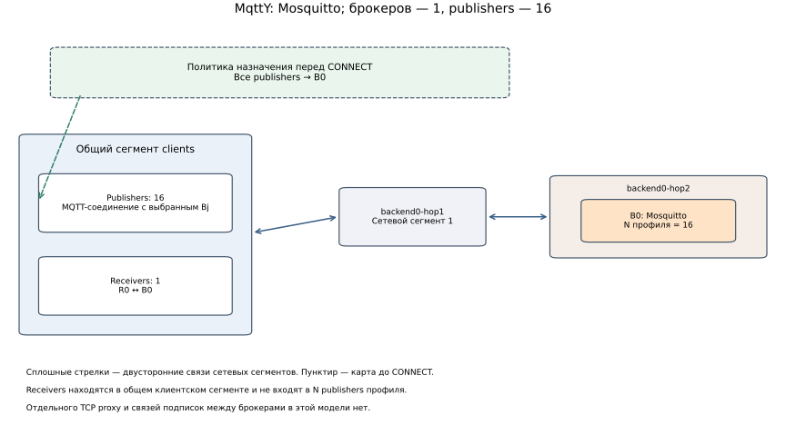
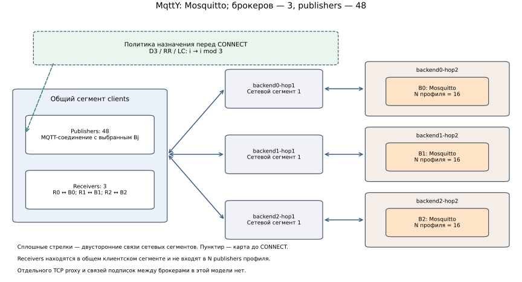
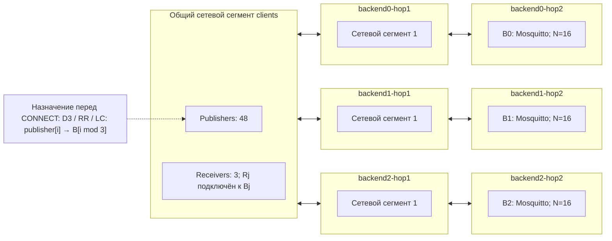
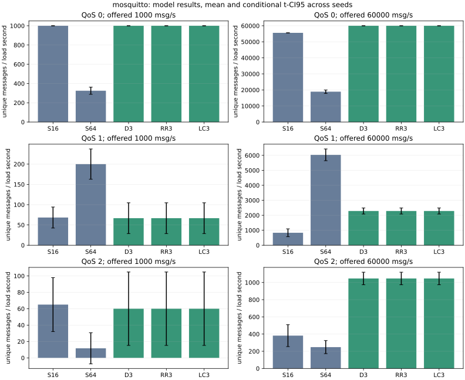
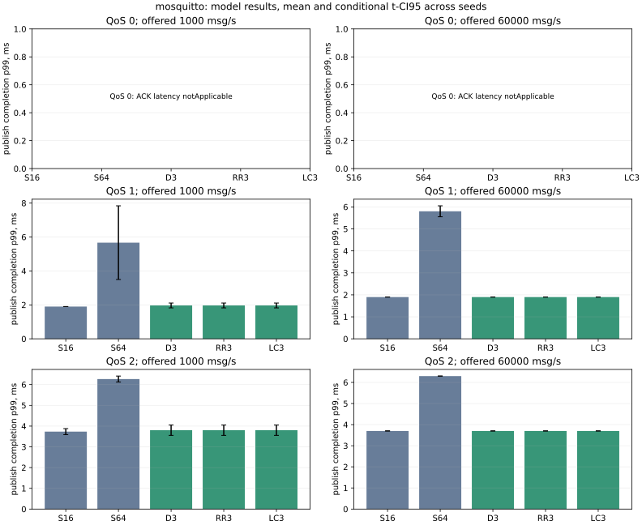

# Двойник Mosquitto: один против трёх

Технически завершены **90/90**, технических отказов **0**; отсутствует результатов **0**. Все числа ниже получены запуском MqttY, а не оценкой заранее.

Использован неизменённый эмпирический профиль Mosquitto v4, построенный по прежним натурным измерениям. **Новых натурных измерений в этой работе нет.** Сравниваются single N=16, single N=64 и пул 3×16.

**Строго одинаковая популяция для single N=48 отсутствует в профиле.** Интерполяция/подмена N не выполнялась. Поэтому S относительно N=16 включает увеличение числа publishers; вариант N=64 — дополнительный контроль с большим числом клиентов у одиночного брокера. Это предварительное модельное сравнение; чистый эффект трёх реальных брокеров здесь не выделен.

## Топология брокеров

Receivers показаны в общем клиентском сегменте, как в экспортированном графе. Они подключены к своим брокерам через те же два участка. Политика назначения работает перед CONNECT; отдельного TCP proxy в пути пакетов нет. Подписки независимых backend не объединяются. Физические связи, состав узлов и принадлежность сегментам сверены с GraphML; карта publisher → broker взята из manifest.

Исходник диаграммы пула для редактирования:

## Условия и границы вывода

Проверяется назначение постоянного MQTT-соединения одному backend до CONNECT. На каждом backend — свой прямой receiver; подписки между независимыми брокерами не объединяются. CPU, RSS, стоимость TCP proxy, health checks и миграция сессий не моделируются. Поэтому здесь нет оценки EST и доказательства производительности настоящего балансировщика.

Payload — 16 байт; QoS публикации и подписки совпадают. Нагрузка общая: 1000 либо 60 000 сообщений/с; seeds 42, 43, 44. Прогрев / measurement / drain: 0.01 / 0.2 / до 1 модельной секунды, tick 0.1 мс. Один клиентский сегмент, два одинаковых сетевых участка к каждому backend; канал 125 000 000 байт/с, окно 100 ticks, transfer 2 ticks, очередь 100 000. Транспорт фиксирован до опытов; параметры по полученному результату не подбирались. Режим EmpiricalServiceBudget одиночного BrokerFidelity не переносится на этот пул.

RPS завершений = завершения измерительной когорты backend / 0.2 с. Goodput = первые корректные получения её ID / 0.2 с, включая поздние получения в drain. Выполнение плана = uniqueReceived / scheduledPublishes. Недоставка = 1−uniqueReceived/apiAttempts; это другой знаменатель. Backpressure — scheduled−apiAttempts, а немедленный отказ Publish не равен всем протокольным ошибкам. Нулевой знаменатель — н/п. Прогрев исключается по ID/поколению. Глобальные p99 считаются из объединённых гистограмм; QoS 0 ACK latency неприменима.

В таблицах — среднее ± t-CI95 для трёх seeds (t=4.302652729911275, df=2). Это условный разброс стохастической модели с одним замороженным профилем, а не неопределённость натурных измерений. Совпавшие детерминированные результаты дают нулевую ширину CI; это не доказывает нулевую ошибку относительно реальности. Короткое окно предназначено для проверки механизма и предварительного анализа, а не для вывода о стационарном p99.

## Эффективность и сравнение стратегий

S = goodput пула / goodput одиночного варианта, E = S/3. E — условный throughput на добавленный backend относительно baseline, не оценка CPU/энергии и не интегральный балл брокера. При недогруженном одиночном сервере S≈1 и E≈1/3 ожидаемы. Если одновременно меняются число publishers и точка профиля, S нельзя целиком приписывать числу брокеров.

DirectBalanced — контроль заранее заданной карты без выбора во время CONNECT. При одинаковых постоянных сессиях RR и Least Connections с немедленным резервированием дают ту же карту. Их превосходство друг над другом в этой программе не ожидается; проверяется побайтное равенство scientific summary при одинаковых входах и seed.

## Полученные результаты

S16/S48/S64 обозначают одиночный брокер и общее число publishers; D3/RR3/LC3 — три брокера с 48 publishers всего.

### Нагрузка 1 000 сообщений/с  QoS 0

| Вариант | Завершения/с | Goodput/с | Выполнение плана, % | Недоставка, доля | p99 завершения, мс | Успешно |
| --- | ---: | ---: | ---: | ---: | ---: | ---: |
| Один / 16 publishers | 1000.00 ± 0.00 | 1000.00 ± 0.00 | 100.00 | 0.000000 | н/п | 3/3 |
| Один / 64 publishers | 996.67 ± 14.34 | 325.00 ± 37.26 | 32.50 | 0.675000 | н/п | 3/3 |
| Три / directBalanced | 1000.00 ± 0.00 | 1000.00 ± 0.00 | 100.00 | 0.000000 | н/п | 3/3 |
| Три / Round Robin | 1000.00 ± 0.00 | 1000.00 ± 0.00 | 100.00 | 0.000000 | н/п | 3/3 |
| Три / Least Connections | 1000.00 ± 0.00 | 1000.00 ± 0.00 | 100.00 | 0.000000 | н/п | 3/3 |

### Нагрузка 1 000 сообщений/с  QoS 1

| Вариант | Завершения/с | Goodput/с | Выполнение плана, % | Недоставка, доля | p99 завершения, мс | Успешно |
| --- | ---: | ---: | ---: | ---: | ---: | ---: |
| Один / 16 publishers | 1000.00 ± 0.00 | 68.33 ± 25.86 | 6.83 | 0.931667 | 1.900 ± 0.000 | 3/3 |
| Один / 64 publishers | 1000.00 ± 0.00 | 200.00 ± 37.26 | 20.00 | 0.800000 | 5.667 ± 2.170 | 3/3 |
| Три / directBalanced | 998.33 ± 7.17 | 66.67 ± 37.95 | 6.67 | 0.933216 | 1.967 ± 0.143 | 3/3 |
| Три / Round Robin | 998.33 ± 7.17 | 66.67 ± 37.95 | 6.67 | 0.933216 | 1.967 ± 0.143 | 3/3 |
| Три / Least Connections | 998.33 ± 7.17 | 66.67 ± 37.95 | 6.67 | 0.933216 | 1.967 ± 0.143 | 3/3 |

### Нагрузка 1 000 сообщений/с  QoS 2

| Вариант | Завершения/с | Goodput/с | Выполнение плана, % | Недоставка, доля | p99 завершения, мс | Успешно |
| --- | ---: | ---: | ---: | ---: | ---: | ---: |
| Один / 16 publishers | 1000.00 ± 0.00 | 65.00 ± 32.86 | 6.50 | 0.935000 | 3.733 ± 0.143 | 3/3 |
| Один / 64 publishers | 1000.00 ± 0.00 | 11.67 ± 18.97 | 1.17 | 0.988333 | 6.267 ± 0.143 | 3/3 |
| Три / directBalanced | 998.33 ± 7.17 | 60.00 ± 44.78 | 6.00 | 0.939891 | 3.800 ± 0.248 | 3/3 |
| Три / Round Robin | 998.33 ± 7.17 | 60.00 ± 44.78 | 6.00 | 0.939891 | 3.800 ± 0.248 | 3/3 |
| Три / Least Connections | 998.33 ± 7.17 | 60.00 ± 44.78 | 6.00 | 0.939891 | 3.800 ± 0.248 | 3/3 |

### Нагрузка 60 000 сообщений/с  QoS 0

| Вариант | Завершения/с | Goodput/с | Выполнение плана, % | Недоставка, доля | p99 завершения, мс | Успешно |
| --- | ---: | ---: | ---: | ---: | ---: | ---: |
| Один / 16 publishers | 55580.00 ± 0.00 | 55580.00 ± 0.00 | 92.63 | 0.073667 | н/п | 3/3 |
| Один / 64 publishers | 54626.67 ± 125.03 | 18900.00 ± 1081.96 | 31.50 | 0.685000 | н/п | 3/3 |
| Три / directBalanced | 60000.00 ± 0.00 | 60000.00 ± 0.00 | 100.00 | 0.000000 | н/п | 3/3 |
| Три / Round Robin | 60000.00 ± 0.00 | 60000.00 ± 0.00 | 100.00 | 0.000000 | н/п | 3/3 |
| Три / Least Connections | 60000.00 ± 0.00 | 60000.00 ± 0.00 | 100.00 | 0.000000 | н/п | 3/3 |

### Нагрузка 60 000 сообщений/с  QoS 1

| Вариант | Завершения/с | Goodput/с | Выполнение плана, % | Недоставка, доля | p99 завершения, мс | Успешно |
| --- | ---: | ---: | ---: | ---: | ---: | ---: |
| Один / 16 publishers | 8735.00 ± 720.72 | 831.67 ± 261.82 | 1.39 | 0.904978 | 1.900 ± 0.000 | 3/3 |
| Один / 64 publishers | 26203.33 ± 534.28 | 6035.00 ± 390.41 | 10.06 | 0.776737 | 5.800 ± 0.248 | 3/3 |
| Три / directBalanced | 26640.00 ± 291.03 | 2285.00 ± 199.89 | 3.81 | 0.914232 | 1.900 ± 0.000 | 3/3 |
| Три / Round Robin | 26640.00 ± 291.03 | 2285.00 ± 199.89 | 3.81 | 0.914232 | 1.900 ± 0.000 | 3/3 |
| Три / Least Connections | 26640.00 ± 291.03 | 2285.00 ± 199.89 | 3.81 | 0.914232 | 1.900 ± 0.000 | 3/3 |

### Нагрузка 60 000 сообщений/с  QoS 2

| Вариант | Завершения/с | Goodput/с | Выполнение плана, % | Недоставка, доля | p99 завершения, мс | Успешно |
| --- | ---: | ---: | ---: | ---: | ---: | ---: |
| Один / 16 publishers | 4498.33 ± 329.87 | 381.67 ± 127.48 | 0.64 | 0.915387 | 3.700 ± 0.000 | 3/3 |
| Один / 64 publishers | 13161.67 ± 165.40 | 248.33 ± 75.89 | 0.41 | 0.981420 | 6.300 ± 0.000 | 3/3 |
| Три / directBalanced | 13618.33 ± 323.97 | 1046.67 ± 72.78 | 1.74 | 0.923202 | 3.700 ± 0.000 | 3/3 |
| Три / Round Robin | 13618.33 ± 323.97 | 1046.67 ± 72.78 | 1.74 | 0.923202 | 3.700 ± 0.000 | 3/3 |
| Три / Least Connections | 13618.33 ± 323.97 | 1046.67 ± 72.78 | 1.74 | 0.923202 | 3.700 ± 0.000 | 3/3 |

## Масштабирование при высокой нагрузке

| QoS | Baseline | S (RR3/baseline), среднее ± CI95 | E=S/3 |
| --- | --- | ---: | ---: |
| 0 | single16 | 1.0795 ± 0.0000 | 0.3598 |
| 0 | single64 | 3.1757 ± 0.1833 | 1.0586 |
| 1 | single16 | 2.7759 ± 0.8733 | 0.9253 |
| 1 | single64 | 0.3790 ± 0.0554 | 0.1263 |
| 2 | single16 | 2.7769 ± 0.9643 | 0.9256 |
| 2 | single64 | 4.2588 ± 1.3507 | 1.4196 |

## Проверяемость

Побайтно совпали scientific summaries D3/RR3/LC3 в **18/18** сочетаниях нагрузки, QoS и seed. Это контроль отсутствия искусственного выигрыша алгоритма. Все три одинаковых варианта выполнялись отдельно.

MqttY commit: `8c88a71b8315d653625fb54ce29be936584c4b2a`. Профиль SHA-256: `d9cf125fb8cb6ec3677fc3c596bafcdfced8be0502362e2b4ff03da1421d46eb`.

Проверены seals, суммы backend, RPS, уникальные доставки, учёт drain и квантили по гистограммам. Данные: [CSV](../../data/load-balancing-study-v1/runs.csv), [scientific summaries](../../data/load-balancing-study-v1/runs.json), [агрегаты](../../data/load-balancing-study-v1/aggregates.json), [проверки и повторные запуски](../../data/load-balancing-study-v1/verification.json), [точная программа](../../data/load-balancing-study-v1/study-plan.json). Полные данные сохраняются отдельно от компактной публикации; расположение и хэш архива указываются в archive-receipt.json после внешнего архивирования.

## Как повторить

Из корня мета-репозитория: собрать LoadBalancing.App в Release, затем выполнить `python tools/load-balancing/study.py run --work-dir <новый-каталог-на-диске-данных>` и `python tools/load-balancing/study.py report --work-dir <тот-же-каталог>`. Профиль и observations берутся из опубликованных входов Mosquitto и сверяются по SHA. Для отчётов нужен Matplotlib. Параметры программы фиксируются до первого запуска. Каждый отдельный сохранённый опыт повторяется обычной командой приложения `run --config <run>/run-config.json --output <new-directory>`.

<!-- study-conclusion -->

## Вывод

- При QoS 0 и 60 000 сообщений/с RR3/single16: S=1.0795 ± 0.0000. Результаты D3 и LC3 совпадают с RR3.
- При QoS 1 и 60 000 сообщений/с RR3/single16: S=2.7759 ± 0.8733. Результаты D3 и LC3 совпадают с RR3.
- При QoS 2 и 60 000 сообщений/с RR3/single16: S=2.7769 ± 0.9643. Результаты D3 и LC3 совпадают с RR3.

Отдельного победителя среди стратегий в программе с одинаковыми постоянными сессиями нет. В профилированной паре одновременно меняются publishers и выбранная точка профиля; чистый выигрыш трёх настоящих брокеров не выделен.

Техническое завершение не гарантирует полной доставки. В профиль N=16 перенесена исходная недоставка около 91–92% для QoS 1/2. Её применение к новой нагрузке — допущение модели, которое требует натурной проверки. Смотрите именно goodput и loss, а не только RPS завершений.

[Общий разбор и границы доказательств](Load-balancing-study.md). [Квитанция полного архива](../../data/load-balancing-study-v1/archive-receipt.json).
