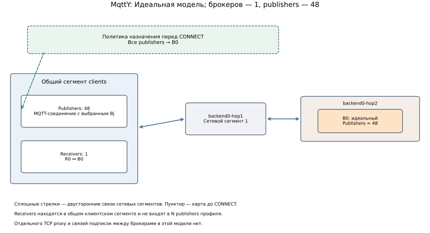
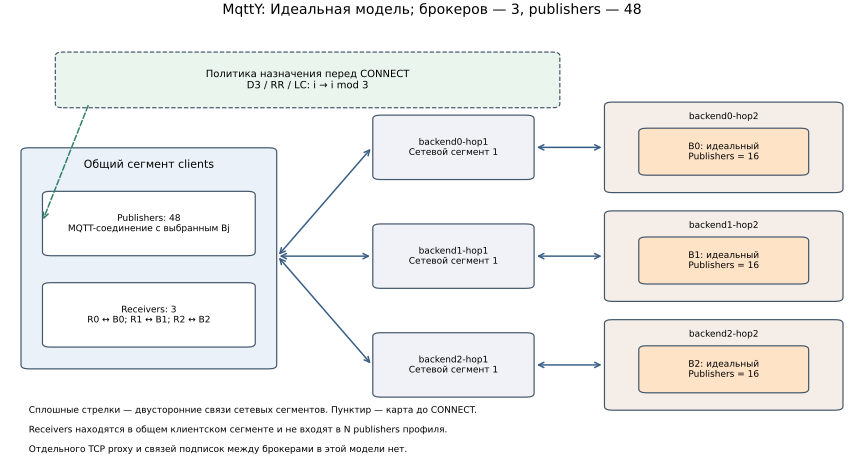
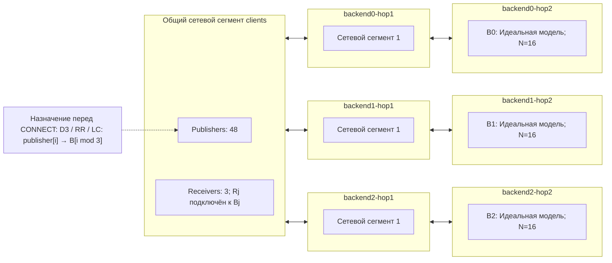
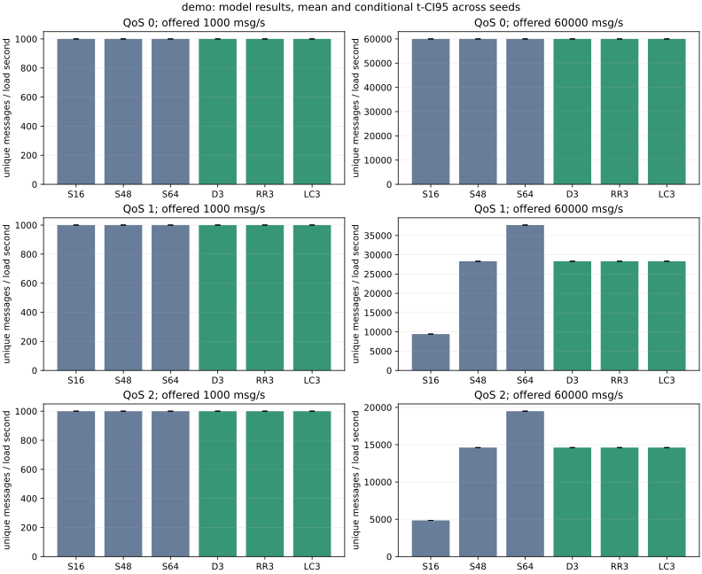
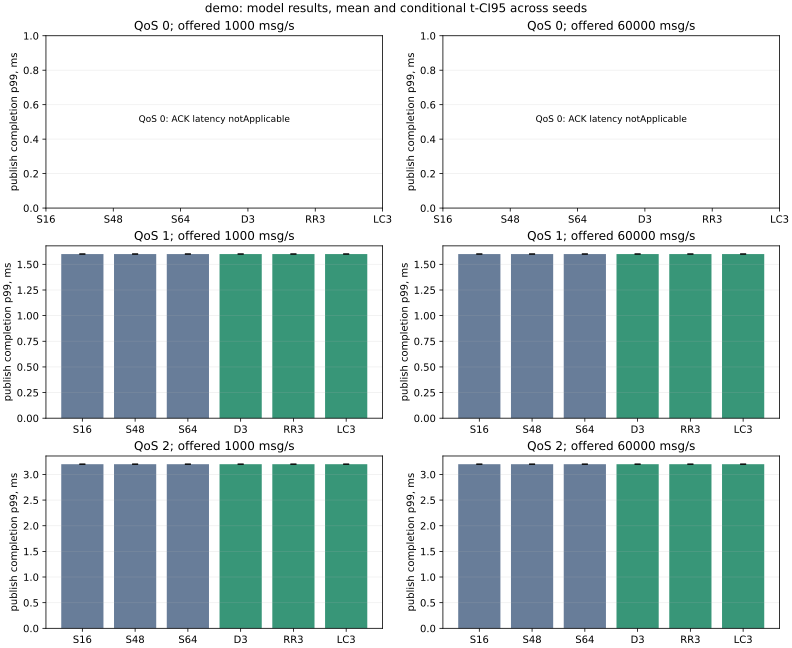

# Идеальные брокеры: один против трёх

Технически завершены **108/108**, технических отказов **0**; отсутствует результатов **0**. Все числа ниже получены запуском MqttY, а не оценкой заранее.

Основное сопоставление: один брокер с 48 publishers против трёх по 16, при одинаковой общей интенсивности. Дополнительные одиночные варианты N=16 и N=64 показывают влияние числа клиентов. Реальные профили не читаются; использована команда demo с сохранением результатов.

## Топология брокеров

Receivers показаны в общем клиентском сегменте, как в экспортированном графе. Они подключены к своим брокерам через те же два участка. Политика назначения работает перед CONNECT; отдельного TCP proxy в пути пакетов нет. Подписки независимых backend не объединяются. Физические связи, состав узлов и принадлежность сегментам сверены с GraphML; карта publisher → broker взята из manifest.

Исходник диаграммы пула для редактирования:

## Условия и границы вывода

Проверяется назначение постоянного MQTT-соединения одному backend до CONNECT. На каждом backend — свой прямой receiver; подписки между независимыми брокерами не объединяются. CPU, RSS, стоимость TCP proxy, health checks и миграция сессий не моделируются. Поэтому здесь нет оценки EST и доказательства производительности настоящего балансировщика.

Payload — 16 байт; QoS публикации и подписки совпадают. Нагрузка общая: 1000 либо 60 000 сообщений/с; seeds 42, 43, 44. Прогрев / measurement / drain: 0.01 / 0.2 / до 1 модельной секунды, tick 0.1 мс. Один клиентский сегмент, два одинаковых сетевых участка к каждому backend; канал 125 000 000 байт/с, окно 100 ticks, transfer 2 ticks, очередь 100 000. Транспорт фиксирован до опытов; параметры по полученному результату не подбирались. Режим EmpiricalServiceBudget одиночного BrokerFidelity не переносится на этот пул.

RPS завершений = завершения измерительной когорты backend / 0.2 с. Goodput = первые корректные получения её ID / 0.2 с, включая поздние получения в drain. Выполнение плана = uniqueReceived / scheduledPublishes. Недоставка = 1−uniqueReceived/apiAttempts; это другой знаменатель. Backpressure — scheduled−apiAttempts, а немедленный отказ Publish не равен всем протокольным ошибкам. Нулевой знаменатель — н/п. Прогрев исключается по ID/поколению. Глобальные p99 считаются из объединённых гистограмм; QoS 0 ACK latency неприменима.

В таблицах — среднее ± t-CI95 для трёх seeds (t=4.302652729911275, df=2). Это условный разброс стохастической модели с одним замороженным профилем, а не неопределённость натурных измерений. Совпавшие детерминированные результаты дают нулевую ширину CI; это не доказывает нулевую ошибку относительно реальности. Короткое окно предназначено для проверки механизма и предварительного анализа, а не для вывода о стационарном p99.

## Эффективность и сравнение стратегий

S = goodput пула / goodput одиночного варианта, E = S/3. E — условный throughput на добавленный backend относительно baseline, не оценка CPU/энергии и не интегральный балл брокера. При недогруженном одиночном сервере S≈1 и E≈1/3 ожидаемы. Если одновременно меняются число publishers и точка профиля, S нельзя целиком приписывать числу брокеров.

DirectBalanced — контроль заранее заданной карты без выбора во время CONNECT. При одинаковых постоянных сессиях RR и Least Connections с немедленным резервированием дают ту же карту. Их превосходство друг над другом в этой программе не ожидается; проверяется побайтное равенство scientific summary при одинаковых входах и seed.

## Полученные результаты

S16/S48/S64 обозначают одиночный брокер и общее число publishers; D3/RR3/LC3 — три брокера с 48 publishers всего.

### Нагрузка 1 000 сообщений/с  QoS 0

| Вариант | Завершения/с | Goodput/с | Выполнение плана, % | Недоставка, доля | p99 завершения, мс | Успешно |
| --- | ---: | ---: | ---: | ---: | ---: | ---: |
| Один / 16 publishers | 1000.00 ± 0.00 | 1000.00 ± 0.00 | 100.00 | 0.000000 | н/п | 3/3 |
| Один / 48 publishers | 1000.00 ± 0.00 | 1000.00 ± 0.00 | 100.00 | 0.000000 | н/п | 3/3 |
| Один / 64 publishers | 1000.00 ± 0.00 | 1000.00 ± 0.00 | 100.00 | 0.000000 | н/п | 3/3 |
| Три / directBalanced | 1000.00 ± 0.00 | 1000.00 ± 0.00 | 100.00 | 0.000000 | н/п | 3/3 |
| Три / Round Robin | 1000.00 ± 0.00 | 1000.00 ± 0.00 | 100.00 | 0.000000 | н/п | 3/3 |
| Три / Least Connections | 1000.00 ± 0.00 | 1000.00 ± 0.00 | 100.00 | 0.000000 | н/п | 3/3 |

### Нагрузка 1 000 сообщений/с  QoS 1

| Вариант | Завершения/с | Goodput/с | Выполнение плана, % | Недоставка, доля | p99 завершения, мс | Успешно |
| --- | ---: | ---: | ---: | ---: | ---: | ---: |
| Один / 16 publishers | 1000.00 ± 0.00 | 1000.00 ± 0.00 | 100.00 | 0.000000 | 1.600 ± 0.000 | 3/3 |
| Один / 48 publishers | 1000.00 ± 0.00 | 1000.00 ± 0.00 | 100.00 | 0.000000 | 1.600 ± 0.000 | 3/3 |
| Один / 64 publishers | 1000.00 ± 0.00 | 1000.00 ± 0.00 | 100.00 | 0.000000 | 1.600 ± 0.000 | 3/3 |
| Три / directBalanced | 1000.00 ± 0.00 | 1000.00 ± 0.00 | 100.00 | 0.000000 | 1.600 ± 0.000 | 3/3 |
| Три / Round Robin | 1000.00 ± 0.00 | 1000.00 ± 0.00 | 100.00 | 0.000000 | 1.600 ± 0.000 | 3/3 |
| Три / Least Connections | 1000.00 ± 0.00 | 1000.00 ± 0.00 | 100.00 | 0.000000 | 1.600 ± 0.000 | 3/3 |

### Нагрузка 1 000 сообщений/с  QoS 2

| Вариант | Завершения/с | Goodput/с | Выполнение плана, % | Недоставка, доля | p99 завершения, мс | Успешно |
| --- | ---: | ---: | ---: | ---: | ---: | ---: |
| Один / 16 publishers | 1000.00 ± 0.00 | 1000.00 ± 0.00 | 100.00 | 0.000000 | 3.200 ± 0.000 | 3/3 |
| Один / 48 publishers | 1000.00 ± 0.00 | 1000.00 ± 0.00 | 100.00 | 0.000000 | 3.200 ± 0.000 | 3/3 |
| Один / 64 publishers | 1000.00 ± 0.00 | 1000.00 ± 0.00 | 100.00 | 0.000000 | 3.200 ± 0.000 | 3/3 |
| Три / directBalanced | 1000.00 ± 0.00 | 1000.00 ± 0.00 | 100.00 | 0.000000 | 3.200 ± 0.000 | 3/3 |
| Три / Round Robin | 1000.00 ± 0.00 | 1000.00 ± 0.00 | 100.00 | 0.000000 | 3.200 ± 0.000 | 3/3 |
| Три / Least Connections | 1000.00 ± 0.00 | 1000.00 ± 0.00 | 100.00 | 0.000000 | 3.200 ± 0.000 | 3/3 |

### Нагрузка 60 000 сообщений/с  QoS 0

| Вариант | Завершения/с | Goodput/с | Выполнение плана, % | Недоставка, доля | p99 завершения, мс | Успешно |
| --- | ---: | ---: | ---: | ---: | ---: | ---: |
| Один / 16 publishers | 60000.00 ± 0.00 | 60000.00 ± 0.00 | 100.00 | 0.000000 | н/п | 3/3 |
| Один / 48 publishers | 60000.00 ± 0.00 | 60000.00 ± 0.00 | 100.00 | 0.000000 | н/п | 3/3 |
| Один / 64 publishers | 60000.00 ± 0.00 | 60000.00 ± 0.00 | 100.00 | 0.000000 | н/п | 3/3 |
| Три / directBalanced | 60000.00 ± 0.00 | 60000.00 ± 0.00 | 100.00 | 0.000000 | н/п | 3/3 |
| Три / Round Robin | 60000.00 ± 0.00 | 60000.00 ± 0.00 | 100.00 | 0.000000 | н/п | 3/3 |
| Три / Least Connections | 60000.00 ± 0.00 | 60000.00 ± 0.00 | 100.00 | 0.000000 | н/п | 3/3 |

### Нагрузка 60 000 сообщений/с  QoS 1

| Вариант | Завершения/с | Goodput/с | Выполнение плана, % | Недоставка, доля | p99 завершения, мс | Успешно |
| --- | ---: | ---: | ---: | ---: | ---: | ---: |
| Один / 16 publishers | 9440.00 ± 0.00 | 9440.00 ± 0.00 | 15.73 | 0.000000 | 1.600 ± 0.000 | 3/3 |
| Один / 48 publishers | 28320.00 ± 0.00 | 28320.00 ± 0.00 | 47.20 | 0.000000 | 1.600 ± 0.000 | 3/3 |
| Один / 64 publishers | 37710.00 ± 0.00 | 37710.00 ± 0.00 | 62.85 | 0.000000 | 1.600 ± 0.000 | 3/3 |
| Три / directBalanced | 28320.00 ± 0.00 | 28320.00 ± 0.00 | 47.20 | 0.000000 | 1.600 ± 0.000 | 3/3 |
| Три / Round Robin | 28320.00 ± 0.00 | 28320.00 ± 0.00 | 47.20 | 0.000000 | 1.600 ± 0.000 | 3/3 |
| Три / Least Connections | 28320.00 ± 0.00 | 28320.00 ± 0.00 | 47.20 | 0.000000 | 1.600 ± 0.000 | 3/3 |

### Нагрузка 60 000 сообщений/с  QoS 2

| Вариант | Завершения/с | Goodput/с | Выполнение плана, % | Недоставка, доля | p99 завершения, мс | Успешно |
| --- | ---: | ---: | ---: | ---: | ---: | ---: |
| Один / 16 publishers | 4850.00 ± 0.00 | 4850.00 ± 0.00 | 8.08 | 0.000000 | 3.200 ± 0.000 | 3/3 |
| Один / 48 publishers | 14610.00 ± 0.00 | 14610.00 ± 0.00 | 24.35 | 0.000000 | 3.200 ± 0.000 | 3/3 |
| Один / 64 publishers | 19490.00 ± 0.00 | 19490.00 ± 0.00 | 32.48 | 0.000000 | 3.200 ± 0.000 | 3/3 |
| Три / directBalanced | 14610.00 ± 0.00 | 14610.00 ± 0.00 | 24.35 | 0.000000 | 3.200 ± 0.000 | 3/3 |
| Три / Round Robin | 14610.00 ± 0.00 | 14610.00 ± 0.00 | 24.35 | 0.000000 | 3.200 ± 0.000 | 3/3 |
| Три / Least Connections | 14610.00 ± 0.00 | 14610.00 ± 0.00 | 24.35 | 0.000000 | 3.200 ± 0.000 | 3/3 |

## Масштабирование при высокой нагрузке

| QoS | Baseline | S (RR3/baseline), среднее ± CI95 | E=S/3 |
| --- | --- | ---: | ---: |
| 0 | single16 | 1.0000 ± 0.0000 | 0.3333 |
| 0 | single48 | 1.0000 ± 0.0000 | 0.3333 |
| 0 | single64 | 1.0000 ± 0.0000 | 0.3333 |
| 1 | single16 | 3.0000 ± 0.0000 | 1.0000 |
| 1 | single48 | 1.0000 ± 0.0000 | 0.3333 |
| 1 | single64 | 0.7510 ± 0.0000 | 0.2503 |
| 2 | single16 | 3.0124 ± 0.0000 | 1.0041 |
| 2 | single48 | 1.0000 ± 0.0000 | 0.3333 |
| 2 | single64 | 0.7496 ± 0.0000 | 0.2499 |

## Проверяемость

Побайтно совпали scientific summaries D3/RR3/LC3 в **18/18** сочетаниях нагрузки, QoS и seed. Это контроль отсутствия искусственного выигрыша алгоритма. Все три одинаковых варианта выполнялись отдельно.

MqttY commit: `8c88a71b8315d653625fb54ce29be936584c4b2a`. Профиль SHA-256: `d9cf125fb8cb6ec3677fc3c596bafcdfced8be0502362e2b4ff03da1421d46eb` (в демо не применяется).

Проверены seals, суммы backend, RPS, уникальные доставки, учёт drain и квантили по гистограммам. Данные: [CSV](../../data/load-balancing-study-v1/runs.csv), [scientific summaries](../../data/load-balancing-study-v1/runs.json), [агрегаты](../../data/load-balancing-study-v1/aggregates.json), [проверки и повторные запуски](../../data/load-balancing-study-v1/verification.json), [точная программа](../../data/load-balancing-study-v1/study-plan.json). Полные данные сохраняются отдельно от компактной публикации; расположение и хэш архива указываются в archive-receipt.json после внешнего архивирования.

## Как повторить

Из корня мета-репозитория: собрать LoadBalancing.App в Release, затем выполнить `python tools/load-balancing/study.py run --work-dir <новый-каталог-на-диске-данных>` и `python tools/load-balancing/study.py report --work-dir <тот-же-каталог>`. Профиль и observations берутся из опубликованных входов Mosquitto и сверяются по SHA. Для отчётов нужен Matplotlib. Параметры программы фиксируются до первого запуска. Каждый отдельный сохранённый опыт повторяется обычной командой приложения `run --config <run>/run-config.json --output <new-directory>`.

<!-- study-conclusion -->

## Вывод

- При QoS 0 и 60 000 сообщений/с RR3/single48: S=1.0000 ± 0.0000. Результаты D3 и LC3 совпадают с RR3.
- При QoS 1 и 60 000 сообщений/с RR3/single48: S=1.0000 ± 0.0000. Результаты D3 и LC3 совпадают с RR3.
- При QoS 2 и 60 000 сообщений/с RR3/single48: S=1.0000 ± 0.0000. Результаты D3 и LC3 совпадают с RR3.

Отдельного победителя среди стратегий в программе с одинаковыми постоянными сессиями нет. В основной идеальной паре сохраняются 48 publishers.

Техническое завершение не гарантирует полной доставки. При QoS 1/2 число незавершённых слотов определяется также ожиданием ACK отдельными publishers.

[Общий разбор и границы доказательств](Load-balancing-study.md). [Квитанция полного архива](../../data/load-balancing-study-v1/archive-receipt.json).
