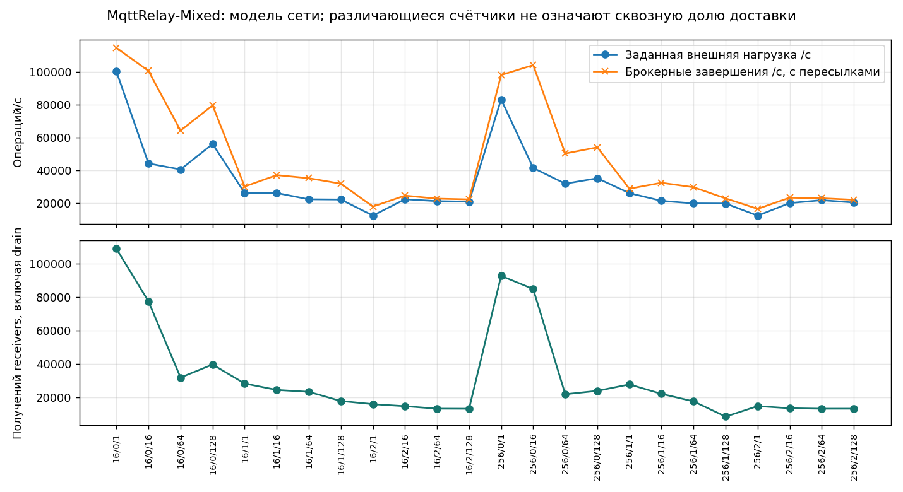

# Смешанная сеть MqttRelay: итоговый отчёт

Завершены **72/72** запуска. Использованы четыре замороженных профиля. Это модельный эксперимент; натурного эталона сети в данной кампании нет.

## Модель сети MqttRelay

Завершены 72 запуска: четыре двойника, networkLength=2, 24 точки × три seed. Все показатели ниже — средние по трём seed. Общий брокерный RPS включает внутренние пересылки. Счётчик receivers означает фактические получения модельными удалёнными приложениями, а не настоящими сетевыми процессами. Он охватывает время после сброса измерений до конца drain; сообщения прогрева в пути могут пересечь границу. Без сквозных ID его нельзя делить на внешнюю нагрузку и называть уникальной сквозной доставкой.

Порядок двойников: Aedes, Mosquitto, ActiveMQ, EMQX. Суммарная внешняя нагрузка равна 4 × минимуму attemptedRps четырёх соответствующих калибровочных точек. На каждый узел приходится четверть.

Модель транспорта: 125 000 000 байт/с (1 Гбит/с), transferTicks=2, очередь 100 000, tick=0,1 мс. Пропускная способность и очередь — допущения; loopback этой кампании не измеряет реальную Ethernet-сеть. Внутренние Relay-публикации добавляют нагрузку и могут получать rateRejected.

| Байт | QoS | N | Внешних/с | На узел/с | Брокерных завершений/с | Failure, % | Loss, % | p99, мс | RateRejected | Ожидалось доставок | Доставлено брокерами | Получений receivers |
| --- | --- | --- | --- | --- | --- | --- | --- | --- | --- | --- | --- | --- |
| 16 | 0 | 1 | 1.001e+05 | 2.502e+04 | 1.145e+05 | 63.1 | 0 | н/п | 3.916e+05 | 3.29e+05 | 3.29e+05 | 1.09e+05 |
| 16 | 0 | 16 | 4.418e+04 | 1.105e+04 | 1.004e+05 | 23.32 | 36.39 | н/п | 6.11e+04 | 2.652e+05 | 1.687e+05 | 7.741e+04 |
| 16 | 0 | 64 | 4.051e+04 | 1.013e+04 | 6.419e+04 | 24.79 | 61.04 | н/п | 4.194e+04 | 1.833e+05 | 7.142e+04 | 3.187e+04 |
| 16 | 0 | 128 | 5.596e+04 | 1.399e+04 | 7.945e+04 | 30.17 | 60.5 | н/п | 6.821e+04 | 2.283e+05 | 9.018e+04 | 3.963e+04 |
| 16 | 1 | 1 | 2.628e+04 | 6569 | 3.015e+04 | 61.28 | 0 | 2.4 | 9.543e+04 | 8.399e+04 | 8.399e+04 | 2.827e+04 |
| 16 | 1 | 16 | 2.618e+04 | 6545 | 3.709e+04 | 35.67 | 43.4 | 12.17 | 4.113e+04 | 1.023e+05 | 5.788e+04 | 2.444e+04 |
| 16 | 1 | 64 | 2.237e+04 | 5592 | 3.52e+04 | 36.42 | 40.38 | 58.07 | 4.034e+04 | 9.659e+04 | 5.759e+04 | 2.33e+04 |
| 16 | 1 | 128 | 2.222e+04 | 5556 | 3.188e+04 | 34.83 | 50.71 | 124.7 | 3.408e+04 | 9.047e+04 | 4.459e+04 | 1.78e+04 |
| 16 | 2 | 1 | 1.247e+04 | 3117 | 1.793e+04 | 58.39 | 0 | 4.8 | 5.032e+04 | 4.96e+04 | 4.96e+04 | 1.592e+04 |
| 16 | 2 | 16 | 2.24e+04 | 5601 | 2.462e+04 | 44 | 46.52 | 13.3 | 3.869e+04 | 7.004e+04 | 3.746e+04 | 1.471e+04 |
| 16 | 2 | 64 | 2.125e+04 | 5313 | 2.276e+04 | 43.01 | 50.08 | 64.5 | 3.435e+04 | 6.552e+04 | 3.271e+04 | 1.322e+04 |
| 16 | 2 | 128 | 2.095e+04 | 5237 | 2.23e+04 | 42.96 | 50.62 | 142.2 | 3.359e+04 | 6.433e+04 | 3.177e+04 | 1.317e+04 |
| 256 | 0 | 1 | 8.31e+04 | 2.077e+04 | 9.795e+04 | 62.14 | 0 | н/п | 3.215e+05 | 2.785e+05 | 2.785e+05 | 9.271e+04 |
| 256 | 0 | 16 | 4.141e+04 | 1.035e+04 | 1.04e+05 | 19.32 | 35.39 | н/п | 4.979e+04 | 2.721e+05 | 1.758e+05 | 8.483e+04 |
| 256 | 0 | 64 | 3.188e+04 | 7970 | 5.021e+04 | 21.05 | 67.8 | н/п | 2.677e+04 | 1.489e+05 | 4.796e+04 | 2.186e+04 |
| 256 | 0 | 128 | 3.516e+04 | 8790 | 5.397e+04 | 22.71 | 67.56 | н/п | 3.009e+04 | 1.606e+05 | 5.21e+04 | 2.389e+04 |
| 256 | 1 | 1 | 2.611e+04 | 6528 | 2.881e+04 | 62.56 | 0 | 2.4 | 9.629e+04 | 8.154e+04 | 8.154e+04 | 2.774e+04 |
| 256 | 1 | 16 | 2.143e+04 | 5358 | 3.242e+04 | 33.46 | 44.3 | 12.77 | 3.26e+04 | 8.962e+04 | 4.992e+04 | 2.208e+04 |
| 256 | 1 | 64 | 1.987e+04 | 4967 | 2.97e+04 | 34.41 | 48.6 | 58.77 | 3.116e+04 | 8.395e+04 | 4.315e+04 | 1.759e+04 |
| 256 | 1 | 128 | 1.98e+04 | 4949 | 2.292e+04 | 29.15 | 72.8 | 131.2 | 1.886e+04 | 7.155e+04 | 1.946e+04 | 8481 |
| 256 | 2 | 1 | 1.241e+04 | 3102 | 1.656e+04 | 58.14 | 0 | 4.8 | 4.6e+04 | 4.507e+04 | 4.507e+04 | 1.476e+04 |
| 256 | 2 | 16 | 2.008e+04 | 5021 | 2.336e+04 | 42.17 | 48.55 | 13.93 | 3.406e+04 | 6.651e+04 | 3.422e+04 | 1.348e+04 |
| 256 | 2 | 64 | 2.184e+04 | 5460 | 2.3e+04 | 43.44 | 50.52 | 69.5 | 3.534e+04 | 6.638e+04 | 3.284e+04 | 1.319e+04 |
| 256 | 2 | 128 | 2.04e+04 | 5099 | 2.207e+04 | 42.42 | 50.28 | 144.3 | 3.253e+04 | 6.351e+04 | 3.158e+04 | 1.321e+04 |

[CSV](../../MqttRelay-Mixed-relay.csv) · [Все настройки, counters, manifests и точные GraphML/PlantUML](../../data/external-archives.json). Все критерии натурной точности Relay имеют статус `notApplicable`. Они не считаются пройденными.

[Проверка модели и повторяемости](../validation/Model-validation.md) · [Версии и программа](../../data/series.json) · [Хэши профилей](../../data/state.json) · [Сводка всех моделей](../../data/model-evidence.json).
