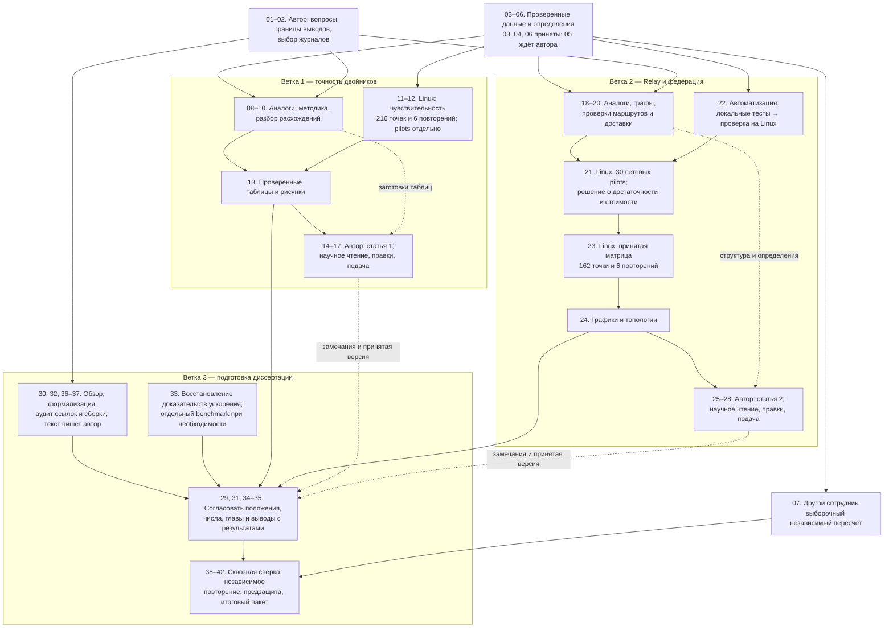

# Журнал прогресса: доказательства, две статьи и диссертация

Этот файл — единый подробный журнал выполненной и оставшейся работы. Он связывает текущий запуск на Linux с последовательным планом из 42 шагов. При следующей проверке состояния обновляются сводка, подтверждения и чекбоксы; законченные записи не заменяются предположениями.

> **Сводка: общий исходный план — 40,4%; новая серия статьи 1 — 40/40 (100%); доступная основная сеть пересчитана — 106/106 (100%), покрытие программы — 106/162 (65,4%), повторы — 0/6.** Выполнены 12 калибровочных измерений, 12 контрольных, 12 моделей и четыре точных повтора. Все 12 моделей прошли допуски в четырёх выбранных условиях. Архив скопирован локально с проверкой SHA; Linux можно выключить. Статья, рисунки и доказательства опубликованы: meta `a2caa0a`, origin/develop. Показатель 80% относится к прежнему локальному блоку оснований, шагам 03–06. В исходном плане уже зачтены методика, опыты и рабочий текст статьи: повторная проверка этих шагов не добавляет им вес. Закрыт технический результат шага 08: вопрос, таблица ближайших методов и проверяемый вклад. Общий показатель — 19,0 из 47 плановых человеко-дней; научное утверждение автором и независимое человеческое рецензирование учитываются отдельно. Старые проценты и стартовые снимки ниже сохранены как история.

## Пересчёт первичных событий основной сети

- [x] Пользователь поручил продолжить локальную проверку 106 доступных результатов. Linux и новые симуляции не используются; исходные файлы не изменяются.
- [x] Последовательный пересчёт завершён: **106/106 raw прошли, ошибок арифметики 0**, время 311,14 с. Сохранены отдельные квитанции всех точек; исходные данные не изменены. Семь тестов новой оболочки и 14 существующих тестов исполнителя прошли.
- [x] Сопоставлены **34/54 полные тройки режимов**: 11 условий по три общих seed и одно условие только с seed 42. Четыре результата без парного режима исключены из сравнения, но сохранены в проверке. Звезда 0/54, две точки кольца отсутствуют, повторы 0/6.
- [x] Подготовлены [разбор](../analysis/Network-main-recount.md), таблица 12 условий, график полноты/задержки и фактические физическая/логическая схемы. Раздел 7 и выводы второй статьи обновлены.
- [x] Итоговая проверка: **21 тест, 55 проверок** чисел, ссылок, SHA, таблицы и области выводов прошли. [Квитанция](../audits/dissertation/network-main-recount-v1/report-verification.json). Палитра графика проверена, PNG просмотрен. Независимое человеческое чтение не засчитано.
- [ ] Итоговые проверки файлов и публикация изменений в Git.

**Текущая сводка:** общий план **40,4%**; доступные raw **106/162**, их пересчёт **106/106 (100%)**. У single и Relay полнота 100%; у федерации выявлены потери и переполнения в 16 точках. Таблицы и обновление второй статьи проверены; осталось опубликовать пакет. Полная программа остаётся незавершённой. Следующий экспериментальный шаг — отдельное решение о недостающих 56 результатах и шести повторах, без автоматического перезапуска старой службы.

## Получение сохранённых результатов основной сети

- [x] Linux доступен. Служба `mqtty-network-full-3h-v1.service` завершилась с exit 1; progress и журнал подтверждают `executionBudgetExhausted`. Живых процессов этой службы нет; перезапуска не было.
- [x] Полностью скопирован каталог кампании: **2 854 файла, 9 618 618 314 байт**; архив **1 048 642 907 байт**. SHA архива, реестра и каждого файла совпали. Полные данные — `C:/temp/mqtty-evidence/network-full-3h-v1/`, вне Git; оригиналы сохранены. **Linux для следующего анализа не нужен.** [Итог](../analysis/Network-main-transfer.md).
- [x] Проверены конфигурации, 281 SHA manifest, 1 802 ссылки seals, 530 научных SHA и 106 физических графов с размещением клиентов. [Квитанция](../audits/dissertation/network-main-transfer-v1/verification.json). Это приёмка файлов и метаданных, не новый пересчёт ID.
- [x] Получен [реестр всех 162 точек](../audits/dissertation/network-main-transfer-v1/coverage.csv): линия **54/54**, кольцо **52/54**, звезда **0/54**. Всего **106** успешных результатов, **2** нерешённых отказа по времени, **54** неисполненные точки. Один прежний RSS-отказ имеет последующую успешную попытку. Повторов **0/6**, полных троек режимов по метаданным **34/54**.
- [x] Локальный пересчёт первичных событий 106 результатов и сравнение полных групп завершены: см. текущий блок выше. Новые симуляции не выполнялись; исходные шаги 23–25 остаются неполными.

**Сводка:** перенос каталога — **100%**, наличие результатов основной сети — **106/162 (65,4%)**, точные повторы — **0/6**. Общий исходный план остаётся **40,4%**; наличие файлов не засчитывается как завершённая научная приёмка.

## Продолжение без Linux: чтение статьи 1 и подготовка статьи 2

- [x] Автор поручил продолжить после публикации проверенной серии и шага 08.
- [x] Выполнено собственное техническое чтение первой статьи: [замечания и ограничения](../analysis/Article-1-bounded-review.md). Уточнено сравнение повторов: шесть файлов побайтно, выбранные счётчики в едином представлении. Числа опытов не менялись.
- [ ] Отдельное агентское чтение в новом контексте не выполнено: две попытки отказали с `Selected model is at capacity`. Содержательного отчёта второго рецензента нет; человеческие шаги 07/15 остаются открытыми.
- [x] Доработана [статья 2](../../docs/dissertation/articles/article-2-relay-federation.md): отдельно показаны локальный и удалённый брокеры, использованы фактические топологии короткой серии, добавлены все девять сочетаний QoS/режима профилированной модели, объём пересылки и доля доставок после подачи. Добавлены три публикации пользователя с ранее проверенными DOI; новые утверждения об их содержании не приписываются.
- [x] Короткая серия пересобрана в [пакет v2](../audits/dissertation/article-2-evidence-package-v2/verification.json): 54 сводки, 18 групп и 378 агрегированных значений. Научные числа совпали с v1; это не новый пересчёт сетевых raw по ID.
- [x] Подготовлен [порядок приёмки основной сети](../analysis/Article-2-main-acceptance.md). Сохранённое покрытие — 106/162 и 0/6 повторов; данных отдельных точек локально нет. Linux не опрашивался, готовые опыты не повторялись.
- [x] Сверены таблицы, SHA, ссылки, топологии и тики фаз: 186 проверок второй статьи и её материалов, 55 первой. [Квитанция](../audits/dissertation/articles-offline-revision-v1/verification.json). Окончательная вёрстка PDF и требования издания не оценивались.
- [x] Редакция опубликована: **meta `6ff575f` → origin/develop**. Два ответа GitHub `Internal Server Error` сохранены в квитанции; третья отправка с HTTP/1.1 успешна. [Квитанция](../audits/dissertation/articles-offline-revision-v1/publication.json).

**Сводка:** глобально **40,4%**, новая серия статьи 1 **100%**. Локальная редакция двух рукописей выполнена, отдельная рецензия недоступна. Шаги 07/15 и 23–25 целиком не закрыты: необходимы человеческое научное чтение и первичные данные основной сети. Новые исходные веса за редакцию уже зачтённых результатов не добавлены; Linux для текущего блока не требуется.

## Следующий шаг выполнен без Linux: сопоставление методов, шаг 08

- [x] По `academic-cs-writing` → `academic-citation` проверены пять первоисточников. Сохранены [вопрос, таблица отличий и конкретное положение статьи](../../docs/dissertation/article-1-contribution-and-related-work.md), а также [основания проверки источников](../../docs/dissertation/articles/citation-evidence.md). Целевой обзор не объявляется исчерпывающим поиском или доказательством первенства.
- [x] Проверяемое положение включено в статью. Допуски проходят 12/12 моделей в четырёх условиях; простые калибровочные средние также проходят. Преимущество для новых нагрузок не заявлено.
- [x] Технический результат шага **08 (1,0 планового человеко-дня)** подготовлен и проверен. Общий зачтённый вес **19,0/47 = 40,4%**. Это вес готовых результатов исходного плана, не фактически затраченный труд агента и не научная достоверность. Авторское утверждение новизны остаётся открытым.
- [x] Подготовлен [порядок следующих действий](../analysis/Article-1-next-steps.md): научное чтение, уточнение вклада автором, оформление для площадки и проверка нового профиля через Web после включения Linux. Повтор готовой серии не требуется.
- [x] Проверенный пакет опубликован: **meta `a2caa0a` → origin/develop**. В Git включены код пересчёта, компактные доказательства, статья и рисунки; полные raw, временные сборки и посторонние журналы не добавлены.

**Сводка:** глобально **40,4%**; текущая серия и программная приёмка — **100%**; прежний локальный блок оснований — **80%**. Независимое человеческое рецензирование и подача не засчитаны.

## Основная серия завершена: проверка результатов сейчас

- [x] По запросу пользователя проверена Linux-служба: **inactive / success / exit 0**. Все **40/40** запусков завершены за **828,23 с (13 мин 48 с)**; повторного запуска не было.
- [x] Проверены SHA сохранённых результатов: **924 файла**, 40 успешных заданий; профили зафиксированы до всех контрольных измерений. Четыре сохранённых точных повтора совпали по семи сравниваемым компонентам каждый. По сводке, допуски прошли **12/12** моделей.
- [x] Полный пересчёт **40 raw-наборов** выполнен отдельным кодом и повторён локально: **1 680 сравнений полей**, 520 SHA файлов заданий и 28 SHA профилей. Повторный JSON совпал, CSV совпали побайтно. [Итог](../analysis/Article-1-matched-main-final.md).
- [x] Обновлена [статья](../../docs/dissertation/articles/article-1-twin-validation.md), временная схема и сравнение. Прошли пять тестов счётчика, семь тестов исполнителя и 55 проверок статьи и файлов: [квитанция](../audits/dissertation/article-1-matched-main-final-v1/article-verification.json). Исправлено обобщение тиков: EMQX — 1 000 018, остальные — 1 000 014. CSV и raw не менялись.
- [x] Архив **243 006 645 байт** и 658 файлов перенесены локально, SHA совпал. Пользователю подтверждено, что Linux можно выключить. Для текущего анализа он не требуется.
- [x] По уточнению пользователя проверка перенесена на сейчас; задача на 11:00 отключена, состояние Disabled. [Квитанция](scheduled-20261026-1100/disabled.json).
- **Сводка:** исполнение новой серии **40/40 (100%)**, программная приёмка завершена; текущий общий процент после шага 08 указан выше. [Проверка целостности](../audits/dissertation/article-1-main-execution-v1/completion-verification.json).

## Однократная проверка на 11:00 МСК

- [x] Зарегистрирована задача **MqttY-Article1-Check-20261026-1100**, Ready: однократная проверка основной серии **26 октября, 11:00 МСК**. [Квитанция](scheduled-20261026-1100/registration.json), [задание](scheduled-20261026-1100/request.md). Проверить службу и progress, готовые результаты и точные причины отказов; живые процессы не перезапускать, deadline не сбрасывать. Новая проверка Linux сейчас не выполняется. Для доставки задания компьютер должен быть включён, пользователь оставаться в системе и Codex быть доступен; разрешены пробуждение и запуск после пропущенного времени.

## Продолжение: изолированная проверка расходов записи

- [x] Продолжение поручено пользователем. Используются SUPERPOWERS writing-plans / test-driven-development / verification-before-completion.
- [x] Добавлен `WriteMessageEventLogs`: меняются только создание/сериализация/очередь/вывод двух журналов сообщений. Фазы, ID, учёт и подписки сохранены; **25/25** тестов с настоящим MQTT прошли, без пропусков. Измеритель `ab513df` и новый Probe `43eef6b` опубликованы; старые runtime не заменялись.
- [x] ABBA on/off/off/on завершён за **59,14 с**, 4/4 без технических отказов. Средний RPS on **13 046,95**, off **11 581,96**, p99 **9,02635 / 15,48195 мс**. Пренебрежимость влияния не установлена, причина знака не установлена. Проверены 55 SHA, 42 значения on независимо пересчитаны; без off-журналов ID-пересчёт невозможен. [Отчёт](../analysis/Article-1-logging-overhead.md).
- [x] Допущена и **запущена основная серия 40 опытов**: 12 калибровочных, 12 контрольных, 12 моделей, 4 точных повтора. Все натурные опыты с записью on; результат относится к измеренному тракту. Профили фиксируются до контроля, модель по контролю не настраивается. [Допуск](../audits/dissertation/article-1-main-execution-v1/admission.json).
- [x] Служба **mqtty-article1-matched-main-v1.service**, **PID 279321**, active/running при единственном подтверждении. Первый опыт `calibration.Aedes.r1`, **0/40** в стартовом снимке, error=null. [Квитанция запуска](../audits/dissertation/article-1-main-execution-v1/launch.json).
- Начало **08:27:30 МСК**, общий предел **14:27:30 МСК**; прогноз до часа, ориентир **09:27 МСК**. Срок не сбрасывается. Память всей группы 4 ГиБ, swap=0, CPU 0/2/3 и квота 300%. Модели новым отдельным Probe; живой Web не перезапускается.
- [x] Параллельно завершён [проверяемый пакет второй статьи](../analysis/Article-2-evidence-package.md): 54 опыта, 18 групп, 378 восстановленных агрегатов, **5/5 тестов**. Основная сеть по-прежнему 106/162, повторов 0/6. Исправлена применимость p99 (2/3) в одном режиме; новым пакетом неполная сеть не объявляется готовой.
- **Сводка:** общий исходный план **38,3%**; проверка записи **4/4 (100%)**, пакет статьи 2 **100% в объявленной области**, новая основная серия **0/40 в снимке старта, выполняется**. Агент остановлен для ожидания, без новых таймеров и циклического опроса.

## Продолжение 26 октября, 03:00 МСК: измеритель и минимальный профиль

- [x] Однократное отложенное продолжение получено. Перечитаны цель, план готовности и журнал; готовые пилоты не повторяются.
- [x] До измерений зафиксирован [протокол](../../docs/dissertation/article-1-instrumentation-diagnostic-protocol.md). Старый флаг записи меняет ещё подписки и границу подачи: некорректное сравнение on/off не выполнялось. Четыре новых повтора ActiveMQ завершены за **62,74 с** при общем пределе 900 с, без технических отказов. Web не перезапускался; `/healthz` здоров, очередь пуста.
- [x] Недоставка новых повторов **0–0,3792%**, p99 **7,3120–9,4709 мс**. Прежние 61,7807% не повторились, причина старого случая не установлена. Независимо проверены **51 SHA и 84 значения**; raw вне Git. [Результаты](../analysis/Article-1-instrumentation-diagnostic.md).
- [ ] Расходы журналирования остаются открыты: нужен отдельный переключатель только записи при прежних границах нагрузки, подписках и полном наблюдении.
- [x] Введён `single-point-v1`: один брокер, 16 байт, QoS 1, 16 отправителей, три повтора; чужие точки и интерполяция запрещены. Прошли **96 выбранных интеграционных тестов** (28 новых случаев) и **39 Web-тестов**; профиль одинаково работает в прямом runner и Web-адаптере. Прежние проверки сохранены. [Проверка](../analysis/Article-1-single-point-profile.md). Код `4c65853` опубликован; Linux runtime не менялся.
- **Сводка:** общий исходный план **38,3%**; новые повторы **4/4 (100%)**, формат профиля **28/28 проверок (100%)**. Расходы записи не оценены; основная новая серия **0/40**, допуска нет. Техническая готовность не равна точности модели.

## Однократное продолжение на 03:00 МСК

- [x] По поручению пользователя зарегистрирована задача Windows **MqttY-Article1-NextStep-20261026-0300**: **26 октября 2026, 03:00 МСК**, состояние Ready. Повторов нет. [Квитанция](scheduled-20261026-0300/registration.json), [задание](scheduled-20261026-0300/request.md).
- Продолжение: короткая проверка расходов журналирования и повторов ActiveMQ, строгий минимальный профиль с тестами. Основная серия 0/40 автоматически не допускается. После подтверждённого долгого запуска — сохранить состояние и остановиться для ожидания.
- Для доставки сообщения компьютер должен быть включён, пользователь оставаться в системе, Codex быть доступен. Разрешены пробуждение и запуск после пропущенного времени; это не гарантия выполнения при выключенном компьютере.

## Следующий шаг: проверка разрыва модельного соединения

- [x] Добавлен и выполнен интеграционный тест: подписчик отключён настоящим методом клиента; восстановление проходит через MQTT CONNECT и ответы модельной сети. Журнал фиксирует connected → disconnected → connected с одним ID и ролью subscriber. Прошли **6/6** тестов PublicationCohortModelTests; рабочий код не менялся.
- [x] Сохранены [проверка, журнал и фазы](../audits/dissertation/article-1-model-reconnect-v1/verification.json): разрыв на 0,0015 модельной секунды, восстановление на 0,0571 с. Проверено наблюдение состояний; восстановление подписок и полная доставка при разрыве этим тестом не доказаны.
- [ ] Следом — заранее описанная короткая проверка расходов журналирования и повторов ActiveMQ, затем строгий одноточечный профиль. Технический пункт наблюдаемости закрыт; допуска основной серии пока нет.
- Новых замеров на Linux для этой проверки не требуется. Основная серия остаётся 0/40, общий исходный план — 38,3%.

## Первичные данные всех пилотов независимо проверены

- [x] Начат независимый разбор шести завершённых пар Aedes / ActiveMQ / EMQX по поручению автора. Готовые опыты повторно не запускаются.
- [x] Снят архив 40,3 МБ вне Git; проверены SHA архива и 174 файлов. Новая независимая реализация `independent_twin_recount.py` не вызывает функцию launcher: совпали 252 значения новых пар и ещё 84 ранее снятых значений Mosquitto, всего 336.
- [x] Проверены подключения, два подтверждённых фильтра, временные окна и отсутствие pending; пройдены 5 новых тестов на известных ID и 9 существующих тестов счётчика. Независимо пересчитаны все восемь пар четырёх брокеров.
- [x] Оформлены [сравнение и решение](../analysis/Article-1-remaining-pilots.md): технические условия пройдены во всех парах; старые профили прошли точностные допуски в 2/6 новых сопоставлений. Разброс ActiveMQ сохранён. Основная программа пока не допущена.
- [x] Сохранён [следующий план](../../docs/dissertation/article-1-calibration-readiness-plan.md). Модельный разрыв уже проверен. До 40 запусков нужны оценка накладных расходов измерителя и явный формат одноточечной калибровки: текущий compact-калибратор требует более широкую сетку. Отсутствующие точки выдумывать нельзя.

**Сводка: общий исходный план 38,3%; проверка модельного разрыва 1/1, 100% (6/6 тестов). Независимый аудит пилотов 8/8 пар завершён. Основная новая серия 0/40.**

## Сводка текущего этапа: пилоты завершены

| Что считаем | Готовность | Основание |
| --- | ---: | --- |
| Исполнение новых пилотов Aedes / ActiveMQ / EMQX | **100% — 6/6 пар** | 6 натурных + 6 модельных опытов, все технические gate пройдены |
| Пилотные окна четырёх брокеров, включая прежний Mosquitto | **100% — 8/8 окон** | По два окна 2/4 с на каждый брокер; Mosquitto повторно не измерялся |
| Независимый пересчёт raw пилотов всех четырёх брокеров | **100% — 8/8 пар** | Отдельная реализация проверила 336 значений и 80 основных raw-файлов; для нового архива проверены все 174 файла |
| Новая основная программа | **0/40** | Следом проверки измерителя, новая калибровка и отдельный контроль; допуска пока нет |
| Общий исходный план статей и диссертации | **38,3% — 18/47 плановых чел.-дней** | Считаются только целиком закрытые шаги исходного плана |

Процент 38,3% не показывал движение внутри новых пилотов и доработки Web: эти работы не имеют отдельного веса в исходном плане на 47 дней. Поэтому он долго выглядел неподвижным. Теперь текущий этап вынесен в начало журнала, а прежние 80% явно названы подготовкой оснований. Исполнение пилотов завершено, но это не 100% точности моделей и не завершение диссертации.

- [x] Служба `mqtty-article1-remaining-pilots-v1.service` завершилась: **Result=success, код 0**, активного процесса нет. Время **211,44 с — 3 мин 31 с**, в пределах 15 минут. Web здоров, активных заданий и очереди нет.
- [x] Все шесть новых пар технически приняты: подписчик непрерывно наблюдался в заданном окне, все публикационные исходы получены, pending=0. Сохранены реальные расхождения старых профилей; технический успех не превращён в утверждение точности.
- [x] Сохранён [результат Linux](../audits/dissertation/article-1-remaining-pilots-v1/result.json). Новые модели выполнены через Web; натурная часть — MqttBenchmark.
- [x] Raw сняты и независимо проверены; решение и следующий план оформлены. Основную серию с нуля не запускать.

## Статья 1: подготовка пилотов остальных брокеров

- [x] Продолжение поручено автором. Планируется отдельная серия Aedes / ActiveMQ / EMQX с окнами 2/4 с: шесть натурных и шесть модельных опытов. Mosquitto повторно не измеряется.
- [x] Применяются ARS experiment-agent и SUPERPOWERS writing-plans / test-driven-development. Начата отдельная проверка Linux и неизменяемых входов; модельная часть должна идти через очередь Web.
- [x] Подготовлен [протокол](../../docs/dissertation/article-1-remaining-pilots-protocol.md). Перед первыми измерениями проверены **363 файла** сохранённого комплекта и все шесть конфигураций Web. Прошли **20 локальных и 20 Linux-тестов**. Учтены замечания независимой проверки: потерянный ответ POST восстанавливается по уникальному имени без повтора опыта; launcher первой попытки не выдаётся за готовый resume.
- [x] Запущена `mqtty-article1-remaining-pilots-v1.service`, **PID 238606** при подтверждении; active/running. Первое состояние — **Aedes / окно 2 с / натурное измерение**, принятых пар **0/6**. Это снимок старта, не итог.
- [x] Начало общего бюджета **23:37:25 МСК**, предел **23:52:25 МСК** (900 с); systemd имеет резерв до 960 с на остановку. Срок не сбрасывается. CPU 0 и 2–3, память 2 ГиБ, без swap. Модели последовательно ставятся через Linux Web; до завершения натурной части соответствующего задания в Web ещё нет.
- [x] Состояние сохраняется в `/run/media/entityfx/hd250/mqtty-evidence/article1-matched-remaining-pilots-v1/attempt-001/progress.json`; [квитанция запуска](../audits/dissertation/article-1-remaining-pilots-v1/launch.json). В Web искать `remaining-pilots` во вкладке Мониторинг.
- [ ] После окончания забрать результаты и точные причины возможных отказов, проверить raw и SHA. Основная новая программа остаётся **0/40**, допуска пока нет. Mosquitto не повторён.
- Агент остановлен для ожидания после подтверждения запуска; таймеров и циклического опроса агентом нет.

**Сводка: глобально 38,3%, локально 80%.** Новые пилоты при подтверждении запуска: **0/6 принятых пар (0%)**. Это отдельный показатель, не откат общей готовности; запуск не объявляется результатом.

## Статья 1: начата одиночная проверка через Web

- [x] Продолжение поручено автором. Используется план `docs/plans/MqttY.Web.single-broker-validation.md` и SUPERPOWERS writing-plans / test-driven-development / verification-before-completion.
- [x] Сверен существующий `TwinValidationProbe`: один брокер, закрытый цикл, точный профиль, журнал ID, полный срок наблюдения и отдельные фазы. Натурный измеритель остаётся MqttBenchmark.
- [x] Добавлен отдельный `twinValidation`: прямое исполнение и адаптер дали побайтно одинаковые summary, гистограмму и журналы ID/соединений/подписок. Прошли 38 Web-тестов и 26 выбранных регрессионных тестов.
- [x] Локальный браузер: форма, запуск, фазы, файлы и точный повтор проверены; 16 014 тиков, 54 201 шаг, 14 SHA, ошибок JavaScript нет. Исправлен подтверждённый stepMismatch в HTML-форме.
- [x] Код `b7537bd` залит и установлен на Linux. Сохранены 55 прежних заданий и 8 топологий, SHA топологий совпали. Linux-браузер выполнил модель и точный повтор: summary совпал, проверены 14 SHA, ошибок JavaScript нет. Экран: http://127.0.0.1:5088/#/twin-validation.
- [x] Сохранённый исполнитель пилота отдельно воспроизвёл summary, гистограмму, публикации, доставки, подписки и фазы побайтно. 30 файлов замороженного runtime не изменились. Полный byte-check сохранён как failed из-за порядка клиентов в connections.ndjson; отдельный разбор подтвердил совпадение всех 68 событий по временным снимкам и порядку каждого клиента. Три теста разбора прошли; старую квитанцию не переписали.
- [x] В одном коротком режиме Windows и Linux дали одинаковые численные показатели, тики и шаги; SHA summary различается только из-за CRLF/LF. Раздел 7 статьи уточнён; переносимость всей сетки не заявлена. [Отчёт](../analysis/Article-1-web-validation.md).
- [ ] Подключить новый натурный эталон к Web-сравнению, проверить остальные брокеры и измеритель, затем новую калибровку и контроль. Основная научная программа остаётся 0/40.
- Основная программа **0/40**. Научные допуски и исторические входы не меняются.

**Сводка: глобально 38,3%, локально 80%.** Технический путь одиночной модели через Web проверен; новые натурные измерения и допуск основной серии ещё не закрыты.

## Завершён переход проверенных запусков на обновлённый Web

- [x] На Linux установлен опубликованный commit **de226d0**. Web здоров, PID **235125** при проверке; очередь пуста. Все **55 заданий и 8 топологий** сохранены, SHA топологий совпали; прежний релиз доступен для возврата.
- [x] Через браузер проверен настоящий профиль ActiveMQ **11,8 МБ**: форма создаёт 3 поля до раскрытия и 7 после первого раскрытия; неизменённые данные сохраняются полностью. Невалидный JSON-профиль 6 МБ получает 400 по схеме вместо прежнего 413.
- [x] Повторно прошли **36/36 Web-тестов**, **12 Python-проверок**, ещё 2 пропущены по платформе. Первоначальный вызов unittest по именам модулей не нашёл tools; корректный запуск через discovery прошёл.
- [x] Оформлен [отчёт о переходе](../analysis/Web-research-transition.md) с диаграммой ролей **MqttBenchmark и MqttY** и границами проверенной серии 9+3.
- [x] Следующий этап оформлен в [плане одиночной проверки через Web](../../docs/plans/MqttY.Web.single-broker-validation.md): подключить существующий исполнитель статьи 1, подтвердить равенство прямого и Web-результата, затем короткий Linux-пилот. Основная научная программа пока **0/40**.

**Сводка: глобально 38,3%, локально 80%.** Проверенный веб-релиз установлен; научное покрытие не увеличено техническими проверками. Многочасовых запусков не начато.

## Проверка статуса Linux — 25 октября, 22:54 МСК

- [x] Web работает: `mqtty-web.service` active/running, `/healthz` OK; процесс приложения **233710**. В очереди **0**, выполняется **0**, сохранено **55 заданий**. Сайт: http://127.0.0.1:5088.
- [x] Проверочная служба `mqtty-web-research-acceptance-v1.service` завершилась: Result=success, активного процесса нет. По сохранённой квитанции прошли **9 опытов + 3 точных повтора**; отдельно подтверждены **14 браузерных сценариев Linux**. Это проверка Web, не доказательство точности двойников.
- [x] Git origin/develop подтверждён на `de226d0`: финальный патч больших профилей опубликован.
- [ ] На Linux пока работает предыдущий Web-релиз `922acf1`. Архив патча подготовлен и передан, но установка и проверка больших профилей на Linux ещё не завершены.
- Новая научная серия статьи 1 не запущена: основная программа **0/40**, пилот Mosquitto **2/2 окон** завершён. Для неё требуется отдельный исполнитель одиночной проверки через Web.

**Сводка: глобально 38,3%, локально 80%.** Проценты научной готовности не изменены; новые проверки подтверждают работоспособность веб-интерфейса.

## Переход к запуску исследований через Web — проверен и установлен

- [x] Автор поручил залить накопленный веб-код и по возможности запускать следующий пакет экспериментов через веб-приложение. Основной рабочий интерфейс постепенно переводится с консоли на Web.
- [x] Проверено текущее состояние Git: накоплены изменения API поиска заданий, имени/шага времени в статусе, пользовательских профилей и JSON-просмотра. Локальные базы заданий, измерения и временные журналы не являются исходным кодом и в commit не включаются.
- [x] Оформлен [план перехода](../../docs/plans/MqttY.Web.research-transition.md). Выполняется проверка веб-кода: подключены JSON-просмотр, поиск/страницы, дата/статус и шаг времени, форма профиля. Сначала найден и воспроизведён тестом ответ 500 для недопустимого пути профиля, затем исправлен на 400. Debug-сборка была заблокирована живым локальным Web; проверка перенесена в Release без остановки этого процесса.
- [x] Исходный код Web опубликован: `mqtty` **922acf1**. Прошли **36 Web API-тестов** и **14 браузерных сценариев**, ошибок JavaScript нет. Проверены редактор, сохранение/запуск топологии, поиск и страницы, новый тип пресета, JSON и результаты. В Git не включены базы заданий и временные файлы IDE.
- [x] Новый immutable Linux release установлен из commit `922acf1`; здоровье OK, PID **233710** при проверке. Перед переключением живых заданий не было; после него сохранены **42 задания и 7 топологий**, SHA файлов топологий совпали. Прежний release и unit сохранены для возврата.
- [x] На Linux через Web выполнены **9 модельных опытов + 3 точных повтора**: все завершены, seals проверены, summaries повторов совпали побайтно. Также прошли **14 браузерных сценариев на Linux Web**. Это проверка исполнительного пути нового релиза, а не новая натурная точность моделей.
- [x] Найдено ограничение больших профилей (2,8–11,8 МБ): свёрнутая форма заранее создавала поля гистограмм. Тест воспроизвёл 503 поля вместо 3; исправлены ленивое раскрытие и страницы по 100 элементов, сохранение невидимых значений проверено. Завершающий патч лимита профиля до 20 МБ установлен и проверен на Linux.
- [x] Результаты связаны с пакетами статей в `reports/analysis/Web-research-transition.md`; оформлен следующий план `docs/plans/MqttY.Web.single-broker-validation.md`. Оставшийся разрыв: текущий Web запускает модельные runners; натурные измерения MqttBenchmark и согласованная одиночная проверка статьи 1 не должны подменяться другим движком.

**Сводка: глобально 38,3%, локально 80%.** Проверка Web и серия 9+3 завершены; новая научная серия статьи 1 ещё не выполнена. Процент научной готовности не увеличен. Завершённый пилот Mosquitto 2/2 окон остаётся отдельным результатом.

## Новая согласованная проверка: пилот Mosquitto завершён, данные сняты

- [x] С Linux забраны оба окна пилота Mosquitto: **два натурных + два модельных запуска**, без повторного измерения готовых точек. Полные архивы — `C:/temp/mqtty-evidence/article1-matched-pilot-v1/`, вне Git. Проверены **20/20 SHA raw**, локальные пересчёты совпали с исходными показателями. [Отчёт](../analysis/Article-1-matched-pilot.md).
- [x] Первая служба остановилась через **31,14 с** на ошибке проверяющего скрипта: он ожидал одну модельную подписку вместо двух настроенных. Оба вычислительных процесса имели код 0. По SUPERPOWERS systematic-debugging и TDD исправлена причина, добавлены негативные тесты; прошли **35 локальных Python-проверок** и **12 проверок допуска на Linux**. Исходный отказ сохранён.
- [x] Недостающее окно 4 с исполнено отдельно через `mqtty-article1-matched-pilot-v1-part2.service`, **44,13 с**, код 0, `Result=success`, процесс завершён. Суммарно две попытки заняли **75,27 с**, первоначальный бюджет 600 с не сбрасывался. Runtime и профили не заменены.
- [x] Обе пары приняты исправленной технической проверкой. Связь подписчика наблюдается непрерывно, QoS подтверждён, pending и измерительных дубликатов нет. Модель: **800014 / 1000014 тиков** для окон 2/4 с, включая подготовку, прогрев, подачу и наблюдение.
- [x] Сохранены расхождения старого профиля с новым натурным пилотом. При 2 с реальные/модельные RPS **13068,5 / 55645,5**, p99 **22,6744 / 0,42 мс**, недоставка **3,54% / 91,36%**. При 4 с — RPS **15282,75 / 55539,25**, p99 **16,2927 / 0,42 мс**, недоставка **3,36% / 91,30%**. Это не финальная новая проверка точности и не замена данных статьи.
- [x] **Пилот Mosquitto: 2/2 окон, 100%.** Артефакты и итог — `reports/audits/dissertation/article-1-matched-pilot-v1/`. Встроенные passed модели относятся к старому профилю, а не к новому реальному измерению.
- [ ] Следующие этапы: остальные три брокера, разрыв/восстановление, влияние регистрации на измеритель, прогноз длительности, новая калибровка и фиксация профилей, отдельный контроль. Устойчивость натурных показателей по одному запуску не установлена.
- [ ] Основная новая программа **0/40**, допуска нет. Новые фоновые задачи после получения результата не запускались; циклического опроса и новых таймеров нет.

**Сводка: глобально 38,3%, локально 80%; пилот Mosquitto — 100%.** Это разные знаменатели. Технический пилот завершён, но научный шаг новой проверки точности пока не закрыт.

## Brainstorm методики первой статьи

- [x] Сохранён `docs/dissertation/article-1-methodology-brainstorm.md`: варианты А (границы нынешних профилей), Б (согласованная новая калибровка/контроль), В (модель перегрузки). Предложен порядок А → минимальный Б; выбор новой программы не объявлен решением автора.
- [x] Разделены закрытый цикл, заданный поток и повтор готового расписания. Предложены client ID по ролям, единый срок наблюдения, сохранение всех разрывов и простой baseline по калибровочным средним.
- [x] Посчитаны будущие сетки: 36 основных + 4 повтора = 40; расширения 76/148 с повторами. Это не замена прежней серии 48+48. Приоритет — сначала четыре условия, затем решение о расширении.
- Новых запусков Linux в рамках brainstorm нет. **Сводка: глобально 38,3%, локально 80%** — методические предложения пока не закрывают новые шаги базового плана.

## EMQX: найдена запись о защитном закрытии соединения

- [x] Во всех трёх старых логах EMQX / QoS 1 / N128 найдены `check_oom_shutdown` и `connection_shutdown` с причиной `mailbox_overflow`: при пределе 1000 очередь достигла 1333, 1168 и 1193. Это предел внутренней очереди соединения, а не доказательство завершения всего брокера ядром Linux.
- [x] Подготовлен разбор `reports/analysis/EMQX-subscriber-shutdown.md`; уточнена первая статья. Сопоставление случайного client ID с меткой subscriber имеет ограничение старого журнала; время и роль согласуются. Причина роста очереди пока не установлена.
- [x] Запущена отдельная короткая диагностика `mqtty-emqx-mailbox-probe-v1.service`, PID 204556 при подтверждении: два варианта предела 1000/5000, до 10 мин, память 2 ГиБ. Используются замороженные бинарные файлы; исходная серия и допуски не меняются. Программа — `docs/dissertation/emqx-mailbox-diagnostic.md`.
- [x] Два диагностических опыта завершены за **53,21 с**, код 0. Реальные настройки 1000/5000 подтверждены через CLI; защита сработала при 1389/5482, подписчик в обоих случаях отключился до измерения, недоставка 100%. Простое увеличение предела не устранило разрыв. Исходные бинарные файлы и профили проверены по SHA до и после.
- [ ] Следующее действие: определить участок накопления очереди и дополнить наблюдаемость получателя. Не повторять матрицу и не перебирать новые пределы. Буферизованная запись доставок уже есть в зафиксированном измерителе; заново считать синхронное журналирование причиной без доказательств нельзя.

**Сводка: глобально 38,3%, локально 80%.** Разбор уточняет причины расхождений; самостоятельный шаг базового плана пока не закрыт.

## Фоновый аудит Linux и ссылки на работы автора

- [x] На Linux запущен `mqtty-article1-raw-audit-v1.service`, PID 203505 при подтверждении: проверка 48 натурных и 48 модельных журналов с отдельным контролем соединения подписчика. Лимиты — 30 мин, 2 ГиБ, один CPU, без swap. 14 локальных и 14 Linux-тестов прошли; короткая проверка пересчитала два комплекта без изменения исходных данных.
- [x] Задача сформулирована через writing-plans: `docs/dissertation/article-1-raw-audit-plan.md`. Квитанция запуска — `reports/audits/dissertation/article-1-skills-validation-v1/raw-audit-launch.json`. Это анализ существующих данных, новые MQTT-нагрузки не запускались.
- [x] Фоновый аудит завершился за **52,15 с**, Result=success, код 0: **96/96** первичных комплектов пересчитаны, показатели и SHA совпали. Натурное соединение подписчика непрерывно в 45/48 случаях; три отключения до окна — EMQX / QoS 1 / N128. По модельному журналу непрерывность подписчика не установлена: `unobserved` не означает отключение. Квитанция — `raw-audit-result.json` в том же каталоге.
- [x] Через публичные ORCID/Crossref проверены три работы автора и добавлены в раздел 1 и литературу первой статьи как [5]–[7]. Для конференционной статьи использован подтверждённый DOI 10.1109/RusAutoCon65989.2025.11177411; расхождение в старой издательской ссылке описано в `reports/analysis/Author-publications-for-articles.md`.
- Сетевая кампания `network-full-3h-v1` по новой проверке остановлена: budgetExhausted, 106/162 результатов, 2 unresolvedErrors, 16 предупреждений, повторы 0/6. Общий deadline исчерпан; он не сбрасывался под видом resume. Web работает. Новых многочасовых измерений не запущено: сначала требуется объяснить отключение подписчика; фоновой проверке уже собранных данных хватило менее минуты.

**Сводка: глобально 38,3%, локально 80%.** Запущенный аудит и добавление ссылок не объявляются завершением научных шагов.

## Навыки установлены, выполнена проверка финальной серии статьи 1

- [x] Установлены восемь выбранных навыков из пяти репозиториев с фиксацией commits и SHA-256 файлов: `reports/status/research-skills-installation.json`. Два неподтверждённых навыка не устанавливались. Для журнала ARS установлен PyYAML 6.0.3; настройки модели, научные профили и runtime не менялись.
- [x] Применены ARS-Codex / experiment-agent (validate) и verification-before-completion. Повторно пересчитаны все 192 строки: 92 в допуске, 100 вне допуска; полностью проходят 2/16 режимов и 6/48 моделей. Проверены сохранённые квитанции четырёх точных повторов; новых симуляций не было.
- [x] Сохранён `reports/analysis/Article-1-skills-validation.md`: размах натурной недоставки превышает 5 п.п. в 7/16 режимов. Незавершённых публикаций, ошибок вызова и дубликатов в 96 сводках нет. Причины расхождений не установлены.
- [x] Прочитаны существующие первичные журналы трёх повторов EMQX / QoS 1 / 128 отправителей на Linux. Подписчик отключился на 0,442–0,499 с, до начала измерения на 1,261–1,322 с; переподключений нет. Все 69/59/54 записанных получения относятся к прогреву. В статью добавлено пояснение: недоставка 100% относится к опыту с отключившимся получателем; причина отключения ещё не установлена.
- [ ] Следующий шаг: установить первопричину отключения по журналам клиента и брокера; только при нехватке наблюдений запускать отдельный микротест. Итоговую серию и допуски не менять.

**Сводка: глобально 38,3%, локально 80%.** Установка навыков и дополнительный анализ не являются новым закрытым шагом базового плана. На Linux читались сохранённые журналы; новые измерительные процессы и симуляции не запускались.

## Подборка навыков для исследования

- [x] Сохранена подборка в `docs/dissertation/research-superpowers.md`: назначение, первичные источники, приоритеты и порядок применения ARS-Codex, Superpowers, performance-optimization, academic-cs-writing и mqttx-cli.
- [x] Отмечены неподтверждённые названия и ограничение benchmark-design; проверки полноты журналов и причинности описаны как предлагаемые проверки проекта.
- Установка навыков и новые расчёты не выполнялись. **Сводка: глобально 38,3%, локально 80%** — подборка инструментов не закрывает научные шаги плана.

## Linux: серия 48+48 завершена, 11:45 МСК

- [x] Повтор недостающих точек завершился **11:42:04 МСК** за 4 мин 51 с. Служба `mqtty-article1-emqx-retry-v1.service`: inactive/dead, Result=success.
- [x] Получены **48/48 натурных и 48/48 модельных результатов**, **48 полных пар (100% технического покрытия)**. В повторном продолжении технических ошибок 0; исходные 12 отказов сохранены в истории.
- [x] Скачаны финальные summary/CSV; отдельный пересчёт подтвердил арифметику всех **192 строк**: **92 показателя в допуске, 100 вне допуска, 0 не оценены**. Эти числа относятся к показателям, не к независимым режимам.
- [x] Web доступен, активных и ожидающих заданий 0/0. Новые расчёты не запускались.
- [ ] Разобрать научные расхождения и обновить текст статьи. Успешное завершение программы не подтверждает точность модели; увеличение допусков не выполнялось.

**Сводка: глобально 38,3%, локально 80%.** Техническое покрытие новой серии — 100%; научная приёмка и редакция статьи остаются отдельными шагами.

## Linux: повтор EMQX идёт без технических ошибок, 11:39 МСК

- Служба `mqtty-article1-emqx-retry-v1.service` активна, PID 176244. После исправления получены **5/12** недостающих натурных результатов EMQX; полных проверенных пар — **41/48 (85,4%)**. Технических ошибок повторного продолжения — **0**.
- Текущая точка: `EMQX.q1.p128.r3`. Осталось семь натурных точек с учётом выполняемой. Все 48 прежних моделей сохраняются; счётчик modelCompleted=41 показывает модели, уже включённые в текущий объединённый результат, а не потерю остальных файлов.
- Web доступен, активных/ожидающих заданий Web — 0/0. Предварительно до окончания повтора несколько минут; итоговая проверка точности выполняется отдельно.

**Сводка: глобально 38,3%, локально 80%.** Техническое покрытие серии — 85,4%; научная точность этим процентом не определяется.

## EMQX: причина подтверждена, повторяются только недостающие измерения

- [x] Подтверждено раннее объявление готовности: TCP открыт, но MQTT CONNECT ещё сбрасывается. Пилот зарегистрировал 22 сброса за ~4,4 с до успешного CONNACK; последующая неизменённая натурная проба дала 20 153 завершения без ошибок и недоставки.
- [x] Исправлена подготовка EMQX: дождаться успешного MQTT CONNACK до измерений. Семь тестов проверки готовности и восстановления прошли. Runtime, профили, нагрузка и допуски не менялись.
- [x] Запущена `mqtty-article1-emqx-retry-v1.service`, PID 176244, active/running при подтверждении. Переиспользуются 36 полных пар; повторяются только 12 отказавших натурных точек. Ранее готовые модели проверяются и используются повторно.
- [x] Прежние попытки и первоначальная итоговая таблица сохранены. Новые результаты и новый анализ не перезаписывают их. Счётчик полных пар исправлен; обработанные строки учитываются отдельно.
- [x] Независимый пересчёт арифметики 192 строк: 53 показателя в допуске, 91 вне допуска, 48 не оценены. Существенные расхождения остальных брокеров не объясняются отказом запуска EMQX. Разбор: `reports/analysis/Article-1-emqx-recovery.md`.
- [ ] Принять повторные измерения, проверить полное покрытие и обновить сравнение. Утверждение о точном воспроизведении пока не подтверждается.
- Общая граница сохранена: около **17:01 МСК**. Повтор ожидаемо занимает несколько минут; агент прекращает ожидание и опросы после сохранения отчёта.

**Сводка: глобально 38,3%, локально 80%.** Причина технического отказа устранена в пилоте; научная приёмка ещё не выполнена.

## Серия статьи 1 завершилась с техническими ошибками

- Завершение: **11:31:17 МСК**. Статус контроллера `completedWithTechnicalErrors`; systemd `failed/exit-code`, MainPID=0. Это окончание обработки матрицы с ошибками, не успешная приёмка серии.
- Готовы **36/48 натурных результатов** и **48/48 модельных**. Для сравнения доступны 36 полных пар; 12 натурных попыток EMQX завершились техническим отказом подключения. Счётчик `completedPairs=48` означает обработанные строки, включая ошибки.
- Первичный автоматический итог: **53 показателя в допуске, 91 вне допуска, 48 не оценены**, всего 192 строки. Это показатели, не число прошедших режимов. Итог ещё требует проверки согласованности и разбора.
- Web доступен, активных и ожидающих заданий нет. Лимит времени не исчерпан; серия завершилась раньше. Нового перезапуска в рамках проверки статуса не выполняли.
- Следующий шаг: сохранить итоговые данные, установить причину подключения EMQX, исправить подтверждённую техническую проблему и повторить только недостающие точки в новых каталогах. Затем разобрать научные расхождения без изменения допусков.

**Сводка: глобально 38,3%, локально 80%.** Полная готовность новой проверки статьи не достигнута.

## Linux: появились технические отказы (11:28 МСК)

- Служба серии активна. Последний снимок: натурных результатов **36/48**, модельных **43/48**, технических ошибок **7**. Текущая точка — `EMQX.q2.p16.r2`.
- EMQX: подтверждён отказ подключения клиента — `MqttConnectingFailedException: Error while authenticating. Connection closed.` Причина закрытия со стороны брокера пока не установлена; это не доказательство неверного пароля.
- Важное ограничение счётчика контроллера: `completedPairs=43` считает обработанные строки, включая технические отказы. Успешных полных пар сейчас **не более 36/48**; нельзя выдавать этот счётчик за успешное покрытие.
- Web доступен, научная серия продолжает работу отдельно. Перезапуски и изменение замороженных входов в этой проверке не выполнялись. Для полного покрытия потребуется диагностика отказавших попыток, а не запуск всей серии с нуля.

**Сводка: глобально 38,3%, локально 80%.** Ранее данный прогноз завершения относится к обработке матрицы; из-за отказов он не гарантирует получение всех сравнений.

## Последняя проверка Linux: 2026-10-25T11:19:29+03:00

- [x] Серия статьи 1 активна: `mqtty-article1-fresh-series-recovery-v3.service`, PID 163732.
- Натурные запуски: **30/48**; модельные: **30/48**; полные пары: **30/48 (60,4%)**. Всего завершено 59/96 отдельных запусков (61,5%).
- Технических ошибок текущего продолжения: **0**. Выполняется модель `ActiveMQ.q1.p128.r3`.
- Web `/healthz`: **ok**, PID 164895, активных/ожидающих заданий Web — 0/0. Научная серия работает отдельно.
- Лимит продолжения — 6 часов, прежняя предельная граница около **17:01 МСК**. Скорость отдельных точек различается; точный срок окончания пока не гарантирован.
- Прохождение научных допусков ещё не оценено итоговым пересчётом; завершённый запуск не равен подтверждённой точности.

**Сводка: глобально 38,3%, локально 80%.** Прогресс текущей серии учитывается отдельно от готовности диссертации.

## Отправка кода, Web и готовность первой статьи

- [x] В Git отправлены MqttY `4e4aab3` и MqttBenchmark `aff43d7`: включаемый учёт ID, фаз и исходов публикаций. Исправление видимости выбора топологий — `d71b4fd`.
- [x] Тесты этого продолжения: 2/2 натурных, 4/4 модельных, 24/24 Python-проверок и 4/4 проверки восстановления серии. Локально и на Linux прошли по 12 браузерных сценариев, ошибок JavaScript нет.
- [x] На Linux развёрнут Web release `10587525c3a4f204948401b926ab1ec8d6f9fca944bf999c9ef9263d567963aa`, PID 164895; healthz ok, данные сохранены. Научная серия не перезапускалась.
- [x] Выбор сохранённой топологии постоянно виден в верхней панели. После обновления сайта требуется Ctrl+F5.
- [x] Пригодность Web подтверждена в ограниченной области: девять модельных опытов и три точных повтора с проверкой файлов. Внешний контроллер статьи 1 не является заданием Web.
- [ ] Для научной готовности статьи принять серию 48+48, пересчитать события, представить новую таблицу «реальный брокер — модель — ошибка» и обновить выводы. Статья остаётся рабочей рукописью до этого шага.

**Сводка: глобально 38,3%, локально 80%.** Техническое обновление и отправка кода не заменяют завершения научной проверки.

## Текущий запуск статьи 1: лимит продолжения 6 часов

- [x] По новому разрешению пользователя продолжение ограничено **6 часами суммарно**, включая уже прошедшие 102 секунды. Предельное завершение — **17:01:46 МСК**; оставшийся бюджет при старте — 21 497 с.
- [x] Подтверждён запуск `mqtty-article1-fresh-series-recovery-v3.service`: PID **163732**, active/running. Подтверждение сохранено в `reports/audits/dissertation/article-1-fresh-validation-v1/six-hour-launch-receipt.json`.
- [x] До переключения сохранены **4/48 натурных и 4/48 модельных результата**, четыре полные пары. Контроллер проверяет события и контрольные суммы перед повторным использованием; незавершённые попытки сохраняются отдельно.
- [x] Первоначальный контроллер завершился с `OSError: [Errno 98] Address already in use` при проверке порта. Исправлена техническая проверка порта и добавлено продолжение с готовых пар. Научная программа, профили и критерии не изменены. Предыдущая ошибка и старый срок сохранены в истории.
- [ ] Принять результаты всей серии **48+48**, пересчитать сравнительные метрики и обновить статью. Запуск не подтверждает прохождение допусков.
- Прогресс: `/run/media/entityfx/hd250/mqtty-evidence/article1-fresh-validation-v1/series-attempt-001/progress.json`; текущий лог: `article1-fresh-validation-v1/series-service-recovery-v3.log`.
- Повторные опросы и ожидание агентом прекращены; Linux продолжает работу самостоятельно.

**Сводка: глобально 38,3%, локально 80%.** Изменение бюджета не увеличивает научную готовность. Следующие записи о первоначальном трёхчасовом запуске являются историческими.

## Запущена полная новая серия статьи 1

- [x] Запущена `mqtty-article1-fresh-series-v1.service`, PID **129190**, active/running. Старт **02:32 МСК**, жёсткая граница **05:32 МСК**. Подтверждена первая натурная точка `Mosquitto.q1.p16.r1`; на момент подтверждения технических ошибок 0.
- [x] Зафиксирована программа: **48 натурных + 48 модельных запусков**, один worker; QoS 1/2, 16/128 отправителей, три повтора, четыре брокера. Прогрев 1 с, нагрузка 2 с, ожидание до 5 с, шаг 10 мкс. SHA программы `b9d8ca76e082dfe1d4d7f4882468f981441f53e6ed0e92579912d54b2ba83087`.
- [x] Добавлены точная граница подачи/состояния native-клиентов и журнал ID одиночной модели. Предварительно выполнены реальные и профилированные пилоты; результаты и решение сохранены. Старые профили, runtime основной сети и допуски не менялись.
- [ ] Дождаться результатов и проверить сравнение. Старт не означает прохождение критериев. Укороченное окно отличается от исходной 20-секундной калибровки; возможные расхождения, включая недоставку, сохраняются.
- **Прогресс Linux:** `/run/media/entityfx/hd250/mqtty-evidence/article1-fresh-validation-v1/series-attempt-001/progress.json`. Лог: `article1-fresh-validation-v1/series-service.log` на том же диске.
- **Ожидание:** предварительно 1–2,5 часа; окончательный предел — три часа от старта. Агент прекращает ожидание и повторные опросы.

## Web: обновлён и проверен на Linux

- [x] На `http://127.0.0.1:5088/#/designer` развёрнут commit `dd36b4d`, release `955795f9f9be66456a4b1e5d734e26602978f96870f58c7dec16afcd50ca5691`; Web PID 128575, /healthz ok. Для загрузки новых модулей браузера требуется обновление страницы.
- [x] Панель разделена на «Создать», «Запуск», «Узел», «Связи», «Файлы». Топологии добавляются к графу; сети соединяются; MqttRelay и федерация исполняют изменённую физическую сеть, включая транзитные узлы.
- [x] Добавлены раскладки по связям/уровням/кругу/сетке. Подробная статистика, временные границы, гистограммы и файлы — в окне результатов.
- [x] Чистый отдельный checkout: **33/33 Web-теста**, **107/107 целевых интеграционных тестов**. На Linux прошли **12 браузерных сценариев**.
- [x] Приёмочная серия Web: **9/9** опытов (три движка × QoS 0/1/2), **3/3** точных повторов; 12 отдельных каталогов, проверены SHA файлов и побайтовые summary. Это доказательство исполнения очереди, не точности реальных брокеров.
- Первая версия проверяющего скрипта ошибочно требовала равенства попыток и запланированных публикаций: у балансировщика QoS 2 были 18 попыток и 2 случая backpressure из 20 запланированных. Исправлен пересчёт инварианта, а не модель или допуски; исходный receipt сохранён.
- Ограничения: один брокер на площадку, общий профиль и параметры сети; произвольная структура балансировщика, разные профили брокеров и восстановление памяти после рестарта пока не поддержаны.

**Сводка: глобально 38,3%, локально 80%.** Серия только запущена; готовность научных результатов заранее не увеличена.

## Текущее продолжение: Web и сокращённая проверка статьи

- [x] Проверен Linux: основная кампания остановлена (`budgetExhausted`), подтверждены 106/162 результата (65,4%), 16 предупреждений, две незавершённые попытки и 0/6 повторов. Нового общего бюджета или перезапуска не создавали.
- [x] Web на Linux доступен; научная кампания — внешний CLI, не задание очереди Web.
- [x] Локально объединены генератор и редактор; добавлены компактная панель, цвета/значки кнопок, выбор узла, связь двух сетей и удаление связи, сохранение черновика и координат.
- [x] Исправлены запуск сохранённой топологии, обновление записи без лишней копии, редактирование пресетов и шаблонов. Мониторинг показывает итоговые метрики и статистику узла.
- [x] Проверены пауза/продолжение того же worker и повтор остановленного опыта в новом каталоге. Пауза не является восстановлением после рестарта сервера.
- [x] 31/31 Web-проверок и 107/107 целевых интеграционных регрессий; девять браузерных сценариев, без ошибок JavaScript.
- [ ] Развернуть и проверить исправленную версию Web на Linux. Произвольные структурно изменённые графы пока сохраняются как проекты; запуск не подменяется исполнением прежнего шаблона.
- [x] Отдельный агент подготовил сокращённую проверку статьи 1: 16 условий, 48 натурных + 48 модельных запусков; 23/23 микро-проверок пересчёта. Новых натурных опытов пока нет.
- [ ] Для новой проверки статьи согласовать нагрузку и добавить точные границы фаз/ID в отдельную версию измерителя и одиночной модели. Прежние профили и критерии не меняются.

**Сводка: глобально 38,3%, локально 80%.** Исправления Web и подготовка протокола не заменяют приёмку экспериментальных шагов.

## Следующая проверка первой статьи: сокращённые натурные опыты

- [x] Пользователь обозначил следующий научный приоритет: дополнить раздел «Насколько точно воспроизводится оригинал» новыми реальными измерениями; предпочтительна сокращённая программа.
- [ ] Рабочий вариант для согласования перед фиксацией: четыре брокера × QoS 1/2 × 16/128 отправителей × три повтора при payload 16 байт = **48 натурных запусков**, затем 48 модельных сравнений. Это выбранные режимы, не проверка всей прежней сетки; QoS 0 и payload 256 байт в такой вариант не входят.
- [ ] До измерений зафиксировать профили, версию модели, правила нагрузки, временные границы и метрики. Не подставлять новый измеренный RPS на вход модели, если проверяется независимый прогноз. Проверить необходимую наблюдаемость клиента и сопоставимость измерителя с моделью.
- [ ] Короткий пилот должен оценить число наблюдений, длительность, память и полный реальный бюджет. Сокращение окна не объявлять безусловно достаточным для p99. Текущую кампанию не менять и конкурирующую натурную нагрузку не запускать.
- [ ] По завершении заменить предварительное описание раздела 7 таблицами новых реальных и модельных значений, ошибок, повторов и ограничений. При расхождении сохранить его, не расширяя критерии.

Новые опыты в этом продолжении **не запускались**. Параметры выше — предложение, а не замороженная программа. Готовность **38,3% / 80%**, без увеличения.

## Первая статья: полное переписывание простым русским языком

- [x] Статья перестроена по восьми пунктам пользователя: измерения → профиль → подготовка и фазы → выходные показатели → стенд → прямое сравнение → проверенная точность → выводы.
- [x] Аннотация объясняет цель: снять показатели настоящего брокера и попробовать воспроизвести их в MqttY. Профиль, p99, отправители, получатель и допуски объяснены по ходу текста.
- [x] Добавлена временная диаграмма SVG/PNG по сохранённым конфигурациям: реальный запуск 5/20/до 10 с, модельный 1/2/до 5 модельных с. Разные масштабы осей и заданная/фактическая длительность не смешиваются; рисунок проверен визуально.
- [x] Сохранены 16 прямых сравнений и ссылка на 384 строки всех режимов. Основной итог — 64/96 режимов прошли все три запуска, без ложного утверждения точного совпадения всех брокеров.
- [x] Подробные уравнения, нулевые случаи, анализ допусков и статистические оговорки вынесены в отдельное техническое приложение. Старые данные и отчёты не удалены.
- [ ] Научные экспериментальные ограничения прежние; новая независимая натурная серия не выполнялась. Готовность остаётся **38,3% / 80%**; переписывание текста не прибавляет процент.

[Новая статья](../../docs/dissertation/articles/article-1-twin-validation.md), [техническое приложение](../analysis/Article-1-technical-notes.md), [временная схема](../audits/dissertation/article-1-plain-v3/timeline.svg). Linux в этом продолжении не изменялся и не опрашивался.

## Первая статья: существенная переработка после внешней критики

- [x] Объект и основной вывод сужены: эмпирическая модель и ретроспективное условное соответствие. Полноценный цифровой двойник и независимый прогноз не объявляются доказанными.
- [x] В центре статьи — **реальное измерение → значение MqttY → ошибка → прежний допуск**. В основной таблице 16 сравнений, полный CSV — 384 строки для 96 условий ×4 метрики. Натурные эталоны отдельно сверены по трём реальным повторам.
- [x] Основная единица — 96 условий: все seed проходят в **64**, часть в **8**, ни один в **24**. Калибровочное воспроизведение: все seed проходят в **88/96**. 203/288 — вспомогательный счётчик, не число независимых натурных испытаний.
- [x] Добавлены per-condition таблица, диапазоны seed, ECDF ошибок, чувствительность к допускам, 27 эмпирических resamples для каждой натурной тройки, интервальные границы поздних получений, версии, формулы модели, QoS2, нули и дубликаты. Bootstrap не объявляется надёжным CI95 при n=3.
- [x] Выявлено по коду: native closed-loop; model также closedLoopPerPublisher для QoS1/2, но с токеновым бюджетом из измеренного attempted RPS. Условия не являются точным независимым прогнозным опытом.
- [x] Проверки: **9/9**; числа прямого сравнения, исходные таблицы и ссылки проверены. Старые данные, профили, критерии и Linux-кампания не изменены.
- [ ] Независимый новый контроль, общие наблюдаемые когорты, reconnect-вариант, проверка измерителя эталонным инструментом и расширенная чувствительность требуют отдельных опытов. Публичный архив с DOI не создан.

[Ответ по пунктам](../analysis/Article-1-review-response.md), [исправленная статья](../../docs/dissertation/articles/article-1-twin-validation.md). **38,3% технической подготовки / 80% локально**, без увеличения процента за редакцию; научные замечания не объявлены полностью закрытыми. Внешний текст не считается независимой человеческой проверкой данных без установления авторства и протокола.

## Подготовка рабочих текстов по расширенному поручению

- [x] [Первая статья](../../docs/dissertation/articles/article-1-twin-validation.md): полный текст, 12 строк численных таблиц сверены с JSON, четыре максимума чувствительности и ссылки на рисунки проверены; 4/4 тестов. Три первоисточника просмотрены непосредственно; журнал не выбран и статья не подана.
- [x] [Вторая статья](../../docs/dissertation/articles/article-2-relay-federation.md): метод, обязанности приложений, диаграммы, условия конечности, результаты короткой серии. Проверены три строки идеальной модели и три значения loss Mosquitto по aggregates.json. Итоги текущей длинной кампании не выдуманы.
- [x] Шаги 09 и 14 приняты в пределах технической подготовки; **38,3% глобально / 80% локально**. Окончательная редакция и утверждение выводов — отдельные человеческие действия.
- Linux в этом продолжении не опрашивался и не изменялся. Защищённые исходники диссертации не изменялись; новые тексты находятся в `docs/dissertation/articles/`.

## Возобновление Linux с увеличенным лимитом памяти

- [x] По запросу пользователя индивидуальный лимит **1,5 → 4 ГиБ**, одновременно **2 процесса** вместо 4; общий cgroup 10 ГиБ, swap 0. Запас для контроллера и пересчёта 2 ГиБ. Более высокий индивидуальный лимит требует снижения параллелизма на этом хосте.
- [x] Служба `mqtty-network-full-3h-v1.service` снова active/running, контроллер PID **106810**. Сначала заново проверяет сохранённые raw; 38 успешных моделей не исполняются повторно. Точка line/relay/QoS2/r5000/s43 повторяется отдельной attempt после проверки исходного отказа.
- [x] Исходные execution manifest, программа, модель и дедлайн сохранены. Разрешение на изменение только ресурсов хранится отдельно; изменённый контроллер исполняется вне замороженного snapshot. Исходный failed не удалён.
- [x] Проверки контроллера: итоговый набор **26/26**. При первом прогоне существующий параллельный тест дал 2/3 вместо 3/3; повтор неизменённого полного набора прошёл. Это ограничение проверки сохранено, а не скрыто.
- [ ] Подтвердить завершение повторной попытки и остальное покрытие при следующем запросе статуса. До окончания перепроверки `progress.json` может содержать прежний failed; служба уже работает. 100% выполнения не объявляется заранее; научные предупреждения не отключены.

Подтверждения: `reports/audits/dissertation/network-full-3h-recovery-v1/`. Готовность **26,6% / 80%**. Общий срок остался около **00:03 МСК**; новый трёхчасовой бюджет не создавался.

## Последняя проверка Linux: кампания остановлена

- **Служба:** `mqtty-network-full-3h-v1.service`, failed / exit 1, PID 0. Завершение контроллера — 21:38:35 МСК.
- **Матрица:** ✅38/162 / ❌1 / ⚠0; 39 попыток. **Повторы:** 0/6. Проверенное покрытие основной матрицы — 23,5%.
- **Причина:** `RuntimeError: jobRssLimit`. Точка `matrix.line.relay.q2.r5000.w10.s43`, attempt-001, процесс остановлен с кодом -9 при RSS 1 641 455 616 байт (около 1,53 ГиБ), через 388 с. Это остановка по индивидуальному ограничению runner, не подтверждённый системный OOM. Пик всей службы — 6,2 ГиБ.
- **Web:** /healthz ok, PID 88940; заданий 0. **Диски:** hd250 свободно 144 ГиБ, системный — 60 ГиБ.
- Исходные попытки сохранены на hd250. Автоматический перезапуск не выполнялся. Для продолжения сначала проверить причину роста памяти этой точки; не повторять 38 проверенных результатов и не менять замороженные научные входы.
- Глобальная готовность **26,6%**, локальная **80%**; шаг 23 не принят. Источник: `network-full-3h-progress.json` и сохранённый failed row.

## Linux: проверка 23:25 МСК

- Служба `mqtty-network-full-3h-v1.service` работает, PID **106810**, два модельных процесса. Матрица **✅90/162 / ❌0 / ⚠9** (55.6%); повторы **0/6**. Общая доля выполненных матрицы и повторов — 53.6%.
- Прежний отказ `jobRssLimit` закрыт повторной попыткой: line/relay/QoS2/r5000/s43, attempt-002, exit 0, пик около 1,04 ГиБ. Исходная failed attempt-001 сохранена. Всего 91 попытка, одна историческая failed; текущих неустранённых технических ошибок нет.
- Девять опытов имеют `queueDrops` и `deliveryLoss`. Это предупреждения модельной доставки, не аварии процессов и не нарушения Fidelity относительно натурного эталона.
- Память всей службы около **6,7/10 ГиБ**. На hd250 свободно **139 ГиБ**, на системном — **60 ГиБ**. Web /healthz ok; внешняя кампания не является заданием собственной очереди Web.
- Исходный общий дедлайн остаётся около **00:03 МСК**; на момент проверки до него примерно 38 минут, до прекращения выдачи новых задач — около 36 минут. Полное покрытие за это время не гарантируется. Дедлайн не сбрасывался.
- **Применимость:** текущая основная матрица использует идеальные модели, без профилей реальных брокеров и без новых натурных измерений. Это основа второй статьи о single/Relay/федерации. Для раздела 7 первой статьи по-прежнему нужна отдельная сокращённая натурная проверка.

Статья опубликована commit `dcbbb77`. [Снимок Linux](../audits/dissertation/network-full-3h-recovery-v1/status.json). Готовность основного плана **38,3% / 80%**, шаги 23/24 ещё не приняты.

## Условие продолжения цели

**Действующее решение пользователя:** продолжать независимые задачи, пока есть полезная работа; останавливаться только для ожидания. После долгого запуска один раз подтвердить PID/progress, сохранить состояние и продолжить доступные блоки. Циклический polling и новые таймеры без запроса запрещены. Это заменяет прежнюю немедленную остановку; детали в Goal.md и goal-constraints.json.

## Ответственность за статьи

Пользователь поручил агенту самостоятельно выполнять следующие шаги, включая полные рабочие тексты статей и предлагаемые правки диссертации. Предварительное чтение автором не блокирует техническую подготовку и проверку. Агент отмечает отдельно: результат подготовлен и проверен; окончательная научная редакция, согласование с соавторами/руководителем и независимая человеческая проверка ещё не выполнены. Подача и публикация от имени автора не выполняются автоматически. Выбор журналов ранее оставлен пользователем за собой.

Техническую готовность можно засчитывать только по результату конкретного шага. Рабочий текст первой статьи закрывает подготовку полного текста, но не её независимое рецензирование, подачу или принятие. Вторая статья остаётся частичной до проверки основной сетевой матрицы. Замороженные экспериментальные входы и результаты по-прежнему неизменны.

## Как читать отметки

- `[x]` — результат получен и указан способ его проверки.
- `[ ]` — работа не принята: не начата, выполняется, подготовлен только черновик либо ожидается независимая проверка.
- «Выполнено технически» означает проверку программы и её результата. Это не заменяет научную оценку автора, руководителя или независимого сотрудника.
- Процент по плану считается по трудоёмкости законченных шагов. Количество архивов, человеко-дни, календарное время и точность модели — разные показатели.

## Текущая проверка Linux: 16:02 МСК

- [x] Web жив: mqtty-web.service active, PID 88940; /healthz — 200, очередь пуста. Правильный URL проверки: `http://127.0.0.1:5088/healthz` на Linux либо через SSH-туннель.
- [x] Диагностика QoS 1 v1 завершена с модельным drain timeout (exit 2), без инфраструктурной ошибки. Экспорт проверен; доставка 58 581/200 000, queueDrops 255 912. В конце остались 270 публикаций в очередях, 6 сетевых пакетов и 8 pending-состояний. Увеличивать время наблюдения нужно отдельным вариантом, а не переписывать failed.
- [x] Отдельная диагностика v2 запущена и подтверждена: PID контроллера 89684, модели 89697; изменён только drain 5 → 10 с, DLL неизменна. Строгая проверка изменения — 7/7 тестов. Исходный опыт сохранён, основная матрица не допущена.
- [ ] Проверить результат около **16:12–16:15 МСК**. Не перезапускать живую задачу; предел процесса 30 минут. Агент завершает ожидание, Linux продолжает считать.

[Разбор и происхождение попытки](../audits/dissertation/qos1-linux-diagnostics-v2/Review.md). Готовность: **24,5% глобально / 80% локально**; запуск диагностики не закрывает научный шаг.

## Актуальное состояние Linux: 16:21 МСК

- [x] Диагностика QoS 1 v2 завершилась в 16:08 МСК: exit 0, инфраструктурных ошибок нет, экспорт проверен runner. Wall time 340,2 с, пик RSS около 524 МиБ.
- [x] При лимите drain 10 с модель завершила хвост за **5,2249 модельной секунды**. В конце сетевые и федераторские очереди пусты, pending = 0. Для этой точки прежних 5 с не хватало; постоянное зависание здесь не воспроизведено.
- [x] Недоставка сохранилась: 58 581/200 000 уникальных пар, **70,7095% недоставки**, queueDrops 255 912. Продление drain устраняет тайм-аут, но не переполнения и не восстанавливает отброшенные доставки. Это предупреждения результата, а не авария процесса.
- [x] Web работает, /healthz — 200; выполняющихся и ожидающих заданий 0. Диагностических расчётов больше нет, перезапуск не требуется.
- [ ] Основная матрица 162 + 6 остаётся без допуска: необходимо завершить разбор перегрузки и программу pilots. Исходные failed и исходная программа неизменны.

[Снимок проверки](qos1-diagnostic-v2-latest.json). Готовность сохраняется: **24,5% глобально / 80% локально**. Диагностика установила причину тайм-аута этой точки, но не закрыла весь научный шаг.

## Ограничение затрат на новые пробы

- [x] Зафиксирован порядок в docs/dissertation/experiment-execution-budget.md: повторное использование результатов, краткие snapshots до 8 КиБ, максимум две новые диагностические версии на гипотезу без нового факта.
- [x] QoS 1 дополнительно не повторять: факт завершения очередей установлен; потеря доставок остаётся результатом, а не поводом к бесконечному retry.
- [ ] До следующего запуска оформить его вопрос, прогноз ресурсов, срок наблюдения и условия остановки. QoS 2 ещё не запущен; основная матрица без допуска.

## Микротесты вместо длинных проб

- [x] Новый быстрый набор на Linux: **✅4/4 / ❌0 за 5,95 с** — QoS 0/1/2 и ожидаемое переполнение очереди. Доставки обычных точек по 80/80; перегрузка 239/1000 с queueDrops 1346. Все файлы проверены verifier/seals, в конце idle.
- [x] Helper ограничивает процесс 15 с и бюджет процессов набора 60 с; зафиксированы SHA. Это проверка механизма, не точности и не допуска основной матрицы.
- [ ] Использовать этот барьер после изменений; длинный запуск выбирать только для вопроса, который нельзя закрыть короткой проверкой или готовыми данными.

[Результат и повторение](../audits/dissertation/network-microtests-v1/Review.md). Готовность основного плана остаётся **24,5% глобально / 80% локально**.

## Текущий следующий этап: QoS 2 и бюджет основной сети

- [x] Запущена ранее неисполненная точка star/federation/QoS 2/r5000/w10/s42 отдельной версией: unit mqtty-network-qos2-final-pilot-v1.service, контроллер PID 101069, модель PID 101076. Проверка в 20:36 МСК подтвердила живой процесс, около 417 МиБ RSS. Нагрузка и runtime прежние, объявленный предел drain 30 с с досрочным завершением при idle; оригинал не меняется.
- [x] Пользователь задал общий предел нового глобального сетевого прогона **3 часа**. Область: 162 + 6; уже выполненные серии не повторять. Зафиксирован network-3h-budget.json: до 4 workers, общий cgroup 10 ГиБ, один deadline, резерв на завершение.
- [ ] После результата QoS 2 — проверить pilots, зафиксировать новую программу и её допуск; реализовать/проверить общий deadline и параллельный checkpoint-контроллер. Матрица ещё не запущена. Если покрытие не укладывается, сохранить неполный результат вместо заявления успеха.

Прогресс основного плана **24,5% глобально / 80% локально**. Бюджет определён, но его исполнительная реализация пока не принята.

## Наблюдаемый Web-тест: лимит 10 минут

- [x] По запросу пользователя через HTTP запущена одна модель Web, ID **bba2f3476ed44bb9aea8e56fc8af4c08** (в таблице bba2f347): federation, идеальная модель, физическая звезда, 4 брокера, 64 publishers, QoS 1, 1000 исходных публикаций/с, модельная нагрузка 30 с, seed 42. Это проверка механизма и Web, не натурной точности.
- [x] Начало **20:43:31 МСК**, лимит реального исполнения **10 минут**, ожидаемая граница **20:53:31 МСК**. Модель может закончить раньше. OutOfProcess; PID 101870 подтверждён, Running/measure, errors=0; снимок содержит 97 модельных узлов и 8 направленных сетевых связей. Данные на hd250.
- [ ] Пользователь наблюдает http://127.0.0.1:5088/#/simulations через действующий SSH-туннель. После завершения проверить статус, доставки, seals и отсутствие pending, затем принимать решение о дальнейшем прогоне.
- [ ] Полная кампания не запускалась. Предел 3 часа сохраняется; подготовлен черновик параллельного контроллера, локальные проверки 21/21 прошли, развёртывание и приёмка ещё впереди. Решение по pilots не подменяется одним Web-тестом.

[Запрос](web-observation-10m-launch.json), [подтверждение процесса и мониторинга](web-observation-10m-confirmation.json). Основной прогресс **24,5% / 80%** не меняется от запуска проверки. Повторных запусков и таймеров ожидания нет.

## Монитор переключён на действующую сетевую кампанию

- [x] `tools/status/monitor_sensitivity.py` поддерживает `--campaign network --study ... --service ...`, новый формат `active.jobs`, отдельные ошибки и предупреждения, счёт 162 + 6 и остаток трёхчасового бюджета. Режим sensitivity сохранён; 14 тестов прошли.
- [x] Старый SSH-монитор остановлен, новый открыт в отдельном видимом терминале: terminal PID 5484, SSH PID 8936, Linux monitor PID 103809. Контроллер расчёта PID 103006 и Web не перезапускались.
- [x] Последний снимок: matrix **✅16/162 / ❌0 / ⚠0**, replay **✅0/6 / ❌0 / ⚠0**, 4 workers; timestamp 2026-10-24T18:14:57.454620+00:00. Текущий этап: matrix. Начало 21:03:38 МСК, предел около 00:03:38 МСК следующего дня.
- [x] Явный технический допуск новой программы сохранён после повторной проверки всех 30 прошлых pilot outputs. Реестр сохраняет неоднородное происхождение; это не новая однородная серия и не авторское научное согласование.

Web не отображает эту кампанию: она запущена внешним `run_network_parallel.py`, который пишет свой `progress.json` и результаты заданий. Web показывает только задания собственного JobRegistry/SimulationJobRunner, принятые через API. Общие модельные runners используются, но адаптер чтения внешних кампаний ещё не добавлен. Это отсутствие интеграции двух источников состояния, а не остановка Linux-моделей. Следующее улучшение — read-only представление внешней кампании, не повторный запуск её задач через Web.

[Снимок кампании](network-full-3h-progress.json), [перезапуск монитора](network-monitor-restart.json). Общая готовность **24,5% / 80%**; шаг матрицы ещё не завершён.

## Сводка

История исходных очередей: проверены в **10:17 МСК**: чувствительность success, сеть failed. В **11:29 МСК** writer-check v2 проверен после завершения: модель exit 0, полный экспорт подтверждён; контроллер ошибочно отметил processRssUnavailable. Это отдельная диагностическая версия, не основная матрица. Готовые исходные результаты перенесены и проверены; полные raw остаются на hd250. [Снимок служб и дисков](manual-continuation-latest.json).

| Блок | Прогресс | Основание |
| --- | --- | --- |
| Прежний локальный блок оснований, шаги 03–06 | `████████░░` **80%** | Приняты 03, 04, 06: 4,0 из 5,0 плановых чел.-дней; 05 ожидает согласования |
| Две статьи и диссертация, шаги 01–42 | `████░░░░░░` **38,3%** | 18,0 из 47,0 плановых чел.-дней: технически приняты 03, 04, 06, 09, 10, 11, 12, 13, 14, 19, 20, 21, 22 |
| Чувствительность, включая pilots и повторы | `██████████` **100%** | 230/230: 8 pilots + 216 основных + 6 повторов; 61 опыт с нарушением критериев, технических ошибок 0 |
| Основная матрица чувствительности | `██████████` **100% выполнено** | 216/216 завершены; ✅161 прошли все критерии / ❌55 не прошли; нарушения не скрыты |
| Точные повторы чувствительности | **✅6/6 / ❌0 несовпадений** | Совпали summary, histogram и каноническая научная часть counters; два повтора воспроизводят нарушения критериев |
| Сетевое пилотное основание | **✅30/30 проверены / ⚠5** | Составной набор сохранённых результатов с разными runtime; явный технический допуск оформлен. Исходные 27 успешных, 2 failed и 1 незапущенная точка сохранены в истории |
| Отдельная проверка writer | **Экспорт проверен; контроллер failed** | Модель exit 0; raw/seals проверены: 50 000 публикаций, 200 000 доставок, loss 0. RSS исчез при завершении; исходный failed receipt сохранён |
| Основная сетевая матрица и повторы | **✅106/162 — 65,4%; ⚠16; 2 незавершённые попытки; повторы 0/6** | Остановлена по общему лимиту времени; 109 попыток, 3 исторических failed; серия не принята |
| Пересчёт первичных архивов | **592/592 — 100%** | Выбранные успешные натурные измерения ✅576/576 / ❌0 расхождений; это проверка метрик, не точности всех двойников |
| Исправление сохранения JSON | **141/141 регрессионных тестов** | В новой рабочей версии потоковая запись и SHA; frozen runtime Linux не менялся |
| Веб-приложение MqttY | **33/33 Web, 107/107 целевых регрессий, 12 браузерных сценариев; серия 9+3** | Обновлено на Linux; изменённый граф исполняется, summary повторов совпали побайтно; это не проверка натурной точности |
| Доказательства ускорения, шаг 33 | **Аудит выполнен, шаг открыт** | Пересчитаны 32 исторических отношения; нет полного сопоставимого before/after с повторами, найдено противоречие CPU |
| Публикация | **Последние commits уже на GitHub; новые изменения готовятся** | Мета-репозиторий 31a9a48 и MqttY 3327b11 опубликованы; итоговые receipts Linux фиксируются отдельным commit |

Резерв 9,5 чел.-дня не входит в знаменатель 47,0. Готовность — доля принятых шагов по их плановым весам, не измеренный труд, не вероятность достоверности и не процент написанного человеком текста. За завершённую проверку чувствительности принят шаг 12 (+1,5 чел.-дня), за проверенный пакет таблиц, карт ошибок, интервалов и схемы методики — шаг 13 (+1,0). За проверенную программу и технический разбор 30 пилотных точек принят шаг 21 (+1,0). За завершённый технический разбор всех 85 провалов принят шаг 10 (+2,0); причины без достаточных доказательств оставлены гипотезами. По новому поручению без предварительного ожидания автора технически завершены методический шаг 09 (+1,5) и полный рабочий текст первой статьи 14 (+2,0). Всего **18,0/47,0 = 38,3%**; это техническая подготовка, не научное утверждение рукописи. Локальная готовность **80%** не изменилась. Шаги 23, 33 и авторские согласования остаются открытыми.

Последняя локальная работа: [матрица выводов и доказательств](../analysis/Claims-and-evidence.md). Источники и SHA сохранены; исторический контроль не назван слепым независимым. Описание новой программы исправлено: 162 + 6 вместо первоначального предложения 216 + 6. Статьи, научная приёмка и защищённые исходники диссертации остаются за автором. Новых запросов к Linux и новых расчётов в этом продолжении не было; 16/162 выше — последний сохранённый снимок, не свежая проверка.

Пакет двойников: [входной документ](../analysis/Broker-twins-package.md), [полный отчёт](../audits/dissertation/broker-twins-package-v1/Report.md). 288 запусков, 1152 решения, 85 провалов и 96 контекстов сверены; 7/7 тестов, повторная генерация побайтно совпадает. Шаг 09 принят технически; авторская научная редакция остаётся отдельной отметкой. Linux в этом продолжении не опрашивался.

Первая рукопись переработана по внешней критике: её вывод теперь ретроспективный и условный, добавлены прямые значения native/model. Критические экспериментальные замечания открыты; 38,3% учитывает техническую подготовку материалов, а не доказанность цифрового двойника или готовность статьи к принятию.

## Следующий крупный результат: сравнение сетевых режимов

Методика, пакет двойников и полный рабочий текст первой статьи готовы технически; автор редактирует их позже. Вторая статья уже содержит метод, диаграммы, доказательство конечности пересылок при заданных предпосылках и проверенные результаты короткой серии. Шаг 25 остаётся открытым до включения основной матрицы.

Ближайшие шаги **23 + 24**: принять фактические результаты 162 + 6, проверить raw, ошибки и повторы, построить сопоставимые графики single/Relay/federation. Их вес 2,5 чел.-дня; после полного выполнения условный рубеж — **43,6% = 20,5/47**. Это не уже полученный процент и не обещание полного покрытия при исчерпании бюджета.

Далее: закончить вторую рукопись; подготовить согласованные изменения глав и библиографии; проверить сборку. Самостоятельно готовить материалы разрешено. Независимую человеческую проверку, согласование соавторов и подачу не отмечать выполненными без факта.

## Передача работающих задач Linux

- [x] MqttY Web развёрнут на Linux: mqtty-web.service, loopback 5088, мониторинг процесса, ограничения 2 ГиБ/150% CPU, максимум один worker, данные/логи на hd250. Девять коротких HTTP-заданий завершены; проверены seals 141 файлов и соответствие HTTP summary сохранённым данным. Идеальная модель и Mosquitto QoS 0 доставляют все ожидаемые пары. Mosquitto QoS 1 сохранил низкую доставку согласно исходному профилю; это не скрыто и не объявлено проверкой точности.
- [x] Интерфейс топологии: высота 90vh, минимум 720 px; узлы и сети перемещаются мышью, связи следуют за ними, координаты передаются в редактор. Проверены обычный клик, отсутствие клика после drag и узкий экран; ошибок JavaScript нет. Commit MqttY 3327b11 опубликован. Linux UI обновлён после проверки пустой очереди; служба active, PID монитора 88937, Web 88940. Новая версия проверена браузером без подмены запросов: высота 972 px на экране 1080 px, drag и связи работают, ошибок JavaScript нет.
- [x] В 15:49 МСК подтверждён отдельный диагностический опыт QoS 1: mqtty-qos1-diagnostics-v1.service, контроллер PID 88812, модель PID 88819. Прежний конфиг и failed evidence неизменны, runtime новой версии 12601f5, добавлены snapshots очередей и pending.
- [ ] Проверить результат диагностики около **16:00 МСК**. Ожидаемые 6–10 минут — ориентир; предел процесса 30 минут, службы 35 минут. Не перезапускать живой процесс. Допуск основной матрицы по-прежнему отсутствует.
- [x] Сохранены команды продолжения и receipts в reports/audits/dissertation/qos1-linux-diagnostics-v1 и reports/audits/web-linux-v1. Агент не ждёт долгого расчёта и не создаёт таймеры.

**Сводка: 24,5% глобально / 80% локально.** Диагностика Linux завершена; веб-служба работает независимо. Новая работа не подменяет приёмку полного шага.

## Продолжение по уточнённой цели

- [x] Goal.md переформулирован: проверяемые результаты, работающий Web на Linux, пакет доказательств и разделение ответственности MqttBenchmark/MqttY/автора. Платформенная Goal имеет usageLimited; это не active и не завершение задачи.
- [x] Web реализует существующие Federation/Relay/LoadBalancing runners, профили по SHA, очередь, отмену и мониторинг; 29 тестов прошли. Финальная проверка последних малых правок и общая регрессия выполняются перед публикацией.
- [x] SDD уточнён по реализации: добавлены схема натурных измерений MqttBenchmark и модельных запусков MqttY, sequence diagram, ограничения редактора и зависимость адаптеров от App-сборок. Невыполненные требования не заявлены готовыми.
- [x] Подготовлена карта связанных исследований: 6 первоисточников, 5 DOI проверены по регистрации, 4 кандидатных вклада. Авторские решения по новизне и шагам 08/18 остаются открытыми.
- [x] Проверенная версия MqttY 3327b11 опубликована; Web работает на Linux, ограничен и проверен через HTTP и браузер. Сохранены 9 заданий и результаты проверки 141 seal.

Готовность основного плана: **24,5% глобально / 80% локально**. Разработка Web не увеличивает процент автоматически.

## Текущие результаты независимой работы

- [x] Шаг 13 принят технически: [пакет таблиц и рисунков](../analysis/Article-figure-package.md), 96 контрольных точек, 192 натурные точки двух этапов с раздельным CI95, карты критериев, разброс seeds и схема методики. SHA и формулы проверены, 6 тестов, повторная генерация побайтно совпадает. Научное согласование не подменяется этим пакетом.
- [x] Выполнен [аудит библиографии](../analysis/Bibliography-review.md): обычные cite разрешаются, найдены два дублированных имени меток и четыре отсутствующих шаблонных nocite; проверены неизменные SHA 61 TeX/Bib, 11 тестов. Шаг 36 открыт: исходный текст не исправлялся.
- [x] Writer-check v2: дочерний процесс завершился exit 0, все журналы сохранены и независимо пересчитаны. Контроллер сохранил failed из-за исчезнувшего RSS при выходе. [Исследование попытки](network-writer-check-v2-investigation.json); оригинальный receipt не переписан в successful.
- [x] Исправлена гонка наблюдения RSS в новой версии runner: ограниченное ожидание завершения сохраняет фактический exit code; живой процесс с недоступным RSS по-прежнему прекращается. 25 тестов сетевых инструментов прошли. Замороженный runner не менялся.
- [ ] Сборка основного LaTeX остаётся открытой: попытка 003 остановлена сторожем объёма при 286 661 521 байт, свежий PDF не получен, защищённые исходники неизменны. Новая попытка не запускается.
- [x] Диагностические snapshots очередей/pending проверены; отдельный Linux-опыт запущен. Причина исходного QoS 1 pilot ещё не установлена.

**Сводка готовности: 80% локально / 24,5% глобально.** Все следующие независимые задачи продолжаются по новому правилу; ожидание Linux не блокирует полезную работу.

## Техническая контрольная точка перед Linux-проверкой writer

| Проверка | Состояние | Подтверждение |
| --- | --- | --- |
| Монитор | 27 тестов; matrix/pilot/replay разделены, replay 6/6 | `monitor-phase-counts-v1/tests.json`; отдельная копия `/tmp/monitor_sensitivity-v2.py`, открытый монитор не перезапускался |
| QoS 1 probe | 3 коротких запуска; отказ сети оставляет pending при пустых очередях | `qos1-pending-probe-v1/repeat-verification.json`; причина исходного pilot ещё не доказана |
| Writer Linux | **11:29 МСК: модель exit 0, экспорт проверен; контроллер failed RSS** | `network-writer-check-v2-investigation.json`; исходные failed receipts неизменны |
| Preflight attempt 1 | Сохранён отказ до запуска: один автоматически созданный pyc | `network-writer-check-preflight-attempt-001.json`; удалён только этот записанный pyc, запись bytecode отключена |
| Содержательный текст | Автор подтвердил High | Сохранён краткий [разбор QoS 1](../analysis/QoS1-pending-diagnosis.md); причина исходного pilot не объявлена доказанной |

Историческая контрольная точка: **80% локально / 22,3% глобально**; чувствительность **100%**, исходные сетевые pilots **27/30 успешных**, основная матрица не допущена. Технические пробы не закрывают научную приёмку.

- [x] Отдельный writer-check v2 запущен и подтверждён через systemd, `/proc` и progress. Лимиты: служба 3 ГиБ, процесс 2 ГиБ, timeout процесса 30 минут; данные на hd250. Snapshot и конфиг зафиксированы, исходная серия не менялась.
- [x] Сохранён инфраструктурный отказ writer-check v1 до MQTT-запуска: завершённая transient-служба чувствительности уже имела LoadState=not-found. Для v2 отдельно подтверждены завершённый progress и отсутствие процессов старых очередей; глобальная блокировка сетевого runner сохранена.
- [x] После подтверждения старта сохранена контрольная точка. По новому правилу пользователя агент продолжает независимые задачи; цель active. Новых таймеров и циклических проверок нет; результат writer заранее не объявляется успешным.

## Предыдущее ручное продолжение: результаты забраны, выполнены независимые задачи

- [x] Чувствительность: проверены 230 run identities, 27 неизменённых входов/runtime, профили, счётчики и гистограммы; независимо пересчитаны RPS, failure/loss, p99 и 920 состояний критериев. Шесть повторов совпали. Проверка анализатора — 16 тестов, включая подмену данных; повторная генерация артефактов детерминирована.
- [x] Создан [итоговый анализ чувствительности](../analysis/Sensitivity-final.md), CSV всех критериев и парных изменений, таблицы и SVG. Half tick: максимальное изменение RPS 0,088%, p99 3,846%; double window: до 10,562% RPS и 26,923% p99 ActiveMQ. Это чувствительность модели, не новая независимая натурная серия.
- [x] Все 27 успешных сетевых pilots повторно проверены исходным frozen verifier, расхождений нет. [Разбор](../analysis/Network-pilot-review.md) сохраняет обе failed-попытки и одну незапущенную. QoS 1: исчерпаны 5 модельных секунд drain, причина оставшегося состояния неизвестна. QoS 0: runtime `Out of memory.`, код −6, незавершённый экспорт; конкретная аллокация не доказана. Основная матрица не допущена.
- [x] В отдельной версии writer JSON пишет потоком; SHA читает поток вместо полного массива. Байты и сохранность прежнего файла при исключении проверены, 141 регрессионный тест прошёл. [Проверка исправления](../audits/dissertation/network-writer-fix-v1/Review.md). Это ещё не успешный повтор большого pilot; исходный runtime не заменён.
- [x] Выполнен [аудит ускорения](../audits/dissertation/acceleration-evidence-v1/Review.md): 32 отношения пересчитаны, найдено противоречие Xeon Gold 6242 / E5-2680v3 для 40,39 с. Код waiter-оптимизации найден, парные первичные timing-протоколы с повторами не восстановлены; 3 теста пересчёта прошли. Шаг 33 не принят.
- [ ] Следующее сетевое действие: отдельная диагностика pending/очередей для QoS 1; затем явно версионированная проверка writer на затронутой большой точке. Не перезапускать frozen-серию с нуля и не принимать матрицу по частичному summary.
- [ ] Авторское чтение итогов точности, решение о достаточности окна и независимый человеческий пересчёт остаются открытыми. Статьи и выбор площадок — ответственность автора.

На снимке свободно около **147,0 ГиБ на hd250** и **59,9 ГиБ на системном диске Linux**. Завершённые данные не удалялись. Долгих фоновых задач и новых таймеров в этом продолжении не создано; расход токенов на ожидание не требуется.

## Разовое продолжение в 04:00: подтверждённый отказ и подготовка остатка

Таймер доставил сообщение в 04:00 МСК, dispatch CLI завершился exit 0; повторных таймеров не создано. На снимке **04:00:56 МСК** чувствительность продолжает работать: 97/216 основных, failed 24; 8 pilots завершены отдельно, failed 4; технических ошибок 0.

Исходная `mqtty-network-pilot-v1.service` остановилась в **03:28:26 МСК**, `Result=exit-code`, `ExecMainStatus=1`. Проверены 23/30 pilots, предупреждения есть у трёх опытов; 24-я попытка `pilot.star.federation.q1.r5000.w10.s42` завершилась CLI 2. Подтверждена ошибка **5 модельных секунд drain**, а не wall timeout, guard RSS или OOM. Её seals, raw и формулы проверены отдельно. Конечная причина незавершённого состояния модели пока не доказана.

- [x] Сохранены [снимок](timed-continuation-20261024-0400.json), [журнал отказа](network-pilot-failure-20261024.json), [разбор](../audits/dissertation/network-pilot-failure-v1/Diagnosis.md), независимый пересчёт частичных данных и таблица 24 попыток.
- [x] Все 23 successful и исходный failed attempt сохранены; failed не заменён completed. Наблюдавшаяся доля недоставки 0,707095 ограничена сроком наблюдения, не объявлена окончательной потерей.
- [x] Подготовлен отдельный контроллер только для шести отсутствующих pilots. Он вызывает неизменённые функции замороженного runner, проверяет хэши, сохраняет старый отказ и останавливается при новом техническом отказе. Восемь тестов прошли; полный набор инструментов — 114 тестов, 112 pass / 2 Linux-only skip.
- [x] Подтверждён старт отдельной очереди остатка `mqtty-network-pilot-tail-v1.service`: PID 56808, child 56828, RSS child около 452 МиБ, stderr пуст. Исходная failed-служба не перезапускалась, точка отказа не повторяется. [Команда](network-pilot-tail-launch.json), [снимок и происхождение](network-pilot-tail-latest.json). Лимит службы 3 ГиБ, вместе с чувствительностью — 11 ГиБ; данные на hd250.
- [x] После подтверждения старта работа агента остановлена по условию цели. Новых таймеров нет. Остаток не означает допуск матрицы: даже при успехе всех шести сохранится один failed pilot; требуется разбор. Контроллер этого остатка рассчитан на исходные 24 попытки, его нельзя вслепую запускать повторно после прерывания.
- [ ] После оставшихся точек выполнить разбор; основная матрица остаётся без допуска. Продление drain, диагностика MQTT pending или исправление модели требуют отдельной версии с собственным происхождением.

Общая готовность **19,1%**, локальная **80%** не изменились: шаг 21 ещё не принят. Ошибка опытной программы не отменяет успешную техническую проверку runner в шаге 22.

## Однократное продолжение в 04:00 МСК

По отдельному запросу пользователя зарегистрирована задача Windows **`MqttY-Goal-Resume-20261024-0400`**: **24 октября, 04:00 МСК**. Планировщик подтвердил `Ready` и точное NextRunTime `2026-10-24T04:00:00+03:00`. Сообщение доставлено в 04:00, dispatch завершился exit 0. Разрешённое отложенное продолжение использовано.

Действие — `codex queue` в существующую сессию `01a1396c-38e4-7e83-8ced-2984171e286a`: прочитать Goal/Progress, один раз проверить службы, выполнить доступные разрешённые шаги и обновить сводку. Это не команда перезапуска расчётов. Основная сетевая матрица по-прежнему требует решения по pilots.

- [x] Таймер разовый, без повторов и автоматических retries. Дубликаты доставки блокируются локальным dispatch receipt.
- [x] Запуск скрытый, от текущего пользователя, без сохранения пароля; WakeToRun и StartWhenAvailable включены. Windows должна оставаться включённой с открытой пользовательской сессией; экран можно блокировать. После выключения или выхода из учётной записи выполнение в точное время не гарантируется.
- [x] Команда и время проверены через Windows Task Scheduler; вызов выполнен, результат сохранён в scheduled-resume-dispatch.json.
- [x] В разовом продолжении проверены доставка и фактическое состояние расчётов; повторный таймер не создан.

[Параметры таймера](scheduled-resume.json), [точный текст задания](scheduled-resume-request.md). Результат отправки сохранён в `reports/status/scheduled-resume-dispatch.json`. Проверка вручную: `Get-ScheduledTaskInfo -TaskName MqttY-Goal-Resume-20261024-0400`. Отмена: `Disable-ScheduledTask -TaskName MqttY-Goal-Resume-20261024-0400`.

Это единственное разрешённое отложенное продолжение. Общий запрет расходовать токены на циклы ожидания сохраняется; новые таймеры без запроса не создавать. Актуальная сводка — сверху: **47,0% серии / 76,7% успешных сетевых pilots / 19,1% общей готовности**. Снимок 02:39 остаётся историческим.

## Проверяемое ожидание после автоматического продолжения

Один снимок **2026-10-24 02:39:19 МСК** подтвердил живые службы и процессы: чувствительность PID 49274, сетевые pilots PID 51204, активный сетевой child PID 51647. Сетевой этап выполнил **5/30**, ошибок и предупреждений 0; сейчас `pilot.line.relay.q1.r1000.w10.s42`. Чувствительность выполнила **62/216** основных, failed критериев 13, технических ошибок 0; всего **70/230** с pilots. [Снимок](goal-resume-20261023T233919Z.json).

Предыдущий ход классифицирован как **progress**: создан Linux-preflight, принят шаг 22 и запущены pilots. Это продолжение — **verified wait**: handle подтверждён сейчас, завершение не предполагалось по времени или lock. Повторного запуска, retry, смены входов и новых опытов не было. Сводка обновлена: серия **30,4%**, матрица **28,7%**, сетевые pilots **16,7%**, глобально **19,1%**, локально **80%**.

Действует условие Goal: не продолжать автоматическое ожидание долгих очередей. После сохранения снимка и команд цель возвращается в paused; Linux продолжает считать. Следующее ручное обращение рекомендовано около 09:00 МСК.

## Linux-preflight сетевого runner: шаг 22 принят технически

- [x] Выполнены 15 коротких симуляций на Linux: 9 pilots механизма, 3 опорных и 3 точных повтора. Это отдельные функциональные тесты, не часть программы из 30 + 162 + 6.
- [x] Проверены настоящий mount, чистые source snapshots, ввод/вывод, конфиги, первичные журналы, полнота и resume. Служба завершилась success/exit 0 за 18,547 с, пик памяти около 220 МиБ.
- [x] Для preflight настроены MemoryMax=3 ГиБ, swap=0 и RuntimeMax=3 мин. Исчерпание cgroup намеренно не вызывалось; факт настройки не выдан за тест OOM.
- [x] На 15 выбранных опытах Windows и Linux совпали все 75 научных JSON после нормализации переводов строк, а также их JSON-значения. Исходные байты различаются CRLF/LF; они сохранены. Три повтора внутри Linux совпадают по исходным байтам. Это ограниченная проверка переноса, не обещание для всех конфигураций.
- [x] Зафиксирован execution snapshot основной программы: 279 файлов, SHA `c5eb7c63eebbba98908086976c5e45a2a2ed3ccac638f834e59faf3b7b2a25a6`, source meta `cdf3152`, MqttY `fafa37e`; данные на hd250.
- [ ] Выполнить 30 содержательных сетевых pilots и оценить достаточность фаз. Основная матрица не стартует автоматически.

Подтверждения: [Linux receipt](../audits/dissertation/network-runner-v1/linux-preflight-verification.json), [служба и лимиты](../audits/dissertation/network-runner-v1/linux-preflight-service.json), [сравнение форматов Windows/Linux](../audits/dissertation/network-runner-v1/cross-platform-smoke-comparison.json). Технически закрыт весь шаг 22: **+1,5 чел.-дня**, всего **9,0/47,0 = 19,1% глобально**. Локально остаётся **80%**; шаги 12/21/23 и научная приёмка не закрываются этим preflight.

## Сетевые pilots запущены; контрольный снимок перед паузой Goal

Наблюдение **2026-10-24 02:30:35 МСК**. Служба `mqtty-network-pilot-v1.service` active/running, **PID 51204**. Подтверждён дочерний .NET **PID 51206**, выполняющий `pilot.line.single.q1.r1000.w2.s42`; около 26 с работы, RSS около 390 МиБ. Готово **0/30**, технических ошибок и предупреждений 0. Первая строка будет принята только после пересчёта raw.

- [x] Новый execution snapshot на hd250 содержит все входы и бинарные SHA; код, модель и профиль в ходе серии не меняются.
- [x] До запуска проверено около 10,5 ГиБ доступной RAM. Ограничения двух служб: чувствительность 8 ГиБ + сеть 3 ГиБ; всего 11 ГиБ на машине с 15,46 ГиБ RAM. Сетевой процесс ограничен RSS 2 ГиБ, swap запрещён. Это контролируемый совместный запуск, не изолированный аппаратный benchmark.
- [x] Одна сетевая модель выполняется параллельно четырём моделям чувствительности. Сетевой каталог имеет бюджет 40 ГиБ и резерв свободного места 10 ГиБ; все raw и stdout/stderr находятся на hd250.
- [x] Во время подтверждения чувствительность продолжала считать: **61/216 / failed 13**, pilots **8/8 / failed 4**, повторы **0/6**, технических ошибок 0. Четыре её процесса живы; уже обрабатывается Mosquitto.
- [x] Основная сетевая матрица 162 и 6 повторов не запускаются автоматически. После pilots необходима оценка длительности, полноты, памяти, диска и стоимости. 54 диагностических опыта не включены автоматически.
- [ ] По следующему ручному обращению проверить обе службы, причины остановок и новые строки; после всех 30 pilots подготовить решение о допуске. Старые линейные ETA не применять к новому совместному режиму без фактических завершений.

Расположение: `/run/media/entityfx/hd250/mqtty-evidence/network-long-v1/`. [Команда и условия запуска](network-pilot-launch.json), [снимок двух служб](network-pilot-latest.json), [execution manifest](../audits/dissertation/network-runner-v1/linux-execution-manifest.json). При технической ошибке новые задания останавливаются с причиной; после расследования применяется явный resume/retry с сохранением прежней попытки.

Проверка вручную: `systemctl --user show mqtty-network-pilot-v1.service mqtty-sensitivity-v1.service -p ActiveState,SubState,MainPID,Result`; затем прочитать `progress.json` каждого каталога. Условие завершения pilots: `status=completed`, phase `pilot`, 30 проверенных строк и `results-pilot.json`, а не только exit службы или старый lock.

Длительный процесс запущен и подтверждён. Прогресс, команды и причины сохранены; **следующее действие — приостановить Goal по её условию и закончить ход**. Сам расчёт на Linux не останавливается. Следующее рекомендуемое ручное обращение — около **09:00 МСК**; это время проверки, не гарантированное время окончания.

## Обновлённая Goal

По запросу пользователя подготовлена [новая формулировка цели](Goal.md): принятые вопросы двух статей, следующие технические этапы, параллельная подготовка, человеческая приёмка и обязательная остановка агента на время долгого расчёта. Пользователь обновил цель через приложенный файл; агент прочитал новую формулировку, и `get_goal` подтвердил **active**. Работа продолжается по новой цели; незавершённые этапы не помечены выполненными.

## Граф параллельной работы

Схема показывает зависимости результатов, а не обязательный порядок работы одного исполнителя. Ветви можно вести одновременно. Стрелка означает: для завершения следующего блока нужен результат предыдущего. Пунктир разрешает подготовку до получения окончательных данных. Номера соответствуют шагам общего плана; объединённый блок не означает, что все его шаги уже выполнены.

Набор узлов охватывает все 42 шага. Подача статей и их принятие редакцией — разные события: схема не обещает срок внешнего рецензирования. Черновики глав и рукописей можно готовить заранее; окончательные числа и выводы включаются после проверок. Техническое завершение эксперимента также не закрывает научное согласование.

| Параллельная линия | Что можно делать сейчас | Что ограничивает завершение | Исполнитель |
| --- | --- | --- | --- |
| Чувствительность, 11–12 | Выполнять независимые конфиги в ограниченном пуле; проверять каждый результат сразу | Память, таймауты, целостность входов и полное покрытие | Linux и оркестратор |
| Анализ точности, 10/13 | Разбирать уже готовые точки, готовить код графиков и попарные сравнения вариантов | Окончательные выводы ждут всей согласованной серии; неполные точки видны явно | Агент; выводы принимает автор |
| Сетевая методика, 18–22 | Linux-preflight пройден; исполняются 30 pilots | Достаточность фаз, бюджет и решение по результатам pilots | Агент; программу принимает автор |
| Сетевые расчёты, 21/23 | Начать pilots после проверки ресурсов и неизменности входов | Основная матрица ждёт решения по pilots; её стоимость пока неизвестна | Linux и оркестратор |
| Ускорение, 33 | Искать сохранённые замеры и проверять сопоставимость версий | Новые замеры скорости требуют свободной или контролируемой среды | Агент; границы утверждения принимает автор |
| Подготовка текста, 01–02/08–09/18/30/32/36–37 | Готовить определения, макеты, проверку библиографии и сборки | Новизна, выбор журнала и текст рукописи остаются за человеком | Агент готовит материалы; автор пишет |
| Независимая проверка, 07/15/26/39 | Передать готовый пакет и инструкции другому сотруднику | Нужен другой человек; проверка самим агентом её не заменяет | Независимый проверяющий |

**Правила совмещения расчётов.** Независимые симуляции с собственными каталогами допускают общий пул процессов. Предел ускоренного планировщика — четыре; фактический запуск четырёх процессов подтверждён в ночном снимке ниже. Пул заполняет освободившийся слот сразу; новые процессы допускаются только при запасе RAM и места на hd250. Сетевые модели потенциально тяжелее: их нельзя автоматически добавить четырьмя процессами поверх четырёх чувствительных моделей. Для них нужен общий бюджет памяти и отдельный пилот. Натурные сравнения брокеров и benchmark ускорения не совмещаются с неконтролируемой соседней нагрузкой: она может изменить измеряемый результат.

**Обработка отказов.** После каждого завершения проверяются код выхода, наличие и целостность научных артефактов, полнота результата и соответствие замороженным входам. Failed критерия точности сохраняется и не требует перезапуска. Технический отказ запрещает новые задания соответствующей очереди до разбора; уже принятые результаты не пересчитываются. Повтор получает новый номер попытки, причина и частичные файлы сохраняются. Heartbeat, RSS и приближение к таймауту позволяют заметить риск раньше, но сами по себе не доказывают зависание.

- [x] Составлены зависимости и параллельные линии для всех 42 шагов без увеличения процента готовности.
- [x] Разделены агентская подготовка, вычисления и человеческая научная приёмка.
- [x] Подтверждён ускоренный пул на Linux: четыре живых процесса; все 56 готовых результатов проверены и сохранены.
- [ ] Уточнить время по первым завершениям при четырёх процессах; старый ETA для парного планировщика к v2 не применять.
- [ ] Подтвердить безопасный бюджет для одновременного сетевого пилота; до этого второй тяжёлый пул не запускать.

## Подготовка решений автора без новых измерений

По дополнительному запросу разрешена подготовительная часть человеческих задач: проверка метода, варианты утверждений с доказательствами, анализ истории контрольных данных, таблицы, рисунки и требования к публикационному пакету. Автор продолжает писать статьи и принимать научные решения.

- [x] Составлен [пакет решений автора](../../docs/dissertation/author-decisions.md): рабочие вопросы двух статей, история использования контрольных данных и ограничения по площадкам.
- [x] Автор принял рабочие вопросы обеих статей; выбор площадок оставил за собой. Историю контроля поручил проверить; формулировки и распределение ответственности обновлены.
- [x] Выполнен ограниченный локальный [аудит истории модели и контроля](../audits/dissertation/control-history-v1/Review.md): у четырёх профилей совпадает SHA калибровочных observations; выбранные контрольные измерения начались после даты commit runtime. Сохранены источники и хэши.
- [x] Прочитаны 864 исторических manifest из четырёх архивов: полные SHA архивов, ссылки на профили, config/manifest SHA, runId и 288 контрольных observations согласованы. [Разбор](../audits/dissertation/control-history-v1/Manifest-review.md), восемь тестов проверяющего скрипта прошли.
- [ ] Установить бинарную идентичность по журналам развёртывания: ни один из 864 manifests не содержит бинарный SHA. Заявленный source commit подтверждён, исполнение конкретной сборки этим не доказано. Отдельно остаётся история использования прежних контролей.
- [ ] Согласовать новизну, границы утверждений и методику с автором/руководителем. Рабочие вопросы не закрывают автоматически шаги 01/05/09; шаг 02 выполняет сам автор.

Новых запусков Linux в этой подготовке нет. Последние вычислительные проценты в «Сводке» остаются привязанными к снимку 02:02 МСК: **24,3% серии / 22,2% матрицы**. Готовность **80% локально / 16,0% глобально** не меняется, пока не выполнен и не принят целый шаг.

## Ночное ускорение: подтверждённый запуск

Наблюдение **2026-10-24 02:02:00 МСК**: служба `mqtty-sensitivity-v1.service` работает с новым scheduler v2, PID **49274**. Сохранено прежнее имя службы, поэтому существующий пользовательский монитор продолжает показывать её состояние. Подтверждены четыре живых .NET-процесса. Профили, конфиги, runtime, критерии и SHA научного плана не менялись.

| Этап | Завершено / план | Failed критериев | Технических ошибок |
| --- | ---: | ---: | ---: |
| Pilots | 8/8 | 4 | 0 |
| Основная матрица | 48/216 | 13 | 0 |
| Повторения | 0/6 | 0 | 0 |
| Всего | 56/230 | 17 | 0 |

«Завершено» включает результаты с failed критерием. При переключении прерваны две незавершённые попытки Aedes / QoS 2 / N=128 / seed 43: baseline и halfTick, примерно по 405 с. Их журналы и явная причина `operationalHandoffInterrupted` сохранены. Только эти точки выполняются новой попыткой; все 48 основных результатов и 8 pilots проверены по фактическим файлам и повторно не запускаются. Это две операционные остановки, они не скрыты за нулём технических ошибок законченных научных запусков.

- [x] Убрано ожидание конца пары: освободившийся слот сразу получает следующее задание.
- [x] Четыре активных модели: Aedes / QoS 2 / N=128, seed 43 во всех трёх вариантах и seed 44 baseline. RSS каждого около 0,68–0,79 ГиБ на снимке.
- [x] Общий лимит службы 8 ГиБ, swap запрещён; резерв допуска 2 ГиБ RAM, оценка на слот 2 ГиБ; свободное место проверяется перед запуском и во время работы. hd250: около 149,1 ГиБ свободно, reserve 5 ГиБ.
- [x] 13/13 тестов scheduler прошли на Linux, включая настоящие flock и завершение группы процессов. На Windows: 89 тестов инструментов диссертации, 87 прошли / 2 Linux-only пропущены; ещё 16/16 тестов диагностики.
- [x] Проверочный .NET-запуск вне научной матрицы дал точное совпадение с замороженным original summary. Целостность всех 56 прежних результатов проверена перед миграцией.
- [x] Подготовлена диагностика heartbeat/PID, таймаута, RSS и диска; она отличает failed критерии от падения. Пользовательский монитор не переписывался; новый helper делает однократную проверку, а не запускает ещё один постоянный SSH-опрос.
- [x] Параллельно подготовлен разбор 48 основных точек: 9 failed deliveryLossRate при Aedes / QoS 1 / N=128 и 4 failed RPS при QoS 2 / N=1. Это не доказательство причины расхождения. Частичные данные не обобщаются на остальные брокеры.
- [ ] Получить полное покрытие 216 + 6 и научно оценить чувствительность. Пороги и профиль по результатам не подгонять.
- [ ] Сетевой pilot пока не запущен: сначала определить его бюджет в общей памяти; второй бесконтрольный пул не добавлять.

Возобновляемость проверена тестами: готовые строки не повторяются, несовместимые входы и повреждённые артефакты отклоняются. При технической ошибке новые задания перестают поступать; уже активные завершаются под guards. Автоматического исправления причины или бесконечных retries нет. У v2 появилась мягкая остановка: создать файл `scheduler-v2/stop-after-active` в корне серии; текущие задания закончатся, новые не начнутся. Для дальнейшего запуска убрать marker после проверки причины и выполнить сохранённую команду. После технического отказа ручное расследование обязательно; режим автоматического retry намеренно отсутствует.

Команды запуска и исходное состояние: [handoff](sensitivity-scheduler-v2-handoff.json). Проверка после старта: [health snapshot](sensitivity-scheduler-v2-health.json). Анализ и ограничения: [Sensitivity-review](../audits/dissertation/overnight-optimization-v1/Sensitivity-review.md), [Health-review](../audits/dissertation/overnight-optimization-v1/Health-review.md). Проверочный запуск: [Linux smoke](../audits/dissertation/overnight-optimization-v1/linux-smoke.json). Исходники scheduler зафиксированы commit `a55094c`; полный snapshot кода хранится на hd250 в `dissertation-sensitivity-v1/scheduler-v2/code/`.

Следующее ручное обращение разумно утром, около **09:00 МСК**: проверить свежесть монитора, технические причины остановки, покрытие и результаты. Это время проверки, а не обещание окончания. Прежний линейный прогноз монитора смешивает стоимость pilots и разных нагрузок; первые завершения в новом пуле нужны для достоверного ETA. Активное ожидание агента прекращается; Linux продолжает считать. Готовность остаётся **80% локально / 16,0% глобально**: смена планировщика не закрывает шаг 12.

## Очистка устаревших измерений

По запросу пользователя удалены 294 ZIP-архива из `two-machine-20261014-1340-linux-local/evidence/attempts`. Это исходная устаревшая кампания; её архивы не входят в окончательный реестр из 592 архивов. Освобождено **16,5 ГиБ**, свободно **149,1 ГиБ**. Каталог `mqtty-evidence` после очистки занимает примерно 30,1 ГиБ; остальные данные диска в эту оценку не входят.

- [x] Проверены mount hd250, абсолютная граница удаления, отсутствие символьных ссылок и переходов на другой диск.
- [x] Не найдено работающих процессов, использующих каталог старой кампании; текущая серия не ссылается на удаляемые ZIP.
- [x] До удаления сохранён перечень 294 файлов с размерами и метаданными; каждый файл удалён по проверенному пути.
- [x] Сохранены все 592 итоговых натурных архива, 7 архивов модельных данных, компактная серия сравнения, профили и текущий runtime.
- [x] После удаления совпали device/inode/размер/mtime всех 599 защищённых архивов; SHA плана текущей серии остался прежним. Полные SHA архивов при этой очистке заново не вычислялись.
- [x] Сохранены отчёты, конфигурации, журналы и остальные файлы старой кампании. Новых опытов для освобождения места не запускалось.

**Ограничение:** удалённые первичные измерения старой кампании больше нельзя пересчитать с этого диска. Сохранённые исторические сводки не заменяют raw. Доказательная база итоговых отчётов и аудита диссертации сохранена.

Журнал: [evidence-cleanup.json](evidence-cleanup.json). Полная копия также находится на hd250 в `cleanup/obsolete-native-20261023T194449Z/receipt.json`. На момент очистки проценты оставались **80% локально / 10,6% глобально**: очистка диска не закрывает исследовательские шаги. В следующем продолжении технически закрыты шаги 19–20; текущий итог — в сводке выше.

## Проверка чувствительности: запущена в фоне

| Показатель | Последнее наблюдение |
| --- | --- |
| Основная матрица | ✅ 62/216 / ❌13 запусков с failed критерием; технических ошибок всего 0 |
| Повторения | ✅ 0/6 / ❌0 запусков с failed критерием; технических ошибок всего 0 |
| Pilots | ✅ 8/8 / ❌4 запусков с failed критерием; технических ошибок всего 0 |
| Варианты | Опорный tick 10 мкс / окно 2 с; tick 5 мкс / окно 2 с; tick 10 мкс / окно 4 с |
| Данные и код | Профили/observations/runtime скопированы без изменения SHA; прежние исходники чистые |
| Проверки | 42 теста инструментов диссертации прошли, включая 6 тестов новой кампании |
| Полный каталог | `/run/media/entityfx/hd250/mqtty-evidence/dissertation-sensitivity-v1` |
| Служба | `mqtty-sensitivity-v1.service`, `active/running`, PID 49274; лимит 8 ГиБ, scheduler v2, параллелизм 4 |
| Прогноз остатка | Старый прогноз для парного планировщика устарел; нужен замер скорости пула из четырёх процессов |

- [x] Программа и конфиги зафиксированы до запуска pilots.
- [x] Во всех 72 исходных точках проверены SHA исходного конфига и профиля.
- [x] При halved tick сохраняются физические длительности всех интервалов в тиках.
- [x] CLI failed criterion (код 3) отделён от технического отказа.
- [x] Подтверждены активная служба PID 40598 и запущенные .NET-процессы pilots; stdout/stderr и progress сохранены.
- [x] Получены wall time и peak RSS всех восьми pilots; прогноз записан, совпадение опорных summaries подтверждено.
- [ ] Выполнить 216 + 6 и проверить выводы; текущие проценты готовности пока не увеличивать.
- [x] Старт подтверждён, состояние сохранено; текущее продолжение агента завершается паузой по условию пользователя. Сам Linux-pipeline продолжает работать.

### Исторический снимок и прогноз до ускорения

- Последнее наблюдение: **2026-10-23 23:05:09 МСК**. Служба active/running, PID 40598; все 8 pilots завершены, технических ошибок нет.
- Pilots подтвердили прежние scientific summaries. Четыре failed критерия распределены так: Aedes 1, Mosquitto 0, ActiveMQ 1, EMQX 2. Это сохранённые расхождения точности исходной кампании, а не технические отказы воспроизведения.
- Основная матрица: **15/216 (6,9%)**, failed критериев 0. Активен Aedes / QoS 0 / 128 publishers / seed 43 / doubleWindow; на снимке около 1031 с работы. Повторения: 0/6. Технических ошибок всего 0. Матрицы Mosquitto, ActiveMQ и EMQX ещё не начались; их pilots завершены.
- Стоимость pilots: около 20–22 с при одном publisher и 698–719 с при 128. Профили, пороги и runtime не изменены.
- Уточнённый остаток по фактическим отношениям вариантов и максимуму каждой пары: **20,3 ч** центрально, сценарии **16,2–26,5 ч**, включая 6 повторов. Ориентир окончания — **24 октября 19:25 МСК**; сценарный диапазон — 24 октября 15:20 — 25 октября 01:36 МСК. Это не доверительный интервал: часть QoS/брокеров ещё экстраполируется. Прежние 11–22 ч относились ко всей матрице от старта и сохранены в старых снимках.
- Следующая рекомендуемая ручная проверка — **24 октября в 09:00 МСК**. Linux-службу для проверки не перезапускать.
- На снимке память службы около 0,78 ГиБ; hd250 свободно **149,1 ГиБ**, системный диск **59,9 ГиБ**. В 23:10 МСК таймер службы расширен с 24 до 36 часов без restart: новый технический предел **25 октября 09:04 МСК**. CPUWeight, MemoryMax=8 ГиБ, swap=0, лимит 30 минут/3 ГиБ на модель, профили, runtime и SHA плана не изменены. Технический отказ останавливает pipeline с сохранением причины.
- Шаг 11 принят технически: программа зафиксирована, pilots завершены, фактическая стоимость сохранена в `reports/audits/dissertation/sensitivity-v1/pilot-timing.json`. После шага 11 глобальная оценка была 10,6%; теперь после технического закрытия 19–20 — 16,0%. Локальный блок 03–06 остаётся 80% из-за открытого научного согласования 05.
- Выполнен один снимок прогресса и затем проверено изменение таймера службы. Фоновая серия продолжает работу; новая сетевая симуляция на Linux не запущена.

### Проверка 24 октября 2026 г.

- **Наблюдение:** **2026-10-24 15:55 МСК**; проверка выполнена по требованию.
- **Состояние служб:**
  - `mqtty-qos1-diagnostics-v1.service`: MainPID=0, ActiveState=inactive, SubState=dead, Result=success. Служба завершилась.
  - `mqtty-web.service`: MainPID=88937, ActiveState=active, SubState=running, Result=success. Служба работает.
- **Web-проверка:** `curl -fsS http://127.0.0.1:5088/healthz` вернул `{"status":"ok","processId":88940,"processWorkingSetBytes":111026176,"dataDirectoryAvailable":true,"runningJobs":0,"queuedJobs":0}`. Web-сервис работает корректно с PID 88940.
- **Диагностика QoS 1:** Служба `mqtty-qos1-diagnostics-v1.service` была запущена 24 октября в 15:48:57 и завершилась в 15:54:39. Статус в `progress.json`: `diagnosticFinished`, `matrixAdmitted: false`. Исторические PID модели (88819) больше не соответствуют текущему состоянию, так как процесс завершился.
- **Монтирование hd250:** `/dev/sdb1 on /run/media/entityfx/hd250 type ext4 (rw,nosuid,nodev,relatime,errors=remount-ro,uhelper=udisks2)`. Монтирование подтверждено, запись возможна.
- **Вывод:** Web-сервис работает стабильно. Диагностика QoS 1 завершена, но не подтверждена активным процессом. Сетевая матрица не допущена в соответствии с политикой. Никаких действий не предпринималось для перезапуска остановленных процессов.

### Синтаксическая проверка скрипта мониторинга 24 октября 2026 г.

- **Наблюдение:** **2026-10-24 16:15 МСК**; проверка выполнена по требованию.
- **Файл:** `tools/status/monitor_sensitivity.py`
- **Метод:** Синтаксическая проверка выполнена на удалённом Linux хосте `192.168.5.1` с использованием `python3 -m py_compile`.
- **Результат:** ✅ **SYNTAX OK** — Python компиляция прошла успешно, синтаксических ошибок не обнаружено. Все вызовы `subprocess.run` с `timeout=10` структурно корректны.
- **Вывод:** Скрипт готов к развертыванию. Динамическое тестирование ещё не выполнено — только статический анализ синтаксиса.

### Контрольный снимок перед паузой

- Наблюдение: **2026-10-23 21:04:39 МСК**; полный снимок — `reports/status/sensitivity-v1-observation.json`.
- Выполняются pilots Aedes, исходные профили и runtime не изменены. Начальная матрица ещё не завершена.
- Свободно на hd250: **132.6 ГиБ**. Журналы и выходы находятся на этом диске, в Git первичные архивы не добавляются.
- Код и программа опубликованы до запуска: `d22410f`; SHA плана `dfda8401e9e3f96aebece1b4baa116b58437c94752ecc0324b6e8c909243ae3c`.
- Pipeline последовательно выполняет pilots → matrix → replay. Failed критерий сохраняется как результат; технический отказ останавливает новые запуски с причиной в progress/rows/logs.
- После восьми pilots задача автоматически продолжает матрицу при успешной технической проверке. Участие агента для ожидания не требуется.
- Проверка вручную: `systemctl --user show mqtty-sensitivity-v1.service -p ActiveState,SubState,MainPID,Result` и чтение `progress.json` в каталоге серии.
- Завершение подтверждать по состоянию службы, `status=completed`, полному покрытию 216 + 6, отдельным 8 pilots и наличию `results.json`.
- Следующее действие агента — только после ручного обращения. Сообщение «статус» вызывает одну проверку, «продолжаем» разрешает дальнейшую работу.

## Остаток Linux и следующие типы запусков

Подробная очередь, расчёт по брокерам и время окончания: [Linux-work-queue.md](Linux-work-queue.md). Прогноз воспроизводится скриптом `tools/dissertation/estimate_sensitivity.py`; три теста проверяют учёт барьера пар и активной задачи. [Входной снимок](sensitivity-v1-timing-observation.json), [расчёт ETA](sensitivity-v1-time-estimate.json) и [изменение operational timer](sensitivity-runtime-limit-amendment.json) сохранены отдельно.

| Работа | Осталось / предложено | Состояние |
| --- | ---: | --- |
| BrokerFidelity sensitivity | 154 основных + 6 повторов | Выполняется; ещё 8/8 pilots завершены отдельно |
| Независимый сотрудник | 24 архива для пересчёта | Задание готово; это не новые MQTT-измерения и не автоматическая приёмка агентом |
| Более длинные сетевые pilots | Осталось 25/30 | 5/30 проверены; отдельная служба с лимитом 3 ГиБ, ошибок и предупреждений 0 |
| Идеальная сеть single/Relay/federation | Кандидат 162 + 6 повторов | После pilots, оценки достаточности фаз/стоимости и готовности runner |
| Mosquitto в сети | Необязательные 54 | Отдельная диагностика; дополнительные соединения за пределами калибровки |
| Проверка ускорения MqttY | Количество пока не определено | Сначала восстановить прежние доказательства, затем при необходимости отдельный benchmark (33) |

Повторять весь набор 576 натурных измерений сейчас не требуется: его первичные события уже пересчитаны. Для другого оборудования, обратной двухмашинной схемы или отсутствующего N=160 потребуется отдельная программа; такие опыты не скрыты в данном прогнозе.

### Подготовка сетевого продолжения: шаги 21–22

- [x] Сформирована отдельная программа: четыре площадки, 64 publishers, все три режима, line/ring/star, QoS 0/1/2, 1000/5000 исходных сообщений в секунду.
- [x] Генератор создаёт 30 pilot, 162 основных, 6 повторных и 54 необязательных профилированных JSON; прежние результаты не перезаписываются.
- [x] Проверены переносимые пути профиля, одинаковые физические условия/полезная задача, ID повторов, бюджеты кэша и пар доставки: 4 теста.
- [x] Все **252/252** конфигурации приняты текущим CLI на Windows; **выполненных симуляций основной научной программы 0**. Отдельные локальные тесты оркестратора описаны ниже.
- [x] Полный набор инструментов диссертации: **54/54 теста**. Проверены 1116 локальных ссылок; 265 защищённых файлов диссертации и 1131 исходный научный файл не изменены.
- [x] Реализован runner: snapshot runtime/профилей/кода, раздельные этапы, mount/free-space guard, лимиты времени/RSS/диска, блокировки, проверяемый resume, сохранение отказов и пересчёт первичных журналов.
- [x] Пройдены **68/68** тестов инструментов, включая **14** новых тестов оркестратора. Окончательная проверка на настоящем локальном MqttY CLI — **15/15** симуляций, три точных повтора; resume без лишних попыток.
- [x] В следующем продолжении выполнен реальный Linux-preflight; проверены mount и настройка cgroup. Работа параллельна чувствительности, изоляция для замера аппаратной скорости не заявляется.
- [ ] После текущей чувствительности выполнить pilots и замерить фактические wall/RSS/диск; до этого время будущей сетевой матрицы не обещается.
- [ ] По pilots принять фазы, зафиксировать программу и выполнить новую матрицу. Не смешивать её с прежним коротким тестом.

Историческая запись подготовки до Linux-preflight. Материалы: [описание программы](../../docs/dissertation/network-study.md), [план и конфиги](../audits/dissertation/network-study-v1/plan.json), [CLI validation](../audits/dissertation/network-study-v1/configuration-validation.json). Шаги 21–22 остаются частично подготовленными; общий процент **16,0%**, локальный **80%**. Длительных новых процессов в этом продолжении не запускалось.

## Итог завершённого первичного аудита на Linux

Завершён независимый пересчёт первичных событий существующей натурной кампании. Новые брокеры и MQTT-нагрузка этим процессом не запускаются. Скрипт прочитал архивы без распаковки на системный диск, сверил seals и идентичности, пересчитал попытки, исходы, уникальные доставки, RPS и квантили задержек.

| Параметр | Фактическое значение |
| --- | --- |
| Пользовательская служба | `mqtty-native-audit-v1.service` (`systemctl --user`) |
| Состояние | `completed`; служба `inactive / dead`, `Result=success`, код выхода 0 |
| PID завершившегося процесса | `8920`; текущий `MainPID=0` |
| Число workers | 2 |
| Лимит адресного пространства worker | 2048 МиБ |
| Время пересчёта на снимке | 51,0 мин |
| Каталог результатов | `/run/media/entityfx/hd250/mqtty-evidence/dissertation-foundation-v1/full` |
| Итоговый файл после окончания | `audit-results.json` |
| Промежуточный счётчик | `progress.json` |
| Частичные результаты | `rows/*.attempt-*.json` |

Состояние `Result=success` у ещё работающей службы не означает, что весь аудит завершился. Для завершения нужны согласованные признаки: `progress.status=completed`, итоговый файл, полное покрытие и отсутствие технических ошибок/расхождений.

### Покрытие по брокерам

| Брокер | Подтверждённые выбранные измерения | Расхождения | Ошибки чтения/пересчёта | Другие архивы |
| --- | --- | ---: | ---: | ---: |
| Aedes | ✅ 144/144 / ❌0 | 0 | 0 | 4 |
| Mosquitto | ✅ 144/144 / ❌0 | 0 | 0 | 4 |
| ActiveMQ | ✅ 144/144 / ❌0 | 0 | 0 | 3 |
| EMQX | ✅ 144/144 / ❌0 | 0 | 0 | 5 |

Каждые 144 выбранных измерения — 72 калибровочных и 72 независимых натурных. Дополнительно сохранены 16 архивов: 12 успешных попыток вне выбранного набора и 4 неуспешные попытки. Эти четыре неуспешные натурные попытки не являются ошибками текущего пересчёта. Все 12 невыбранных успешных архивов относятся к pilots. Причины четырёх отказов приведены ниже; в выбранные 576 измерений они не включены.

### Время и состояние ресурсов

- Аудит завершился за **50.95 минуты**. Остаток машинного времени этого пересчёта — **0**.
- `MainPID=0`, `inactive/dead`, `Result=success`, код выхода 0 согласуются с `progress.status=completed`. Это штатное завершение.
- Обработаны 592/592 архивов, все 576/576 выбранных натурных результатов подтверждены; ошибок пересчёта и расхождений нет.
- Полный `audit-results.json` получен с Linux: 6577019 байт. SHA-256 совпал: `8af5751b2abe4f3c2983efc8eb1e45cda3cf89166cc14b4de7ce29adae9f28c3`.
- Системный диск Linux: свободно **59.9 ГиБ**; hd250: **132.7 ГиБ**. На Linux исходные архивы и полная сводка остаются на hd250; в Git сохраняется компактное заключение.
- Свежий снимок счётчиков содержит завершённое состояние. Первоначальный `linux-native-audit-observation.json` сохранён как исторический снимок работающего процесса.
- Реестр пригодных входов и ограничений (06) принят технически и повторно проверен на Linux. Следующая приёмка — научное согласование контракта метрик (05) и выборочная проверка другим сотрудником (07). Новый длительный расчёт этой проверкой статуса не запущен.

### Причины четырёх сохранённых отказов и ограничения

| Брокер | Попытки | Причина отклонения |
| --- | ---: | --- |
| Aedes | 1 | Телеметрия не покрывает границу завершения удалённой нагрузки |
| Mosquitto | 1 | Телеметрия не покрывает границу завершения удалённой нагрузки |
| EMQX | 2 | Исполняемый файл MQTT-listener не совпал с закреплённой идентичностью |

Для двух отклонённых EMQX-попыток нет журналов публикаций/доставок: проверены доступные записи отказа и целостность архива, но отсутствующие события не восстановлены. По журналам принятых измерений нельзя перепроверить произвольные байты payload сверх ID и размера. Точная граница measurement/drain у получателя известна как интервал; это ограничение сохранено. Совпадение пересчёта не доказывает точность двойников.

### Чекбоксы завершённого пересчёта

- [x] Реализован независимый верификатор первичных событий.
- [x] Выполнены 22 теста верификатора и вспомогательных проверок.
- [x] Зафиксированы snapshot входов, хэши кода и реестр 592 архивов.
- [x] Аудит запущен отдельной пользовательской службой, независимо от SSH-сеанса.
- [x] Подтверждены mount hd250 и запас места.
- [x] Сохранены частичные результаты и прогресс; источник читается без изменений.
- [x] Подтверждены 144/144 выбранных результатов Aedes.
- [x] Подтверждены 144/144 выбранных результатов ActiveMQ.
- [x] Подтверждены 144/144 выбранных результатов EMQX.
- [x] Подтвердить 144/144 выбранных результатов Mosquitto.
- [x] Получить итоговый `audit-results.json` и `completed`.
- [x] Сверить 592/592 архивов, 576/576 выбранных результатов и все ошибки/расхождения.
- [x] Скачать компактную сводку, сверить её SHA-256 с Linux; архивы в Git не добавлять.
- [x] Разобрать 12 невыбранных успешных и 4 неуспешные попытки.
- [x] Зафиксировать ограничения первичных журналов и принять шаг 04.
- [x] Сверить словарь метрик с реализацией benchmark/model и уточнить знаменатели.
- [x] Зафиксировать пакет входов и повторить его проверку на Windows/Linux (06).
- [ ] Научно согласовать контракт метрик с автором (05).

## Проверенная основа проекта

Эти материалы уже существуют. Они подтверждают исходное состояние, но не означают готовность новых рукописей.

- [x] Сохранены 576 выбранных натурных измерений четырёх брокеров.
- [x] Сохранены 576 симуляций одиночных двойников, включая независимый контроль.
- [x] Сохранены 360 сетевых MqttRelay-симуляций основной кампании.
- [x] Созданы отчёты Aedes, Mosquitto, ActiveMQ и EMQX.
- [x] Подготовлены сравнение брокеров, EST и оценка доказательств.
- [x] Имеются короткие опыты single / relay / federation и их повторения.
- [x] Имеются опыты десяти брокеров с промежуточным сетевым узлом.
- [x] Подготовлен аудит готовности диссертации по трём репозиториям.
- [x] Подготовлен план двух статей и диссертации: 42 шага / 47,0 чел.-дня.
- [ ] Выполнить научное принятие результатов и завершить шаги нового плана.

## Публикация и организация репозиториев

| Репозиторий | Опубликованный commit | Ветка |
| --- | --- | --- |
| Мета-репозиторий | `4c67107` | `develop` |
| MqttY | `fafa37e` | `develop` |
| MqttBenchmark | `a7c3cf9` | `develop` |
| Диссертация | `c7d4e82` | `develop` |

- [x] Руководства объединены в `docs` мета-репозитория, разделены по назначению и проекту.
- [x] Отчёты распределены по разделам `reports`.
- [x] Убраны восемь устаревших/дублирующих руководств; история переноса сохранена.
- [x] README MqttY и MqttBenchmark содержат назначение, состав и быстрый запуск.
- [x] Обновлены ссылки и генераторы отчётов для новой структуры.
- [x] Проверены 1035 локальных ссылок в 94 документах с учётом этого журнала.
- [x] Проверены шесть реестров публикации, 1224 записи контрольных сумм.
- [x] Подтверждена неизменность 265 файлов диссертации вне `doc`.
- [x] Подтверждена неизменность 1131 файла научных данных.
- [x] Пройдены 47 Python-тестов: документация 4, аудит 22, федерация 7, балансировка 7, отчёты 7.
- [x] Проверены быстрые команды CLI MqttBenchmark и демо MqttY.
- [x] Изменения отправлены в удалённые ветки без ZIP/TAR и первичных архивов.
- [x] Текущий журнал прогресса и снимки состояния включены в отдельный commit публикации.

## Проверка основы исследования, шаги 05–06

- [x] Сверены попытки, исходы, доставки и их разные знаменатели.
- [x] Уточнены фиксированное модельное и фактическое натурное окна, drain и notApplicable.
- [x] Сверены строгий EST и адаптация QoS 0, проверены примеры с известным ответом.
- [x] Создан пакет foundation-v2: 1095 входов и исходников, четыре неизменённых профиля.
- [x] Проверка пакета повторена на Windows и Linux по тем же хэшам.
- [x] Проверены семь внешних архивов публикации; CPU/RSS пересчитаны для 576 наборов (1152 проверки).
- [x] Сопоставлены сохранённые исходные и повторные файлы шести модельных опытов.
- [x] Пройдены 33 теста инструментов диссертации, включая 11 новых проверок пакета и смысла EST.
- [x] Зафиксирован технический дефект пробной v1: неполный набор зависимостей EST. Исправлена комплектация в отдельной v2, данные и пороги не менялись; snapshot v1 сохранён вне Git.
- [ ] Получить научное согласование контракта метрик автором (05).
- [ ] Передать выборочный пересчёт другому сотруднику (07). Автоматическая проверка на двух ОС этого не заменяет.

Проверка входов и арифметики не является новым физическим экспериментом и не повышает показатели точности двойников. Расхождения 85/288 holdout остаются частью результата.

## Другие шаги во время фонового расчёта

- [x] Подготовлена техническая схема шага 09: роли MqttBenchmark / MqttY CLI / ядра / настоящего брокера, команды и sequence diagram.
- [x] Сверены источники параметров, агрегирование повторов и эмпирической CDF, условные ошибки, RTT/протокольный бюджет и разные знаменатели benchmark/model.
- [x] Подготовлена матрица «проверяемый факт → данные → допустимый вывод → что не доказано» для автора и руководителя.
- [x] Источники схемы сопоставлены с классами калибратора, MqttBroker и experiment runner.
- [ ] Автор научно принимает описание метода и формулировки утверждений. Материалы не являются написанной статьёй.
- [x] Описаны физический/логический граф Relay и федерации, расположение клиентов, нагрузка, ресурсы и формулы доставки (19).
- [x] Проверены 39 интеграционных тестов, 12 тестов Python-верификаторов, 72 сохранённых опыта и 12 точных повторов (20).
- [ ] Следующая техническая работа: программа более длинных сетевых опытов и оценка стоимости pilot (21); новые длительные расчёты в этом продолжении не запускались.

После одной проверки Linux выполнена локальная техническая работа. Входы/профили/runtime фоновой серии не менялись; новых длительных расчётов нет. Проверены формулы по первичным журналам, GraphML и размещение клиентов. В 18 группах трёх режимов совпадают физическая сеть и полезная задача. Различия числа брокеров, соединений и очередей явно записаны: FIFO федератора не приписывается Relay.

Материалы: [условия сетевого сравнения](../../docs/dissertation/network-model-contract.md), [заключение проверки](../audits/dissertation/network-model-review-v1/Review.md), [машинное подтверждение](../audits/dissertation/network-model-review-v1/verification.json). Приняты технические шаги 19–20: +2,5 плановых чел.-дня, общий прогресс **10,6% → 16,0%**. Локальные **80%** не менялись; ни один принятый шаг не снят. Эти проценты описывают разные блоки и не являются точностью моделей. Расхождения точности исходной серии остались в данных; новых ухудшений эта проверка не установила.

### Почему проценты могут выглядеть по-разному

| Показатель | Предыдущая оценка | Текущая оценка | Причина изменения |
| --- | ---: | ---: | --- |
| Подготовка доказательств, 03–06 | 80% | 80% | Научное согласование 05 остаётся открытым |
| Весь план, 01–42 | 10,6% | 16,0% | Добавлены проверенные технические шаги 19 и 20; знаменатель 47 чел.-дней прежний |
| Текущая матрица чувствительности | 13/216 | 14/216 | Новое наблюдение Linux; это счётчик запусков, а не процент всего плана |

Ни один принятый шаг не отменён. Четыре failed критерия pilots и 85/288 исходных holdout-расхождений не превращаются в новые технические отказы; качество модели оценивается отдельно от готовности работ.

## Локальное продолжение: оркестратор сети

Этот блок выполнен без обращения к Linux. Последний снимок фоновой серии выше остаётся наблюдением **23 октября, 23:05 МСК**, а не текущей телеметрией.

- [x] Созданы отдельные модули: snapshot/хранение, контроль процесса, независимая проверка нагруженной сети и управление этапами. Код MqttY не менялся.
- [x] Stage требует чистые Git-версии, копирует фиксированные входы и runtime, сохраняет SHA. При повторе сверяется полный состав снимка и загруженный код.
- [x] Pilots, матрица, повторы и необязательная диагностика запускаются раздельно; переход после pilots привязан к зафиксированному результату и записанной оценке программы.
- [x] Технический отказ останавливает очередь; явный retry сохраняет прежнюю попытку и причину. Незавершённая попытка не перезапускается, пока не проверено отсутствие живого процесса. Счётчики покрытия разделены по этапам; после retry исторический отказ не исчезает из attempts.
- [x] При потере индекса восстанавливается запись по durable receipt, без повторной симуляции. Подменённые seals/raw и неверные результаты этапа отклоняются.
- [x] Недоставка, очереди и backpressure отделены от ошибок процесса. Для нагруженного Relay введён отдельный пересчёт без необоснованного предположения полного экспорта; исторический верификатор не менялся.
- [x] Проверены **68/68 тестов**. На окончательном коде выполнены **15 локальных MqttY-симуляций**, включая **3 точных повтора**; предупреждений и технических ошибок в этих коротких случаях 0.
- [x] Сохранены три локальные проверки разных версий по 15/15, всего 45 функциональных симуляций. Окончательная версия проверена после уточнения счётчиков этапов и истории отказов. В покрытие научной программы эти тесты не входят.
- [x] В следующем продолжении получен Linux-preflight с настоящим mount и настроенным cgroup; Windows-smoke сохранён отдельно с указанием имитации mount.
- [ ] Завершить 30 содержательных pilots; они уже запущены, но ещё не приняты.
- [ ] Достаточность фаз и динамика завершений ACK требуют дальнейшей проверки. Из коротких случаев на 6 мс не следует установившаяся производительность.

Инструкция: [network-runner.md](../../docs/dissertation/network-runner.md). Подтверждения: [обзор проверки](../audits/dissertation/network-runner-v1/Review.md), [smoke](../audits/dissertation/network-runner-v1/smoke-verification.json), [тесты и SHA](../audits/dissertation/network-runner-v1/unit-tests.json).

Историческое состояние до Linux-preflight: работа по шагу 22 продвинулась от конфигов к протестированной реализации. На тот момент полный шаг не был принят; **80% локально / 16,0% глобально** остаются прежними. Новых длительных процессов или Linux-замеров в этом продолжении не запускалось.

## Последовательный план: 42 шага

Полный шаг отмечается выполненным только после проверки результата приёмки. Подготовленный черновик и успешный запуск программы сами по себе не закрывают шаг. Ниже сохранены оценки и критерии исходного плана; новые научные задачи без подтверждения не отмечены.

### А. Общая подготовка — 7,0 чел.-дня

#### 01. Зафиксировать вопросы двух статей и границы защищаемых положений

- [ ] Шаг принят: **0,5 чел.-дня** по плану.
- **Состояние:** Подготовлена техническая матрица фактов и доказательств. Научные положения и новизна автором/руководителем пока не утверждены.
- **Критерий приёмки:** Краткая матрица «вопрос → имеющиеся данные → необходимая проверка → допустимый вывод», согласованная с руководителем.
- **Материал:** `docs/dissertation/claim-evidence-map.md`; появление таблицы само по себе не закрывает согласование.

#### 02. Выбрать площадку для каждой статьи, проверить тематику, объём, язык, требования к данным и отличие от уже опубликованных работ

- [ ] Шаг принят: **0,5 чел.-дня** по плану.
- **Состояние:** Не отмечен выполненным: подтверждения приёмки этого шага пока нет.
- **Критерий приёмки:** Два шаблона рукописей и перечень требований; при необходимости перевода — отдельная оценка.
- **После выполнения:** сохранить путь к результату, проверку и замечания; затем изменить чекбокс.

#### 03. Дополнить независимый проверяющий скрипт первичных событий, задержек и seals; проверить его на малых примерах с известным ответом

- [x] Шаг принят: **2,0 чел.-дня** по плану.
- **Состояние:** Выполнено технически. Верификатор принят по 22 тестам; научное принятие полного массива выделено в шаги 04 и 07.
- **Критерий приёмки:** Верификатор обнаруживает неверные ID, повторные доставки, подмену знаменателя и ошибочные квантили.
- **Подтверждение:** `tools/dissertation/native_audit.py`, `run_native_audit.py`, тесты `tools/dissertation/test_*.py`; отдельный snapshot кода в manifest Linux.

#### 04. Пересчитать доступные первичные показатели 576 успешных измерений; разобрать существенные расхождения и зарегистрированные неудачные попытки

- [x] Шаг принят: **1,5 чел.-дня** по плану.
- **Состояние:** Выполнено технически: 592/592 архивов; 576/576 выбранных измерений подтверждены, расхождений и технических ошибок 0; pilots и отказы классифицированы.
- **Критерий приёмки:** Таблица покрытия всех 592 архивов: что проверено, что не восстановить, какие результаты требуют исправления.
- **Подтверждение:** `reports/status/linux-native-audit-summary.json`; полный файл скачан, SHA-256 сверён с Linux; ограничения журналов записаны.

#### 05. Согласовать словарь метрик, временные окна и формулу EST

- [ ] Шаг принят: **1,0 чел.-дня** по плану.
- **Состояние:** Техническая сверка завершена: формулы, временные окна, EST/EST* и исходники сопоставлены; 33 теста прошли. Научное согласование автором ещё не получено.
- **Критерий приёмки:** Единые определения attempted/completed/delivered, ACK/RTT/end-to-end, drain; EST и адаптация QoS 0 различаются.
- **Подготовленный материал:** `docs/overview/measurement-contract.md`. Техническая проверка не подменяет согласование автором.

#### 06. Зафиксировать пригодные наборы данных, код, профили и правила последующих сравнений

- [x] Шаг принят: **0,5 чел.-дня** по плану.
- **Состояние:** Выполнено технически. Зафиксированы 1095 файлов, четыре профиля и раздельные идентичности; пакет повторно проверен на Windows и Linux, дополнительно сверены ресурсы и сохранённые модельные повторы.
- **Критерий приёмки:** Реестр входов с хэшами, воспроизводимые команды и перечень ограничений.
- **Подтверждение:** `reports/audits/dissertation/foundation-v2/manifest.json`, `input-registry.json`, `metrics-verification.json`, `native-coverage.csv`; протокол `foundation-v2-linux-verification.json`.

#### 07. Передать выборочный пересчёт другому сотруднику; проверить соответствие основных таблиц данным

- [ ] Шаг принят: **1,0 чел.-дня** по плану.
- **Состояние:** Подготовлены задание, 24 выбранных архива и реестр для воспроизведения; независимый сотрудник проверку ещё не выполнял.
- **Критерий приёмки:** Независимый протокол проверки и список замечаний; критические расхождения закрыты либо блокируют использование соответствующих чисел.
- **После выполнения:** сохранить путь к результату, проверку и замечания; затем изменить чекбокс.

### Б. Статья о точности двойников — 11,5 чел.-дня

#### 08. Сформулировать вопрос и сравнить метод с ближайшими работами по калибровке/валидации моделей

- [ ] Шаг принят: **1,0 чел.-дня** по плану.
- **Состояние:** Не отмечен выполненным: подтверждения приёмки этого шага пока нет.
- **Критерий приёмки:** Таблица отличий и конкретное положение статьи; новизна не сводится к наличию seed.
- **После выполнения:** сохранить путь к результату, проверку и замечания; затем изменить чекбокс.

#### 09. Описать построение профиля, Fidelity и независимый контроль

- [x] Шаг подготовлен и принят технически: **1,5 чел.-дня** по плану.
- **Состояние:** Метод проверен и включён в полный рабочий текст первой статьи; роли, источники параметров, формулы и ограничения рассмотрены. По новому поручению предварительное чтение автора больше не блокирует техническую приёмку; научное утверждение остаётся за ним.
- **Критерий приёмки:** Схема потока данных, формулы, критерии, различия событий benchmark и simulator; источник каждого параметра известен.
- **Материал:** `docs/dissertation/broker-twin-method-map.md`. Полный текст статьи пишет человек.

- **Подтверждение:** `docs/dissertation/articles/article-1-twin-validation.md`, `reports/audits/dissertation/article-1-draft-v1/verification.json`.

#### 10. Разобрать провалы точности, особенно ActiveMQ; отделить ошибки измерения от ограничений модели

- [x] Шаг принят технически: **2,0 чел.-дня** по плану.
- **Состояние:** Все 85 провалов заново восстановлены из 1152 решений для 288 запусков, сопоставлены с 96 натурными точками; сводки четырёх брокеров совпали. Механизмы, наблюдения и причинные гипотезы разделены. 7/7 тестов, проверены SHA и побайтовое повторение пакета. Причины каждого запуска не объявлены установленными; научная приёмка остаётся за автором.
- **Критерий приёмки:** Карта ошибок и доказанные причины там, где их позволяют установить журналы; остальные причины помечены как гипотезы.
- **Материал:** `reports/audits/dissertation/accuracy-analysis-v1/Accuracy-analysis.md`, полные CSV, JSON, SVG/PNG и manifest.

- **Итоговый пакет:** `reports/analysis/Broker-twins-package.md`, `reports/audits/dissertation/broker-twins-package-v1/manifest.json`. Приёмка закрывает технический анализ, а не исправление модели и не рукопись.

#### 11. Подготовить фиксированную программу проверки чувствительности к tick и длительности окна

- [x] Шаг принят: **1,0 чел.-дня** по плану.
- **Состояние:** Выполнено технически: конфиги и программа зафиксированы, 8/8 pilots завершены без технических ошибок, прежние опорные summaries совпали; wall time и peak RSS сохранены.
- **Критерий приёмки:** Конфиги, ожидаемое покрытие, критерии и замер стоимости пилотной точки.
- **Материалы:** `docs/dissertation/sensitivity-study.md`, `reports/audits/dissertation/sensitivity-v1/plan.json`; исходные результаты/профили не менялись.

#### 12. Выполнить выбранные симуляции и повторения, проверить результаты

- [x] Шаг принят технически: **1,5 чел.-дня** по плану.
- **Состояние:** 216/216 основных + 8 pilots + 6 повторов; технических ошибок 0. Независимый пересчёт счётчиков, гистограмм и 920 критериев прошёл; все шесть выбранных повторов совпали. Основная матрица: 161 pass / 55 failed критериев.
- **Критерий приёмки:** Полное покрытие утверждённой программы, таблица влияния параметров, подтверждение повторяемости выбранных точек.
- **Подтверждение:** `reports/analysis/Sensitivity-final.md`, `reports/audits/dissertation/sensitivity-final-v1/analysis/verification.json`, таблицы, transfer receipt и 16 тестов анализатора. Научное согласование и новая независимая натурная оценка этим не подменяются.

#### 13. Подготовить таблицы точности, карты ошибок, интервалы и схему методики

- [x] Шаг принят технически: **1,0 чел.-дня** по плану.
- **Состояние:** Воспроизводимый пакет таблиц четырёх брокеров, карт по отдельным критериям, натурных CI95, условного разброса seeds и схемы методики готов. 6 тестов, полное совпадение двух генераций, SHA источников и SVG проверены. Нарушения 85/288 holdout и 55/216 sensitivity сохранены.
- **Критерий приёмки:** Рисунки и таблицы строятся из сохранённых данных; прошедшие и проваленные точки видны.
- **Подтверждение:** `reports/analysis/Article-figure-package.md`, `reports/audits/dissertation/article-figures-v1/manifest.json`. Авторская рукопись, научная оценка и независимый человеческий контроль остаются открытыми.

#### 14. Написать рукопись: задача, метод, эксперимент, результаты, ограничения, выводы

- [x] Шаг подготовлен и принят технически: **2,0 чел.-дня** по плану.
- **Состояние:** Полный рабочий текст статьи подготовлен агентом: задача, три первоисточника, метод, программа, результаты, обсуждение и ограничения, выводы и воспроизведение. Таблицы сверены с JSON, ссылки на графики проверены; 4/4 тестов. Авторская редакция, соавторы и подача ещё не выполнены.
- **Критерий приёмки:** Полный текст с источниками и приложением для воспроизведения.
- **После выполнения:** сохранить путь к результату, проверку и замечания; затем изменить чекбокс.

- **Подтверждение:** `docs/dissertation/articles/article-1-twin-validation.md`, `reports/audits/dissertation/article-1-draft-v1/verification.json`.

#### 15. Провести независимое научное чтение

- [ ] Шаг принят: **0,5 чел.-дня** по плану.
- **Состояние:** Не отмечен выполненным: подтверждения приёмки этого шага пока нет.
- **Критерий приёмки:** Замечания к корректности выводов, новизне и достаточности доказательств.
- **После выполнения:** сохранить путь к результату, проверку и замечания; затем изменить чекбокс.

#### 16. Исправить замечания, привести текст и рисунки к требованиям выбранной площадки

- [ ] Шаг принят: **0,5 чел.-дня** по плану.
- **Состояние:** Не отмечен выполненным: подтверждения приёмки этого шага пока нет.
- **Критерий приёмки:** Проверенный пакет рукописи; нет утверждения о точности всей сетки при наличии провалов.
- **После выполнения:** сохранить путь к результату, проверку и замечания; затем изменить чекбокс.

#### 17. Подготовить сопроводительные материалы и выполнить подачу после согласования соавторами

- [ ] Шаг принят: **0,5 чел.-дня** по плану.
- **Состояние:** Не отмечен выполненным: подтверждения приёмки этого шага пока нет.
- **Критерий приёмки:** Поданная версия и сохранённый пакет подачи; при отсутствии согласования — готовый пакет с явно отмеченным ожиданием.
- **После выполнения:** сохранить путь к результату, проверку и замечания; затем изменить чекбокс.

### В. Статья о MqttRelay и федерации — 12,0 чел.-дня

#### 18. Сформулировать вопрос и сравнить Relay с bridges и федераторами

- [ ] Шаг принят: **1,0 чел.-дня** по плану.
- **Состояние:** Не отмечен выполненным: подтверждения приёмки этого шага пока нет.
- **Критерий приёмки:** Таблица отличий и границы новизны; самоорганизация не приписана статической реализации.
- **После выполнения:** сохранить путь к результату, проверку и замечания; затем изменить чекбокс.

#### 19. Согласовать формальные графы, расположение клиентов, нагрузку и ресурсы сравниваемых режимов

- [x] Шаг принят технически: **1,5 чел.-дня** по плану.
- **Состояние:** Технические условия зафиксированы и сверены: 18 групп с общей физической сетью/задачей; различия брокеров, соединений, очередей и параллелизма явно учтены.
- **Критерий приёмки:** Одинаковая физическая сеть и полезная задача внутри сравнения; различия соединений/параллелизма явно учтены.
- **Подтверждение:** `docs/dissertation/network-model-contract.md`, `reports/audits/dissertation/network-model-review-v1/verification.json`. Более длинные эксперименты остаются отдельными шагами 21–24.

#### 20. Проверить маршруты, подавление повторов, учёт очередей и пар доставки

- [x] Шаг принят технически: **1,0 чел.-дня** по плану.
- **Состояние:** Выполнено технически: 39 интеграционных тестов и 12 тестов Python, пересчёт 72 первичных сетевых опытов, 12 побайтно совпавших повторов summary; научные и натурные ограничения сохранены.
- **Критерий приёмки:** Тесты линии/цикла/транзита и независимые проверки формул; идеальная модель доставляет ожидаемые ID.
- **Подтверждение:** `docs/dissertation/network-model-contract.md`, `reports/audits/dissertation/network-model-review-v1/verification.json`. Более длинные эксперименты остаются отдельными шагами 21–24.

#### 21. Подготовить программу более длинных опытов и выполнить пилот

- [x] Шаг принят технически: **1,0 чел.-дня** по плану.
- **Состояние:** Проверены 30 составных сохранённых пилотных точек, расхождений пересчёта нет; 5 точек с предупреждениями сохранены. Программа 162 + 6 и предел 3 часа зафиксированы, оформлено отдельное техническое решение. Это не однородная новая серия и не доказательство натурной точности сети.
- **Критерий приёмки:** Длины фаз и уровни нагрузки выбраны по достаточности наблюдений и стоимости расчёта; программа зафиксирована.
- **Материалы:** `docs/dissertation/network-study.md`, `reports/audits/dissertation/network-study-v1/plan.json`; техническая подготовка не засчитывается как выполненная серия.

- **Подтверждение приёмки:** `reports/audits/dissertation/network-pilot-reuse-v1/registry.json`, `reports/audits/dissertation/network-full-3h-v1/pilot-technical-decision.json`. Для наблюдавшихся хвостов до 9,5664 с задан drain до 30 с; окно 10 с используется для конечного опыта, без заявления стационарности p99. Основная матрица принимается отдельно в шаге 23.

#### 22. Автоматизировать согласованную матрицу, выгрузку топологий и проверку результатов

- [x] Шаг принят: **1,5 чел.-дня** по плану.
- **Состояние:** Выполнено технически. После локальных тестов получен настоящий Linux-preflight: 15/15 опытов, три точных повтора, resume без новых попыток, реальный mount и настроенный cgroup. Проверены raw и снимки входов. Это проверка механизма, а не результаты научной матрицы.
- **Критерий приёмки:** Команда воспроизведения, конфиги и контроль полного покрытия; результаты не перезаписываются.
- **Материалы:** `docs/dissertation/network-study.md`, `reports/audits/dissertation/network-study-v1/plan.json`; техническая подготовка не засчитывается как выполненная серия.

#### 23. Выполнить матрицу и выбранные повторения, проверить первичные модельные журналы

- [ ] Шаг принят: **1,5 чел.-дня** по плану.
- **Состояние:** Не отмечен выполненным: подтверждения приёмки этого шага пока нет.
- **Критерий приёмки:** Проверенные данные; завершения в drain и отсутствие получений отражены отдельно.
- **После выполнения:** сохранить путь к результату, проверку и замечания; затем изменить чекбокс.

#### 24. Построить графики доставки, задержки, пересылок и нагрузки транзита

- [ ] Шаг принят: **1,0 чел.-дня** по плану.
- **Состояние:** Не отмечен выполненным: подтверждения приёмки этого шага пока нет.
- **Критерий приёмки:** Сопоставимые таблицы и физические/логические диаграммы, согласованные с исполняемым графом.
- **После выполнения:** сохранить путь к результату, проверку и замечания; затем изменить чекбокс.

#### 25. Написать рукопись и обсудить ограничения переноса профиля Mosquitto в сеть

- [ ] Шаг принят: **2,0 чел.-дня** по плану.
- **Состояние:** Не отмечен выполненным: подтверждения приёмки этого шага пока нет.
- **Критерий приёмки:** Полный текст; модельные результаты не выдаются за измерения реальной федерации.
- **После выполнения:** сохранить путь к результату, проверку и замечания; затем изменить чекбокс.

#### 26. Провести независимое научное чтение

- [ ] Шаг принят: **0,5 чел.-дня** по плану.
- **Состояние:** Не отмечен выполненным: подтверждения приёмки этого шага пока нет.
- **Критерий приёмки:** Замечания к справедливости сравнения, формальным свойствам и причинным выводам.
- **После выполнения:** сохранить путь к результату, проверку и замечания; затем изменить чекбокс.

#### 27. Исправить замечания и оформить пакет по требованиям площадки

- [ ] Шаг принят: **0,5 чел.-дня** по плану.
- **Состояние:** Не отмечен выполненным: подтверждения приёмки этого шага пока нет.
- **Критерий приёмки:** Проверенная рукопись с данными, рисунками и описанием воспроизведения.
- **После выполнения:** сохранить путь к результату, проверку и замечания; затем изменить чекбокс.

#### 28. Подготовить сопровождение и выполнить подачу после согласования соавторами

- [ ] Шаг принят: **0,5 чел.-дня** по плану.
- **Состояние:** Не отмечен выполненным: подтверждения приёмки этого шага пока нет.
- **Критерий приёмки:** Поданная версия либо готовый пакет с отмеченным ожиданием согласования.
- **После выполнения:** сохранить путь к результату, проверку и замечания; затем изменить чекбокс.

### Г. Диссертация и предзащита — 16,5 чел.-дня

#### 29. Обновить матрицу положений по фактическим результатам двух статей

- [ ] Шаг принят: **0,5 чел.-дня** по плану.
- **Состояние:** Не отмечен выполненным: подтверждения приёмки этого шага пока нет.
- **Критерий приёмки:** Каждое положение имеет метод, реализацию, опыт, вывод, ограничения и личный вклад.
- **После выполнения:** сохранить путь к результату, проверку и замечания; затем изменить чекбокс.

#### 30. Доработать главу 1: постановка задачи и ближайшие аналоги

- [ ] Шаг принят: **1,0 чел.-дня** по плану.
- **Состояние:** Не отмечен выполненным: подтверждения приёмки этого шага пока нет.
- **Критерий приёмки:** Уточнённые пробелы существующих методов и задачи работы, без широких неподтверждённых сравнений.
- **После выполнения:** сохранить путь к результату, проверку и замечания; затем изменить чекбокс.

#### 31. Обновить главу 2: натурная методика, показатели, сравнение брокеров и EST

- [ ] Шаг принят: **2,0 чел.-дня** по плану.
- **Состояние:** Не отмечен выполненным: подтверждения приёмки этого шага пока нет.
- **Критерий приёмки:** Исторические/современные серии разделены; события, нормировка, веса и QoS 0 согласованы.
- **После выполнения:** сохранить путь к результату, проверку и замечания; затем изменить чекбокс.

#### 32. Обновить главу 3: формальная модель Relay и сравнение с федерацией

- [ ] Шаг принят: **1,5 чел.-дня** по плану.
- **Состояние:** Не отмечен выполненным: подтверждения приёмки этого шага пока нет.
- **Критерий приёмки:** Определены графы, маршруты, достижимость и конечность пересылки в заявленных условиях.
- **После выполнения:** сохранить путь к результату, проверку и замечания; затем изменить чекбокс.

#### 33. Восстановить доказательства ускорения MqttY либо выполнить ограниченный контролируемый benchmark

- [ ] Шаг принят: **1,5 чел.-дня** по плану.
- **Состояние:** Исторические таблицы и код проверены; 32 отношения пересчитаны, 3 теста прошли. Противоречие CPU и отсутствие парных первичных timing-журналов не позволяют принять весь шаг. Нового benchmark не было; исходный текст диссертации не менялся.
- **Критерий приёмки:** Сопоставимая работа, версии и повторения; коэффициенты следуют из таблицы. При недоступности доказательств утверждение сужено.
- **Материал:** `reports/audits/dissertation/acceleration-evidence-v1/Review.md`; требуется восстановление протоколов, отдельный контролируемый benchmark либо авторское сужение утверждения.

#### 34. Обновить главу 4: архитектура MqttY, калибровка, точность, воспроизводимость и новые сетевые опыты

- [ ] Шаг принят: **2,0 чел.-дня** по плану.
- **Состояние:** Не отмечен выполненным: подтверждения приёмки этого шага пока нет.
- **Критерий приёмки:** Современные приложения и фактические результаты связаны с исходниками и протоколами.
- **После выполнения:** сохранить путь к результату, проверку и замечания; затем изменить чекбокс.

#### 35. Переписать введение, новизну, положения, личный вклад и заключение

- [ ] Шаг принят: **1,5 чел.-дня** по плану.
- **Состояние:** Не отмечен выполненным: подтверждения приёмки этого шага пока нет.
- **Критерий приёмки:** Обещания совпадают с доказанными результатами; полнота MQTT, платформы и переносимость описаны точно.
- **После выполнения:** сохранить путь к результату, проверку и замечания; затем изменить чекбокс.

#### 36. Исправить цитаты, библиографию, метки и список публикаций; сверить используемые источники

- [ ] Шаг принят: **1,0 чел.-дня** по плану.
- **Состояние:** Не отмечен выполненным: подтверждения приёмки этого шага пока нет.
- **Критерий приёмки:** Нет пустых цитат, неизвестных ключей, повторных меток и ошибочных метаданных.
- **После выполнения:** сохранить путь к результату, проверку и замечания; затем изменить чекбокс.

#### 37. Подготовить воспроизводимую сборку основного LaTeX и проверить PDF

- [ ] Шаг принят: **1,0 чел.-дня** по плану.
- **Состояние:** Не отмечен выполненным: подтверждения приёмки этого шага пока нет.
- **Критерий приёмки:** Один основной текст, перечень зависимостей, команда сборки, журнал и визуально проверенный PDF.
- **После выполнения:** сохранить путь к результату, проверку и замечания; затем изменить чекбокс.

#### 38. Сквозная сверка формул, чисел, подписей, рисунков и терминов

- [ ] Шаг принят: **0,5 чел.-дня** по плану.
- **Состояние:** Не отмечен выполненным: подтверждения приёмки этого шага пока нет.
- **Критерий приёмки:** Главы, выводы, статьи и опубликованные таблицы согласованы; устаревшие сведения исправлены.
- **После выполнения:** сохранить путь к результату, проверку и замечания; затем изменить чекбокс.

#### 39. Передать пакет другому сотруднику для независимого повторения

- [ ] Шаг принят: **1,0 чел.-дня** по плану.
- **Состояние:** Не отмечен выполненным: подтверждения приёмки этого шага пока нет.
- **Критерий приёмки:** Сотрудник пересчитывает ключевые таблицы и повторяет выбранные симуляции по инструкции; фиксирует среду и расхождения.
- **После выполнения:** сохранить путь к результату, проверку и замечания; затем изменить чекбокс.

#### 40. Подготовить доклад, презентацию, ответы на ограничения и провести репетицию

- [ ] Шаг принят: **1,5 чел.-дня** по плану.
- **Состояние:** Не отмечен выполненным: подтверждения приёмки этого шага пока нет.
- **Критерий приёмки:** Материалы предзащиты соответствуют положениям и результатам, слабые места объяснены.
- **После выполнения:** сохранить путь к результату, проверку и замечания; затем изменить чекбокс.

#### 41. Исправить замечания руководителя и пробного обсуждения в пределах одного цикла

- [ ] Шаг принят: **1,0 чел.-дня** по плану.
- **Состояние:** Не отмечен выполненным: подтверждения приёмки этого шага пока нет.
- **Критерий приёмки:** Согласованный текст и материалы предзащиты, список оставшихся внешних вопросов.
- **После выполнения:** сохранить путь к результату, проверку и замечания; затем изменить чекбокс.

#### 42. Зафиксировать версии, архив доказательств и итоговый пакет

- [ ] Шаг принят: **0,5 чел.-дня** по плану.
- **Состояние:** Не отмечен выполненным: подтверждения приёмки этого шага пока нет.
- **Критерий приёмки:** Commit текста/кода, хэши данных, инструкции и PDF связаны; архивы хранятся вне Git.
- **После выполнения:** сохранить путь к результату, проверку и замечания; затем изменить чекбокс.

## Сохранённый анализ точности

- [x] Разобраны 288 holdout-симуляций, 96 точек и все 85 запусков с failed критерием.
- [x] Построена карта числа проваленных seed по точкам каждого брокера.
- [x] Сопоставлен разброс натурной недоставки трёх повторов, без изменения критериев.
- [x] Выделены границы поздних получений и неопределённость у measurement/drain для 576 измерений.
- [x] Сохранены все решения критериев и источники; графики сверены с данными и просмотрены.
- [x] Три новых теста подтверждают равный вес повторов и отклонение неполных/дублирующих повторов.
- [x] Завершена фиксированная чувствительность: 216 основных + 6 повторов, отдельно 8 pilots. Итоговый отчёт сохранён; нарушение критериев не означает технический отказ.
- [ ] Научно принять причины расхождений; текущее изложение отделяет факты от гипотез.

Наличие API-ошибок не объясняет автоматически все потери: у ActiveMQ 33 из 43 провалов связаны с loss; категории критериев пересекаются. Доля поздних получений в отдельных крайних контрольных запусках достигает примерно 81% у Mosquitto и 82% у ActiveMQ **среди полученных ID**, а не среди всех попыток. Эти числа не означают процент потерь всей сети.

Локальный и глобальный проценты не увеличены: новые материалы пока не закрывают полную научную приёмку шагов 10/13. Материал этого раздела получен без новых симуляций. Следующий запуск чувствительности учитывается отдельным блоком выше.

## Условия перехода к следующим работам

- [ ] Не считать совпадение RPS и квантилей доказательством точности двойника: оно подтверждает пересчёт измерения.
- [ ] Сохранить независимый контроль отдельно от калибровки; не улучшать профиль по проверочным результатам без новой независимой серии.
- [ ] Сохранить пороги RPS ≤15%, p99 ≤20%, абсолютная разность failure/loss ≤0,05; QoS 0 ACK — неприменим.
- [ ] Не называть короткий сетевой опыт исследованием предельной производительности.
- [ ] Не выдавать профиль Mosquitto в новой составной сети за подтверждённую натурную точность Relay/федерации.
- [ ] Отделить детерминированность повторов, верификацию формул и точность относительно настоящего брокера.
- [ ] Для EST указать веса 0,25, смысл CPU, нормировку по одной нагрузочной точке, знаменатели доставки и обработку QoS 0.
- [ ] Зафиксировать человеческое независимое чтение и повторение отдельно от автоматических тестов.

В существующем независимом контроле все применимые критерии проходят 203/288 запусков: Aedes 58/72, Mosquitto 58/72, ActiveMQ 29/72, EMQX 58/72. Успех нынешнего пересчёта не изменяет эти показатели точности.

## Резерв и нерешённые зависимости

- [ ] При обнаружении расхождений выделить разбор в резерв Р1 — 2,5 чел.-дня.
- [ ] Дополнительный разбор точности двойников и первой рукописи: Р2 — 2,0 чел.-дня.
- [ ] Исправления сопоставимости сетевых опытов: Р3 — 2,5 чел.-дня.
- [ ] Сборка и согласованность итогового текста: Р4 — 2,5 чел.-дня.
- [ ] Согласовать научные вопросы и публикационные площадки с автором/руководителем.
- [ ] Назначить независимого проверяющего для шагов 07, 15, 26, 39.
- [ ] Отдельно оценить ветки с новой натурной сетью, новой моделью или подтверждением отказоустойчивости, если такие утверждения сохраняются.

## Как обновлять этот журнал

1. Проверить пользовательскую службу, PID и свежесть `progress.json` по SSH.
2. Снять число обработанных архивов, расхождений, ошибок и состояние mount/дисков.
3. Сохранить компактные снимки в `reports/status`, исходные raw оставить на hd250.
4. При завершении проверить итоговый файл и SHA-256, сверить выбранные результаты 576/576 и все 592 архивов.
5. Обновить текущую сводку и чекбоксы только при наличии подтверждения; причины провалов записывать явно.
6. Пересчитать локальный и глобальный прогресс по принятым шагам; частичный пересчёт не превращать в принятие всего шага 04.
7. Добавить запись в историю ниже. Авторские заметки и прежние существенные результаты сохранять.
8. Сохранить и опубликовать изменения после проверки ссылок; архивы и секреты не добавлять.

### Если запуск завершился ошибкой

- [ ] Зафиксировать фактическую причину: `Result`, `ExecMainStatus`, журнал службы и `progress.reason`.
- [ ] Указать, что подтверждено, что не проверено и сколько строк сохранено.
- [ ] При OOM отличить RSS, лимит процесса и файловый кэш; не ставить диагноз по одному счётчику.
- [ ] Проверить mount и запас места перед возобновлением.
- [ ] Продолжить только с совместимыми входами и кодом через `--resume`; новую версию выполнять отдельно.
- [ ] Не очищать исходные архивы и не скрывать неудачную попытку.

## История проверок

| Наблюдение | Результат | Решение |
| --- | --- | --- |
| Первая проверка после публикации | 523/592, 507 выбранных подтверждены, ошибок и расхождений 0 | Процесс жив, продолжает работать на hd250 |
| Предыдущий снимок: 2026-10-23 16:25:06 МСК | 527/592, 511/576 выбранных подтверждены, ошибок и расхождений 0 | Выполнялся пересчёт Mosquitto |
| Предыдущий снимок: 2026-10-23 16:28:57 МСК | 557/592, 541/576 выбранных подтверждены, ошибок и расхождений 0 | Дождаться итогового файла; ожидание не требует активной работы агента |
| Завершение подтверждено: 2026-10-23 17:01:32 МСК | 592/592 архивов, 576/576 измерений, ошибок и расхождений 0; SHA-256 итогового файла совпал | Шаг 04 принят технически; локально 70%, глобально 7,4%; перейти к 05–06 |
| Приёмка пакета основы | foundation-v2: 1095 файлов; Windows/Linux; ресурсы и шесть сохранённых повторов проверены | Шаг 06 принят технически; локально 80%, глобально 8,5%; научное согласование 05 остаётся открытым |

## Опорные материалы

- [План двух статей и диссертации](../../docs/dissertation/articles-and-work-plan.md).
- [Контракт измерений](../../docs/overview/measurement-contract.md).
- [Аудит готовности](../../docs/dissertation/readiness-plan.md).
- [Машиночитаемый прогресс](dissertation-agent-progress.json).
- [Состояние службы и ресурсов](linux-native-audit-observation.json).
- [Счётчики и разбор по брокерам](linux-native-audit-counts.json).
- [Отчёт о проверке переноса документации](../data/documentation-layout-v1/verification.json).
- [Компактное заключение завершённого аудита](linux-native-audit-summary.json).
- [Заключение по проверенной основе](../audits/dissertation/Foundation-assessment.md).
- [Повторение проверки на другой машине](../../docs/dissertation/foundation-reproduction.md).

- [Точность по всем точкам и границы окон](../audits/dissertation/accuracy-analysis-v1/Accuracy-analysis.md).

- [Программа чувствительности](../../docs/dissertation/sensitivity-study.md).
- [Макеты для автора статей](../../docs/dissertation/article-layouts.md).

- [Текущий снимок фоновой чувствительности](sensitivity-v1-observation.json).

- [Стоимость всех восьми пилотов](../audits/dissertation/sensitivity-v1/pilot-timing.json).

- [Схема построения и проверки двойника](../../docs/dissertation/broker-twin-method-map.md).
- [Матрица фактов и доказательств](../../docs/dissertation/claim-evidence-map.md).
