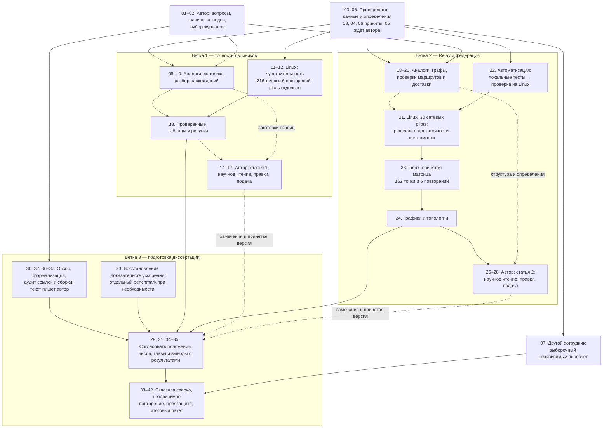

# Журнал прогресса: доказательства, две статьи и диссертация

Этот файл — единый подробный журнал выполненной и оставшейся работы. Он связывает текущий запуск на Linux с последовательным планом из 42 шагов. При следующей проверке состояния обновляются сводка, подтверждения и чекбоксы; законченные записи не заменяются предположениями.

## Условие продолжения цели

**После запуска расчёта дольше 5 минут:** проверить живой процесс, сохранить прогресс и команды, приостановить цель и закончить работу агента до следующего обращения. Сам расчёт на Linux не останавливать. Автоматические циклы ожидания и проверки не запускать. Сообщение «статус» означает одну проверку, «продолжаем» — возобновление работы. Правило включено пользователем в саму цель и сохранено в `goal-constraints.json` и `docs/dissertation/agent-work-policy.md`. Пользователь возобновил работу. Подготовлена отдельная проверка чувствительности; после подтверждения её фонового старта агент снова останавливается до ручного продолжения.

## Ответственность за статьи

**Статьи пишет человек.** Агент делает замеры, дорабатывает и проверяет код, анализирует данные, предлагает улучшения и макет: структуру, таблицы, рисунки и диаграммы. Технический отчёт не закрывает шаги написания и утверждения рукописи. Научная новизна, причинные выводы, личный вклад и подача остаются за автором/соавторами.

## Как читать отметки

- `[x]` — результат получен и указан способ его проверки.
- `[ ]` — работа не принята: не начата, выполняется, подготовлен только черновик либо ожидается независимая проверка.
- «Выполнено технически» означает проверку программы и её результата. Это не заменяет научную оценку автора, руководителя или независимого сотрудника.
- Процент по плану считается по трудоёмкости законченных шагов. Количество архивов, человеко-дни, календарное время и точность модели — разные показатели.

## Сводка

Последний снимок текущего Linux-расчёта: **2026-10-24 02:13:01 МСК**. Проверен scheduler v2: четыре живых дочерних процесса, служба PID 49274. Состояние и диагностика сохранены в `sensitivity-next-steps-observation.json`; старые снимки остаются историческими. Итог первичного аудита ниже относится к его отдельному завершённому запуску. Это последнее наблюдение, а не непрерывная телеметрия.

| Блок | Прогресс | Основание |
| --- | --- | --- |
| Локальная подготовка доказательств, шаги 03–06 | `████████░░` **80%** | Технически приняты шаги 03, 04, 06: 4,0 из 5,0 плановых чел.-дней; шаг 05 ожидает научного согласования |
| Две статьи и диссертация, шаги 01–42 | `██░░░░░░░░` **16,0%** | 7,5 из 47,0 плановых чел.-дней: приняты технические шаги 03, 04, 06, 11, 19, 20; научное принятие выводов учитывается отдельно |
| Текущая серия чувствительности, включая pilots и повторы | `██░░░░░░░░` **24,3%** | Завершено 56/230 по снимку 02:13 МСК: 8 pilots + 48 основных + 0 повторов; 17 результатов с failed критерием включены в завершённые, технических ошибок 0 |
| Основная матрица чувствительности | `██░░░░░░░░` **22,2%** | 48/216; оставшиеся 168 основных точек и 6 повторов продолжают считаться на Linux |
| Текущий пересчёт архивов на Linux | **592/592 — 100%** | Число обработанных архивов, включая невыбранные и неуспешные попытки |
| Выбранные успешные натурные результаты | **✅ 576/576 / ❌ 0** | Подтверждены пересчитанные показатели; это не число точных двойников |
| Технические ошибки аудита | **0** | Исключения чтения, проверки или пересчёта |
| Публикация изменений | **Предыдущая версия отправлена** | Мета-репозиторий и три подмодуля ранее опубликованы; текущее продолжение зафиксировано локально, push в этом сеансе не выполнялся |

Резерв 9,5 чел.-дня не входит в знаменатель готовности 47,0. Фактически затраченное время человека здесь не измеряется. Исходные эксперименты уже существовали до нового плана; повторно засчитывать их как закрытые новые шаги нельзя.

Проценты в этой сводке обновляются при каждой подтверждённой проверке: счётчики серии — по новому снимку, локальная и глобальная готовность — по принятым шагам и их весам. Неизменный общий процент при растущем числе запусков означает незавершённый шаг, а не потерю результата. Последняя сверка готовности: **80% локально / 16,0% глобально**, завершённая часть текущей серии **24,3%**.

## Обновлённая Goal

По запросу пользователя подготовлена [новая формулировка цели](Goal.md): принятые вопросы двух статей, следующие технические этапы, параллельная подготовка, человеческая приёмка и обязательная остановка агента на время долгого расчёта. Пользователь обновил цель через приложенный файл; агент прочитал новую формулировку, и `get_goal` подтвердил **active**. Работа продолжается по новой цели; незавершённые этапы не помечены выполненными.

## Граф параллельной работы

Схема показывает зависимости результатов, а не обязательный порядок работы одного исполнителя. Ветви можно вести одновременно. Стрелка означает: для завершения следующего блока нужен результат предыдущего. Пунктир разрешает подготовку до получения окончательных данных. Номера соответствуют шагам общего плана; объединённый блок не означает, что все его шаги уже выполнены.

Набор узлов охватывает все 42 шага. Подача статей и их принятие редакцией — разные события: схема не обещает срок внешнего рецензирования. Черновики глав и рукописей можно готовить заранее; окончательные числа и выводы включаются после проверок. Техническое завершение эксперимента также не закрывает научное согласование.

| Параллельная линия | Что можно делать сейчас | Что ограничивает завершение | Исполнитель |
| --- | --- | --- | --- |
| Чувствительность, 11–12 | Выполнять независимые конфиги в ограниченном пуле; проверять каждый результат сразу | Память, таймауты, целостность входов и полное покрытие | Linux и оркестратор |
| Анализ точности, 10/13 | Разбирать уже готовые точки, готовить код графиков и попарные сравнения вариантов | Окончательные выводы ждут всей согласованной серии; неполные точки видны явно | Агент; выводы принимает автор |
| Сетевая методика, 18–22 | Проверять runner, формулы, конфиги и диаграммы локально | Linux-preflight и решение по результатам pilots | Агент; программу принимает автор |
| Сетевые расчёты, 21/23 | Начать pilots после проверки ресурсов и неизменности входов | Основная матрица ждёт решения по pilots; её стоимость пока неизвестна | Linux и оркестратор |
| Ускорение, 33 | Искать сохранённые замеры и проверять сопоставимость версий | Новые замеры скорости требуют свободной или контролируемой среды | Агент; границы утверждения принимает автор |
| Подготовка текста, 01–02/08–09/18/30/32/36–37 | Готовить определения, макеты, проверку библиографии и сборки | Новизна, выбор журнала и текст рукописи остаются за человеком | Агент готовит материалы; автор пишет |
| Независимая проверка, 07/15/26/39 | Передать готовый пакет и инструкции другому сотруднику | Нужен другой человек; проверка самим агентом её не заменяет | Независимый проверяющий |

**Правила совмещения расчётов.** Независимые симуляции с собственными каталогами допускают общий пул процессов. Предел ускоренного планировщика — четыре; фактический запуск четырёх процессов подтверждён в ночном снимке ниже. Пул заполняет освободившийся слот сразу; новые процессы допускаются только при запасе RAM и места на hd250. Сетевые модели потенциально тяжелее: их нельзя автоматически добавить четырьмя процессами поверх четырёх чувствительных моделей. Для них нужен общий бюджет памяти и отдельный пилот. Натурные сравнения брокеров и benchmark ускорения не совмещаются с неконтролируемой соседней нагрузкой: она может изменить измеряемый результат.

**Обработка отказов.** После каждого завершения проверяются код выхода, наличие и целостность научных артефактов, полнота результата и соответствие замороженным входам. Failed критерия точности сохраняется и не требует перезапуска. Технический отказ запрещает новые задания соответствующей очереди до разбора; уже принятые результаты не пересчитываются. Повтор получает новый номер попытки, причина и частичные файлы сохраняются. Heartbeat, RSS и приближение к таймауту позволяют заметить риск раньше, но сами по себе не доказывают зависание.

- [x] Составлены зависимости и параллельные линии для всех 42 шагов без увеличения процента готовности.
- [x] Разделены агентская подготовка, вычисления и человеческая научная приёмка.
- [x] Подтверждён ускоренный пул на Linux: четыре живых процесса; все 56 готовых результатов проверены и сохранены.
- [ ] Уточнить время по первым завершениям при четырёх процессах; старый ETA для парного планировщика к v2 не применять.
- [ ] Подтвердить безопасный бюджет для одновременного сетевого пилота; до этого второй тяжёлый пул не запускать.

## Подготовка решений автора без новых измерений

По дополнительному запросу разрешена подготовительная часть человеческих задач: проверка метода, варианты утверждений с доказательствами, анализ истории контрольных данных, таблицы, рисунки и требования к публикационному пакету. Автор продолжает писать статьи и принимать научные решения.

- [x] Составлен [пакет решений автора](../../docs/dissertation/author-decisions.md): рабочие вопросы двух статей, история использования контрольных данных и ограничения по площадкам.
- [x] Автор принял рабочие вопросы обеих статей; выбор площадок оставил за собой. Историю контроля поручил проверить; формулировки и распределение ответственности обновлены.
- [x] Выполнен ограниченный локальный [аудит истории модели и контроля](../audits/dissertation/control-history-v1/Review.md): у четырёх профилей совпадает SHA калибровочных observations; выбранные контрольные измерения начались после даты commit runtime. Сохранены источники и хэши.
- [x] Прочитаны 864 исторических manifest из четырёх архивов: полные SHA архивов, ссылки на профили, config/manifest SHA, runId и 288 контрольных observations согласованы. [Разбор](../audits/dissertation/control-history-v1/Manifest-review.md), восемь тестов проверяющего скрипта прошли.
- [ ] Установить бинарную идентичность по журналам развёртывания: ни один из 864 manifests не содержит бинарный SHA. Заявленный source commit подтверждён, исполнение конкретной сборки этим не доказано. Отдельно остаётся история использования прежних контролей.
- [ ] Согласовать новизну, границы утверждений и методику с автором/руководителем. Рабочие вопросы не закрывают автоматически шаги 01/05/09; шаг 02 выполняет сам автор.

Новых запусков Linux в этой подготовке нет. Последние вычислительные проценты в «Сводке» остаются привязанными к снимку 02:02 МСК: **24,3% серии / 22,2% матрицы**. Готовность **80% локально / 16,0% глобально** не меняется, пока не выполнен и не принят целый шаг.

## Ночное ускорение: подтверждённый запуск

Наблюдение **2026-10-24 02:02:00 МСК**: служба `mqtty-sensitivity-v1.service` работает с новым scheduler v2, PID **49274**. Сохранено прежнее имя службы, поэтому существующий пользовательский монитор продолжает показывать её состояние. Подтверждены четыре живых .NET-процесса. Профили, конфиги, runtime, критерии и SHA научного плана не менялись.

| Этап | Завершено / план | Failed критериев | Технических ошибок |
| --- | ---: | ---: | ---: |
| Pilots | 8/8 | 4 | 0 |
| Основная матрица | 48/216 | 13 | 0 |
| Повторения | 0/6 | 0 | 0 |
| Всего | 56/230 | 17 | 0 |

«Завершено» включает результаты с failed критерием. При переключении прерваны две незавершённые попытки Aedes / QoS 2 / N=128 / seed 43: baseline и halfTick, примерно по 405 с. Их журналы и явная причина `operationalHandoffInterrupted` сохранены. Только эти точки выполняются новой попыткой; все 48 основных результатов и 8 pilots проверены по фактическим файлам и повторно не запускаются. Это две операционные остановки, они не скрыты за нулём технических ошибок законченных научных запусков.

- [x] Убрано ожидание конца пары: освободившийся слот сразу получает следующее задание.
- [x] Четыре активных модели: Aedes / QoS 2 / N=128, seed 43 во всех трёх вариантах и seed 44 baseline. RSS каждого около 0,68–0,79 ГиБ на снимке.
- [x] Общий лимит службы 8 ГиБ, swap запрещён; резерв допуска 2 ГиБ RAM, оценка на слот 2 ГиБ; свободное место проверяется перед запуском и во время работы. hd250: около 149,1 ГиБ свободно, reserve 5 ГиБ.
- [x] 13/13 тестов scheduler прошли на Linux, включая настоящие flock и завершение группы процессов. На Windows: 89 тестов инструментов диссертации, 87 прошли / 2 Linux-only пропущены; ещё 16/16 тестов диагностики.
- [x] Проверочный .NET-запуск вне научной матрицы дал точное совпадение с замороженным original summary. Целостность всех 56 прежних результатов проверена перед миграцией.
- [x] Подготовлена диагностика heartbeat/PID, таймаута, RSS и диска; она отличает failed критерии от падения. Пользовательский монитор не переписывался; новый helper делает однократную проверку, а не запускает ещё один постоянный SSH-опрос.
- [x] Параллельно подготовлен разбор 48 основных точек: 9 failed deliveryLossRate при Aedes / QoS 1 / N=128 и 4 failed RPS при QoS 2 / N=1. Это не доказательство причины расхождения. Частичные данные не обобщаются на остальные брокеры.
- [ ] Получить полное покрытие 216 + 6 и научно оценить чувствительность. Пороги и профиль по результатам не подгонять.
- [ ] Сетевой pilot пока не запущен: сначала определить его бюджет в общей памяти; второй бесконтрольный пул не добавлять.

Возобновляемость проверена тестами: готовые строки не повторяются, несовместимые входы и повреждённые артефакты отклоняются. При технической ошибке новые задания перестают поступать; уже активные завершаются под guards. Автоматического исправления причины или бесконечных retries нет. У v2 появилась мягкая остановка: создать файл `scheduler-v2/stop-after-active` в корне серии; текущие задания закончатся, новые не начнутся. Для дальнейшего запуска убрать marker после проверки причины и выполнить сохранённую команду. После технического отказа ручное расследование обязательно; режим автоматического retry намеренно отсутствует.

Команды запуска и исходное состояние: [handoff](sensitivity-scheduler-v2-handoff.json). Проверка после старта: [health snapshot](sensitivity-scheduler-v2-health.json). Анализ и ограничения: [Sensitivity-review](../audits/dissertation/overnight-optimization-v1/Sensitivity-review.md), [Health-review](../audits/dissertation/overnight-optimization-v1/Health-review.md). Проверочный запуск: [Linux smoke](../audits/dissertation/overnight-optimization-v1/linux-smoke.json). Исходники scheduler зафиксированы commit `a55094c`; полный snapshot кода хранится на hd250 в `dissertation-sensitivity-v1/scheduler-v2/code/`.

Следующее ручное обращение разумно утром, около **09:00 МСК**: проверить свежесть монитора, технические причины остановки, покрытие и результаты. Это время проверки, а не обещание окончания. Прежний линейный прогноз монитора смешивает стоимость pilots и разных нагрузок; первые завершения в новом пуле нужны для достоверного ETA. Активное ожидание агента прекращается; Linux продолжает считать. Готовность остаётся **80% локально / 16,0% глобально**: смена планировщика не закрывает шаг 12.

## Очистка устаревших измерений

По запросу пользователя удалены 294 ZIP-архива из `two-machine-20261014-1340-linux-local/evidence/attempts`. Это исходная устаревшая кампания; её архивы не входят в окончательный реестр из 592 архивов. Освобождено **16,5 ГиБ**, свободно **149,1 ГиБ**. Каталог `mqtty-evidence` после очистки занимает примерно 30,1 ГиБ; остальные данные диска в эту оценку не входят.

- [x] Проверены mount hd250, абсолютная граница удаления, отсутствие символьных ссылок и переходов на другой диск.
- [x] Не найдено работающих процессов, использующих каталог старой кампании; текущая серия не ссылается на удаляемые ZIP.
- [x] До удаления сохранён перечень 294 файлов с размерами и метаданными; каждый файл удалён по проверенному пути.
- [x] Сохранены все 592 итоговых натурных архива, 7 архивов модельных данных, компактная серия сравнения, профили и текущий runtime.
- [x] После удаления совпали device/inode/размер/mtime всех 599 защищённых архивов; SHA плана текущей серии остался прежним. Полные SHA архивов при этой очистке заново не вычислялись.
- [x] Сохранены отчёты, конфигурации, журналы и остальные файлы старой кампании. Новых опытов для освобождения места не запускалось.

**Ограничение:** удалённые первичные измерения старой кампании больше нельзя пересчитать с этого диска. Сохранённые исторические сводки не заменяют raw. Доказательная база итоговых отчётов и аудита диссертации сохранена.

Журнал: [evidence-cleanup.json](evidence-cleanup.json). Полная копия также находится на hd250 в `cleanup/obsolete-native-20261023T194449Z/receipt.json`. На момент очистки проценты оставались **80% локально / 10,6% глобально**: очистка диска не закрывает исследовательские шаги. В следующем продолжении технически закрыты шаги 19–20; текущий итог — в сводке выше.

## Проверка чувствительности: запущена в фоне

| Показатель | Последнее наблюдение |
| --- | --- |
| Основная матрица | ✅ 48/216 / ❌13 запусков с failed критерием; технических ошибок всего 0 |
| Повторения | ✅ 0/6 / ❌0 запусков с failed критерием; технических ошибок всего 0 |
| Pilots | ✅ 8/8 / ❌4 запусков с failed критерием; технических ошибок всего 0 |
| Варианты | Опорный tick 10 мкс / окно 2 с; tick 5 мкс / окно 2 с; tick 10 мкс / окно 4 с |
| Данные и код | Профили/observations/runtime скопированы без изменения SHA; прежние исходники чистые |
| Проверки | 42 теста инструментов диссертации прошли, включая 6 тестов новой кампании |
| Полный каталог | `/run/media/entityfx/hd250/mqtty-evidence/dissertation-sensitivity-v1` |
| Служба | `mqtty-sensitivity-v1.service`, `active/running`, PID 49274; лимит 8 ГиБ, scheduler v2, параллелизм 4 |
| Прогноз остатка | Старый прогноз для парного планировщика устарел; нужен замер скорости пула из четырёх процессов |

- [x] Программа и конфиги зафиксированы до запуска pilots.
- [x] Во всех 72 исходных точках проверены SHA исходного конфига и профиля.
- [x] При halved tick сохраняются физические длительности всех интервалов в тиках.
- [x] CLI failed criterion (код 3) отделён от технического отказа.
- [x] Подтверждены активная служба PID 40598 и запущенные .NET-процессы pilots; stdout/stderr и progress сохранены.
- [x] Получены wall time и peak RSS всех восьми pilots; прогноз записан, совпадение опорных summaries подтверждено.
- [ ] Выполнить 216 + 6 и проверить выводы; текущие проценты готовности пока не увеличивать.
- [x] Старт подтверждён, состояние сохранено; текущее продолжение агента завершается паузой по условию пользователя. Сам Linux-pipeline продолжает работать.

### Исторический снимок и прогноз до ускорения

- Последнее наблюдение: **2026-10-23 23:05:09 МСК**. Служба active/running, PID 40598; все 8 pilots завершены, технических ошибок нет.
- Pilots подтвердили прежние scientific summaries. Четыре failed критерия распределены так: Aedes 1, Mosquitto 0, ActiveMQ 1, EMQX 2. Это сохранённые расхождения точности исходной кампании, а не технические отказы воспроизведения.
- Основная матрица: **15/216 (6,9%)**, failed критериев 0. Активен Aedes / QoS 0 / 128 publishers / seed 43 / doubleWindow; на снимке около 1031 с работы. Повторения: 0/6. Технических ошибок всего 0. Матрицы Mosquitto, ActiveMQ и EMQX ещё не начались; их pilots завершены.
- Стоимость pilots: около 20–22 с при одном publisher и 698–719 с при 128. Профили, пороги и runtime не изменены.
- Уточнённый остаток по фактическим отношениям вариантов и максимуму каждой пары: **20,3 ч** центрально, сценарии **16,2–26,5 ч**, включая 6 повторов. Ориентир окончания — **24 октября 19:25 МСК**; сценарный диапазон — 24 октября 15:20 — 25 октября 01:36 МСК. Это не доверительный интервал: часть QoS/брокеров ещё экстраполируется. Прежние 11–22 ч относились ко всей матрице от старта и сохранены в старых снимках.
- Следующая рекомендуемая ручная проверка — **24 октября в 09:00 МСК**. Linux-службу для проверки не перезапускать.
- На снимке память службы около 0,78 ГиБ; hd250 свободно **149,1 ГиБ**, системный диск **59,9 ГиБ**. В 23:10 МСК таймер службы расширен с 24 до 36 часов без restart: новый технический предел **25 октября 09:04 МСК**. CPUWeight, MemoryMax=8 ГиБ, swap=0, лимит 30 минут/3 ГиБ на модель, профили, runtime и SHA плана не изменены. Технический отказ останавливает pipeline с сохранением причины.
- Шаг 11 принят технически: программа зафиксирована, pilots завершены, фактическая стоимость сохранена в `reports/audits/dissertation/sensitivity-v1/pilot-timing.json`. После шага 11 глобальная оценка была 10,6%; теперь после технического закрытия 19–20 — 16,0%. Локальный блок 03–06 остаётся 80% из-за открытого научного согласования 05.
- Выполнен один снимок прогресса и затем проверено изменение таймера службы. Фоновая серия продолжает работу; новая сетевая симуляция на Linux не запущена.

### Контрольный снимок перед паузой

- Наблюдение: **2026-10-23 21:04:39 МСК**; полный снимок — `reports/status/sensitivity-v1-observation.json`.
- Выполняются pilots Aedes, исходные профили и runtime не изменены. Начальная матрица ещё не завершена.
- Свободно на hd250: **132.6 ГиБ**. Журналы и выходы находятся на этом диске, в Git первичные архивы не добавляются.
- Код и программа опубликованы до запуска: `d22410f`; SHA плана `dfda8401e9e3f96aebece1b4baa116b58437c94752ecc0324b6e8c909243ae3c`.
- Pipeline последовательно выполняет pilots → matrix → replay. Failed критерий сохраняется как результат; технический отказ останавливает новые запуски с причиной в progress/rows/logs.
- После восьми pilots задача автоматически продолжает матрицу при успешной технической проверке. Участие агента для ожидания не требуется.
- Проверка вручную: `systemctl --user show mqtty-sensitivity-v1.service -p ActiveState,SubState,MainPID,Result` и чтение `progress.json` в каталоге серии.
- Завершение подтверждать по состоянию службы, `status=completed`, полному покрытию 216 + 6, отдельным 8 pilots и наличию `results.json`.
- Следующее действие агента — только после ручного обращения. Сообщение «статус» вызывает одну проверку, «продолжаем» разрешает дальнейшую работу.

## Остаток Linux и следующие типы запусков

Подробная очередь, расчёт по брокерам и время окончания: [Linux-work-queue.md](Linux-work-queue.md). Прогноз воспроизводится скриптом `tools/dissertation/estimate_sensitivity.py`; три теста проверяют учёт барьера пар и активной задачи. [Входной снимок](sensitivity-v1-timing-observation.json), [расчёт ETA](sensitivity-v1-time-estimate.json) и [изменение operational timer](sensitivity-runtime-limit-amendment.json) сохранены отдельно.

| Работа | Осталось / предложено | Состояние |
| --- | ---: | --- |
| BrokerFidelity sensitivity | 168 основных + 6 повторов | Выполняется; ещё 8/8 pilots завершены отдельно |
| Независимый сотрудник | 24 архива для пересчёта | Задание готово; это не новые MQTT-измерения и не автоматическая приёмка агентом |
| Более длинные сетевые pilots | 30 | Конфиги готовы, на Linux не запущены |
| Идеальная сеть single/Relay/federation | Кандидат 162 + 6 повторов | После pilots, оценки достаточности фаз/стоимости и готовности runner |
| Mosquitto в сети | Необязательные 54 | Отдельная диагностика; дополнительные соединения за пределами калибровки |
| Проверка ускорения MqttY | Количество пока не определено | Сначала восстановить прежние доказательства, затем при необходимости отдельный benchmark (33) |

Повторять весь набор 576 натурных измерений сейчас не требуется: его первичные события уже пересчитаны. Для другого оборудования, обратной двухмашинной схемы или отсутствующего N=160 потребуется отдельная программа; такие опыты не скрыты в данном прогнозе.

### Подготовка сетевого продолжения: шаги 21–22

- [x] Сформирована отдельная программа: четыре площадки, 64 publishers, все три режима, line/ring/star, QoS 0/1/2, 1000/5000 исходных сообщений в секунду.
- [x] Генератор создаёт 30 pilot, 162 основных, 6 повторных и 54 необязательных профилированных JSON; прежние результаты не перезаписываются.
- [x] Проверены переносимые пути профиля, одинаковые физические условия/полезная задача, ID повторов, бюджеты кэша и пар доставки: 4 теста.
- [x] Все **252/252** конфигурации приняты текущим CLI на Windows; **выполненных симуляций основной научной программы 0**. Отдельные локальные тесты оркестратора описаны ниже.
- [x] Полный набор инструментов диссертации: **54/54 теста**. Проверены 1116 локальных ссылок; 265 защищённых файлов диссертации и 1131 исходный научный файл не изменены.
- [x] Реализован runner: snapshot runtime/профилей/кода, раздельные этапы, mount/free-space guard, лимиты времени/RSS/диска, блокировки, проверяемый resume, сохранение отказов и пересчёт первичных журналов.
- [x] Пройдены **68/68** тестов инструментов, включая **14** новых тестов оркестратора. Окончательная проверка на настоящем локальном MqttY CLI — **15/15** симуляций, три точных повтора; resume без лишних попыток.
- [ ] Выполнить Linux-preflight реального mount/cgroup и проверить изоляцию; в этом локальном блоке Linux не опрашивался.
- [ ] После текущей чувствительности выполнить pilots и замерить фактические wall/RSS/диск; до этого время будущей сетевой матрицы не обещается.
- [ ] По pilots принять фазы, зафиксировать программу и выполнить новую матрицу. Не смешивать её с прежним коротким тестом.

Материалы: [описание программы](../../docs/dissertation/network-study.md), [план и конфиги](../audits/dissertation/network-study-v1/plan.json), [CLI validation](../audits/dissertation/network-study-v1/configuration-validation.json). Шаги 21–22 остаются частично подготовленными; общий процент **16,0%**, локальный **80%**. Длительных новых процессов в этом продолжении не запускалось.

## Итог завершённого первичного аудита на Linux

Завершён независимый пересчёт первичных событий существующей натурной кампании. Новые брокеры и MQTT-нагрузка этим процессом не запускаются. Скрипт прочитал архивы без распаковки на системный диск, сверил seals и идентичности, пересчитал попытки, исходы, уникальные доставки, RPS и квантили задержек.

| Параметр | Фактическое значение |
| --- | --- |
| Пользовательская служба | `mqtty-native-audit-v1.service` (`systemctl --user`) |
| Состояние | `completed`; служба `inactive / dead`, `Result=success`, код выхода 0 |
| PID завершившегося процесса | `8920`; текущий `MainPID=0` |
| Число workers | 2 |
| Лимит адресного пространства worker | 2048 МиБ |
| Время пересчёта на снимке | 51,0 мин |
| Каталог результатов | `/run/media/entityfx/hd250/mqtty-evidence/dissertation-foundation-v1/full` |
| Итоговый файл после окончания | `audit-results.json` |
| Промежуточный счётчик | `progress.json` |
| Частичные результаты | `rows/*.attempt-*.json` |

Состояние `Result=success` у ещё работающей службы не означает, что весь аудит завершился. Для завершения нужны согласованные признаки: `progress.status=completed`, итоговый файл, полное покрытие и отсутствие технических ошибок/расхождений.

### Покрытие по брокерам

| Брокер | Подтверждённые выбранные измерения | Расхождения | Ошибки чтения/пересчёта | Другие архивы |
| --- | --- | ---: | ---: | ---: |
| Aedes | ✅ 144/144 / ❌0 | 0 | 0 | 4 |
| Mosquitto | ✅ 144/144 / ❌0 | 0 | 0 | 4 |
| ActiveMQ | ✅ 144/144 / ❌0 | 0 | 0 | 3 |
| EMQX | ✅ 144/144 / ❌0 | 0 | 0 | 5 |

Каждые 144 выбранных измерения — 72 калибровочных и 72 независимых натурных. Дополнительно сохранены 16 архивов: 12 успешных попыток вне выбранного набора и 4 неуспешные попытки. Эти четыре неуспешные натурные попытки не являются ошибками текущего пересчёта. Все 12 невыбранных успешных архивов относятся к pilots. Причины четырёх отказов приведены ниже; в выбранные 576 измерений они не включены.

### Время и состояние ресурсов

- Аудит завершился за **50.95 минуты**. Остаток машинного времени этого пересчёта — **0**.
- `MainPID=0`, `inactive/dead`, `Result=success`, код выхода 0 согласуются с `progress.status=completed`. Это штатное завершение.
- Обработаны 592/592 архивов, все 576/576 выбранных натурных результатов подтверждены; ошибок пересчёта и расхождений нет.
- Полный `audit-results.json` получен с Linux: 6577019 байт. SHA-256 совпал: `8af5751b2abe4f3c2983efc8eb1e45cda3cf89166cc14b4de7ce29adae9f28c3`.
- Системный диск Linux: свободно **59.9 ГиБ**; hd250: **132.7 ГиБ**. На Linux исходные архивы и полная сводка остаются на hd250; в Git сохраняется компактное заключение.
- Свежий снимок счётчиков содержит завершённое состояние. Первоначальный `linux-native-audit-observation.json` сохранён как исторический снимок работающего процесса.
- Реестр пригодных входов и ограничений (06) принят технически и повторно проверен на Linux. Следующая приёмка — научное согласование контракта метрик (05) и выборочная проверка другим сотрудником (07). Новый длительный расчёт этой проверкой статуса не запущен.

### Причины четырёх сохранённых отказов и ограничения

| Брокер | Попытки | Причина отклонения |
| --- | ---: | --- |
| Aedes | 1 | Телеметрия не покрывает границу завершения удалённой нагрузки |
| Mosquitto | 1 | Телеметрия не покрывает границу завершения удалённой нагрузки |
| EMQX | 2 | Исполняемый файл MQTT-listener не совпал с закреплённой идентичностью |

Для двух отклонённых EMQX-попыток нет журналов публикаций/доставок: проверены доступные записи отказа и целостность архива, но отсутствующие события не восстановлены. По журналам принятых измерений нельзя перепроверить произвольные байты payload сверх ID и размера. Точная граница measurement/drain у получателя известна как интервал; это ограничение сохранено. Совпадение пересчёта не доказывает точность двойников.

### Чекбоксы завершённого пересчёта

- [x] Реализован независимый верификатор первичных событий.
- [x] Выполнены 22 теста верификатора и вспомогательных проверок.
- [x] Зафиксированы snapshot входов, хэши кода и реестр 592 архивов.
- [x] Аудит запущен отдельной пользовательской службой, независимо от SSH-сеанса.
- [x] Подтверждены mount hd250 и запас места.
- [x] Сохранены частичные результаты и прогресс; источник читается без изменений.
- [x] Подтверждены 144/144 выбранных результатов Aedes.
- [x] Подтверждены 144/144 выбранных результатов ActiveMQ.
- [x] Подтверждены 144/144 выбранных результатов EMQX.
- [x] Подтвердить 144/144 выбранных результатов Mosquitto.
- [x] Получить итоговый `audit-results.json` и `completed`.
- [x] Сверить 592/592 архивов, 576/576 выбранных результатов и все ошибки/расхождения.
- [x] Скачать компактную сводку, сверить её SHA-256 с Linux; архивы в Git не добавлять.
- [x] Разобрать 12 невыбранных успешных и 4 неуспешные попытки.
- [x] Зафиксировать ограничения первичных журналов и принять шаг 04.
- [x] Сверить словарь метрик с реализацией benchmark/model и уточнить знаменатели.
- [x] Зафиксировать пакет входов и повторить его проверку на Windows/Linux (06).
- [ ] Научно согласовать контракт метрик с автором (05).

## Проверенная основа проекта

Эти материалы уже существуют. Они подтверждают исходное состояние, но не означают готовность новых рукописей.

- [x] Сохранены 576 выбранных натурных измерений четырёх брокеров.
- [x] Сохранены 576 симуляций одиночных двойников, включая независимый контроль.
- [x] Сохранены 360 сетевых MqttRelay-симуляций основной кампании.
- [x] Созданы отчёты Aedes, Mosquitto, ActiveMQ и EMQX.
- [x] Подготовлены сравнение брокеров, EST и оценка доказательств.
- [x] Имеются короткие опыты single / relay / federation и их повторения.
- [x] Имеются опыты десяти брокеров с промежуточным сетевым узлом.
- [x] Подготовлен аудит готовности диссертации по трём репозиториям.
- [x] Подготовлен план двух статей и диссертации: 42 шага / 47,0 чел.-дня.
- [ ] Выполнить научное принятие результатов и завершить шаги нового плана.

## Публикация и организация репозиториев

| Репозиторий | Опубликованный commit | Ветка |
| --- | --- | --- |
| Мета-репозиторий | `4c67107` | `develop` |
| MqttY | `fafa37e` | `develop` |
| MqttBenchmark | `a7c3cf9` | `develop` |
| Диссертация | `c7d4e82` | `develop` |

- [x] Руководства объединены в `docs` мета-репозитория, разделены по назначению и проекту.
- [x] Отчёты распределены по разделам `reports`.
- [x] Убраны восемь устаревших/дублирующих руководств; история переноса сохранена.
- [x] README MqttY и MqttBenchmark содержат назначение, состав и быстрый запуск.
- [x] Обновлены ссылки и генераторы отчётов для новой структуры.
- [x] Проверены 1035 локальных ссылок в 94 документах с учётом этого журнала.
- [x] Проверены шесть реестров публикации, 1224 записи контрольных сумм.
- [x] Подтверждена неизменность 265 файлов диссертации вне `doc`.
- [x] Подтверждена неизменность 1131 файла научных данных.
- [x] Пройдены 47 Python-тестов: документация 4, аудит 22, федерация 7, балансировка 7, отчёты 7.
- [x] Проверены быстрые команды CLI MqttBenchmark и демо MqttY.
- [x] Изменения отправлены в удалённые ветки без ZIP/TAR и первичных архивов.
- [x] Текущий журнал прогресса и снимки состояния включены в отдельный commit публикации.

## Проверка основы исследования, шаги 05–06

- [x] Сверены попытки, исходы, доставки и их разные знаменатели.
- [x] Уточнены фиксированное модельное и фактическое натурное окна, drain и notApplicable.
- [x] Сверены строгий EST и адаптация QoS 0, проверены примеры с известным ответом.
- [x] Создан пакет foundation-v2: 1095 входов и исходников, четыре неизменённых профиля.
- [x] Проверка пакета повторена на Windows и Linux по тем же хэшам.
- [x] Проверены семь внешних архивов публикации; CPU/RSS пересчитаны для 576 наборов (1152 проверки).
- [x] Сопоставлены сохранённые исходные и повторные файлы шести модельных опытов.
- [x] Пройдены 33 теста инструментов диссертации, включая 11 новых проверок пакета и смысла EST.
- [x] Зафиксирован технический дефект пробной v1: неполный набор зависимостей EST. Исправлена комплектация в отдельной v2, данные и пороги не менялись; snapshot v1 сохранён вне Git.
- [ ] Получить научное согласование контракта метрик автором (05).
- [ ] Передать выборочный пересчёт другому сотруднику (07). Автоматическая проверка на двух ОС этого не заменяет.

Проверка входов и арифметики не является новым физическим экспериментом и не повышает показатели точности двойников. Расхождения 85/288 holdout остаются частью результата.

## Другие шаги во время фонового расчёта

- [x] Подготовлена техническая схема шага 09: роли MqttBenchmark / MqttY CLI / ядра / настоящего брокера, команды и sequence diagram.
- [x] Сверены источники параметров, агрегирование повторов и эмпирической CDF, условные ошибки, RTT/протокольный бюджет и разные знаменатели benchmark/model.
- [x] Подготовлена матрица «проверяемый факт → данные → допустимый вывод → что не доказано» для автора и руководителя.
- [x] Источники схемы сопоставлены с классами калибратора, MqttBroker и experiment runner.
- [ ] Автор научно принимает описание метода и формулировки утверждений. Материалы не являются написанной статьёй.
- [x] Описаны физический/логический граф Relay и федерации, расположение клиентов, нагрузка, ресурсы и формулы доставки (19).
- [x] Проверены 39 интеграционных тестов, 12 тестов Python-верификаторов, 72 сохранённых опыта и 12 точных повторов (20).
- [ ] Следующая техническая работа: программа более длинных сетевых опытов и оценка стоимости pilot (21); новые длительные расчёты в этом продолжении не запускались.

После одной проверки Linux выполнена локальная техническая работа. Входы/профили/runtime фоновой серии не менялись; новых длительных расчётов нет. Проверены формулы по первичным журналам, GraphML и размещение клиентов. В 18 группах трёх режимов совпадают физическая сеть и полезная задача. Различия числа брокеров, соединений и очередей явно записаны: FIFO федератора не приписывается Relay.

Материалы: [условия сетевого сравнения](../../docs/dissertation/network-model-contract.md), [заключение проверки](../audits/dissertation/network-model-review-v1/Review.md), [машинное подтверждение](../audits/dissertation/network-model-review-v1/verification.json). Приняты технические шаги 19–20: +2,5 плановых чел.-дня, общий прогресс **10,6% → 16,0%**. Локальные **80%** не менялись; ни один принятый шаг не снят. Эти проценты описывают разные блоки и не являются точностью моделей. Расхождения точности исходной серии остались в данных; новых ухудшений эта проверка не установила.

### Почему проценты могут выглядеть по-разному

| Показатель | Предыдущая оценка | Текущая оценка | Причина изменения |
| --- | ---: | ---: | --- |
| Подготовка доказательств, 03–06 | 80% | 80% | Научное согласование 05 остаётся открытым |
| Весь план, 01–42 | 10,6% | 16,0% | Добавлены проверенные технические шаги 19 и 20; знаменатель 47 чел.-дней прежний |
| Текущая матрица чувствительности | 13/216 | 14/216 | Новое наблюдение Linux; это счётчик запусков, а не процент всего плана |

Ни один принятый шаг не отменён. Четыре failed критерия pilots и 85/288 исходных holdout-расхождений не превращаются в новые технические отказы; качество модели оценивается отдельно от готовности работ.

## Локальное продолжение: оркестратор сети

Этот блок выполнен без обращения к Linux. Последний снимок фоновой серии выше остаётся наблюдением **23 октября, 23:05 МСК**, а не текущей телеметрией.

- [x] Созданы отдельные модули: snapshot/хранение, контроль процесса, независимая проверка нагруженной сети и управление этапами. Код MqttY не менялся.
- [x] Stage требует чистые Git-версии, копирует фиксированные входы и runtime, сохраняет SHA. При повторе сверяется полный состав снимка и загруженный код.
- [x] Pilots, матрица, повторы и необязательная диагностика запускаются раздельно; переход после pilots привязан к зафиксированному результату и записанной оценке программы.
- [x] Технический отказ останавливает очередь; явный retry сохраняет прежнюю попытку и причину. Незавершённая попытка не перезапускается, пока не проверено отсутствие живого процесса. Счётчики покрытия разделены по этапам; после retry исторический отказ не исчезает из attempts.
- [x] При потере индекса восстанавливается запись по durable receipt, без повторной симуляции. Подменённые seals/raw и неверные результаты этапа отклоняются.
- [x] Недоставка, очереди и backpressure отделены от ошибок процесса. Для нагруженного Relay введён отдельный пересчёт без необоснованного предположения полного экспорта; исторический верификатор не менялся.
- [x] Проверены **68/68 тестов**. На окончательном коде выполнены **15 локальных MqttY-симуляций**, включая **3 точных повтора**; предупреждений и технических ошибок в этих коротких случаях 0.
- [x] Сохранены три локальные проверки разных версий по 15/15, всего 45 функциональных симуляций. Окончательная версия проверена после уточнения счётчиков этапов и истории отказов. В покрытие научной программы эти тесты не входят.
- [ ] Linux-preflight, проверка настоящего mount/cgroup и 30 научных pilots ещё не выполнены. В Windows-smoke имитировался только признак mount; это ограничение записано явно.
- [ ] Достаточность фаз и динамика завершений ACK требуют дальнейшей проверки. Из коротких случаев на 6 мс не следует установившаяся производительность.

Инструкция: [network-runner.md](../../docs/dissertation/network-runner.md). Подтверждения: [обзор проверки](../audits/dissertation/network-runner-v1/Review.md), [smoke](../audits/dissertation/network-runner-v1/smoke-verification.json), [тесты и SHA](../audits/dissertation/network-runner-v1/unit-tests.json).

Работа по шагу 22 продвинулась от конфигов к протестированной реализации. Полный шаг пока не принят до Linux-preflight; **80% локально / 16,0% глобально** остаются прежними. Новых длительных процессов или Linux-замеров в этом продолжении не запускалось.

## Последовательный план: 42 шага

Полный шаг отмечается выполненным только после проверки результата приёмки. Подготовленный черновик и успешный запуск программы сами по себе не закрывают шаг. Ниже сохранены оценки и критерии исходного плана; новые научные задачи без подтверждения не отмечены.

### А. Общая подготовка — 7,0 чел.-дня

#### 01. Зафиксировать вопросы двух статей и границы защищаемых положений

- [ ] Шаг принят: **0,5 чел.-дня** по плану.
- **Состояние:** Подготовлена техническая матрица фактов и доказательств. Научные положения и новизна автором/руководителем пока не утверждены.
- **Критерий приёмки:** Краткая матрица «вопрос → имеющиеся данные → необходимая проверка → допустимый вывод», согласованная с руководителем.
- **Материал:** `docs/dissertation/claim-evidence-map.md`; появление таблицы само по себе не закрывает согласование.

#### 02. Выбрать площадку для каждой статьи, проверить тематику, объём, язык, требования к данным и отличие от уже опубликованных работ

- [ ] Шаг принят: **0,5 чел.-дня** по плану.
- **Состояние:** Не отмечен выполненным: подтверждения приёмки этого шага пока нет.
- **Критерий приёмки:** Два шаблона рукописей и перечень требований; при необходимости перевода — отдельная оценка.
- **После выполнения:** сохранить путь к результату, проверку и замечания; затем изменить чекбокс.

#### 03. Дополнить независимый проверяющий скрипт первичных событий, задержек и seals; проверить его на малых примерах с известным ответом

- [x] Шаг принят: **2,0 чел.-дня** по плану.
- **Состояние:** Выполнено технически. Верификатор принят по 22 тестам; научное принятие полного массива выделено в шаги 04 и 07.
- **Критерий приёмки:** Верификатор обнаруживает неверные ID, повторные доставки, подмену знаменателя и ошибочные квантили.
- **Подтверждение:** `tools/dissertation/native_audit.py`, `run_native_audit.py`, тесты `tools/dissertation/test_*.py`; отдельный snapshot кода в manifest Linux.

#### 04. Пересчитать доступные первичные показатели 576 успешных измерений; разобрать существенные расхождения и зарегистрированные неудачные попытки

- [x] Шаг принят: **1,5 чел.-дня** по плану.
- **Состояние:** Выполнено технически: 592/592 архивов; 576/576 выбранных измерений подтверждены, расхождений и технических ошибок 0; pilots и отказы классифицированы.
- **Критерий приёмки:** Таблица покрытия всех 592 архивов: что проверено, что не восстановить, какие результаты требуют исправления.
- **Подтверждение:** `reports/status/linux-native-audit-summary.json`; полный файл скачан, SHA-256 сверён с Linux; ограничения журналов записаны.

#### 05. Согласовать словарь метрик, временные окна и формулу EST

- [ ] Шаг принят: **1,0 чел.-дня** по плану.
- **Состояние:** Техническая сверка завершена: формулы, временные окна, EST/EST* и исходники сопоставлены; 33 теста прошли. Научное согласование автором ещё не получено.
- **Критерий приёмки:** Единые определения attempted/completed/delivered, ACK/RTT/end-to-end, drain; EST и адаптация QoS 0 различаются.
- **Подготовленный материал:** `docs/overview/measurement-contract.md`. Техническая проверка не подменяет согласование автором.

#### 06. Зафиксировать пригодные наборы данных, код, профили и правила последующих сравнений

- [x] Шаг принят: **0,5 чел.-дня** по плану.
- **Состояние:** Выполнено технически. Зафиксированы 1095 файлов, четыре профиля и раздельные идентичности; пакет повторно проверен на Windows и Linux, дополнительно сверены ресурсы и сохранённые модельные повторы.
- **Критерий приёмки:** Реестр входов с хэшами, воспроизводимые команды и перечень ограничений.
- **Подтверждение:** `reports/audits/dissertation/foundation-v2/manifest.json`, `input-registry.json`, `metrics-verification.json`, `native-coverage.csv`; протокол `foundation-v2-linux-verification.json`.

#### 07. Передать выборочный пересчёт другому сотруднику; проверить соответствие основных таблиц данным

- [ ] Шаг принят: **1,0 чел.-дня** по плану.
- **Состояние:** Подготовлены задание, 24 выбранных архива и реестр для воспроизведения; независимый сотрудник проверку ещё не выполнял.
- **Критерий приёмки:** Независимый протокол проверки и список замечаний; критические расхождения закрыты либо блокируют использование соответствующих чисел.
- **После выполнения:** сохранить путь к результату, проверку и замечания; затем изменить чекбокс.

### Б. Статья о точности двойников — 11,5 чел.-дня

#### 08. Сформулировать вопрос и сравнить метод с ближайшими работами по калибровке/валидации моделей

- [ ] Шаг принят: **1,0 чел.-дня** по плану.
- **Состояние:** Не отмечен выполненным: подтверждения приёмки этого шага пока нет.
- **Критерий приёмки:** Таблица отличий и конкретное положение статьи; новизна не сводится к наличию seed.
- **После выполнения:** сохранить путь к результату, проверку и замечания; затем изменить чекбокс.

#### 09. Описать построение профиля, Fidelity и независимый контроль

- [ ] Шаг принят: **1,5 чел.-дня** по плану.
- **Состояние:** Подготовлен технический материал: схема участников/запусков, sequence diagram, источники каждого описанного параметра, формулы и ограничения Fidelity/holdout. Ожидает научного чтения автором.
- **Критерий приёмки:** Схема потока данных, формулы, критерии, различия событий benchmark и simulator; источник каждого параметра известен.
- **Материал:** `docs/dissertation/broker-twin-method-map.md`. Полный текст статьи пишет человек.

#### 10. Разобрать провалы точности, особенно ActiveMQ; отделить ошибки измерения от ограничений модели

- [ ] Шаг принят: **2,0 чел.-дня** по плану.
- **Состояние:** Подготовлен анализ всех 288 holdout-симуляций и контекста 576 натурных запусков; графики проверены визуально. Часть причин остаётся гипотезами, научное принятие не выполнено.
- **Критерий приёмки:** Карта ошибок и доказанные причины там, где их позволяют установить журналы; остальные причины помечены как гипотезы.
- **Материал:** `reports/audits/dissertation/accuracy-analysis-v1/Accuracy-analysis.md`, полные CSV, JSON, SVG/PNG и manifest.

#### 11. Подготовить фиксированную программу проверки чувствительности к tick и длительности окна

- [x] Шаг принят: **1,0 чел.-дня** по плану.
- **Состояние:** Выполнено технически: конфиги и программа зафиксированы, 8/8 pilots завершены без технических ошибок, прежние опорные summaries совпали; wall time и peak RSS сохранены.
- **Критерий приёмки:** Конфиги, ожидаемое покрытие, критерии и замер стоимости пилотной точки.
- **Материалы:** `docs/dissertation/sensitivity-study.md`, `reports/audits/dissertation/sensitivity-v1/plan.json`; исходные результаты/профили не менялись.

#### 12. Выполнить выбранные симуляции и повторения, проверить результаты

- [ ] Шаг принят: **1,5 чел.-дня** по плану.
- **Состояние:** Pipeline запущен на Linux отдельной службой; проходят первые pilots. Полное покрытие 216 + 6 и сравнение результатов пока не получены.
- **Критерий приёмки:** Полное покрытие утверждённой программы, таблица влияния параметров, подтверждение повторяемости выбранных точек.
- **После выполнения:** сохранить путь к результату, проверку и замечания; затем изменить чекбокс.

#### 13. Подготовить таблицы точности, карты ошибок, интервалы и схему методики

- [ ] Шаг принят: **1,0 чел.-дня** по плану.
- **Состояние:** Не отмечен выполненным: подтверждения приёмки этого шага пока нет.
- **Критерий приёмки:** Рисунки и таблицы строятся из сохранённых данных; прошедшие и проваленные точки видны.
- **После выполнения:** сохранить путь к результату, проверку и замечания; затем изменить чекбокс.

#### 14. Написать рукопись: задача, метод, эксперимент, результаты, ограничения, выводы

- [ ] Шаг принят: **2,0 чел.-дня** по плану.
- **Состояние:** Не отмечен выполненным: подтверждения приёмки этого шага пока нет.
- **Критерий приёмки:** Полный текст с источниками и приложением для воспроизведения.
- **После выполнения:** сохранить путь к результату, проверку и замечания; затем изменить чекбокс.

#### 15. Провести независимое научное чтение

- [ ] Шаг принят: **0,5 чел.-дня** по плану.
- **Состояние:** Не отмечен выполненным: подтверждения приёмки этого шага пока нет.
- **Критерий приёмки:** Замечания к корректности выводов, новизне и достаточности доказательств.
- **После выполнения:** сохранить путь к результату, проверку и замечания; затем изменить чекбокс.

#### 16. Исправить замечания, привести текст и рисунки к требованиям выбранной площадки

- [ ] Шаг принят: **0,5 чел.-дня** по плану.
- **Состояние:** Не отмечен выполненным: подтверждения приёмки этого шага пока нет.
- **Критерий приёмки:** Проверенный пакет рукописи; нет утверждения о точности всей сетки при наличии провалов.
- **После выполнения:** сохранить путь к результату, проверку и замечания; затем изменить чекбокс.

#### 17. Подготовить сопроводительные материалы и выполнить подачу после согласования соавторами

- [ ] Шаг принят: **0,5 чел.-дня** по плану.
- **Состояние:** Не отмечен выполненным: подтверждения приёмки этого шага пока нет.
- **Критерий приёмки:** Поданная версия и сохранённый пакет подачи; при отсутствии согласования — готовый пакет с явно отмеченным ожиданием.
- **После выполнения:** сохранить путь к результату, проверку и замечания; затем изменить чекбокс.

### В. Статья о MqttRelay и федерации — 12,0 чел.-дня

#### 18. Сформулировать вопрос и сравнить Relay с bridges и федераторами

- [ ] Шаг принят: **1,0 чел.-дня** по плану.
- **Состояние:** Не отмечен выполненным: подтверждения приёмки этого шага пока нет.
- **Критерий приёмки:** Таблица отличий и границы новизны; самоорганизация не приписана статической реализации.
- **После выполнения:** сохранить путь к результату, проверку и замечания; затем изменить чекбокс.

#### 19. Согласовать формальные графы, расположение клиентов, нагрузку и ресурсы сравниваемых режимов

- [x] Шаг принят технически: **1,5 чел.-дня** по плану.
- **Состояние:** Технические условия зафиксированы и сверены: 18 групп с общей физической сетью/задачей; различия брокеров, соединений, очередей и параллелизма явно учтены.
- **Критерий приёмки:** Одинаковая физическая сеть и полезная задача внутри сравнения; различия соединений/параллелизма явно учтены.
- **Подтверждение:** `docs/dissertation/network-model-contract.md`, `reports/audits/dissertation/network-model-review-v1/verification.json`. Более длинные эксперименты остаются отдельными шагами 21–24.

#### 20. Проверить маршруты, подавление повторов, учёт очередей и пар доставки

- [x] Шаг принят технически: **1,0 чел.-дня** по плану.
- **Состояние:** Выполнено технически: 39 интеграционных тестов и 12 тестов Python, пересчёт 72 первичных сетевых опытов, 12 побайтно совпавших повторов summary; научные и натурные ограничения сохранены.
- **Критерий приёмки:** Тесты линии/цикла/транзита и независимые проверки формул; идеальная модель доставляет ожидаемые ID.
- **Подтверждение:** `docs/dissertation/network-model-contract.md`, `reports/audits/dissertation/network-model-review-v1/verification.json`. Более длинные эксперименты остаются отдельными шагами 21–24.

#### 21. Подготовить программу более длинных опытов и выполнить пилот

- [ ] Шаг принят: **1,0 чел.-дня** по плану.
- **Состояние:** Программа и 252 CLI-валидных конфигурации подготовлены; 30 Linux-pilots, оценка достаточности фаз и фактической стоимости ещё не выполнены.
- **Критерий приёмки:** Длины фаз и уровни нагрузки выбраны по достаточности наблюдений и стоимости расчёта; программа зафиксирована.
- **Материалы:** `docs/dissertation/network-study.md`, `reports/audits/dissertation/network-study-v1/plan.json`; техническая подготовка не засчитывается как выполненная серия.

#### 22. Автоматизировать согласованную матрицу, выгрузку топологий и проверку результатов

- [ ] Шаг принят: **1,5 чел.-дня** по плану.
- **Состояние:** Runner реализован и проверен локально: 68 тестов, окончательные 15 реальных CLI-симуляций и три точных повтора. Snapshot, resume, guards, сохранение отказов и пересчёт raw работают. Linux-preflight реального mount/cgroup ещё впереди; шаг целиком не принят.
- **Критерий приёмки:** Команда воспроизведения, конфиги и контроль полного покрытия; результаты не перезаписываются.
- **Материалы:** `docs/dissertation/network-study.md`, `reports/audits/dissertation/network-study-v1/plan.json`; техническая подготовка не засчитывается как выполненная серия.

#### 23. Выполнить матрицу и выбранные повторения, проверить первичные модельные журналы

- [ ] Шаг принят: **1,5 чел.-дня** по плану.
- **Состояние:** Не отмечен выполненным: подтверждения приёмки этого шага пока нет.
- **Критерий приёмки:** Проверенные данные; завершения в drain и отсутствие получений отражены отдельно.
- **После выполнения:** сохранить путь к результату, проверку и замечания; затем изменить чекбокс.

#### 24. Построить графики доставки, задержки, пересылок и нагрузки транзита

- [ ] Шаг принят: **1,0 чел.-дня** по плану.
- **Состояние:** Не отмечен выполненным: подтверждения приёмки этого шага пока нет.
- **Критерий приёмки:** Сопоставимые таблицы и физические/логические диаграммы, согласованные с исполняемым графом.
- **После выполнения:** сохранить путь к результату, проверку и замечания; затем изменить чекбокс.

#### 25. Написать рукопись и обсудить ограничения переноса профиля Mosquitto в сеть

- [ ] Шаг принят: **2,0 чел.-дня** по плану.
- **Состояние:** Не отмечен выполненным: подтверждения приёмки этого шага пока нет.
- **Критерий приёмки:** Полный текст; модельные результаты не выдаются за измерения реальной федерации.
- **После выполнения:** сохранить путь к результату, проверку и замечания; затем изменить чекбокс.

#### 26. Провести независимое научное чтение

- [ ] Шаг принят: **0,5 чел.-дня** по плану.
- **Состояние:** Не отмечен выполненным: подтверждения приёмки этого шага пока нет.
- **Критерий приёмки:** Замечания к справедливости сравнения, формальным свойствам и причинным выводам.
- **После выполнения:** сохранить путь к результату, проверку и замечания; затем изменить чекбокс.

#### 27. Исправить замечания и оформить пакет по требованиям площадки

- [ ] Шаг принят: **0,5 чел.-дня** по плану.
- **Состояние:** Не отмечен выполненным: подтверждения приёмки этого шага пока нет.
- **Критерий приёмки:** Проверенная рукопись с данными, рисунками и описанием воспроизведения.
- **После выполнения:** сохранить путь к результату, проверку и замечания; затем изменить чекбокс.

#### 28. Подготовить сопровождение и выполнить подачу после согласования соавторами

- [ ] Шаг принят: **0,5 чел.-дня** по плану.
- **Состояние:** Не отмечен выполненным: подтверждения приёмки этого шага пока нет.
- **Критерий приёмки:** Поданная версия либо готовый пакет с отмеченным ожиданием согласования.
- **После выполнения:** сохранить путь к результату, проверку и замечания; затем изменить чекбокс.

### Г. Диссертация и предзащита — 16,5 чел.-дня

#### 29. Обновить матрицу положений по фактическим результатам двух статей

- [ ] Шаг принят: **0,5 чел.-дня** по плану.
- **Состояние:** Не отмечен выполненным: подтверждения приёмки этого шага пока нет.
- **Критерий приёмки:** Каждое положение имеет метод, реализацию, опыт, вывод, ограничения и личный вклад.
- **После выполнения:** сохранить путь к результату, проверку и замечания; затем изменить чекбокс.

#### 30. Доработать главу 1: постановка задачи и ближайшие аналоги

- [ ] Шаг принят: **1,0 чел.-дня** по плану.
- **Состояние:** Не отмечен выполненным: подтверждения приёмки этого шага пока нет.
- **Критерий приёмки:** Уточнённые пробелы существующих методов и задачи работы, без широких неподтверждённых сравнений.
- **После выполнения:** сохранить путь к результату, проверку и замечания; затем изменить чекбокс.

#### 31. Обновить главу 2: натурная методика, показатели, сравнение брокеров и EST

- [ ] Шаг принят: **2,0 чел.-дня** по плану.
- **Состояние:** Не отмечен выполненным: подтверждения приёмки этого шага пока нет.
- **Критерий приёмки:** Исторические/современные серии разделены; события, нормировка, веса и QoS 0 согласованы.
- **После выполнения:** сохранить путь к результату, проверку и замечания; затем изменить чекбокс.

#### 32. Обновить главу 3: формальная модель Relay и сравнение с федерацией

- [ ] Шаг принят: **1,5 чел.-дня** по плану.
- **Состояние:** Не отмечен выполненным: подтверждения приёмки этого шага пока нет.
- **Критерий приёмки:** Определены графы, маршруты, достижимость и конечность пересылки в заявленных условиях.
- **После выполнения:** сохранить путь к результату, проверку и замечания; затем изменить чекбокс.

#### 33. Восстановить доказательства ускорения MqttY либо выполнить ограниченный контролируемый benchmark

- [ ] Шаг принят: **1,5 чел.-дня** по плану.
- **Состояние:** Не отмечен выполненным: подтверждения приёмки этого шага пока нет.
- **Критерий приёмки:** Сопоставимая работа, версии и повторения; коэффициенты следуют из таблицы. При недоступности доказательств утверждение сужено.
- **После выполнения:** сохранить путь к результату, проверку и замечания; затем изменить чекбокс.

#### 34. Обновить главу 4: архитектура MqttY, калибровка, точность, воспроизводимость и новые сетевые опыты

- [ ] Шаг принят: **2,0 чел.-дня** по плану.
- **Состояние:** Не отмечен выполненным: подтверждения приёмки этого шага пока нет.
- **Критерий приёмки:** Современные приложения и фактические результаты связаны с исходниками и протоколами.
- **После выполнения:** сохранить путь к результату, проверку и замечания; затем изменить чекбокс.

#### 35. Переписать введение, новизну, положения, личный вклад и заключение

- [ ] Шаг принят: **1,5 чел.-дня** по плану.
- **Состояние:** Не отмечен выполненным: подтверждения приёмки этого шага пока нет.
- **Критерий приёмки:** Обещания совпадают с доказанными результатами; полнота MQTT, платформы и переносимость описаны точно.
- **После выполнения:** сохранить путь к результату, проверку и замечания; затем изменить чекбокс.

#### 36. Исправить цитаты, библиографию, метки и список публикаций; сверить используемые источники

- [ ] Шаг принят: **1,0 чел.-дня** по плану.
- **Состояние:** Не отмечен выполненным: подтверждения приёмки этого шага пока нет.
- **Критерий приёмки:** Нет пустых цитат, неизвестных ключей, повторных меток и ошибочных метаданных.
- **После выполнения:** сохранить путь к результату, проверку и замечания; затем изменить чекбокс.

#### 37. Подготовить воспроизводимую сборку основного LaTeX и проверить PDF

- [ ] Шаг принят: **1,0 чел.-дня** по плану.
- **Состояние:** Не отмечен выполненным: подтверждения приёмки этого шага пока нет.
- **Критерий приёмки:** Один основной текст, перечень зависимостей, команда сборки, журнал и визуально проверенный PDF.
- **После выполнения:** сохранить путь к результату, проверку и замечания; затем изменить чекбокс.

#### 38. Сквозная сверка формул, чисел, подписей, рисунков и терминов

- [ ] Шаг принят: **0,5 чел.-дня** по плану.
- **Состояние:** Не отмечен выполненным: подтверждения приёмки этого шага пока нет.
- **Критерий приёмки:** Главы, выводы, статьи и опубликованные таблицы согласованы; устаревшие сведения исправлены.
- **После выполнения:** сохранить путь к результату, проверку и замечания; затем изменить чекбокс.

#### 39. Передать пакет другому сотруднику для независимого повторения

- [ ] Шаг принят: **1,0 чел.-дня** по плану.
- **Состояние:** Не отмечен выполненным: подтверждения приёмки этого шага пока нет.
- **Критерий приёмки:** Сотрудник пересчитывает ключевые таблицы и повторяет выбранные симуляции по инструкции; фиксирует среду и расхождения.
- **После выполнения:** сохранить путь к результату, проверку и замечания; затем изменить чекбокс.

#### 40. Подготовить доклад, презентацию, ответы на ограничения и провести репетицию

- [ ] Шаг принят: **1,5 чел.-дня** по плану.
- **Состояние:** Не отмечен выполненным: подтверждения приёмки этого шага пока нет.
- **Критерий приёмки:** Материалы предзащиты соответствуют положениям и результатам, слабые места объяснены.
- **После выполнения:** сохранить путь к результату, проверку и замечания; затем изменить чекбокс.

#### 41. Исправить замечания руководителя и пробного обсуждения в пределах одного цикла

- [ ] Шаг принят: **1,0 чел.-дня** по плану.
- **Состояние:** Не отмечен выполненным: подтверждения приёмки этого шага пока нет.
- **Критерий приёмки:** Согласованный текст и материалы предзащиты, список оставшихся внешних вопросов.
- **После выполнения:** сохранить путь к результату, проверку и замечания; затем изменить чекбокс.

#### 42. Зафиксировать версии, архив доказательств и итоговый пакет

- [ ] Шаг принят: **0,5 чел.-дня** по плану.
- **Состояние:** Не отмечен выполненным: подтверждения приёмки этого шага пока нет.
- **Критерий приёмки:** Commit текста/кода, хэши данных, инструкции и PDF связаны; архивы хранятся вне Git.
- **После выполнения:** сохранить путь к результату, проверку и замечания; затем изменить чекбокс.

## Сохранённый анализ точности

- [x] Разобраны 288 holdout-симуляций, 96 точек и все 85 запусков с failed критерием.
- [x] Построена карта числа проваленных seed по точкам каждого брокера.
- [x] Сопоставлен разброс натурной недоставки трёх повторов, без изменения критериев.
- [x] Выделены границы поздних получений и неопределённость у measurement/drain для 576 измерений.
- [x] Сохранены все решения критериев и источники; графики сверены с данными и просмотрены.
- [x] Три новых теста подтверждают равный вес повторов и отклонение неполных/дублирующих повторов.
- [ ] Завершить заранее фиксированную чувствительность к tick и длительности. Запуск продолжается на Linux; готово 48/216 основных точек.
- [ ] Научно принять причины расхождений; текущее изложение отделяет факты от гипотез.

Наличие API-ошибок не объясняет автоматически все потери: у ActiveMQ 33 из 43 провалов связаны с loss; категории критериев пересекаются. Доля поздних получений в отдельных крайних контрольных запусках достигает примерно 81% у Mosquitto и 82% у ActiveMQ **среди полученных ID**, а не среди всех попыток. Эти числа не означают процент потерь всей сети.

Локальный и глобальный проценты не увеличены: новые материалы пока не закрывают полную научную приёмку шагов 10/13. Материал этого раздела получен без новых симуляций. Следующий запуск чувствительности учитывается отдельным блоком выше.

## Условия перехода к следующим работам

- [ ] Не считать совпадение RPS и квантилей доказательством точности двойника: оно подтверждает пересчёт измерения.
- [ ] Сохранить независимый контроль отдельно от калибровки; не улучшать профиль по проверочным результатам без новой независимой серии.
- [ ] Сохранить пороги RPS ≤15%, p99 ≤20%, абсолютная разность failure/loss ≤0,05; QoS 0 ACK — неприменим.
- [ ] Не называть короткий сетевой опыт исследованием предельной производительности.
- [ ] Не выдавать профиль Mosquitto в новой составной сети за подтверждённую натурную точность Relay/федерации.
- [ ] Отделить детерминированность повторов, верификацию формул и точность относительно настоящего брокера.
- [ ] Для EST указать веса 0,25, смысл CPU, нормировку по одной нагрузочной точке, знаменатели доставки и обработку QoS 0.
- [ ] Зафиксировать человеческое независимое чтение и повторение отдельно от автоматических тестов.

В существующем независимом контроле все применимые критерии проходят 203/288 запусков: Aedes 58/72, Mosquitto 58/72, ActiveMQ 29/72, EMQX 58/72. Успех нынешнего пересчёта не изменяет эти показатели точности.

## Резерв и нерешённые зависимости

- [ ] При обнаружении расхождений выделить разбор в резерв Р1 — 2,5 чел.-дня.
- [ ] Дополнительный разбор точности двойников и первой рукописи: Р2 — 2,0 чел.-дня.
- [ ] Исправления сопоставимости сетевых опытов: Р3 — 2,5 чел.-дня.
- [ ] Сборка и согласованность итогового текста: Р4 — 2,5 чел.-дня.
- [ ] Согласовать научные вопросы и публикационные площадки с автором/руководителем.
- [ ] Назначить независимого проверяющего для шагов 07, 15, 26, 39.
- [ ] Отдельно оценить ветки с новой натурной сетью, новой моделью или подтверждением отказоустойчивости, если такие утверждения сохраняются.

## Как обновлять этот журнал

1. Проверить пользовательскую службу, PID и свежесть `progress.json` по SSH.
2. Снять число обработанных архивов, расхождений, ошибок и состояние mount/дисков.
3. Сохранить компактные снимки в `reports/status`, исходные raw оставить на hd250.
4. При завершении проверить итоговый файл и SHA-256, сверить выбранные результаты 576/576 и все 592 архивов.
5. Обновить текущую сводку и чекбоксы только при наличии подтверждения; причины провалов записывать явно.
6. Пересчитать локальный и глобальный прогресс по принятым шагам; частичный пересчёт не превращать в принятие всего шага 04.
7. Добавить запись в историю ниже. Авторские заметки и прежние существенные результаты сохранять.
8. Сохранить и опубликовать изменения после проверки ссылок; архивы и секреты не добавлять.

### Если запуск завершился ошибкой

- [ ] Зафиксировать фактическую причину: `Result`, `ExecMainStatus`, журнал службы и `progress.reason`.
- [ ] Указать, что подтверждено, что не проверено и сколько строк сохранено.
- [ ] При OOM отличить RSS, лимит процесса и файловый кэш; не ставить диагноз по одному счётчику.
- [ ] Проверить mount и запас места перед возобновлением.
- [ ] Продолжить только с совместимыми входами и кодом через `--resume`; новую версию выполнять отдельно.
- [ ] Не очищать исходные архивы и не скрывать неудачную попытку.

## История проверок

| Наблюдение | Результат | Решение |
| --- | --- | --- |
| Первая проверка после публикации | 523/592, 507 выбранных подтверждены, ошибок и расхождений 0 | Процесс жив, продолжает работать на hd250 |
| Предыдущий снимок: 2026-10-23 16:25:06 МСК | 527/592, 511/576 выбранных подтверждены, ошибок и расхождений 0 | Выполнялся пересчёт Mosquitto |
| Предыдущий снимок: 2026-10-23 16:28:57 МСК | 557/592, 541/576 выбранных подтверждены, ошибок и расхождений 0 | Дождаться итогового файла; ожидание не требует активной работы агента |
| Завершение подтверждено: 2026-10-23 17:01:32 МСК | 592/592 архивов, 576/576 измерений, ошибок и расхождений 0; SHA-256 итогового файла совпал | Шаг 04 принят технически; локально 70%, глобально 7,4%; перейти к 05–06 |
| Приёмка пакета основы | foundation-v2: 1095 файлов; Windows/Linux; ресурсы и шесть сохранённых повторов проверены | Шаг 06 принят технически; локально 80%, глобально 8,5%; научное согласование 05 остаётся открытым |

## Опорные материалы

- [План двух статей и диссертации](../../docs/dissertation/articles-and-work-plan.md).
- [Контракт измерений](../../docs/overview/measurement-contract.md).
- [Аудит готовности](../../docs/dissertation/readiness-plan.md).
- [Машиночитаемый прогресс](dissertation-agent-progress.json).
- [Состояние службы и ресурсов](linux-native-audit-observation.json).
- [Счётчики и разбор по брокерам](linux-native-audit-counts.json).
- [Отчёт о проверке переноса документации](../data/documentation-layout-v1/verification.json).
- [Компактное заключение завершённого аудита](linux-native-audit-summary.json).
- [Заключение по проверенной основе](../audits/dissertation/Foundation-assessment.md).
- [Повторение проверки на другой машине](../../docs/dissertation/foundation-reproduction.md).

- [Точность по всем точкам и границы окон](../audits/dissertation/accuracy-analysis-v1/Accuracy-analysis.md).

- [Программа чувствительности](../../docs/dissertation/sensitivity-study.md).
- [Макеты для автора статей](../../docs/dissertation/article-layouts.md).

- [Текущий снимок фоновой чувствительности](sensitivity-v1-observation.json).

- [Стоимость всех восьми пилотов](../audits/dissertation/sensitivity-v1/pilot-timing.json).

- [Схема построения и проверки двойника](../../docs/dissertation/broker-twin-method-map.md).
- [Матрица фактов и доказательств](../../docs/dissertation/claim-evidence-map.md).
