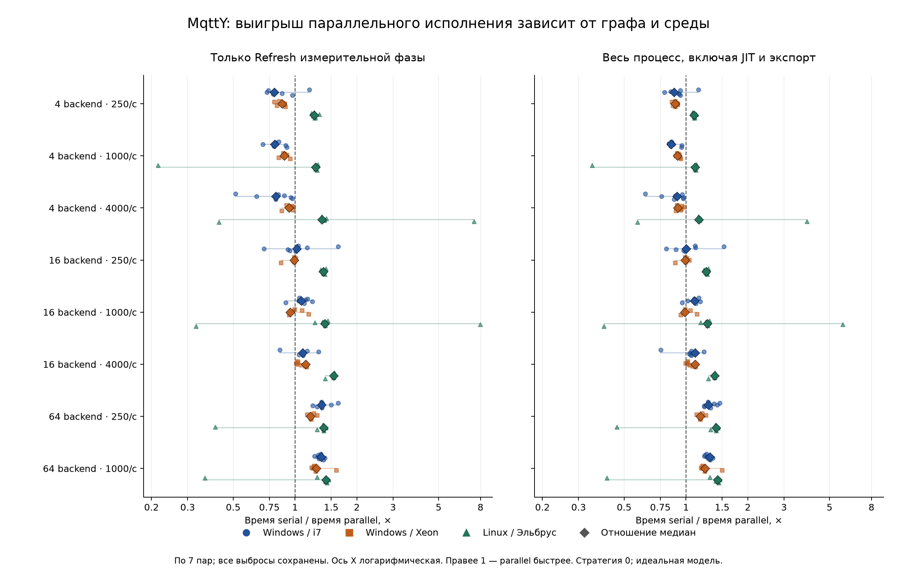

# MqttY: производительность и воспроизводимость

## Нагрузочная серия на трёх машинах: итог 03.11.2026

**Научные результаты восьми принятых конфигураций совпали на i7, Xeon и Эльбрусе.**
Параллельный load-balancer выигрывает на крупных графах, но расходует больше CPU;
на Эльбрусе наблюдаются крупные временные выбросы. Это результат принятой программы,
а не основание немедленно менять общий Engine.

Основной показатель — сумма времени **строго внутри `graph.Refresh` измерительной
фазы**, измеренная `Stopwatch`. Вторичный — полное монотонное время процесса,
включая запуск, JIT, построение и экспорт. Таблица показывает отношение **медиан
семи учётных повторов serial / parallel**; больше 1 — parallel быстрее.
Это не медиана парных отношений и не доверительный интервал.

| Backend | Публикаций/с на backend | Windows / i7 | Windows / Xeon | Linux / Эльбрус |
| ---: | ---: | ---: | ---: | ---: |
| 4 | 250 | 0,791× | 0,865× | 1,239× |
| 4 | 1000 | 0,797× | 0,886× | 1,259× |
| 4 | 4000 | 0,804× | 0,935× | 1,353× |
| 16 | 250 | 1,021× | 0,990× | 1,371× |
| 16 | 1000 | 1,073× | 0,948× | 1,395× |
| 16 | 4000 | 1,091× | 1,128× | 1,545× |
| 64 | 250 | 1,346× | 1,190× | 1,377× |
| 64 | 1000 | 1,338× | 1,268× | 1,413× |



Ромбы — отношение медиан, остальные знаки — все семь пар, тонкие линии —
наблюдаемые min–max парных коэффициентов, **не интервалы уверенности**.
Ось X логарифмическая, чтобы сохранить все выбросы и различить точки около 1.

### Время Refresh в секундах

Медианы serial / parallel; те же семь учётных повторов.

| Backend | Публикаций/с на backend | Windows / i7, с | Windows / Xeon, с | Linux / Эльбрус, с |
| ---: | ---: | ---: | ---: | ---: |
| 4 | 250 | 0,742 / 0,938 | 0,530 / 0,613 | 9,210 / 7,432 |
| 4 | 1000 | 0,841 / 1,055 | 0,562 / 0,634 | 9,663 / 7,673 |
| 4 | 4000 | 0,940 / 1,169 | 0,646 / 0,691 | 11,169 / 8,254 |
| 16 | 250 | 3,135 / 3,070 | 2,219 / 2,242 | 36,150 / 26,366 |
| 16 | 1000 | 3,232 / 3,011 | 2,280 / 2,404 | 37,692 / 27,010 |
| 16 | 4000 | 3,928 / 3,599 | 2,925 / 2,592 | 44,069 / 28,530 |
| 64 | 250 | 28,345 / 21,056 | 17,849 / 14,995 | 166,338 / 120,806 |
| 64 | 1000 | 26,859 / 20,081 | 18,223 / 14,375 | 175,572 / 124,233 |

Полное время процесса, CPU, peak memory, все исходные времена, пары и диапазоны
сохранены в [CSV](../reports/audits/mqtty-load-comparison-20261103/comparison.csv) и
[проверяемых расчётах](../reports/audits/mqtty-load-comparison-20261103/comparison.json).

### Что установлено

- **На i7 и Xeon при 4 backend параллелизм невыгоден по медианам.** Для 16 backend
  результат зависит от нагрузки: i7 — 1,021–1,091×, Xeon — 0,948–1,128×.
- **На 64 backend обе Windows-машины выигрывают во всех семи парах обеих нагрузок.**
  Refresh: i7 1,338–1,346×, Xeon 1,190–1,268×. Полный процесс: i7 1,284–1,305×,
  Xeon 1,172–1,236×. Значит эффект не ограничивается одним выделенным таймером.
- **На Эльбрусе отношение медиан Refresh выше 1 во всех восьми точках** —
  1,239–1,545×; это не выигрыш во всех отдельных повторах. На 64 backend получены
  1,377× и 1,413×, быстрее 6/7 пар в каждой точке. Полный процесс: 1,399× и 1,428×.
- **Снижение wall time требует больше CPU.** Отношение медиан суммарного CPU-времени
  процесса parallel / serial: i7 1,46–2,41, Xeon 1,93–2,71, Эльбрус 1,22–1,37.
  На 64 backend — соответственно 1,46–1,54, 1,93–1,96 и 1,22–1,24. CPU относится
  ко всему процессу, не только Refresh; потребление энергии здесь не измерялось.

На Эльбрусе у `b64-r250`, повтор 3, Refresh составил **166,338 / 407,710 с**;
у `b64-r1000`, повтор 2 — **168,505 / 463,270 с**. В этих парах parallel медленнее,
несмотря на выигрыш медиан. Есть и противоположные выбросы: `b16-r1000`, повтор 5,
serial 207,465 с против parallel 26,049 с; парное отношение 7,964× **не выдаётся за
типичное ускорение** (отношение медиан этой точки — 1,395×). CPU-время тоже меняется,
поэтому объяснение одним ожиданием планировщика не установлено. Все выбросы сохранены;
причины без профилирования не изолированы. Общий порог переключения serial/parallel
по одному числу backend из этих данных вывести нельзя.

Медианные peak memory внутри Windows меняются от 0,96 до 1,05 раза (parallel/serial),
на Эльбрусе — 1,14–1,59. Это пик полного процесса; Windows peak working set и Linux
maximum RSS учитываются по-разному, межплатформенный рейтинг памяти не строится.

### Условия и границы

Одна managed Release-сборка MqttY **`24e15dc`**, стратегия 0.
Стратегия 1, используемая API по умолчанию, здесь не измерялась. i7-2600: Windows 10,
4 ядра / 8 потоков, .NET 6.0.36; Xeon E3-1230 v6: Windows Server build 17763,
4/8, .NET 6.0.2; Эльбрус E8C: ALT Linux/e2k, 8 ядер, .NET 6.0.10.
Различаются CPU, ОС и runtime; это сравнение сред, а не изолированного процессора.
Обычные рабочие машины не резервировались исключительно под опыт.

Контрольная идеальная модель распределяет подключения round-robin, имеет 4/16/64
backend и по 16 publishers на backend. Один клиентский LAN и по два сетевых сегмента
до backend; capacity 100 000 000 байт/с, queue capacity 100 000, transfer 1 тик.
QoS публикации/подписки 1, payload 256, seed 42, tick 0,1 мс. Прогрев 0,01 модельной
секунды, измерение 0,2 с (**2000 тиков**), drain до 1 с. Интенсивность на backend
250/1000/4000 публикаций/с; суммарная — произведение на backend. Увеличиваются
и клиенты, и граф: это не опыт с фиксированным числом publishers.
Точки 4×4000, 16×1000 и 64×250 имеют одинаковые 16 000 публикаций/с, но разный граф.
Свежий процесс для каждого повтора; код может проходить JIT/GC внутри Refresh,
поэтому выделенный показатель не объявляется установившейся скоростью чистого ядра.
Порядок клеток перемешан с seed 42, порядок режимов чередуется; потери, несовпадения
и таймауты не заменялись успешными повторениями.

Точка 64×4000 (**256 000 публикаций/с**) не прошла локальный пилот и была исключена
до отправки на другие машины. Оба процесса не завершили drain за 10 000 тиков.
В parallel из 51 200 запланированных публикаций только 13 100 дошло до API,
38 100 осталось неотправленными из-за backpressure. Эти два диагностических пилота
сохранены; по ним нет принятой оценки ускорения. На удалённых машинах их не повторяли.
Другая серия с federation/16 имеет нестабильные тики доставок: результаты
load-balancer не доказывают корректность всех параллельных моделей.

### Контроль таймеров и воспроизводимость

Таймеры находятся в runner и пишут отдельный sidecar, не меняя научные JSON/CSV.
Три пары timer on/off в каждом режиме на каждой машине сохранили научный результат.
Отношение медиан полного времени timed/plain составило: i7 0,954 (serial),
0,948 (parallel); Xeon 1,014 и 1,018; Эльбрус 1,007 и 0,989.
Это грубый контроль возмущения процесса, а не точная оценка стоимости таймера:
ускорение при включении таймера также показывает разброс запусков. Коррекции времени
вычитанием этих отношений не выполнялись; таймеры включены одинаково в обеих ветвях.

Всего обработаны **422 попытки**: 336 учётных, 36 контрольных, 48 успешных пилотных
и 2 локальных диагностических. Для **420 успешных процессов** научные fingerprints
строго совпали с эталоном своей конфигурации, в том числе между платформами.
Независимо проверены **4620 sealed-файлов и 402 timer sidecars**, входы и фактические
SHA DLL; пересчитаны backend CSV, гистограммы и p99. У load-balancer нет
экспортированного per-message ledger: сверка агрегатов не называется проверкой
каждого ID доставки. Внешние реестры покрывают все файлы скачанных архивов.

[Локальная проверка](../reports/audits/mqtty-load-comparison-20261103/local-i7-verification.json)
имеет DIAGNOSTIC только из-за двух отвергнутых пилотов;
[Xeon](../reports/audits/mqtty-load-comparison-20261103/windows-xeon-verification.json) и
[Эльбрус](../reports/audits/mqtty-load-comparison-20261103/linux-e2k-verification.json) — PASS.
Полные архивы вне Git:
`reproducibility/artifacts/load-benchmark-20261103-001/load-benchmark-results.tar.gz`,
`reproducibility/artifacts/load-remote-collected-20261103-001/windows-xeon/load-benchmark-results.tar.gz`,
`reproducibility/artifacts/load-remote-collected-20261103-001/linux-e2k/load-benchmark-results.tar.gz`.
SHA и пути указаны в квитанциях `*-retrieval.json` рядом с расчётами.

Пересчёт из распакованных архивов:

```powershell
python reproducibility/verify_load_benchmark.py <export> --output <verification-local.json>
python reproducibility/compare_load_benchmarks.py --base reproducibility/artifacts/load-remote-collected-20261103-001 --output reports/audits/mqtty-load-comparison-20261103
```

Первый скрипт требует только Python; график второго — matplotlib (использован 3.11.2).
Для каждой машины в base сохранены `data/` и `verification-local.json`.
Статус вывода: **пригоден для включения с указанными ограничениями**. Технический
раздел добавлен во вторую статью; текст первой статьи и диссертации не меняется.
Решение о профилировании и общей оптимизации Engine остаётся отдельным следующим этапом.

## Архив запуска удалённой нагрузочной серии, 03.11.2026

На Эльбрусе `10.100.101.14` и Windows/Xeon `10.10.144.66` развёрнуты те же
Release DLL MqttY `24e15dc`, что в завершённой локальной нагрузочной серии.
SHA архивов, всех 48 файлов поставки на машину и исходный commit проверены.
Этот раздел сохраняет условия и квитанции старта. Обе серии уже завершены;
архивы скачаны и проверены, итог приведён выше.

Общая программа — восемь локально принятых точек, 16 пилотных попыток,
112 учётных (семь пар на точку) и 12 контролей timer on/off на машину.
Локально перегруженная точка 64 backend × 4000 публикаций/с исключена до отправки.
Основная серия запускается только если все пилотные процессы корректны и их
scientific fingerprints совпали с локальным serial-эталоном. При ошибке или
расхождении задание сохраняет диагностику и не начинает main.

На Эльбрусе — user systemd service `mqtty-load-benchmark-20261103.service`,
900 с на процесс, 90 мин на пилот, 8 ч на main, 10 ч на задание, MemoryMax 4 GiB,
swap 0. На Windows — Task Scheduler S4U `MqttY-Load-Benchmark-20261103`, 180 с
на процесс, 30 мин на пилот, 2 ч на main, 3 ч 30 мин на задание.
Пределы времени различаются по скорости среды; DLL, workload и порядок повторов одинаковы.
Windows использует отдельную копию embedded Python с каталогом контроллера
в `python312._pth`: первоначальный импорт остановился до любых симуляций,
исправление и повторный старт сохранены. Пароли в файлы не записывались.

[Сводная квитанция](../reports/audits/mqtty-load-remote-20261103/launch-summary.json),
[Эльбрус: подтверждение](../reports/audits/mqtty-load-remote-20261103/linux-e2k-confirmation.json),
[Windows: подтверждение](../reports/audits/mqtty-load-remote-20261103/windows-xeon-confirmation.json).
Каталог на Эльбрусе: `/home/user/mqtty-load-benchmark-20261103-001`;
на Windows: `C:/Users/sysadm/mqtty-load-benchmark-20261103-001`.
Состояние — `remote-job-status.json`, журнал — `remote-stdout.log`,
ошибки — `remote-stderr.log`. По окончании архив — `load-benchmark-results.tar.gz`;
графики отложены до локального сбора. Разницу часов машин не используем как метрику:
время процесса и `Refresh` измеряется монотонными счётчиками.

По поручению автора порядок разделён: **запуск → остановка; затем сбор и отчёты →
остановка; затем отдельное решение о переносе общих частей в Engine**.
Этап сбора и отчёта теперь выполнен по следующему поручению автора;
новые оптимизации Engine не вносятся.

## Локальная нагрузочная серия: завершена 03.11.2026

**Локальная серия завершена за 19,6 минуты:** 112/112 учётных и 12/12 контрольных
процессов прошли проверки. Независимо обработаны 142 попытки и 1540 sealed-файлов;
статус DIAGNOSTIC относится к двум ранее исключённым пилотным отказам перегруженной
точки. Подтверждены восемь точек. На 64 backend ускорение внутри Refresh —
1,34–1,35×, всего процесса — 1,28–1,30×. Полный разбор и визуальная проверка общего графика
выполнены в итоговом разделе выше. Серия проверяет, появляется ли
выигрыш load-balancer при достаточной работе на backend, и отделяет `Refresh`
от построения, JIT и экспорта. MqttY `24e15dc` из `develop` добавляет необязательные
таймеры runner; общий Engine и научные JSON/CSV не меняются. Таймеры пишутся
отдельным sidecar. Пройдены 42 выбранных C# теста, включая равенство результата
с таймерами и без них в serial/parallel; 8 Python тестов прошли.

Заранее заданная сетка: 4/16/64 backend × 250/1000/4000 публикаций/с на backend,
16 publishers на backend, ideal, QoS 1, payload 256, tick 0,1 мс, прогрев 0,01 с,
измерение 0,2 с, drain до 1 с. Диагональ сетки имеет одинаковые 16 000 публикаций/с;
строки при одинаковой частоте на backend показывают рост суммарной задачи.
Это стоимость модельной симуляции, не производительность реальных MQTT-брокеров.

Пилот: 18 процессов, **8/9 точек допущены**, 16 успешных процессов эквивалентны;
176 sealed-файлов проверены, 16 timer sidecars согласованы с фазами и измерениями.
Точка 64 backend × 4000 публикаций/с исключена: оба режима не завершили drain
за 10 000 тиков. В parallel из 51 200 запланированных публикаций к API дошло
13 100, backpressure оставил 38 100 неотправленными. Это диагностическая точка,
не принятый режим нагрузки и не свидетельство ускорения. Повторов ради допуска нет.

В основной серии выполнены **112 учётных процессов**: семь пар на каждую
из восьми допущенных точек. Порядок конфигураций перемешан с фиксированным seed,
порядок режимов чередуется. Ещё 12 процессов — три пары timer on/off в каждом
режиме на контрольной точке 4 backend × 1000 публикаций/с. Каждая попытка ограничена
180 с; основная серия — двумя часами. Реальные данные и все ошибки сохраняются.

[Протокол и порядок](../reports/audits/mqtty-load-20261103/protocol.json),
[допуск](../reports/audits/mqtty-load-20261103/admission.json),
[независимая проверка пилота](../reports/audits/mqtty-load-20261103/pilot-verification.json),
[запуск и пути](../reports/audits/mqtty-load-20261103/launch.json).
Рабочий каталог: `C:/Users/SolopiyA/AppData/Local/Temp/mqtty-load-20261103-001`.
Состояние — `campaign-status.json`, журнал — `campaign-stdout.log`.
По окончании задание выполнило анализ, независимую offline-проверку, построило
график и сохранило архив с outer SHA index в
`reproducibility/artifacts/load-benchmark-20261103-001/` (вне Git).
Автоматический график требует визуальной проверки при последующем сборе;
завершение вычислений само по себе не означает готовность публикации.

Актуальное дальнейшее применение: завершить запущенные серии Xeon/Эльбруса →
по отдельному поручению собрать данные и оформить отчёты, затем остановиться →
отдельно решить, оправдана ли оптимизация общего Engine → материал второй статьи
и новой главы 5. Общие оптимизации требуют регрессий всех трёх сетей.
[Критерии и структура главы](../docs/plans/completion.md#локальная-нагрузочная-серия-и-перенос-в-статью-2--главу-5).
Рукописи пока не редактируются. Предыдущие принятые серии ниже сохраняют свои
версии и ограничения и не смешиваются с новыми таймерами.

## Локальное увеличение графа, 03.11.2026

**Relay начинает выигрывать на более крупном графе: 1,386× при 8 брокерах и
1,592× при 16. Federation на 16 обнаружил невоспроизводимые тики доставок;
его ускорение не засчитывается.** Проверка выполнена только на текущей машине:
Core i7-2600, 4 ядра / 8 потоков, Windows 10, .NET 6.0.36; DLL MqttY `40640a3`.
Удалённые задания не запускались.

Увеличены брокеры/backend **4 → 8 → 16**, publishers **16 → 32 → 64**.
Остальные параметры прежние: ideal, QoS 1, payload 256, seed 42, tick 0,1 мс,
1000 публикаций/с суммарно, 0,2 с измерительной нагрузки, 0,01 с прогрева,
drain до 1 с. Каждая задача содержит 200 измерительных публикаций.
Время — медиана пяти учётных повторов в секундах, serial / parallel — стратегия 0.
Порядок чередуется; каждый повтор запускается в новом процессе с JIT и экспортом.

| Брокеры / publishers | Сеть | Serial, с | Parallel, с | Serial / parallel |
| --- | --- | ---: | ---: | ---: |
| 4 / 16 | relay | 1.795 | 1.836 | 0.978× |
| 4 / 16 | federation | 1.527 | 1.716 | 0.890× |
| 4 / 16 | load-balancer | 1.007 | 1.295 | 0.777× |
| 8 / 32 | relay | 4.458 | 3.216 | 1.386× |
| 8 / 32 | federation | 2.425 | 2.381 | 1.019× |
| 8 / 32 | load-balancer | 1.349 | 1.617 | 0.834× |
| 16 / 64 | relay | 24.448 | 15.359 | 1.592× |
| 16 / 64 | federation | 4.054 | 3.295 | не засчитано* |
| 16 / 64 | load-balancer | 1.970 | 2.256 | 0.873× |


Relay быстрее во всех пяти парах при 8 и 16 брокерах; при 4 — только в двух.
Но на 16 суммарное CPU-время parallel выше примерно в **1,64 раза**.
Federation при 8 почти равен serial (1,019×, быстрее 3/5 пар).
Load-balancer не даёт выигрыша по медианам ни на одном размере.
Суммарная входная частота фиксирована: fanout relay/federation растёт
(800 → 1600 → 3200 доставок), тогда как load-balancer доставляет 200 сообщений.
Это сравнение размеров каждой модели, не рейтинг трёх алгоритмов.

**\* Federation / 16 — диагностические времена.** В трёх из пяти учётных
parallel-повторов изменились тики **70–72 из 3200** измерительных доставок.
Два повтора совпали с serial; один дополнительный пилот также разошёлся.
Потерь доставки нет, общий receiver p99 остался 23 мс, но per-message задержки
и гистограммы отличаются. Пример: публикация 21, receiver 9, тик 376 в serial
и 383 в parallel. Причина не изолирована; простая сортировка экспорта не объясняет
изменение самих тиков. Следующий технический шаг — разобрать эту недетерминированность
перед дальнейшими заявлениями об ускорении federation.

Основная серия: **108/108 процессов завершились**, 90 учётных и 18 пилотных.
Независимо проверены **1620 sealed-файлов**, DLL и входы; выполнены 72 пересчёта
первичных событий и 36 сверок балансировщика. Проверка целостности и арифметики
прошла для всех; научная эквивалентность всей серии — **нет** из-за federation/16.
Ещё 18 предварительных пилотов служат допуском и исключены из статистики.
Для 4 брокеров scientific fingerprints совпали с уже собранными Xeon и Эльбрусом:
локальная матрица пяти повторов на исправленном коде теперь тоже готова.

64 брокера отвергнуты существующей валидацией relay/federation (предел 16);
это не таймаут и не измерение производительности. Предел не изменялся.
Первая попытка контроллера остановилась на Windows sharing-lock при атомарной
записи `result.json`; симуляция завершилась. Добавлен ограниченный повтор только
записи метаданных, проверенный тестом с реальной блокировкой файла.
Та попытка сохранена отдельно и не подмешана в статистику.
Рабочая серия перенесена из каталога редактора в отдельный temp-каталог.
У сохранённых фоновых процессов .NET между контрольными снимками CPU-время
не выросло; машина при этом не резервировалась исключительно под бенчмарк.
Все выбросы сохранены; пять пар не доказывают универсальное ускорение.

[Расчёты и диагностика](../reports/audits/mqtty-scaling-20261103/analysis.json),
[квитанция архива](../reports/audits/mqtty-scaling-20261103/collection-receipt.json),
[проверка 4](../reports/audits/mqtty-scaling-20261103/nodes-4-verification.json),
[проверка 8](../reports/audits/mqtty-scaling-20261103/nodes-8-verification.json),
[проверка 16 с явными несовпадениями](../reports/audits/mqtty-scaling-20261103/nodes-16-verification.json).
Полные raw и предварительные пилоты находятся вне Git:
`reproducibility/artifacts/benchmark-scaling-collected-20261103-001/local-scaling-results.tar.gz`.

Повторение на локальной машине с отдельным новым каталогом вывода:

```powershell
python reproducibility/scale_benchmark.py --package reproducibility/artifacts/benchmark-fixed-20261103-002/package --output "$env:TEMP/mqtty-scaling-new"
```

Новый каталог обязателен; `--resume` переиспользует только завершённые пилоты
с совпавшими manifest, входами и seals, не перезаписывает попытки.
Строгий verifier по умолчанию отклоняет научное расхождение.
Его `--diagnostic` сохраняет несовпадения, сохраняя строгие проверки seals,
входов, DLL и пересчёт арифметики. Такой результат имеет статус
`SCIENTIFIC_MISMATCH`, а не `PASS`.

## Итог исправленной серии, 03.11.2026

**Обе удалённые серии завершены: 72/72 попытки корректны и эквивалентны по научным данным.**
Проверены 1080 файлов по seals и одинаковые SHA всех исполняемых DLL.
Время ниже — медиана **пяти учётных повторов** на ячейку; 12 пилотных запусков
проверены, но исключены из временной статистики. Сборка: MqttY `40640a3` из `develop`.

| Среда | Сеть | Serial, с | Parallel, с | Serial / parallel |
| --- | --- | ---: | ---: | ---: |
| Windows / Xeon E3-1230 v6 | relay | 1,211 | 1,222 | 0,991× |
| Windows / Xeon E3-1230 v6 | federation | 0,979 | 1,092 | 0,897× |
| Windows / Xeon E3-1230 v6 | load-balancer | 0,677 | 0,768 | 0,881× |
| Linux / Эльбрус E8C | relay | 22,085 | 18,336 | 1,204× |
| Linux / Эльбрус E8C | federation | 17,782 | 16,133 | 1,102× |
| Linux / Эльбрус E8C | load-balancer | 12,977 | 12,879 | 1,008× |


### Что следует из измерений

- **На Xeon параллелизм для этих задач невыгоден.** Relay практически равен serial;
  federation медленнее на 11,5%, load-balancer — на 13,4%. Последние два режима
  медленнее во всех пяти парах. Суммарное CPU-время parallel выше в 2,15–2,77 раза.
- **На Эльбрусе federation даёт наиболее устойчивый выигрыш:** 1,102× по медианам,
  parallel быстрее во всех пяти парах. Для relay отношение медиан 1,204×,
  но первая parallel-попытка заняла **31,354 с**, остальные — 17,936–18,536 с.
  Выброс сохранён; быстрее только 4 из 5 пар, причина выброса не изолирована.
- **Load-balancer на Эльбрусе почти не выигрывает:** разница медиан менее 1%,
  быстрее 3 из 5 пар. При этом parallel увеличивает CPU-время примерно на 36%.
  Во всех трёх сетях Эльбруса CPU-время parallel выше на 35–36%, медианный peak RSS
  выше на 33–55%.

Разница времени между этими машинами — примерно 15–19 раз для одинаковой задачи.
Это сравнение **всей среды**, а не отдельного процессора: Windows/.NET 6.0.2 и
Linux/e2k/.NET 6.0.10 различаются ОС, runtime, CPU и хранилищем. Windows peak working set
и Linux maximum RSS учитываются по-разному; их нельзя считать одной мерой памяти.

### Область вывода

Три небольших идеальных модели: четыре брокера/backend, 16 publishers, payload 256,
QoS 1, seed 42, tick 0,1 мс, прогрев 0,01 с, нагрузка 0,2 с при 1000 публикаций/с
(**200 измерительных публикаций**), drain до 1 с. Relay/federation имеют другую
задачу доставки и fanout, чем load-balancer; времена не ранжируют три алгоритма.
Реальные MQTT-брокеры не запускались.

Проверяется `Refresh(false/true, 0)` внутри одного графа. **Скорость стратегии 1,
используемой API по умолчанию, этой серией не измерена.** Каждый повтор — новый
процесс; время включает .NET/JIT и запись артефактов, исключает сборку, SSH и проверку
файлов. Это не оценка установившейся скорости ядра на крупных графах.

На момент сбора удалённых архивов локальная i7 имела только 6 пилотов.
Теперь локальная серия из пяти повторов на исправленном коде готова — см. раздел
увеличения графа выше. Прежние локальные времена старой версии не смешиваются с ней.

### Проверяемость и данные

[Таблица, разброс, CPU и память](../reports/audits/mqtty-parallel-fix-20261103/collection/comparison.csv),
[расчёты и границы вывода](../reports/audits/mqtty-parallel-fix-20261103/collection/analysis.json).
Все пять исходных времён, парные коэффициенты и ресурсы доступны в
[сводке Xeon](../reports/audits/mqtty-parallel-fix-20261103/collection/windows-xeon-summary.json) и
[сводке Эльбруса](../reports/audits/mqtty-parallel-fix-20261103/collection/linux-e2k-summary.json).

Независимый verifier заново проверил coverage 36 попыток на машину, входы,
процесс/режим, измерения, seals, fingerprints и SHA DLL. Для **48** результатов
relay/federation пересчитаны первичные публикации, пары доставки, пересылки и p99;
для **24** результатов load-balancer согласованы backend CSV и гистограммы.
У балансировщика нет экспортированного per-message ledger — проверка не выдаётся
за пересчёт отсутствующих событий.
[Проверка Xeon](../reports/audits/mqtty-parallel-fix-20261103/collection/windows-xeon-verification.json),
[проверка Эльбруса](../reports/audits/mqtty-parallel-fix-20261103/collection/linux-e2k-verification.json).

Источник версии — manifest пакета и SHA реально загруженных DLL. Runtime Git-label
на удалённых машинах пуст, поскольку поиск Git идёт по родительским каталогам DLL;
он не используется как подтверждение исходников. Архивы скачаны в
`reproducibility/artifacts/benchmark-collected-20261103-001/` и остаются вне Git.
[Квитанция скачивания Xeon](../reports/audits/mqtty-parallel-fix-20261103/collection/windows-xeon-retrieval.json),
[квитанция скачивания Эльбруса](../reports/audits/mqtty-parallel-fix-20261103/collection/linux-e2k-retrieval.json).

Проверка скачанной распаковки не требует SSH или .NET, только Python 3.9+:

```powershell
python reproducibility/verify_benchmark_results.py <export-directory> --manifest reports/audits/mqtty-parallel-fix-20261103/package-manifest.json --output <verification.json>
python reproducibility/summarize_benchmark.py <export-directory>/results --output <summary.json>
python -m unittest discover -s reproducibility -p "test_*benchmark*.py" -v
```

Новый пакет готовится `python reproducibility/prepare_benchmark.py --output <new-directory>`.
У исправленной версии pilot вызывает штатный API с явными serial/parallel,
без копирования runners. Старый `--mode native` предназначен для CLI с serial по
умолчанию; для текущей версии используется `--mode pilot`. Для main нужны
завершённый pilot-baseline и admission JSON с SHA manifest и лимитом 1–600 с.
Все output-каталоги новые, автоматических повторов нет.

### Исправление и исторические результаты

Старая версия `f5c0a47` падала на конкурентной записи в `Dictionary` кэша маршрутов
и теряла записи журналов. Текущая `40640a3` включает потокобезопасный кэш из актуальной
`develop`, синхронизацию журналов и гистограмм, полный детерминированный экспорт
с сохранением дублей и исходного исключения. Прошли **98 регрессионных тестов**.
[Диагноз до исправления](../reports/audits/mqtty-benchmark-20261103/xeon-diagnosis.json),
[приёмка исправления](../reports/audits/mqtty-parallel-fix-20261103/verification.json),
[первоначальные времена](../reports/audits/mqtty-benchmark-20261103/local-summary.json).

Результаты старой версии не заменяются текущими. Разницу времени до/после нельзя
приписывать только кэшу: новая версия также содержит ранее внесённые оптимизации.
Тексты двух статей, проекты глав и диссертация не изменялись.

## Принятая проверка воспроизводимости Windows → Эльбрус

[Актуальный отчёт ALT Linux / Эльбрус от 02.11.2026](reports/linux-e2k-20261102/README.md):
**6/6 сценариев, 12/12 удалённых запусков**, все научные fingerprints совпали
с заново полученным Windows baseline. Различается только runtime: 6.0.10 / 6.0.36.
Прежние результаты и baseline заменены; они доступны в истории Git.

## Версии принятого эксперимента

- Метарепозиторий `develop` при сборке: `487b23c9269229a54246cf0013e9df40817ebbd1`.
- MqttY, закреплённый gitlink: `f5c0a4715b555c4348d2a2843177251f62c640ff`.
- MqttBenchmark, закреплённый gitlink: `ab513df3d2b65462abcfba8084f066ae4b1bd0a1`.
- Новый baseline: [baseline-windows-smoke.json](baseline-windows-smoke.json).
- Точный профиль: [broker-benchmark.v2.json](reports/linux-e2k-20261102/evidence/inputs/broker-benchmark.v2.json).

Брались версии подмодулей из root `develop`, а не произвольные более поздние
вершины их веток. Сборка выполнялась в отдельных чистых копиях. Для нового
эксперимента проверяйте gitlink-версии и чистоту tracked-файлов исходников.

## Проверка скачанного отчёта

Нужен только Python 3.8+, без SSH и .NET:

```bash
python3 reproducibility/verify_evidence.py reproducibility/reports/linux-e2k-20261102
```

Verifier проверяет 102 побайтовых SHA-256, все 12 исходных bundles, шесть сравнений
с baseline, источник сборки и профиль. Он заново вычисляет fingerprints из JSON,
а не доверяет только флагам итогового сравнения. Для evidence отключена Git-конверсия
окончаний строк, чтобы сохранить исходные байты.

## Что моделируется

Один брокер, один издатель и один подписчик; `brokerFidelity`, выбор профиля по
двум `connectedClients`. Два режима: ideal и предварительный legacy Mosquitto v2.
Payload 16 байт, seed 42, QoS 0/1/2; публикация и подписка используют одинаковый QoS.
Обработка последовательная: `parallel=false`, `refreshStrategy=0`.

Тик 0,1 мс; прогрев 0,1 с; измерение 1 с; drain до 2 с виртуального времени.
Offered RPS 1000; сеть 100 000 000 байт/с, очередь 100 000, transferTicks=1.
Каждый сценарий запускается дважды в отдельном процессе.

В новой серии attempted равен 1000 во всех сценариях. В legacy QoS0 воспроизводятся
49 отказов и 951 completed; остальные сценарии дают 1000 completed. Полные метрики,
гистограммы, конфигурации и границы фаз приведены в отчёте и исходных данных.

## Создание нового Windows baseline

`run.py` использует только стандартную библиотеку Python, Git и .NET SDK для net6.0.
Он собирает консольный проект из `mqtty/`, фиксирует SHA обоих репозиториев и
точных байтов профиля, выполняет 12 запусков и проверяет совпадение пар:

```powershell
python reproducibility/run.py --output reproducibility/artifacts/windows-new-001
```

Сохраняйте новый `fingerprints.json` вместе с исходниками, точным профилем и
готовой сборкой. Не заменяйте SHA старого baseline вручную: для нового кода нужна
новая выполненная серия. `--full` расширяет набор до payload 16/256 и seeds 42/43/44:
36 сценариев, 72 запуска. Расширенная матрица в опубликованном отчёте не выполнялась.

## Сборка локально и запуск на Linux

На Windows публикуется управляемая сборка без RID и apphost:

```powershell
dotnet publish mqtty/src/EntityFX.MqttSimulator/EntityFX.MqttY.MqttRelay.App/EntityFX.MqttY.MqttRelay.App.csproj `
  -c Release --self-contained false -p:UseAppHost=false --output <new-package>/app
```

В пакет входят приложение со всеми опубликованными зависимостями, `run.py`,
`run_prebuilt.py`, новый baseline, точные байты профиля и Git bundle обоих исходных
репозиториев. Проверяйте SHA-256 архива и файлов перед запуском. Разверните bundle
в каталоги `mqtty/` и `MqttBenchmark/` в корне пакета: CLI требует настоящие чистые
Git-репозитории даже при запуске готовой DLL.

На Linux нужны Git, Python и совместимый runtime. Сборка на Linux не выполняется:

```bash
python3 reproducibility/run_prebuilt.py   --app app/EntityFX.MqttY.MqttRelay.App.dll   --profile profiles/broker-benchmark.v2.json   --baseline reproducibility/baseline-windows-smoke.json   --output results
```

Каталог результата должен отсутствовать. Профиль передавайте отдельным файлом:
CRLF и LF дают разные побайтовые SHA-256 даже при одинаковом JSON. В принятом
пакете профиль содержит LF. На проверенном сервере фоновый процесс не пережил
закрытия SSH, поэтому успешная серия выполнялась с удержанием SSH-соединения.
При обрыве сохраняйте частичную попытку отдельно и используйте новый output.

## Критерии и границы вывода

Строго сравниваются полная summary, брокерные counters, latency histogram, фазы,
подключения и научные параметры конфигурации. Нормализуются только порядок ключей
и форматирование JSON. Численные допуски и округление не применяются.

`run.py` сравнивает runtime вместе с остальными fingerprints; `run_prebuilt.py`
отдельно сообщает `runtimeMatches` и `scientificFingerprintsMatch`. Отличие runtime
не скрывается: опубликованный результат подтверждает равенство научных данных
в разных окружениях. Timestamps, run IDs, ОС, CPU, строковый общий dump counters
и формат топологии сохраняются, но не входят в критерий равенства.

CLI-код 3 означает непройденный reference-критерий. Все legacy-запуски имеют этот
код; ideal-запуски — 0. Успешный replay не доказывает fidelity предварительного
профиля `provisional-legacy-v1`. Модельные эксперименты не требуют реальных брокеров,
Docker или физической сети. Другие топологии, реальные брокеры, пропускная способность
оборудования, статистическая независимость повторов и побайтовая воспроизводимость
пересборки этим набором не проверяются.
