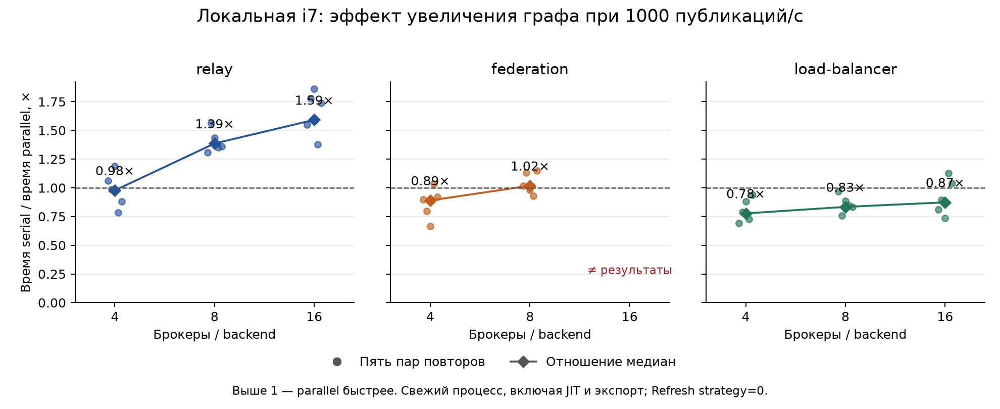
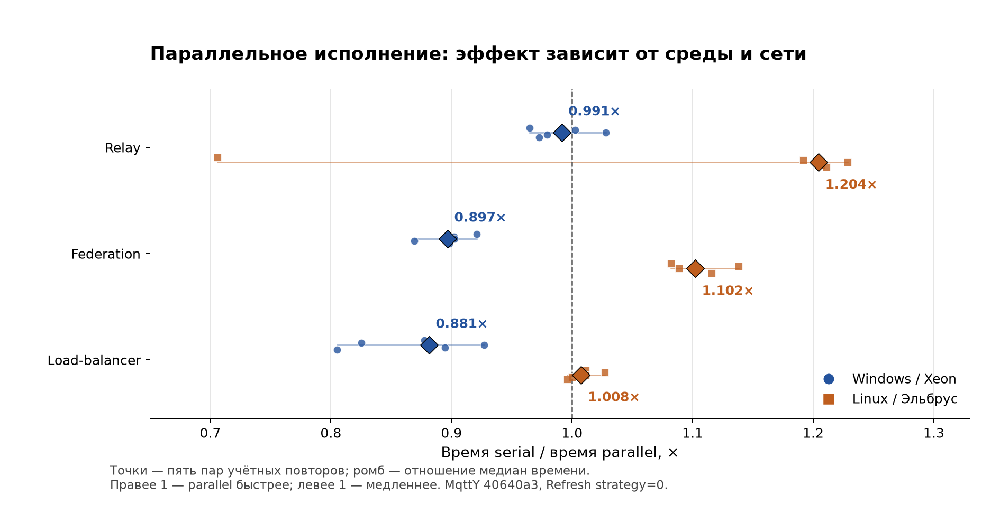

# MqttY: производительность и воспроизводимость

## Локальное увеличение графа, 03.11.2026

**Relay начинает выигрывать на более крупном графе: 1,386× при 8 брокерах и
1,592× при 16. Federation на 16 обнаружил невоспроизводимые тики доставок;
его ускорение не засчитывается.** Проверка выполнена только на текущей машине:
Core i7-2600, 4 ядра / 8 потоков, Windows 10, .NET 6.0.36; DLL MqttY `40640a3`.
Удалённые задания не запускались.

Увеличены брокеры/backend **4 → 8 → 16**, publishers **16 → 32 → 64**.
Остальные параметры прежние: ideal, QoS 1, payload 256, seed 42, tick 0,1 мс,
1000 публикаций/с суммарно, 0,2 с измерительной нагрузки, 0,01 с прогрева,
drain до 1 с. Каждая задача содержит 200 измерительных публикаций.
Время — медиана пяти учётных повторов в секундах, serial / parallel — стратегия 0.
Порядок чередуется; каждый повтор запускается в новом процессе с JIT и экспортом.

| Брокеры / publishers | Сеть | Serial, с | Parallel, с | Serial / parallel |
| --- | --- | ---: | ---: | ---: |
| 4 / 16 | relay | 1.795 | 1.836 | 0.978× |
| 4 / 16 | federation | 1.527 | 1.716 | 0.890× |
| 4 / 16 | load-balancer | 1.007 | 1.295 | 0.777× |
| 8 / 32 | relay | 4.458 | 3.216 | 1.386× |
| 8 / 32 | federation | 2.425 | 2.381 | 1.019× |
| 8 / 32 | load-balancer | 1.349 | 1.617 | 0.834× |
| 16 / 64 | relay | 24.448 | 15.359 | 1.592× |
| 16 / 64 | federation | 4.054 | 3.295 | не засчитано* |
| 16 / 64 | load-balancer | 1.970 | 2.256 | 0.873× |



Relay быстрее во всех пяти парах при 8 и 16 брокерах; при 4 — только в двух.
Но на 16 суммарное CPU-время parallel выше примерно в **1,64 раза**.
Federation при 8 почти равен serial (1,019×, быстрее 3/5 пар).
Load-balancer не даёт выигрыша по медианам ни на одном размере.
Суммарная входная частота фиксирована: fanout relay/federation растёт
(800 → 1600 → 3200 доставок), тогда как load-balancer доставляет 200 сообщений.
Это сравнение размеров каждой модели, не рейтинг трёх алгоритмов.

**\* Federation / 16 — диагностические времена.** В трёх из пяти учётных
parallel-повторов изменились тики **70–72 из 3200** измерительных доставок.
Два повтора совпали с serial; один дополнительный пилот также разошёлся.
Потерь доставки нет, общий receiver p99 остался 23 мс, но per-message задержки
и гистограммы отличаются. Пример: публикация 21, receiver 9, тик 376 в serial
и 383 в parallel. Причина не изолирована; простая сортировка экспорта не объясняет
изменение самих тиков. Следующий технический шаг — разобрать эту недетерминированность
перед дальнейшими заявлениями об ускорении federation.

Основная серия: **108/108 процессов завершились**, 90 учётных и 18 пилотных.
Независимо проверены **1620 sealed-файлов**, DLL и входы; выполнены 72 пересчёта
первичных событий и 36 сверок балансировщика. Проверка целостности и арифметики
прошла для всех; научная эквивалентность всей серии — **нет** из-за federation/16.
Ещё 18 предварительных пилотов служат допуском и исключены из статистики.
Для 4 брокеров scientific fingerprints совпали с уже собранными Xeon и Эльбрусом:
локальная матрица пяти повторов на исправленном коде теперь тоже готова.

64 брокера отвергнуты существующей валидацией relay/federation (предел 16);
это не таймаут и не измерение производительности. Предел не изменялся.
Первая попытка контроллера остановилась на Windows sharing-lock при атомарной
записи `result.json`; симуляция завершилась. Добавлен ограниченный повтор только
записи метаданных, проверенный тестом с реальной блокировкой файла.
Та попытка сохранена отдельно и не подмешана в статистику.
Рабочая серия перенесена из каталога редактора в отдельный temp-каталог.
У сохранённых фоновых процессов .NET между контрольными снимками CPU-время
не выросло; машина при этом не резервировалась исключительно под бенчмарк.
Все выбросы сохранены; пять пар не доказывают универсальное ускорение.

[Расчёты и диагностика](../reports/audits/mqtty-scaling-20261103/analysis.json),
[квитанция архива](../reports/audits/mqtty-scaling-20261103/collection-receipt.json),
[проверка 4](../reports/audits/mqtty-scaling-20261103/nodes-4-verification.json),
[проверка 8](../reports/audits/mqtty-scaling-20261103/nodes-8-verification.json),
[проверка 16 с явными несовпадениями](../reports/audits/mqtty-scaling-20261103/nodes-16-verification.json).
Полные raw и предварительные пилоты находятся вне Git:
`reproducibility/artifacts/benchmark-scaling-collected-20261103-001/local-scaling-results.tar.gz`.

Повторение на локальной машине с отдельным новым каталогом вывода:

```powershell
python reproducibility/scale_benchmark.py --package reproducibility/artifacts/benchmark-fixed-20261103-002/package --output "$env:TEMP/mqtty-scaling-new"
```

Новый каталог обязателен; `--resume` переиспользует только завершённые пилоты
с совпавшими manifest, входами и seals, не перезаписывает попытки.
Строгий verifier по умолчанию отклоняет научное расхождение.
Его `--diagnostic` сохраняет несовпадения, сохраняя строгие проверки seals,
входов, DLL и пересчёт арифметики. Такой результат имеет статус
`SCIENTIFIC_MISMATCH`, а не `PASS`.

## Итог исправленной серии, 03.11.2026

**Обе удалённые серии завершены: 72/72 попытки корректны и эквивалентны по научным данным.**
Проверены 1080 файлов по seals и одинаковые SHA всех исполняемых DLL.
Время ниже — медиана **пяти учётных повторов** на ячейку; 12 пилотных запусков
проверены, но исключены из временной статистики. Сборка: MqttY `40640a3` из `develop`.

| Среда | Сеть | Serial, с | Parallel, с | Serial / parallel |
| --- | --- | ---: | ---: | ---: |
| Windows / Xeon E3-1230 v6 | relay | 1,211 | 1,222 | 0,991× |
| Windows / Xeon E3-1230 v6 | federation | 0,979 | 1,092 | 0,897× |
| Windows / Xeon E3-1230 v6 | load-balancer | 0,677 | 0,768 | 0,881× |
| Linux / Эльбрус E8C | relay | 22,085 | 18,336 | 1,204× |
| Linux / Эльбрус E8C | federation | 17,782 | 16,133 | 1,102× |
| Linux / Эльбрус E8C | load-balancer | 12,977 | 12,879 | 1,008× |



### Что следует из измерений

- **На Xeon параллелизм для этих задач невыгоден.** Relay практически равен serial;
  federation медленнее на 11,5%, load-balancer — на 13,4%. Последние два режима
  медленнее во всех пяти парах. Суммарное CPU-время parallel выше в 2,15–2,77 раза.
- **На Эльбрусе federation даёт наиболее устойчивый выигрыш:** 1,102× по медианам,
  parallel быстрее во всех пяти парах. Для relay отношение медиан 1,204×,
  но первая parallel-попытка заняла **31,354 с**, остальные — 17,936–18,536 с.
  Выброс сохранён; быстрее только 4 из 5 пар, причина выброса не изолирована.
- **Load-balancer на Эльбрусе почти не выигрывает:** разница медиан менее 1%,
  быстрее 3 из 5 пар. При этом parallel увеличивает CPU-время примерно на 36%.
  Во всех трёх сетях Эльбруса CPU-время parallel выше на 35–36%, медианный peak RSS
  выше на 33–55%.

Разница времени между этими машинами — примерно 15–19 раз для одинаковой задачи.
Это сравнение **всей среды**, а не отдельного процессора: Windows/.NET 6.0.2 и
Linux/e2k/.NET 6.0.10 различаются ОС, runtime, CPU и хранилищем. Windows peak working set
и Linux maximum RSS учитываются по-разному; их нельзя считать одной мерой памяти.

### Область вывода

Три небольших идеальных модели: четыре брокера/backend, 16 publishers, payload 256,
QoS 1, seed 42, tick 0,1 мс, прогрев 0,01 с, нагрузка 0,2 с при 1000 публикаций/с
(**200 измерительных публикаций**), drain до 1 с. Relay/federation имеют другую
задачу доставки и fanout, чем load-balancer; времена не ранжируют три алгоритма.
Реальные MQTT-брокеры не запускались.

Проверяется `Refresh(false/true, 0)` внутри одного графа. **Скорость стратегии 1,
используемой API по умолчанию, этой серией не измерена.** Каждый повтор — новый
процесс; время включает .NET/JIT и запись артефактов, исключает сборку, SSH и проверку
файлов. Это не оценка установившейся скорости ядра на крупных графах.

На момент сбора удалённых архивов локальная i7 имела только 6 пилотов.
Теперь локальная серия из пяти повторов на исправленном коде готова — см. раздел
увеличения графа выше. Прежние локальные времена старой версии не смешиваются с ней.

### Проверяемость и данные

[Таблица, разброс, CPU и память](../reports/audits/mqtty-parallel-fix-20261103/collection/comparison.csv),
[расчёты и границы вывода](../reports/audits/mqtty-parallel-fix-20261103/collection/analysis.json).
Все пять исходных времён, парные коэффициенты и ресурсы доступны в
[сводке Xeon](../reports/audits/mqtty-parallel-fix-20261103/collection/windows-xeon-summary.json) и
[сводке Эльбруса](../reports/audits/mqtty-parallel-fix-20261103/collection/linux-e2k-summary.json).

Независимый verifier заново проверил coverage 36 попыток на машину, входы,
процесс/режим, измерения, seals, fingerprints и SHA DLL. Для **48** результатов
relay/federation пересчитаны первичные публикации, пары доставки, пересылки и p99;
для **24** результатов load-balancer согласованы backend CSV и гистограммы.
У балансировщика нет экспортированного per-message ledger — проверка не выдаётся
за пересчёт отсутствующих событий.
[Проверка Xeon](../reports/audits/mqtty-parallel-fix-20261103/collection/windows-xeon-verification.json),
[проверка Эльбруса](../reports/audits/mqtty-parallel-fix-20261103/collection/linux-e2k-verification.json).

Источник версии — manifest пакета и SHA реально загруженных DLL. Runtime Git-label
на удалённых машинах пуст, поскольку поиск Git идёт по родительским каталогам DLL;
он не используется как подтверждение исходников. Архивы скачаны в
`reproducibility/artifacts/benchmark-collected-20261103-001/` и остаются вне Git.
[Квитанция скачивания Xeon](../reports/audits/mqtty-parallel-fix-20261103/collection/windows-xeon-retrieval.json),
[квитанция скачивания Эльбруса](../reports/audits/mqtty-parallel-fix-20261103/collection/linux-e2k-retrieval.json).

Проверка скачанной распаковки не требует SSH или .NET, только Python 3.9+:

```powershell
python reproducibility/verify_benchmark_results.py <export-directory> --manifest reports/audits/mqtty-parallel-fix-20261103/package-manifest.json --output <verification.json>
python reproducibility/summarize_benchmark.py <export-directory>/results --output <summary.json>
python -m unittest discover -s reproducibility -p "test_*benchmark*.py" -v
```

Новый пакет готовится `python reproducibility/prepare_benchmark.py --output <new-directory>`.
У исправленной версии pilot вызывает штатный API с явными serial/parallel,
без копирования runners. Старый `--mode native` предназначен для CLI с serial по
умолчанию; для текущей версии используется `--mode pilot`. Для main нужны
завершённый pilot-baseline и admission JSON с SHA manifest и лимитом 1–600 с.
Все output-каталоги новые, автоматических повторов нет.

### Исправление и исторические результаты

Старая версия `f5c0a47` падала на конкурентной записи в `Dictionary` кэша маршрутов
и теряла записи журналов. Текущая `40640a3` включает потокобезопасный кэш из актуальной
`develop`, синхронизацию журналов и гистограмм, полный детерминированный экспорт
с сохранением дублей и исходного исключения. Прошли **98 регрессионных тестов**.
[Диагноз до исправления](../reports/audits/mqtty-benchmark-20261103/xeon-diagnosis.json),
[приёмка исправления](../reports/audits/mqtty-parallel-fix-20261103/verification.json),
[первоначальные времена](../reports/audits/mqtty-benchmark-20261103/local-summary.json).

Результаты старой версии не заменяются текущими. Разницу времени до/после нельзя
приписывать только кэшу: новая версия также содержит ранее внесённые оптимизации.
Тексты двух статей, проекты глав и диссертация не изменялись.

## Принятая проверка воспроизводимости Windows → Эльбрус

[Актуальный отчёт ALT Linux / Эльбрус от 02.11.2026](reports/linux-e2k-20261102/README.md):
**6/6 сценариев, 12/12 удалённых запусков**, все научные fingerprints совпали
с заново полученным Windows baseline. Различается только runtime: 6.0.10 / 6.0.36.
Прежние результаты и baseline заменены; они доступны в истории Git.

## Версии принятого эксперимента

- Метарепозиторий `develop` при сборке: `487b23c9269229a54246cf0013e9df40817ebbd1`.
- MqttY, закреплённый gitlink: `f5c0a4715b555c4348d2a2843177251f62c640ff`.
- MqttBenchmark, закреплённый gitlink: `ab513df3d2b65462abcfba8084f066ae4b1bd0a1`.
- Новый baseline: [baseline-windows-smoke.json](baseline-windows-smoke.json).
- Точный профиль: [broker-benchmark.v2.json](reports/linux-e2k-20261102/evidence/inputs/broker-benchmark.v2.json).

Брались версии подмодулей из root `develop`, а не произвольные более поздние
вершины их веток. Сборка выполнялась в отдельных чистых копиях. Для нового
эксперимента проверяйте gitlink-версии и чистоту tracked-файлов исходников.

## Проверка скачанного отчёта

Нужен только Python 3.8+, без SSH и .NET:

```bash
python3 reproducibility/verify_evidence.py reproducibility/reports/linux-e2k-20261102
```

Verifier проверяет 102 побайтовых SHA-256, все 12 исходных bundles, шесть сравнений
с baseline, источник сборки и профиль. Он заново вычисляет fingerprints из JSON,
а не доверяет только флагам итогового сравнения. Для evidence отключена Git-конверсия
окончаний строк, чтобы сохранить исходные байты.

## Что моделируется

Один брокер, один издатель и один подписчик; `brokerFidelity`, выбор профиля по
двум `connectedClients`. Два режима: ideal и предварительный legacy Mosquitto v2.
Payload 16 байт, seed 42, QoS 0/1/2; публикация и подписка используют одинаковый QoS.
Обработка последовательная: `parallel=false`, `refreshStrategy=0`.

Тик 0,1 мс; прогрев 0,1 с; измерение 1 с; drain до 2 с виртуального времени.
Offered RPS 1000; сеть 100 000 000 байт/с, очередь 100 000, transferTicks=1.
Каждый сценарий запускается дважды в отдельном процессе.

В новой серии attempted равен 1000 во всех сценариях. В legacy QoS0 воспроизводятся
49 отказов и 951 completed; остальные сценарии дают 1000 completed. Полные метрики,
гистограммы, конфигурации и границы фаз приведены в отчёте и исходных данных.

## Создание нового Windows baseline

`run.py` использует только стандартную библиотеку Python, Git и .NET SDK для net6.0.
Он собирает консольный проект из `mqtty/`, фиксирует SHA обоих репозиториев и
точных байтов профиля, выполняет 12 запусков и проверяет совпадение пар:

```powershell
python reproducibility/run.py --output reproducibility/artifacts/windows-new-001
```

Сохраняйте новый `fingerprints.json` вместе с исходниками, точным профилем и
готовой сборкой. Не заменяйте SHA старого baseline вручную: для нового кода нужна
новая выполненная серия. `--full` расширяет набор до payload 16/256 и seeds 42/43/44:
36 сценариев, 72 запуска. Расширенная матрица в опубликованном отчёте не выполнялась.

## Сборка локально и запуск на Linux

На Windows публикуется управляемая сборка без RID и apphost:

```powershell
dotnet publish mqtty/src/EntityFX.MqttSimulator/EntityFX.MqttY.MqttRelay.App/EntityFX.MqttY.MqttRelay.App.csproj `
  -c Release --self-contained false -p:UseAppHost=false --output <new-package>/app
```

В пакет входят приложение со всеми опубликованными зависимостями, `run.py`,
`run_prebuilt.py`, новый baseline, точные байты профиля и Git bundle обоих исходных
репозиториев. Проверяйте SHA-256 архива и файлов перед запуском. Разверните bundle
в каталоги `mqtty/` и `MqttBenchmark/` в корне пакета: CLI требует настоящие чистые
Git-репозитории даже при запуске готовой DLL.

На Linux нужны Git, Python и совместимый runtime. Сборка на Linux не выполняется:

```bash
python3 reproducibility/run_prebuilt.py   --app app/EntityFX.MqttY.MqttRelay.App.dll   --profile profiles/broker-benchmark.v2.json   --baseline reproducibility/baseline-windows-smoke.json   --output results
```

Каталог результата должен отсутствовать. Профиль передавайте отдельным файлом:
CRLF и LF дают разные побайтовые SHA-256 даже при одинаковом JSON. В принятом
пакете профиль содержит LF. На проверенном сервере фоновый процесс не пережил
закрытия SSH, поэтому успешная серия выполнялась с удержанием SSH-соединения.
При обрыве сохраняйте частичную попытку отдельно и используйте новый output.

## Критерии и границы вывода

Строго сравниваются полная summary, брокерные counters, latency histogram, фазы,
подключения и научные параметры конфигурации. Нормализуются только порядок ключей
и форматирование JSON. Численные допуски и округление не применяются.

`run.py` сравнивает runtime вместе с остальными fingerprints; `run_prebuilt.py`
отдельно сообщает `runtimeMatches` и `scientificFingerprintsMatch`. Отличие runtime
не скрывается: опубликованный результат подтверждает равенство научных данных
в разных окружениях. Timestamps, run IDs, ОС, CPU, строковый общий dump counters
и формат топологии сохраняются, но не входят в критерий равенства.

CLI-код 3 означает непройденный reference-критерий. Все legacy-запуски имеют этот
код; ideal-запуски — 0. Успешный replay не доказывает fidelity предварительного
профиля `provisional-legacy-v1`. Модельные эксперименты не требуют реальных брокеров,
Docker или физической сети. Другие топологии, реальные брокеры, пропускная способность
оборудования, статистическая независимость повторов и побайтовая воспроизводимость
пересборки этим набором не проверяются.
